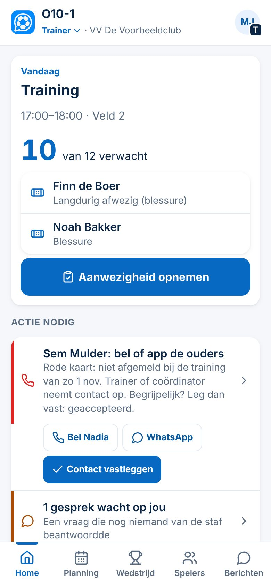
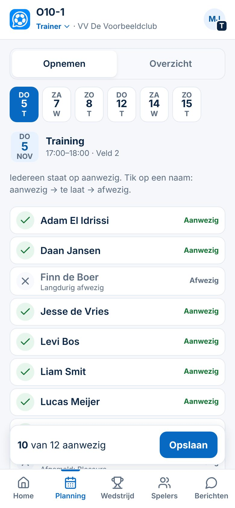

# Wie komt er, en aanwezigheid opnemen

| | |
|---|---|
| **Status in de app** | In productie · commit `9eff3ce` (5-11-2026) |
| **Status van deze kaart** | Gepubliceerd in de bundel *Snelstart vrijwillige trainer* (6-11-2026; Kort) · Besluit 151 |
| **Besluiten** | 5 · 10 · 32 · 91 · 105 · 130 |
| **Schermafbeeldingen** | `docs/presentaties/beelden/aanwezigheid-home.jpg` · `aanwezigheid-opnemen.jpg` |
| **Doelgroepen** | beginner trainer · ervaren trainer |

## Kort
*Voor elke trainer. Ouders melden hun kind zelf af; jij tikt op het veld af wie er is.*

1. Open **Home**. Bovenaan staat je eerstvolgende training: hoeveel spelers je **verwacht** en wie is afgemeld, met de reden.
2. Tik op het veld **Aanwezigheid opnemen**.
3. Iedereen die niet is afgemeld, staat al op **aanwezig**. Tik op een naam om te wisselen: aanwezig → te laat → afwezig.
4. Tik **Opslaan**.
5. Klaar. Vergist? Je kunt het tot 48 uur na de start nog aanpassen (de club kan die termijn anders instellen).

## Meer
*Waar je de aanwezigheid ook vindt.*

- **Zonder trainingsmodule:** tabblad **Planning → Opnemen**, tik bovenaan de dag.
- **Met trainingsmodule:** tabblad **Training → Op het veld**, tik **Aanwezigheid · … verwacht** onder de training (Besluit 130).
- Bij **Planning → Overzicht** en op de pagina van een speler kijk je terug.
- **Actie nodig** op Home toont alleen wat jij moet doen, bijvoorbeeld een ouder bellen na een rode kaart (niet afgemeld en niet gekomen). Bel of app de ouder, of leg vast dat het begrijpelijk was.

## Let op
- **ClubComm signaleert, jij beslist.** Een kaart of kleur is een signaal; er volgt nooit een automatische straf.
- Een kleur bij een speler komt pas na **6 keer gemeten** (Besluit 105).
- Een speler die **langdurig afwezig** is (bijvoorbeeld een blessure), staat al op afwezig.
