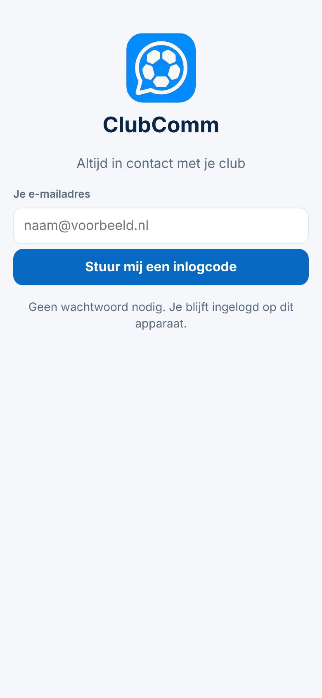

# Inloggen en de app op je beginscherm

| | |
|---|---|
| **Status in de app** | In productie · commit `9eff3ce` (5-11-2026) |
| **Status van deze kaart** | Gepubliceerd in de bundels *Snelstart trainersbijeenkomst* (5-11-2026; Kort + Let op) en *Snelstart vrijwillige trainer* (6-11-2026; Kort) · Besluit 151 |
| **Besluiten** | 1 · 52 · 54 |
| **Schermafbeeldingen** | `docs/presentaties/beelden/kaart-inloggen.jpg` |
| **Doelgroepen** | beginner trainer (ook ouder en teamleider) |

## Kort
*Voor iedereen. Je hebt geen wachtwoord nodig.*

1. Open **mijnclubcomm.nl** op je telefoon (dat adres staat ook in de welkomstmail van je club).
2. Vul je **e-mailadres** in en tik **Stuur mij een inlogcode**.
3. Je krijgt een mail met een **code van 6 cijfers** (de code staat ook in het onderwerp). Typ de code over en tik **Inloggen**.
4. Zet ClubComm op je beginscherm: tik rechtsboven op je **rondje met initialen** → **App op je beginscherm zetten** en volg de stappen.
5. Klaar. Je blijft ingelogd op dit apparaat.

## Let op
- **Je hoeft je niet aan te melden.** De club heeft je al toegevoegd als trainer; je logt in met het e-mailadres dat de club van je heeft.
- **Op de iPhone** gaat het via **Delen** → **Zet op beginscherm** → **Voeg toe** (in Chrome zit Delen rechtsboven). Een knop die dat voor je doet, staat Apple niet toe.
- **Werkt de code niet meer?** Vraag gewoon een nieuwe aan; de nieuwste code geldt.
- **Uitloggen** (in je profiel) logt je op al je apparaten uit. Na 6 maanden zonder gebruik log je opnieuw in.
