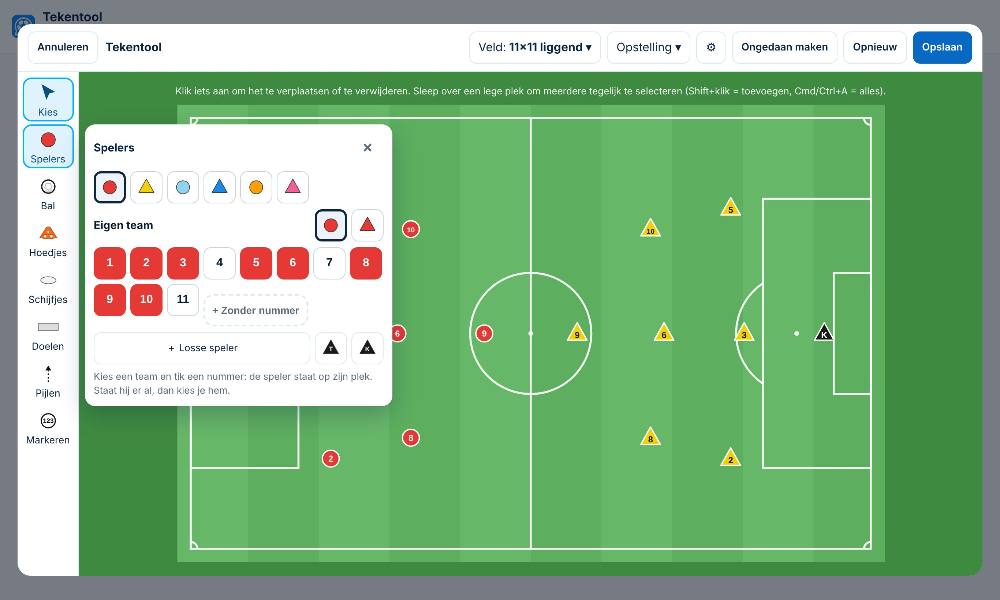
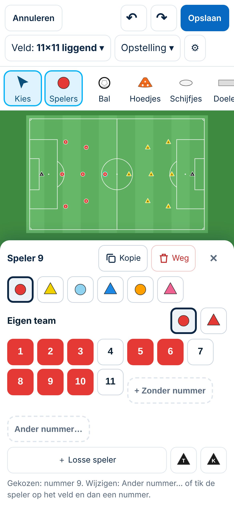
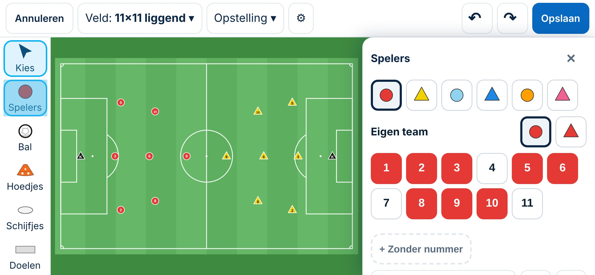

# Tekentool: een oefenvorm tekenen

| | |
|---|---|
| **Status in de app** | In productie · commit `699cb9e` (5-11-2026) |
| **Status van deze kaart** | Concept (Besluit 151) |
| **Besluiten** | 124–127 · 148 · 152 · 153 · 156 · 157 · 158 · 160 |
| **Schermafbeeldingen** | `docs/presentaties/beelden/tekentool-laptop.jpg` · `tekentool-telefoon.jpg` · `tekentool-gekanteld.jpg` |
| **Doelgroepen** | beginner trainer · ervaren trainer |

## Kort
*Voor elke trainer. Je tekent een oefenvorm bij een vorm in de Vormenbank.*

1. Ga naar **Training → Vormenbank** en tik **Nieuwe oefenvorm**. Bij een vorm die al bestaat: open hem en tik **Bewerken**.
2. Tik **Tekening maken** (of **Tekening aanpassen**).
3. Kies bovenaan het **Veld** (bijvoorbeeld *Vak* of *Half veld*). Tik links op **Spelers** en tik nummers aan: elke speler staat meteen op zijn plek.
4. Tik links op **Hoedjes**, **Bal**, **Doelen** of **Pijlen** en tik of sleep op het veld. **Kies** = iets aantikken om het te verschuiven.
5. Tik **Opslaan**. De tekening staat bij de vorm en in elke training waarin je die vorm gebruikt.

## Meer
*Voor de trainer die vaker tekent.*

**Spelers en rugnummers** (Besluit 148, 156)
- Kies in het paneel **Spelers** eerst een **team**: *Eigen team*, *Tegenstander*, lichtblauw, blauw, oranje of roze. Per team kies je **rondje of driehoek**.
- **Een nummer tikken dat er nog niet is:** de speler komt op zijn plek. **Staat het nummer er al,** dan kies je die speler; er wordt nooit iets verwijderd.
- **Nummer wijzigen:** tik de speler op het veld aan en tik een nummer, of gebruik **Ander nummer…** (1 tot en met 99). Hetzelfde nummer twee keer mag.
- **+ Zonder nummer** zet een speler zonder cijfer neer. **＋ Losse speler**: tik de knop en daarna op het veld. Trainer en keeper staan ernaast.
- **Opstelling** (bovenaan) zet in één tik een 2-1-2 of 3-3-1 neer, met dezelfde nummers als de knoppen. De keeper is nummer 1 en de spits van de 3-3-1 is 9.

**Werken met wat er staat**
- **Kies** en tik iets aan om het te verslepen. Je hoeft niet precies te raken: een tik net naast een speler of hoedje kiest het dichtstbijzijnde (Besluit 160).
- **Meerdere tegelijk:** sleep een vak over een lege plek.
- Onder het veld staan **Dupliceren**, de **kleuren** en **Verwijderen**. Op de telefoon (staand) met het paneel Spelers open staan *Kopie* en *Weg* bovenin het paneel (Besluit 158).
- **↶ / Ongedaan maken** zet de laatste stap terug, ook na verwijderen.
- **Pijlen:** *Loopactie*, *Pass*, *Dribbel* en *Schot*, ook met een boog. Sleep de witte bolletjes om een pijl langer of schuiner te maken, en het blauwe bolletje voor een boog (Besluit 126, 127).
- **Hoedjes:** tik *Hoedjes*, kies een kleur en tik op het veld; je kunt doortikken. *Vak met hoedjes*: sleep een rechthoek en op elke hoek komt een hoedje.

**Op de telefoon** (Besluit 156, 157)
- **Staand:** het paneel Spelers ligt onderaan en het veld blijft erboven zichtbaar.
- **Gekanteld:** de knoppen staan links en het paneel rechts naast het veld. Spelers zijn dan het grootst, dus voor nauwkeurig tekenen draai je de telefoon.
- Op de laptop gaat uittekenen nog het snelst: daar werken ook sneltoetsen (1–6 spelers, T, K, H hoedje, B bal, L/P/R/S pijlen, Esc stoppen).

 

## Let op
- **Een nummerknop verwijdert nooit.** Weghalen gaat alleen met *Verwijderen* (of *Weg*) en kan ongedaan worden gemaakt.
- **Een menu sluiten met ×** zet het gereedschap uit. Daarna tik je niets per ongeluk neer (Besluit 152).
- **Een tekening aanpassen verandert hem in elke training** die de vorm gebruikt. Wil je een andere versie, maak dan een **variant** bij de vorm.
- **Ander veld kiezen verschuift niets:** spelers en hoedjes blijven op dezelfde plek in het beeld. Bij een veld van een andere vorm kunnen ze buiten de lijnen vallen; zet ze dan terug of gebruik *Ongedaan maken*.
- Veldlijnen (penaltystip, halve maan, hoekjes) staan op **11×11** en **Half veld**, niet op 8×8, 6×6 en Vak (Besluit 153).
- *Opslaan ingezoomd* (⚙) toont in de tegel alleen het stuk waar je getekend hebt.
