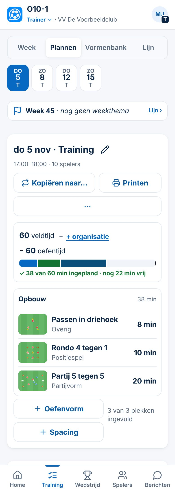
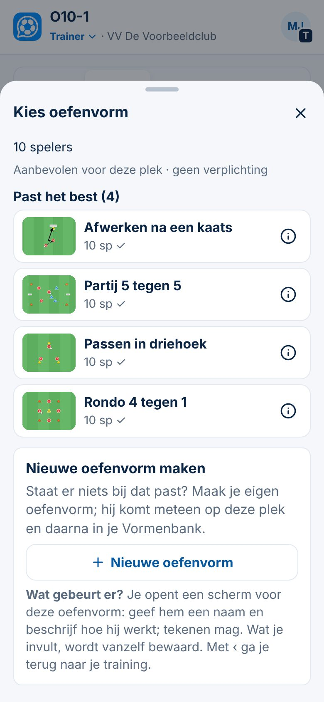

# Training voorbereiden

| | |
|---|---|
| **Status in de app** | In productie · commit `dcb59d7` (5-11-2026) |
| **Status van deze kaart** | Concept (Besluit 151) |
| **Besluiten** | 128 · 130 · 132 · 135 · 139 · 141 · 142 · 144 · 145 · 150 · 155 |
| **Schermafbeeldingen** | `docs/presentaties/beelden/training-plannen.jpg` · `training-kies-oefenvorm.jpg` |
| **Doelgroepen** | beginner trainer · ervaren trainer |

## Kort
*Voor elke trainer. Je zet de oefenvormen voor één training in de goede volgorde.*

1. Ga naar **Training → Plannen** en tik bovenaan de **dag** van de training.
2. Tik **Training voorbereiden**. De app vraagt *Hoe wil je beginnen?*: kies **Eerdere training gebruiken** (als je er al een hebt) of **＋ Oefenvorm**.
3. Kies in **Kies oefenvorm** een vorm uit je Vormenbank. Bovenaan staat wat het best past bij het aantal spelers; niets is verboden. Staat er niets bij, tik **Nieuwe oefenvorm**.
4. Herhaal **＋ Oefenvorm** (of **＋ Spacing**) tot de training vol is. De balk laat zien hoeveel minuten je hebt ingepland en hoeveel er nog vrij zijn.
5. Klaar. Alles wordt vanzelf bewaard. Met **Printen** krijg je een A4 voor op het veld.

## Meer
*Voor de trainer die vaker voorbereidt.*

**De tijd** (Besluit 142)
- Bovenaan staat **veldtijd − organisatie = oefentijd**. De veldtijd komt uit de planning. Tik **＋ organisatie** voor de tijd die geen oefentijd is (uitleg, wissels, drinken, ombouw).
- Plan je meer minuten dan de oefentijd, dan zie je een waarschuwing en welke vorm erbuiten valt. Je kunt gewoon doorgaan: de app blokkeert nooit.

**Een vorm in de training aanpassen**
- Tik een vorm in de lijst aan voor **Minuten**, een **Notitie**, **Gebruiken als spacing**, **Omlaag**, **Vorm bekijken**, **Dupliceren** of **Weghalen**.
- Na het neerzetten van een vorm verschijnt even **Ongedaan maken** (Besluit 139).
- *Spacing* is een kort ander oefeningetje tussen twee vormen, bijvoorbeeld 2 minuten hooghouden.

**Sneller voorbereiden**
- **Kopiëren naar…** zet deze opbouw in een andere training (of op een losse datum). Daarna pas je aan wat anders moet.
- **⋯ → Eerdere training overnemen** haalt de opbouw van een eerdere training hierheen; **⋯ → Training leegmaken** begint opnieuw.
- Vanuit de **Vormenbank** kan het ook andersom: open een vorm en tik **Zet in een training…**.
- Onder de training staat je Vormenbank als lijst: tik **＋** en de vorm komt op de eerste passende lege plek.

**Bij een club met een opleidingsprofiel** (Besluit 141, 144, 145, 155)
- De training heeft een **sjabloon** met vaste plekken (bijvoorbeeld Start, A1, A2, B1, B2, Partij) en bovenaan **Stap x van y**.
- De **trainingskaart** heeft vijf regels: *Wat · Waar · Welke · Niveau · Mee uit vorige*. Een voorstel uit de week of de periodisering staat gestippeld en vult nooit vanzelf in.
- **Kies oefenvorm** filtert ook op leerdoel, vaardigheid en leerniveau. Een vorm die al staat, verplaats je met **Verplaatsen naar** (een bezette plek wisselt).
- Zonder opleidingsprofiel blijft de training één lijst in de volgorde die jij kiest; het **weekthema** kies je dan zelf bij **Lijn**.

## Let op
- **Een tekening of beschrijving wijzig je in de Vormenbank,** niet in de training. Die wijziging zie je in elke training waarin de vorm staat.
- **Een waarschuwing is een signaal, geen fout.** ClubComm signaleert, jij beslist.
- **Voorbereiden is iets anders dan vastleggen.** Na de training leg je in **Week** vast wat er echt gegeven is (*Training voorbereiden of vastleggen*); dat krijgt later een eigen kaart.
- Een training die je weghaalt of leegmaakt, laat de vormen in je Vormenbank staan.
