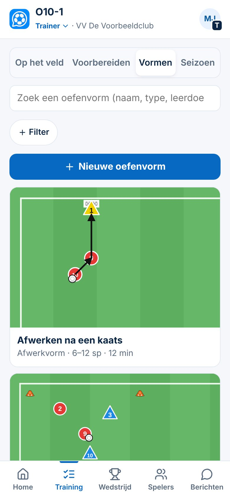
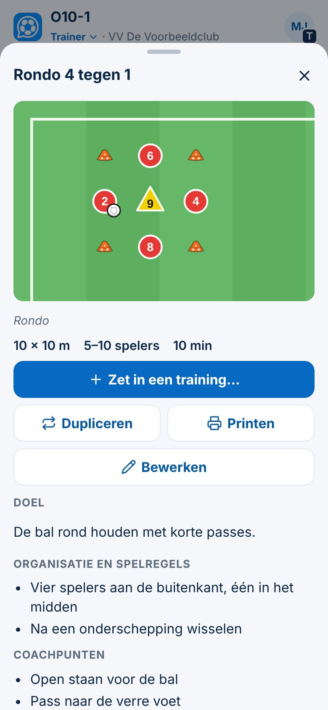

# Vormenbank: je eigen oefenvormen

| | |
|---|---|
| **Status in de app** | In productie · commit `dcb59d7` (5-11-2026) |
| **Status van deze kaart** | Concept (Besluit 151) |
| **Besluiten** | 128 · 131 · 132 · 133 · 139 · 141 · 150 |
| **Schermafbeeldingen** | `docs/presentaties/beelden/vormenbank-lijst.jpg` · `vormenbank-vorm.jpg` |
| **Doelgroepen** | beginner trainer · ervaren trainer |

## Kort
*Voor elke trainer. In de Vormenbank bewaar je je oefenvormen; elke vorm gebruik je in zoveel trainingen als je wilt.*

1. Ga naar **Training → Vormen** (tot november heette dit tabblad *Vormenbank*) en tik **Nieuwe oefenvorm**.
2. Geef de vorm een **naam**. Vul in wat je weet: onder **Opzet** spelers van–tot, minuten en afmeting (ingeklapt met een samenvatting zodra er iets staat), doel, **organisatie** (hoe het klaarstaat), **spelverloop** (hoe een actie loopt), **spelregels** en coachpunten. Alles mag leeg blijven. *Kenmerken* en *Eigen notities* staan ingeklapt; tik erop om ze te openen (Besluit 164).
3. Tik **Tekening maken** als je hem wilt tekenen (zie de kaart *Tekentool*). Staan er spelers in je tekening, dan zie je **Uit je tekening** (bijvoorbeeld *6 spelers: 4 oranje, 2 roze → 4 tegen 2*). **Overnemen** vult alleen lege velden in: spelers, keepers en de aantallen per groepje. **Niet nu** laat alles zoals het is (Besluit 165).
4. Tik **‹** om terug te gaan. Alles wordt vanzelf bewaard.
5. Zoek een vorm terug met het **zoekvak** of **Filter**. Tik een vorm aan om hem te bekijken.

## Meer
*Voor de trainer met een groeiende Vormenbank.*

**Een vorm bekijken** (Besluit 132)
- Je ziet de tekening, het vormtype, de afmeting, het aantal spelers en de minuten, met daaronder doel, organisatie, spelverloop, spelregels, coachpunten en varianten. Bij een oudere vorm met alles in één veld heet dat blok nog *Organisatie en spelregels*; ClubComm splitst niets vanzelf.
- **Materiaal** (ballen, hoedjes, hesjes) telt de app uit de tekening.
- Knoppen: **Zet in een training…**, **Dupliceren**, **Printen** (een A4 per vorm) en **Bewerken**.

**Een vorm bewerken**
- **Varianten:** een makkelijkere of moeilijkere versie van dezelfde vorm, met een eigen tekst of tekening. Zo hoef je geen nieuwe vorm te maken.
- **Bij andere groepsgroottes:** schrijf per aantal spelers hoe je de vorm opzet (bijvoorbeeld *14 spelers + 2 keepers: 6 tegen 6 met keepers*).
- **Classificatie** (Besluit 131): vormtype (rondo, positiespel, partijvorm …), aantallen per groepje, speelrichting (geen, één, twee, meer) en schakelen. Elke keuze bij schakelen (ook *wisselende rollen of richtingen*) maakt de vorm een **schakelvorm**; zoek daarop met het woord *schakelvorm*. Daarmee vind je vormen terug met **Filter**. Alles is optioneel; nog een tik maakt een keuze weer leeg.
- **Wat ik de volgende keer anders doe** en **eigen woorden** (tags) helpen je later bij het zoeken.
- **Dupliceren** maakt een kopie om aan te passen; het origineel blijft hetzelfde.

**Filter**
- Op **vormtype**, **weerstand** (zonder, ondertal, gelijk, overtal) en **spelers en tijd** (*past bij* het aantal spelers van je team, ≤ 10 minuten, met keepers). Onder *Meer* staan fase, speelrichting en schakelen.

**Bij een club met een opleidingsprofiel** (Besluit 133, 139)
- Je kunt een vorm koppelen aan een **leerdoel** (de eerste tik is het hoofdleerdoel ★, daarna *ook*) en aan **vaardigheden**. De vorm telt dan mee in de minuten per leerdoel bij **Lijn**.
- Onder *Uitgebreid (optioneel)* staan extra velden uit het profiel, zoals leeromgeving en *Als de vorm vastloopt*.

## Let op
- **Je Vormenbank is van jou.** Andere trainers zien je vormen niet; een gedeelde clubbank is nog niet gebouwd (Besluit 134).
- **Een wijziging in een vorm geldt in elke training** waarin die vorm staat. Wil je een andere versie: maak een **variant** of **dupliceer** de vorm.
- **Verwijderen** haalt de vorm uit je lijst. Trainingen waarin hij stond, houden zijn naam en tekening.
- Een nieuwe vorm die je maakt vanuit **Kies oefenvorm** komt meteen in die training én in je Vormenbank.
