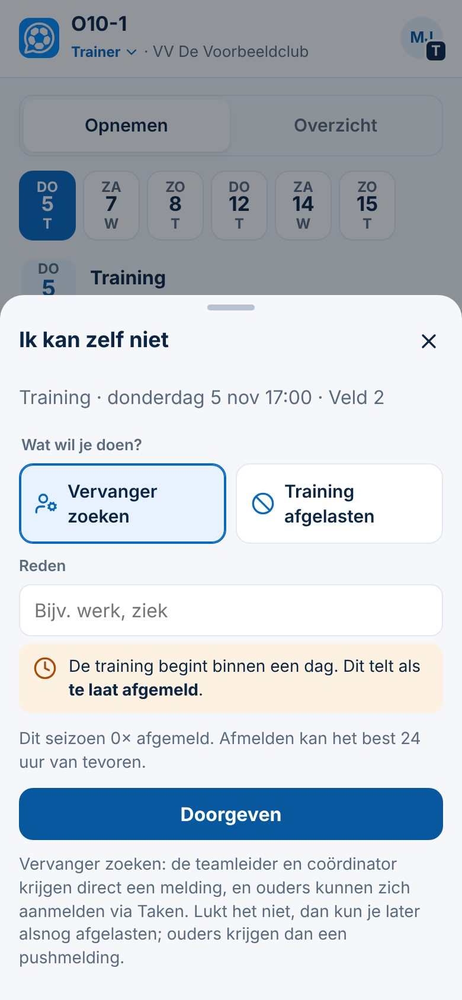

# Kun je zelf niet? Vervanger zoeken of afgelasten

| | |
|---|---|
| **Status in de app** | In productie · met #136 (5-11-2026) |
| **Status van deze kaart** | Gepubliceerd in de bundel *Snelstart vrijwillige trainer* (6-11-2026; Kort) · Besluit 151 |
| **Besluiten** | 20 · 95 · 115 |
| **Schermafbeeldingen** | `docs/presentaties/beelden/zelf-afmelden.jpg` |
| **Doelgroepen** | beginner trainer · ervaren trainer |

## Kort
*Voor elke trainer. Meld het zo vroeg mogelijk, dan kan de club iets regelen.*

1. Ga naar **Planning** (of **Training → Op het veld**) en zoek de training.
2. Tik **Kun je zelf echt niet?** en daarna **Afmelden als trainer**.
3. Kies **Vervanger zoeken** of **Training afgelasten**.
4. Vul een korte **reden** in (bijvoorbeeld werk of ziek).
5. Tik **Doorgeven**.

## Let op
- **Vervanger zoeken:** de teamleider en de coördinator van je team krijgen direct een melding; heeft je team geen coördinator, dan de HJO (Besluit 115). Ouders kunnen zich aanmelden via *Taken*. Lukt het niet, dan kun je later alsnog afgelasten.
- **Afgelasten:** ouders krijgen een pushmelding.
- **Het wordt vastgelegd.** Afmelden kan het best 24 uur van tevoren; binnen een dag telt het als *te laat afgemeld*.
