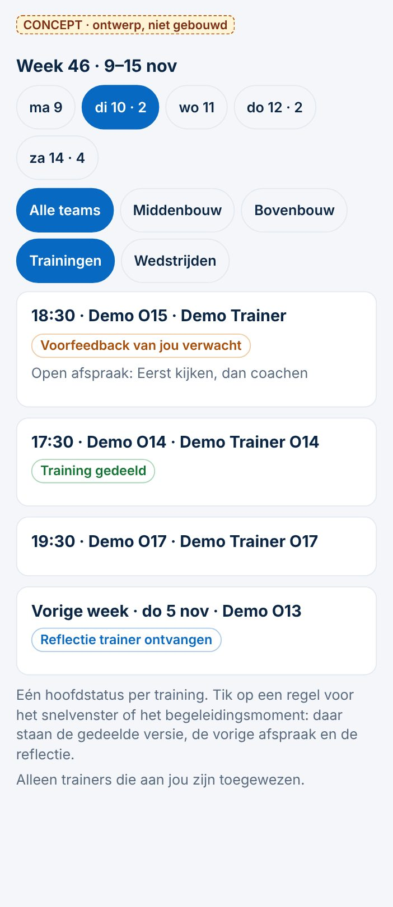
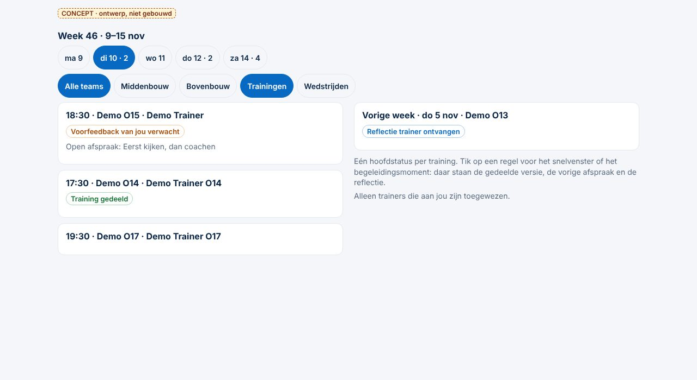
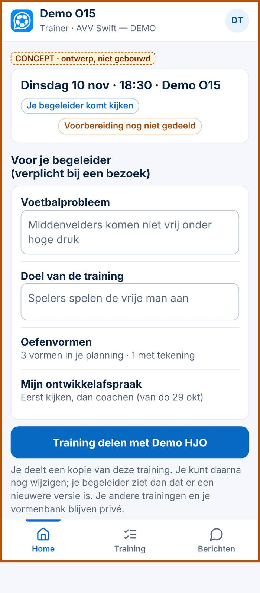
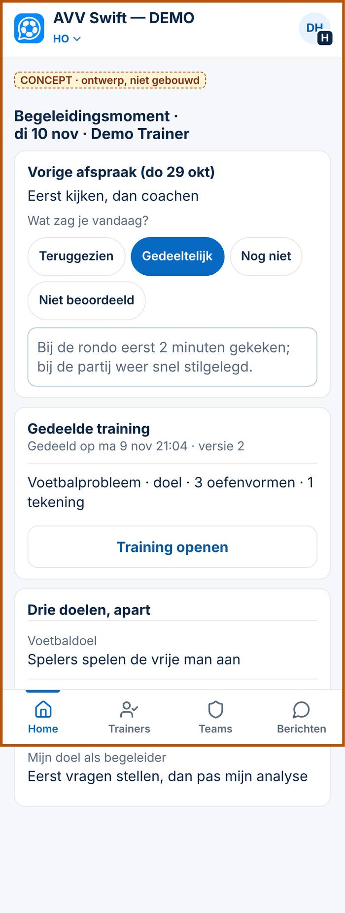
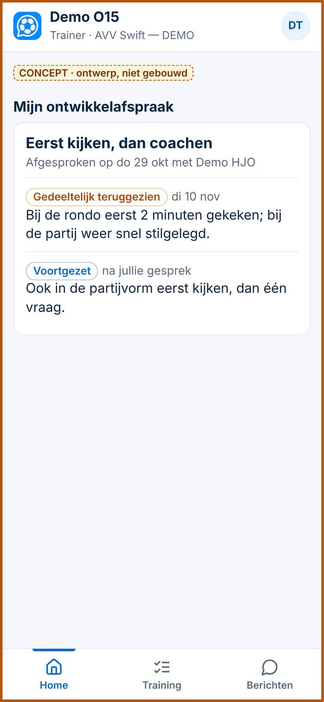

# Eén begeleidingsproces voor trainer en HJO — functioneel ontwerp

*4-11-2026. Spoor 2 (inhoud) + Spoor 3 (software). **Onderzoek en ontwerp, geen bouwopdracht.** Niets gewijzigd aan code, database, rechten of productie. Schermen zijn concepten met verzonnen namen (demo). **Bijgewerkt met de besluiten van de initiatiefnemer (4-11), zie hieronder.***

**Technische voorstellen (apart, niet gebouwd):**
- [Voorstel 1 — vorige-afspraaklus en reflectievolgorde](technisch-1-afspraak-en-reflectie.md) (maat M, geen nieuw recht)
- [Voorstel 2 — rechten: delen per training, vastgelegde versie, werkgebied](technisch-2-rechten-delen-werkgebied.md) (maat L, vervangt 032)

**Uitgangspunt:** de trainersomgeving en het HJO-dashboard ondersteunen **hetzelfde** proces: de KNVB-begeleidingscyclus *Voorbereiding → Planningsgesprek → Praktijk → Reflectiegesprek → Nazorg*. Wat al bestaat, bouwen we niet opnieuw. Het belangrijkste dat ontbreekt, is de **verbinding**: training ↔ begeleidingsmoment ↔ volgend moment.

## Besluiten 4-11 (initiatiefnemer)

| # | Onderwerp | Besluit | Uitgewerkt in |
|---|---|---|---|
| 1 | **Delen** | 032 vervalt. De trainer deelt **expliciet één training**; concepten blijven privé; delen mag ook vrijwillig zonder observatie. De HJO leest en geeft feedback, maar **wijzigt de voorbereiding nooit**. Apart rechtenvoorstel, maat L. | §4, §7, voorstel 2 |
| 2 | **Intrekken en versies** | **Optie A onder voorwaarden.** Drie versies: privévoorbereiding · vrijwillig gedeelde versie · vastgelegde versie bij observatie. Vrijwillig delen kan de trainer intrekken; de vastgelegde versie blijft bij het verslag zolang er een grondslag en bewaartermijn is. De trainer ziet **vooraf** wat er bij een observatie met zijn voorbereiding gebeurt. Bewaartermijn nog niet vastgesteld (privacybeleid, afspraken Swift). Verwijderverzoek en vertrek onderzocht. | §5, voorstel 2 (D, E) |
| 3 | **Koppeling** | `actId` voor de datum, plus **expliciet** welke voorbereiding en welke gedeelde versie bij het moment horen. Eén activiteit kan meerdere trainers of voorbereidingen hebben; **geen automatische koppeling die fout kan gaan**. | §5, voorstel 2 (E) |
| 4 | **HJO-dashboard** | Vanuit de bestaande week. **Maximaal één hoofdstatus per training**; details in het snelvenster of het moment. Vanuit de week: gedeelde voorbereiding openen, voorfeedback, observeren, vorige afspraak bekijken, voortgang vastleggen, volgend moment plannen. Geen tweede planner. | §3 |
| 5 | **Vorige afspraak** (prioriteit) | Komt automatisch terug in het volgende moment; *Teruggezien · Gedeeltelijk · Nog niet · Niet beoordeeld* + één toelichting; na het gesprek *afgerond · voortgezet · aangepast*. **Oorspronkelijke afspraak en historie blijven bewaard.** De trainer mag een eigen tussentijdse inschatting geven: dat is zijn reflectie, geen HJO-observatie. | §6, voorstel 1 |
| 6 | **Reflectievolgorde** | De trainer vult de 3 vragen **direct na de training** in; de HJO gebruikt ze in het gesprek. Mondeling aan het begin blijft kan, maar de software doet niet alsof dat een schriftelijke reflectie is: status **Mondeling besproken**, zonder antwoorden namens de trainer. Geen verplichte vergrendeling. | §2, voorstel 1 |
| 7 | **Werkgebied** | Niet alleen de bouw: **expliciete toewijzingen** begeleider ↔ trainer of team, **in de database** afgedwongen. Geen automatische inzage voor een clubbeheerder zonder begeleidersrol. | §7, voorstel 2 (A, B) |
| 8 | **Bouwvolgorde** | 033 → afspraaklus → reflectie vóór gesprek → #108 apart → rechtenvoorstel → delen/versies/voorfeedback → Swift-criteria. Geen grote verzamel-PR. | § Volgorde |

---

## 1. KNVB-cyclus tegenover de Swift-route en ClubComm

*Bronnen: KNVB HO-opleiding (sheets 7, 14, 15, model "Coachen van de voetbalcoach"); Spoor 2 ronde 5 (zeven stappen, `onderzoek/swift-trainersontwikkeling`); de code van ClubComm.*

| KNVB-fase | Swift-route (ronde 5) | Bestaat in ClubComm | Werkt gedeeltelijk | Ontbreekt | Inhoudelijk nodig | Nieuwe software nodig |
|---|---|---|---|---|---|---|
| **Voorbereiding**: voetbaldoelstelling, persoonlijke doelstelling coach (feed-up), persoonlijke doelstelling HO, tijdsplanning en randvoorwaarden | 1. Basisvoorbereiding trainer | Doel en voetbalprobleem, leerdoel trainer, *Mijn eigen doel als HO*; trainingen in de planner | Het doel van de HO staat in het moment, maar valt weinig op; de training staat los van het moment | **Vorige afspraak** bovenaan; tijdsplanning en randvoorwaarden | De drie doelen apart en zichtbaar: voetbaldoel · leerdoel trainer · doel begeleider | Vorige afspraak tonen (klein); training koppelen aan het moment (zie §5) |
| **Planningsgesprek**: vragenlijst, afspraken over begeleiding en praktijk, inzet staf | 2. Voorfeedback HJO/TJC | Vragenlijst vooraf (trainer), *afspraken uit het gesprek* (focus, moment van feedback) | Voorfeedback bestaat alleen als bericht, niet bij de training | Voorfeedback op de (gedeelde) training; inzet staf | Kort (5 minuten bij een beginner) | Voorfeedback-veld; training delen (§4) |
| **Praktijk**: lezen, analyseren, beïnvloeden; gerichte interventies en coachmomenten | 3. Observatie | A4-observatie (5 KNVB-categorieën, ✓ / ~ / –), notities, leertijdklok | Geen koppeling met de vorige afspraak; geen *oorzaak → gevolg* | **Vorige afspraak teruggezien?**; de zes Swift-criteria (na de pilot) | Elke waarneming met een toelichting; geen cijfers | Teruggezien-keuze + toelichting (§6) |
| **Reflectiegesprek**: **eerst reflectie coach**, feedback HO t.o.v. doelstellingen, gesprekstechnieken, feed-forward, vervolgafspraken | 4. Korte reflectie (direct na de training) · 5. Gesprek naast elkaar | 3 reflectievragen; vier vakken (sterk, ontwikkelpunt, effect, afspraak); de instructie *"laat de trainer eerst vertellen"* | De reflectie komt pas **na** het delen van het verslag, dus na het gesprek | Reflectie vóór het gesprek; feedback per doelstelling | Volgorde KNVB: trainer eerst | Reflectie-aanvraag na de training i.p.v. na delen (statuslogica) |
| **Nazorg**: verslag coach, verslag HO, volgend begeleidingsmoment | 6. Eén ontwikkelafspraak · 7. Opvolging | Verslag delen, terugblik HO (privé), *Volgend moment plannen*, ontwikkelpunt naar het traject | De afspraak wordt bewaard, maar komt **niet terug** bij het volgende moment | Afspraak **afronden / voortzetten / aanpassen**; voortgang zichtbaar voor beide | De lus sluit: nazorg → voorbereiding | Status van de afspraak (§6) |

**Drie doelen blijven apart herkenbaar** (bestaat al als veld, wordt zichtbaar gemaakt):
| Doel | Van wie | Waar het nu staat |
|---|---|---|
| Voetbaldoelstelling | Trainer (vooraf), vastgelegd door de begeleider | `voor.doel` in het moment |
| Persoonlijk leerdoel trainer | Trainer | vragenlijst vooraf, traject `leerdoel` |
| Begeleidingsdoel HJO/TJC | Begeleider | `voor.hoDoel` (*Mijn eigen doel als HO*); terugblik in `begelHoVerslag` (privé) |

---

## 2. De gezamenlijke route

| | Trainer | Gedeeld gegeven | HJO/TJC |
|---|---|---|---|
| 1 | **Mijn volgende training** (Home) | het trainingsmoment uit het rooster | **Weekoverzicht** (Home, PR #108) |
| 2 | **Voorbereiden** in de planner (bestaat) | de training (privé) | Trainer kiezen in de week |
| 3 | **Delen** (één training) | gedeelde versie (§4) | **Gedeelde voorbereiding bekijken** |
| 4 | **Voorfeedback bekijken** | voorfeedback in het moment | **Voorfeedback geven** |
| 5 | Training geven | — | **Observeren** (+ vorige afspraak teruggezien?) |
| 6 | **Reflecteren** (3 vragen, direct na de training) | eigen reflectie (beschermd, 033) | Reflectie lezen vóór het gesprek, of *Mondeling besproken* (status, geen antwoorden) |
| 7 | Gesprek | — | **Reflectiegesprek**, feedback per doel, feed-forward |
| 8 | **Ontwikkelafspraak** zien (Home) | afspraak + status | **Afspraak opvolgen** bij het volgende moment |

Een beginnende trainer krijgt **geen extra formulier**: bij een bezoek alleen de minimale voorbereiding (voetbalprobleem, doel, oefenvormen) en de 3 reflectievragen. Alles wat hij al in de planner zet, wordt hergebruikt.

---

## 3. Concept: HJO-weekweergave met gedeelde trainingen

 

- **Vertrekpunt:** de week van de begeleider (Besluit 146, PR #108). Geen tweede planner: de regels komen uit het bestaande rooster.
- **Per regel, compact:** tijd · team · trainer, met **maximaal één hoofdstatus** (besluit 4) en, als die er is, één regel *Open afspraak: …*.
- **Rangorde** (de eerste die geldt, wordt getoond):
  1. *Voorfeedback van jou verwacht* (er is een observatie én een gedeelde versie zonder voorfeedback)
  2. *Observatie vandaag*
  3. *Reflectie trainer ontvangen* (nog niet besproken)
  4. *Observatie gepland*
  5. *Training gedeeld*
  6. *Afgerond*
  7. niets (geen label)
- **Details** (versie, gedeeld op, vorige keer teruggezien, reflectie schriftelijk of mondeling) staan in het snelvenster of het moment, niet in de week.
- **Vanuit de week** (één tik, geen tweede planner): gedeelde voorbereiding openen · voorfeedback geven · observeren · vorige afspraak bekijken · voortgang vastleggen · volgend moment plannen.
- **Alleen toegewezen trainers** (besluit 7); de bouwchips blijven een filter.
- Een tik opent het begeleidingsmoment als er een is, anders het snelvenster van de trainer.

## 4. Concept: trainersvoorbereiding met delen

- **Waar:** in de planner (bestaat) en vanaf Home (*Mijn volgende training*).
- **Bij een gepland bezoek:** bovenaan *Je begeleider komt kijken* en een korte lijst *Voor je begeleider*: voetbalprobleem, doel, oefenvormen (verplicht) en zijn ontwikkelafspraak (ter herinnering). Eén knop **Training delen met [begeleider]**.
- **Zonder bezoek:** dezelfde knop, vrijwillig, onder *⋯* in de planner. Vrijwillig delen kan de trainer altijd weer **intrekken**.
- **Vooraf uitgelegd** (besluit 2): bij *Training delen* staat wat er gebeurt: *"Je begeleider kan deze training lezen en feedback geven, maar niet wijzigen. Bij een observatie bewaren we een kopie bij het verslag, zolang dat volgens de afspraken van de club mag."*
- **Delen = een kopie** van deze ene training (*gedeelde versie*), met de oefenvormen en tekeningen die erin staan. De vormenbank en andere trainingen blijven privé. Wijzigt de trainer daarna nog iets, dan ziet de begeleider *er is een nieuwere versie* en kan de trainer opnieuw delen.
- **Wat de begeleider ziet:** voetbalprobleem, teamfunctie en teamtaak (als het profiel ze heeft), doelstelling, oefenvormen, tekeningen, coachaccenten (als ingevuld). **Alleen lezen.** Feedback schrijft hij in het begeleidingsmoment, niet in de training.

## 5. Koppeling met het begeleidingsmoment

- **Datum via `actId`** (bestaat): een moment verwijst naar een activiteit; de training van de trainer ook.
- **Maar niet alleen `actId`** (besluit 3): bij één activiteit kunnen meerdere trainers of voorbereidingen horen (een team met twee trainers; een trainer met twee voorbereidingen). Het moment legt daarom **expliciet** vast welke voorbereiding en welke gedeelde versie erbij horen: `training { planId, gedeeldeVersie }`. Dat gebeurt alleen door een bewuste handeling (de trainer deelt *voor dit bezoek*, of de HJO kiest uit de gedeelde trainingen van deze trainer). ClubComm koppelt nooit zelf op goed geluk.
- **HJO → training:** in het moment *Gedeelde training · gedeeld op … · versie n* met *Training openen*.
- **Trainer → moment:** in de planner en op Home bij die training: *Je begeleider komt kijken*, later *Feedback beschikbaar*.

**Drie versies, uit elkaar gehouden:**
| Versie | Wat | Van wie | Verandert? |
|---|---|---|---|
| Actuele voorbereiding | de training in de planner | trainer, privé | ja, altijd |
| Gedeelde versie | kopie bij *Delen* | trainer deelt | alleen door opnieuw delen |
| Vastgelegde versie | kopie die bij de observatie hoort (op het moment dat de praktijk begint of het verslag wordt gedeeld) | hoort bij het begeleidingsmoment | nee |

**Wat gebeurt er als de trainer het delen intrekt?** Gekozen: **optie A onder voorwaarden** (besluit 2). De tabel blijft staan als onderbouwing.
| Optie | Gedeelde versie | Vastgelegde versie bij een observatie | Voordeel | Nadeel |
|---|---|---|---|---|
| A | verdwijnt | **blijft** bij het verslag, tot het einde van het traject of seizoen | het verslag blijft begrijpelijk | de trainer kan zijn eigen tekst niet helemaal terugnemen |
| B | verdwijnt | verdwijnt; het verslag houdt alleen probleem en doel | trainer houdt volledige zeggenschap | het verslag mist de vormen waarover het gesprek ging |
| C | intrekken kan **alleen vóór** de observatie | blijft | duidelijk voor beide | minder vrijheid voor de trainer |

**Voorwaarden bij A:**
- de vastgelegde versie blijft alleen zolang er een **grondslag en bewaartermijn** is; de termijn is **nog niet vastgesteld** en volgt het privacybeleid en de afspraken van Swift (Spoor 2);
- de trainer ziet **vóór het delen** wat er bij een observatie gebeurt (zie §4);
- **verwijderverzoek:** de clubbeheerder start een verwijderroutine zonder de inhoud te lezen; of iets moet blijven, beslist de club, niet de software;
- **vertrek van een trainer:** toewijzingen krijgen een einddatum, gedeelde versies verdwijnen, vastgelegde versies en verslagen volgen de bewaartermijn.

Uitwerking: [voorstel 2, D en E](technisch-2-rechten-delen-werkgebied.md).

## 6. De terugkerende ontwikkelafspraak

1. **Voorbereiding (HJO):** bovenaan het nieuwe moment *Vorige afspraak (datum): …*. ClubComm stelt de laatste open afspraak van deze trainer voor (ook van een andere begeleider); de HJO bevestigt met één tik of kiest *Geen open afspraak*.
2. **Praktijk of direct erna (HJO):** *Teruggezien · Gedeeltelijk · Nog niet · Niet beoordeeld* + één zin: *welk gedrag was waarneembaar?*
3. **Na het reflectiegesprek (HJO, samen):** de afspraak is **afgerond**, **voortgezet** of **aangepast** (dan met de nieuwe tekst).
4. **Zichtbaar voor beide:** de trainer ziet op Home *Mijn ontwikkelafspraak* met de laatste stand; de HJO ziet het in het snelvenster (*vorige afspraak → teruggezien → volgende stap*), niet als extra label in de week.
5. **Historie** (besluit 5): de oorspronkelijke afspraak blijft bewaard. Elk volgend moment bewaart een kopie van de afspraak zoals die toen gold, en wat er mee gebeurde. *Mijn ontwikkeling* toont de keten: *afgesproken → gedeeltelijk teruggezien → voortgezet met nieuwe tekst → afgerond*.
6. **Eigen tussentijdse inschatting van de trainer** (optioneel): *Hoe ik eraan werkte*. Staat in zijn eigen opslag, heet in beeld *"jouw eigen inschatting"* en wordt nooit getoond als observatie van de HJO.

**Gegevens:** in het bestaande begeleidingsmoment (scope `trainerdossier`: de begeleider schrijft, de trainer leest): `opvolging { vanMoment, afspraak (kopie), teruggezien, toelichting, door, op }` en `afspraakUitkomst { status, nieuw, door, op }`. De eigen inschatting in `begeleidZelf` (scope `trainerzelf`, na 033 alleen de trainer). **Geen nieuw recht, geen migratie.** Uitwerking: [voorstel 1](technisch-1-afspraak-en-reflectie.md).

*Opmerking:* "teruggezien" legt alleen de HJO vast als hij er was. Tussen twee bezoeken in is er alleen de eigen inschatting van de trainer.

---

## 7. Rechtenmatrix (voorstel, risicoklasse L — apart besluit)

**Nu** = productie (migraties t/m 031; 032 en 033 niet toegepast). **Voorstel** = wat dit ontwerp vraagt.

*Werkgebied* = **expliciete toewijzing** begeleider ↔ trainer of team (besluit 7), niet alleen de bouw.

| Gegeven | Trainer zelf | HJO/TJC met toewijzing | HJO/TJC zonder toewijzing | Clubbeheerder zonder begeleidersrol | Andere trainer | Andere club |
|---|---|---|---|---|---|---|
| Rooster (datum, tijd, tegenstander) | lezen + schrijven (eigen team) | **Nu:** lezen, hele club · **Voorstel:** lezen, eigen werkgebied | **Nu:** lezen · **Voorstel:** nee | lezen + schrijven | eigen team | nee |
| Persoonlijke voorbereiding (planner) | eigenaar | nee | nee | nee | nee | nee |
| Privé-oefenvormen (vormenbank) | eigenaar | nee | nee | nee | nee | nee |
| **Gedeelde versie** van één training (nieuw) | eigenaar, kan intrekken | **lezen** | nee | nee | nee | nee |
| **Vastgelegde versie** bij een observatie (nieuw) | lezen | lezen (schrijft bij het vastleggen) | nee | nee (open vraag) | nee | nee |
| Voorfeedback en begeleidingsverslag (moment) | lezen | lezen + schrijven | **Nu:** ook · **Voorstel:** nee | **Nu:** ja · **Met 033:** nee | nee | nee |
| Eigen reflectie trainer | eigenaar | lezen | **Nu:** lezen · **Voorstel:** nee | **Nu:** ja · **Met 033:** nee | nee | nee |
| Werkaantekening begeleider | nee | eigen bouw (bestaat) | nee (bestaat) | nee | nee | nee |
| Vorige afspraak + teruggezien | lezen | lezen + schrijven | **Voorstel:** nee | **Met 033:** nee | nee | nee |

**Wat er nu niet klopt met de uitgangspunten** (gevonden in de migraties):
1. **TJC-werkgebied wordt in de database niet afgedwongen.** `priv.cc_begeleider()` geldt voor élke HO of TC in de club. Alleen de werkaantekeningen (`hoprive`) kijken naar de bouw. Dossiers, reflecties en het rooster zijn dus clubbreed leesbaar voor elke begeleider; de beperking per bouw zit alleen in de schermen.
2. **Voorstel 032 opent te veel.** Met `trainerplan` ziet een begeleider **alle** trainingen van een trainer met een traject, zodra de club meekijken aanzet. Het uitgangspunt is nu: **alleen wat expliciet gedeeld is**. Daarnaast heeft 032 het eerder gevonden gat (*Scope wijzigen mag niet* bij bestaande trainingen).
3. **Zonder 033** kan een HO de reflectie van een trainer wijzigen, en kan een clubbeheerder zonder begeleidersrol dossiers lezen.

**Technisch ontwerp:** [voorstel 2](technisch-2-rechten-delen-werkgebied.md) (maat L). Kort:
- **Toewijzingsrijen** (begeleider ↔ trainer of team, van/tot) en een databasefunctie *begeleidt deze persoon deze trainer?*; de bouw is alleen nog een filter en een snelle manier om toe te wijzen.
- Dekt: HJO bovenbouw met meerdere teams, TJC met een beperkt werkgebied, trainers met meerdere teams, wisseling van begeleider of team, en inzage in eerder afgeronde dossiers (beleidskeuze).
- **Delen als kopie-rij** (`gedeeldeTraining`, eigenaar = trainer); intrekken = verwijderen; geen scope-wijziging van bestaande rijen (geen botsing met `cc_bewaak`).
- **Vastgelegde versie** als aparte, onveranderlijke rij per moment.
- **Clubbeheerder zonder begeleidersrol:** geen automatische inzage.
- **Clubscheiding** blijft via `club_id` en `priv.cc_club()`. Testen zoals bij 033.

---

## 8. Wat bestaat en wat werkelijk nieuw is

| Onderdeel | Bestaat | Aanpassen | Nieuw |
|---|---|---|---|
| Vijf fasen in het begeleidingsmoment | ✓ | | |
| Voetbaldoel, leerdoel trainer, doel HO, terugblik HO | ✓ | beter zichtbaar (drie doelen apart) | |
| Vragenlijst vooraf, observatie, vier vakken, verslag delen, volgend moment | ✓ | | |
| Week van de begeleider | PR #108 (open) | één hoofdstatus per regel | |
| Mijn volgende training (trainer) | | demo-ontwerp | Home-indeling (presentatie) |
| Vorige afspraak + teruggezien + afronden/voortzetten/aanpassen | | | ✓ (in het bestaande moment, geen nieuw recht) |
| Reflectie vóór het gesprek | ✓ (3 vragen) | moment van vragen (na de training) | statuslogica + *Mondeling besproken* |
| Afspraakhistorie + eigen inschatting trainer | | | ✓ (bestaande opslag) |
| Expliciete koppeling moment ↔ voorbereiding/versie | `actId` | | ✓ |
| Toewijzing begeleider ↔ trainer/team | | | ✓ **(L)** |
| Training delen (één training, kopie) | | | ✓ **nieuw recht (L)** |
| Vastgelegde versie bij observatie | | | ✓ + **beleidsbesluit intrekken** |
| Voorfeedback bij de gedeelde training | als bericht | | veld in het moment |
| TJC/HO-werkgebied in de database | alleen werkaantekeningen | | ✓ **(L)** |
| Zes Swift-criteria in de observatie | | | na de pilot (Spoor 2) |

## Afhankelijkheden en bouwvolgorde (besluit 8)

| | Wat | Hangt af van | Los van #108? |
|---|---|---|---|
| 1 | **033 afronden** (toepassen en controleren) | eigen akkoord | ja |
| 2 | **Vorige-afspraaklus** (§6, voorstel 1a) | 1 | **ja**: zit in het moment, het verslag en Home van de trainer; alleen de regel in het snelvenster wacht op #108 |
| 3 | **Reflectie vóór het gesprek** (voorstel 1b) | 1; Spoor 2 akkoord op de drie vragen | **ja**: Home-actie en verslag van de trainer, Reflectiegesprek van de HJO |
| 4 | **PR #108** apart beoordelen | eigen akkoord | — |
| 5 | **Rechtenvoorstel:** delen + werkgebieden (voorstel 2, migratie 034 als voorstel) | 1; privacytoets | — |
| 6 | Delen, versiebeheer, voorfeedback in de app | 5; 4 voor de week | — |
| 7 | Zes Swift-criteria | na de pilot (Spoor 2) | — |

**Kleine PR's, niet gebundeld:** 2 en 3 kunnen samen of apart (allebei klein); 5 is één PR met alleen de migratie als voorstel en de lokale tests; 6 is een aparte schermen-PR. Kleine overlap met #108: `begeleiding.js` (#108 voegt alleen `CC.begelPlanOpAct` toe); wie het eerst wordt samengevoegd, de ander voegt `main` in.

**Nog open (beleid, niet voor de software):**
1. Bewaartermijn van vastgelegde versies en verslagen (privacybeleid Swift).
2. Ziet een nieuwe begeleider oudere, afgeronde verslagen? (clubkeuze)
3. Wat blijft bij een verwijderverzoek op grond van een grondslag?
4. De drie nieuwe reflectievragen (Spoor 2).
