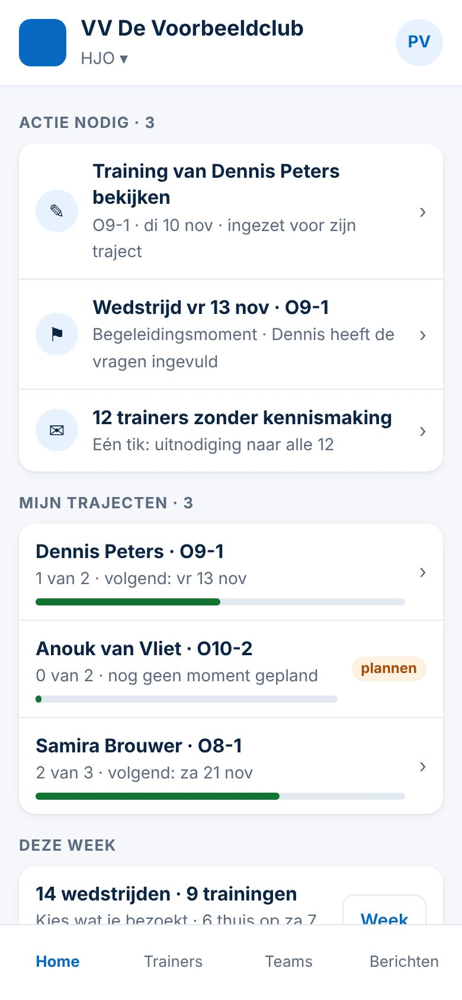
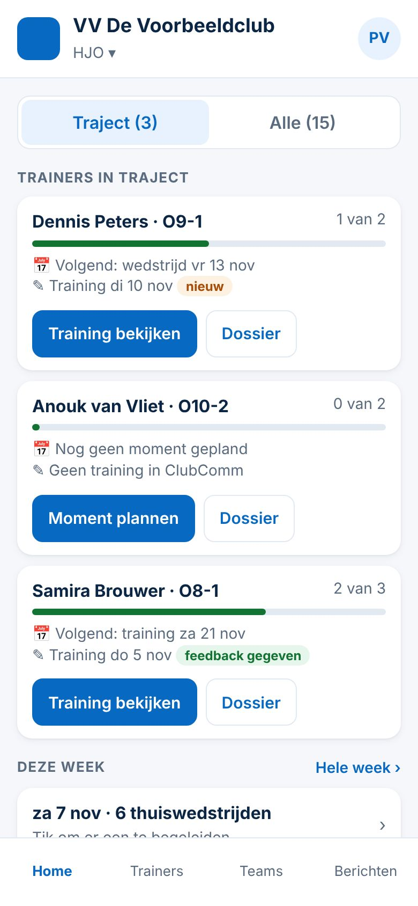
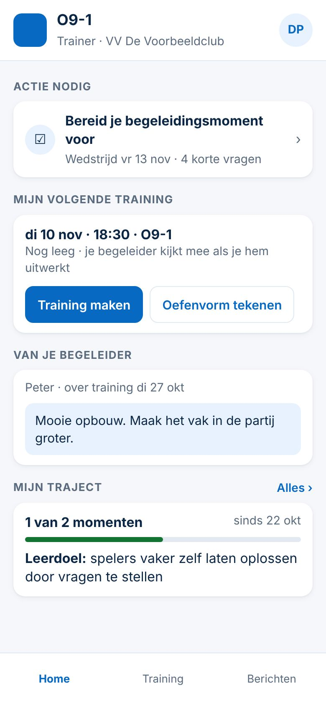
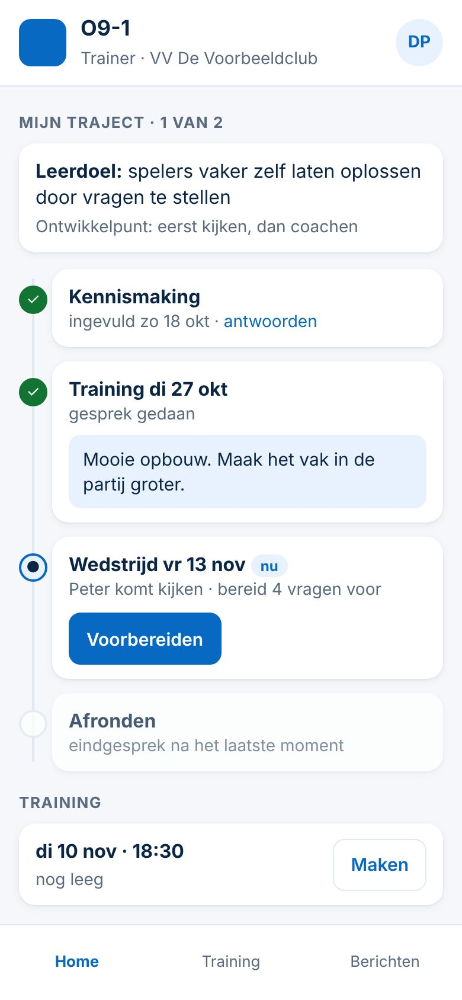

# Dashboards van de HO en de trainer: twee voorstellen per rol (5 november 2026)

*Spoor 3 — ClubComm (de indeling geldt voor elke club met het pakket* Trainers begeleiden*). Wat alleen voor Swift is, staat apart onderaan. Alleen onderzoek: er is niets veranderd aan de app, de database of productie. Gemeten in de demo (verzonnen namen) op 390 px.*

## Hoe het nu is (gemeten)

| Scherm | Tikbare dingen | Woorden | Schermhoogtes | Wat bovenaan staat |
|---|---|---|---|---|
| HO · Home | 37 | 268 | 2,4 | dagknoppen, bouwfilter, *Wedstrijden · Trainingen · Beide*, daarna 15 wedstrijden met elk *Begeleiden* |
| HO · Trainers | 29 | 204 | 1,9 | *Alle (15) · Traject (1)*, zoeken, 15 regels; kennismaking onderaan |
| HO · dossier van een trainer | 15 | 130 | 1,5 | volgen, printen, traject, momenten, trainingen, kennismaking, notities |
| Trainer · Home | 8 | 108 | 1,2 | Actie nodig, Mijn ontwikkeling, Begeleidingsmomenten, Kennismaking |
| Trainer · Training | 20 | 83 | 1,0 | de trainingen en de Vormenbank |

Schermafbeeldingen: `nu-ho-home.jpg`, `nu-ho-trainers.jpg`, `nu-ho-snelvenster.jpg`, `nu-ho-dossier.jpg`, `nu-trainer-home.jpg`, `nu-trainer-training.jpg`.

**Wat opvalt**
- **HO-Home is een rooster, geen startpunt.** De week (Besluit 146) is goed om een bezoek te kiezen, maar vult 2,4 schermen. Wat de HO *moet* doen (een nieuwe training van een trainer bekijken, een voorbereiding lezen, trainers uitnodigen) staat er niet tussen.
- **Een training van een trainer bekijken kost 4 tikken** (Trainers → trainer → *Volledig dossier* → training) en je moet zelf weten dát er iets nieuws is.
- **Trajecten zitten verstopt** achter *Trainers → Traject (1)*; op Home zie je niet wie achterloopt.
- **Trainer-Home is al rustig**, maar mist de twee dingen die de trainer nu het meest doet: zijn **volgende training** maken en de **feedback** van zijn begeleider lezen. De kennismaking (al ingevuld) neemt wel ruimte in.

## De taken en het aantal tikken

| Taak | Nu | HO-A | HO-B |
|---|---|---|---|
| Nieuwe training van een trainer bekijken | 4 (en zelf zoeken) | **1** (Actie nodig) | **1** (*Training bekijken*) |
| Voorbereiding van een moment lezen | 4 | **1** | 2 |
| Zien wie in het traject achterloopt | 2 + kijken | **0** | **0** |
| Een wedstrijd of training kiezen om te bezoeken | 2 (+ scrollen) | 3 (*Week* → regel → bevestigen) | 3 (*za 7 nov* → regel → bevestigen) |
| Kennismaking uitnodigen | 2 + scrollen | **1** (als er iets openstaat) | 2 |

| Taak (trainer in een traject) | Nu | Trainer-A | Trainer-B |
|---|---|---|---|
| Begeleidingsmoment voorbereiden | 1 | 1 | 1 |
| Volgende training maken | 2–3 | **1** | **1** |
| Oefenvorm tekenen | 3 | **1** | 3 |
| Feedback van de begeleider lezen | 2–3 (bij de training) | **0** | **0** |
| Stand van mijn traject zien | 0 | 0 | 0 |
| Mijn kennismaking teruglezen | 1 | 2 (*Alles ›*) | 1 |

## HO — Voorstel A: "Actie eerst" (advies)

- **Wat erop staat (≈ 1 scherm, ±110 woorden, 8 tikvlakken):**
  1. **Actie nodig** (alleen als er iets is, max. 3 regels, daarna *Alles*): *Training van … bekijken* (nieuw ingezet, nog geen feedback), *voorbereiding ingevuld* voor een moment binnen 7 dagen, *n trainers zonder kennismaking*. Elke regel verdwijnt zodra hij gedaan is (één keer signaleren).
  2. **Mijn trajecten**: één regel per trainer met voortgang (*1 van 2 · volgend: vr 13 nov*). Geen moment gepland = label *plannen*. Tik = dossier.
  3. **Deze week**: één regel (*14 wedstrijden · 9 trainingen · 6 thuis op za*) met de knop **Week**: daarachter de huidige week van Besluit 146, ongewijzigd.
- **Knoppen die er altijd staan:** de regels van Actie nodig, de trajectregels, *Week*. Niets anders.
- **Voordelen:** wat moet gebeuren staat bovenaan; nieuwe trainingen worden niet gemist; past op één scherm, ook bij 40 trainers (trajecten zijn er minder dan trainers).
- **Nadelen:** het kiezen van een bezoek kost één tik meer (de week staat erachter). Dit herziet Besluit 146 deels (*Home = Actie nodig + de week*).

## HO — Voorstel B: "Kaart per trainer in traject"

- **Wat erop staat (≈ 1 scherm bij 3 trainers, ±90 woorden, 9 tikvlakken):** per trainer in traject een kaart met voortgang, volgend moment, laatste training (*nieuw* of *feedback gegeven*) en twee knoppen: **Training bekijken** (of **Moment plannen**) en **Dossier**. Daaronder één regel *Deze week*.
- **Voordelen:** alles over één trainer bij elkaar; heel duidelijk bij weinig trajecten (zoals nu bij Swift).
- **Nadelen:** groeit mee met het aantal trajecten (bij 8 trajecten ±2,5 schermen); de HO moet zelf zien welke kaart aandacht vraagt (er is geen Actie nodig); dubbelt deels met het tabblad Trainers.

**Eerlijk advies HO: A.** Het volgt de vuistregels (actie eerst, informatie is geen taak, één vaste plek per actie) en blijft rustig als de club groeit. De week blijft precies zoals hij is, één tik verder.

## Trainer in een traject — Voorstel A: "Mijn volgende stap" (advies)

- **Wat erop staat (1 scherm, ±80 woorden, 3 tikvlakken + 2 knoppen):**
  1. **Actie nodig** (zoals nu): het moment voorbereiden.
  2. **Mijn volgende training**: datum en tijd, *nog leeg* of de titel, met de knoppen **Training maken / openen** en **Oefenvorm tekenen**. Met de zin *je begeleider kijkt mee als je hem uitwerkt* (alleen als de club meekijken aan heeft).
  3. **Van je begeleider**: de laatste feedback (één, met datum). Verdwijnt na 14 dagen naar het traject.
  4. **Mijn traject**: voortgang en leerdoel in twee regels, *Alles ›* opent de hele lijst (momenten, kennismaking).
- **Voordelen:** sluit aan op wat trainers nu gaan doen (tekenen, trainersbijeenkomst); feedback wordt gelezen; kennismaking staat niet meer in de weg.
- **Nadelen:** de kennismaking teruglezen kost één tik meer.

## Trainer in een traject — Voorstel B: "Mijn traject als tijdlijn"

- **Wat erop staat (1 scherm, ±75 woorden):** leerdoel bovenaan, dan een tijdlijn *Kennismaking ✓ → Training ✓ (met feedback) → Wedstrijd · nu (Voorbereiden) → Afronden*. Onderaan één regel *Training · Maken*.
- **Voordelen:** de trainer ziet zijn hele ontwikkeling in één beeld; motiverend.
- **Nadelen:** groeit mee met het aantal momenten; trainen en tekenen (het dagelijkse werk) staat onderaan; voor een trainer zonder traject is de pagina bijna leeg.

**Eerlijk advies trainer: A**, en de tijdlijn van B gebruiken als het scherm achter *Mijn traject › Alles*. Zo staat het dagelijkse werk voorop en is de ontwikkeling één tik verder in een mooi overzicht.

## Wat is Spoor 3 en wat is Swift (Spoor 2)

| Spoor 3 — voor elke club | Spoor 2 — alleen Swift (instelling of inhoud, geen code) |
|---|---|
| De indeling: Actie nodig, Mijn trajecten, Deze week; trainer: volgende training, feedback, traject | Hoeveel momenten een traject heeft (nu 1 wedstrijd + 1 training) |
| De regels *Training bekijken* en *voorbereiding ingevuld* (op basis van meekijken, Besluit 159) | De woorden van leerdoel en ontwikkelpunt (KNVB, jeugdbeleidsplan) |
| De trainer-knoppen *Training maken* en *Oefenvorm tekenen* | De bouwen (Swift: Onderbouw t/m Bovenbouw, werkgebied per HO) |

## Gegevens, rechten en maat

- **Niets nieuws in de database.** Alles wat op de schermen staat, bestaat al: trajecten, momenten, trainingen met scope `trainerplan` (alleen als meekijken aan staat, Besluit 159), feedback (`trainerdossier`). Geen migratie.
- **Maat M** (gewijzigde schermen): na een keuze een besluit, bouwen, gerichte tests (o.a. `tests/ho-week.spec.js` moet blijven werken via *Week*), daarna de volledige test.
- **Afgewezen ideeën nagekeken:** geen tegenstrijdigheid. Wel bewust **niet** gedaan: percentages of ranglijsten van trainers (Besluit 28/29/62), dashboards over minuten (Besluit 142), losse spelers op de HO-Home (Besluit 34).
- **Normen (app-controle):** tikvlakken ≥ 44 pt, leestekst 16 px, labels in bestaande kleuren (contrast ≥ 4,5:1); de voortgangsbalk is extra, het getal staat er altijd bij.

## Beslispunten voor de initiatiefnemer

1. HO: **A** (actie eerst, week één tik verder) of **B** (kaart per trainer)?
2. Trainer: **A** (volgende stap, tijdlijn achter *Alles*) of **B** (tijdlijn op Home)?
3. Mag *Van je begeleider* na 14 dagen van Home verdwijnen (blijft in het traject)?
