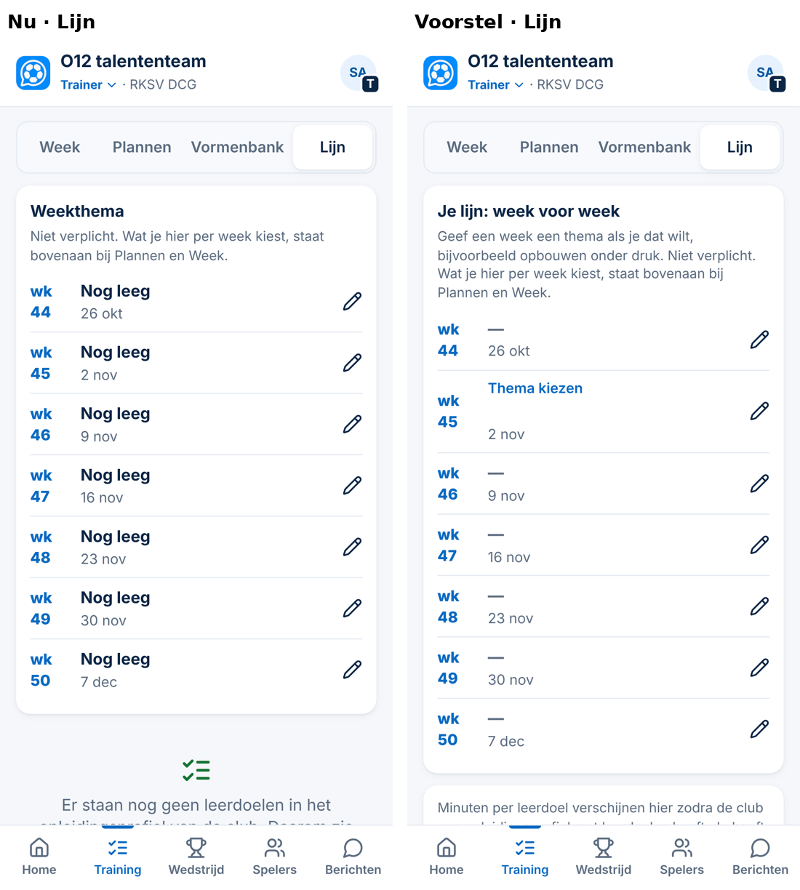
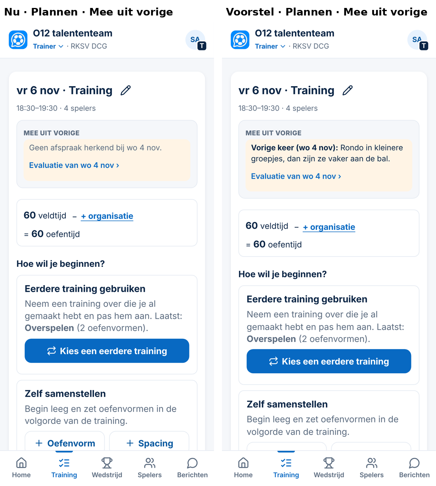
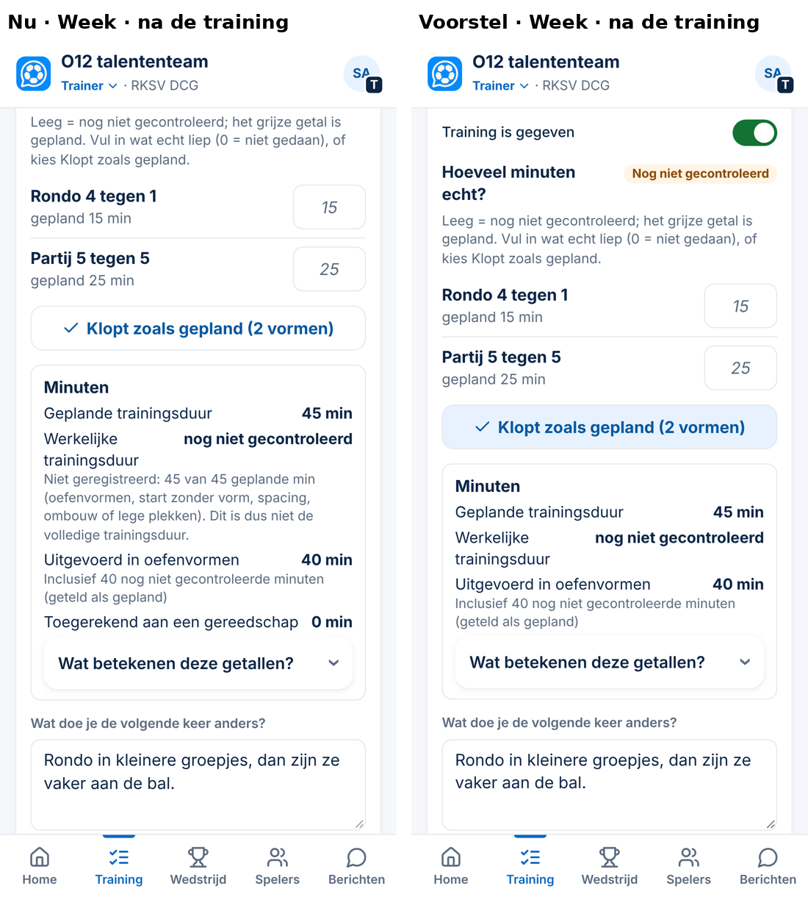
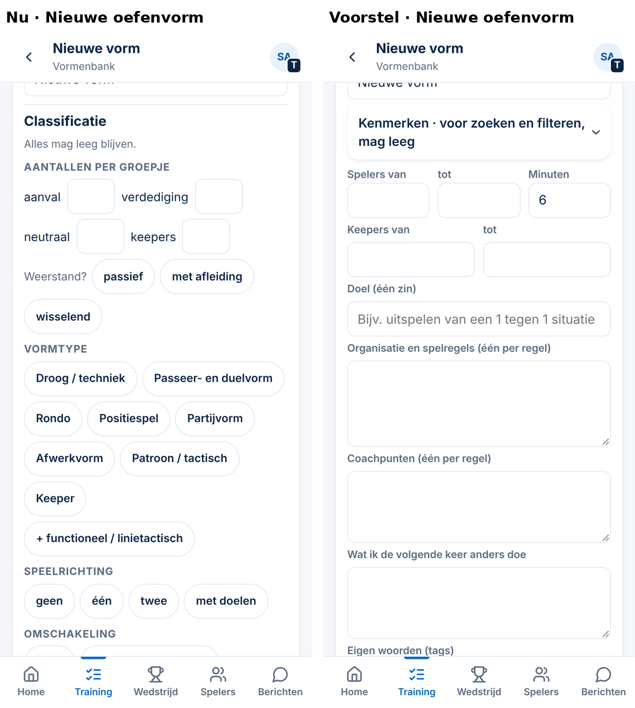

# Voorstel — Lijn en vaktaal bij clubs zonder opleidingsprofiel (Spoor 3, 05-11-2026)

*Alleen een voorstel. Er is niets veranderd aan code, database of productie. De schermen komen uit een tijdelijk prototype met verzonnen gegevens (390 px). Dat prototype staat niet in de repository.*

**Maat: M.** Wat de trainer ziet, verandert, maar alleen bij een club **zonder leerdoelen** in het profiel (zoals Swift nu). Er komt geen nieuw veld, geen migratie, er veranderen geen rechten en er komen geen nieuwe schermen. Na je akkoord komt er een besluit (`Besluit NNN`).

**Bij DCG verandert niets**, behalve bij punt 3, als je voor optie b kiest. Elke andere wijziging hangt aan *"de club heeft geen leerdoelen"*. Krijgt een club later het KNVB-basisprofiel, dan ziet die club vanzelf weer de volle weergave.

## Hoe onderzocht

Elk trainingsscherm is in de app zelf doorlopen als trainer van een club zonder profiel, op 390 px, met verzonnen gegevens:
- Lijn;
- Plannen, leeg en gevuld;
- de kiezer;
- Week na een gegeven training;
- de Vormenbank;
- een nieuwe oefenvorm.

Daarna is per scherm alle tekst verzameld en nagelopen op vaktaal en op informatie die als een taak voelt.

**Toetsregels:**
- Besluit 149, regel 2: *leeg = één zin uitleg en één duidelijke actie, geen "x van y"*.
- Besluit 149, regel 5: *vaktaal alleen met profiel, anders gewone woorden*.
- Besluit 30/34: *informatie is geen taak*.

## Wat er nu schuurt (gezien)

| Scherm | Nu | Probleem |
|---|---|---|
| **Lijn** | 7× *"Nog leeg"*, daaronder *"Er staan nog geen leerdoelen in het opleidingsprofiel van de club…"* | Het voelt als een achterstand, en het noemt iets waar de trainer niets aan kan doen. |
| **Plannen, *Mee uit vorige*** | *"Geen afspraak herkend bij wo 4 nov."*, terwijl de trainer na die training een zin had geschreven | **Fout:** de eigen zin van de trainer wordt niet getoond. Zonder *"Afspraak: …"* aan het begin herkent de app de zin niet. Zonder profiel zijn er ook geen evaluatievragen die het overnemen. |
| **Week, na de training** | *"Niet geregistreerd: 45 van 45 geplande min (oefenvormen, start zonder vorm, spacing, ombouw of lege plekken). Dit is dus niet de volledige trainingsduur."* en *"Toegerekend aan een gereedschap 0 min"* | Vaktaal (*gereedschap*), en een getal dat zonder profiel altijd 0 is. Het leest als een fout. |
| **Nieuwe oefenvorm** | Een open blok *Classificatie*, boven *Doel*, *Organisatie* en *Coachpunten*: *Weerstand? passief / met afleiding / wisselend*, *Vormtype*, *+ functioneel / linietactisch*, *Speelrichting*, *Omschakeling* | Veel vaktermen staan vooraan. Een beginner zoekt eerst: naam, wat doen ze, regels, coachpunten. |

**Wat al goed is en blijft:**
- *Hoe wil je beginnen?* met de uitleg van *Spacing* (Besluit 150);
- *veldtijd − organisatie = oefentijd* (Besluit 142);
- de kiezer met *Aanbevolen voor deze plek · geen verplichting*;
- *Alles mag leeg blijven*.

## Voorstel (vier kleine aanpassingen, alleen zonder leerdoelen)

| # | Waar | Voorstel |
|---|---|---|
| 1 | **Lijn** | Kop **"Je lijn: week voor week"** met één zin: *"Geef een week een thema als je dat wilt, bijvoorbeeld opbouwen onder druk."* Alleen **deze week** krijgt een rustige link **Thema kiezen**; andere weken tonen **—** in plaats van *"Nog leeg"*. Onderaan een informatieregel: *"Minuten per leerdoel verschijnen hier zodra de club een opleidingsprofiel met leerdoelen heeft. Je hoeft daar zelf niets voor te doen."* Geen kleur, geen telling en geen signaal. Dit is het ontwerp uit de UX-audit (bijlage A), dat op 04-11 als ontwerp akkoord was. |
| 2 | **Week, Minuten** | Zonder leerdoelen vervallen de regel *"Toegerekend aan een gereedschap"*, de zin *"Niet geregistreerd …"* en hun uitleg. Er blijven over: geplande duur, werkelijke duur en *Uitgevoerd in oefenvormen*. |
| 3 | **Plannen, *Mee uit vorige*** | Zonder leerdoelen staat er: **"Vorige keer (wo 4 nov): [de eigen zin]"**. Is er geen zin, dan staat er **niets** (geen *"Geen evaluatie"*). **Keuze voor DCG:** (a) DCG blijft zoals nu, of (b) ook bij DCG staat de eigen zin er, als er geen *Afspraak:* wordt herkend. Nu staat daar *"Geen afspraak herkend"*. |
| 4 | **Nieuwe oefenvorm** | Zonder leerdoelen staat *Classificatie* ingeklapt, onder de naam **"Kenmerken · voor zoeken en filteren, mag leeg"**. Daardoor staan *Spelers*, *Minuten*, *Doel*, *Organisatie* en *Coachpunten* bovenaan. Er gaat niets weg en de kiezer blijft werken. |

## Voorbeelden op 390 px (nu → voorstel)

**Opgemerkt in het prototype:** in Lijn staat de link *Thema kiezen* op een eigen regel boven de datum. Bij het bouwen zet ik hem in de regel, zodat de rij net zo hoog blijft als de andere.

## Gegevens en wat niet verandert

- **Geen gegevens veranderen.** Het gaat alleen om wat er getoond wordt. Weekthema's, trainingen, minuten en oefenvormen blijven zoals ze zijn.
- **Clubs met leerdoelen (DCG):** alles blijft zoals nu, behalve bij keuze 3b.
- **Afgewezen ideeën** gecontroleerd op *Lijn, classificatie, vormtype, minuten*:
  - Lijn wordt **niet verborgen**. Het tabblad blijft (Besluit 122/141); alleen de lege toestand verandert.
  - Er komt **geen** extra registratie van minuten achteraf (afgewezen bij Besluit 142); dit voorstel haalt juist registratietekst weg.
  - De lijst vormtypes blijft gelijk (Besluit 131).

## Normen

- Bestaande knoppen en tekststijlen.
- Leestekst 16 px, waar die al 16 px was.
- Geen horizontaal scrollen op 390 px.
- De link *Thema kiezen* krijgt het tikvlak van de hele rij (44 px of meer).

## Voordelen en nadelen

**Voordelen**
- Een beginner ziet geen begrippen die bij een profiel horen dat de club niet heeft.
- Er staat niets meer dat als een achterstand voelt.
- De eigen zin van vorige keer komt weer terug. Die fout raakt nu elke club zonder profiel.
- Er komt geen nieuw scherm bij; DCG merkt niets, behalve bij 3b.

**Nadelen**
- Twee weergaven (met en zonder leerdoelen) betekent iets meer om te testen. Dat vang ik af met tests voor beide.
- Wie zonder profiel toch wil classificeren, tikt één keer extra om *Kenmerken* te openen.

## Advies

**Doen**, alle vier, in één pull request. Bij punt 3 adviseer ik **b**: ook bij DCG de eigen zin tonen in plaats van *"Geen afspraak herkend"*. Daar gaat niets mee verloren.

**Tests:**
- een club zonder profiel: 4 schermen;
- een club met DCG-profiel: ongewijzigd, behalve 3b;
- *Mee uit vorige* met en zonder eigen zin;
- de kiezer werkt met een ingeklapte classificatie.

Alles op 390 en 1366 px.

## Wat ik van je nodig heb

1. Akkoord op de vier aanpassingen.
2. Bij punt 3: **a** (alleen zonder profiel) of **b** (ook bij DCG, mijn advies).
