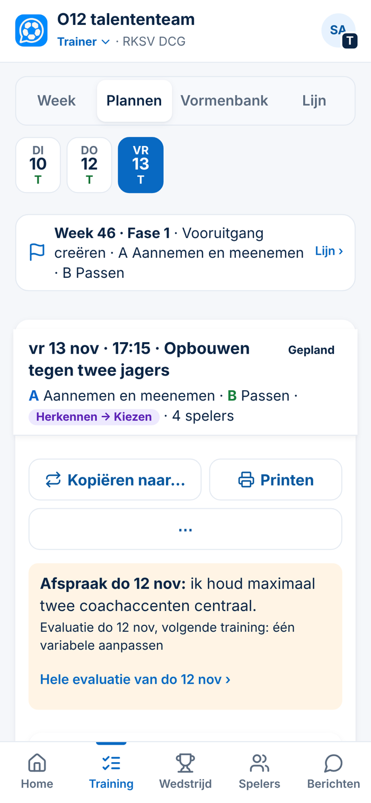
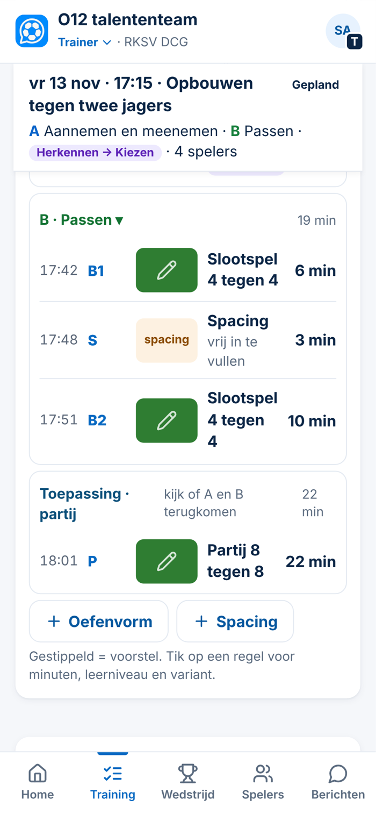
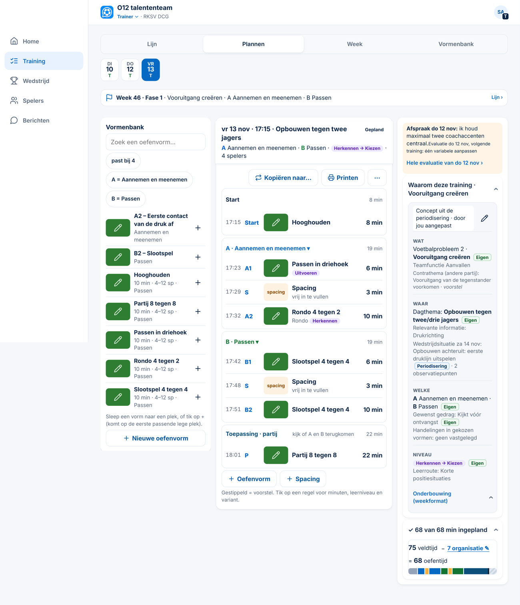

# Onderzoek — minder klikken: welke techniek waar? + voorbeeld voorstel 2 (Spoor 3, 05-11-2026)

*Alleen onderzoek en voorbeelden. Er is niets veranderd aan code, database of productie. Gemeten in de echte app (stand van `main` na #148). Er zijn twee bronnen:*
- *de voorbeeldclub van de app (`?demo`): vier accounts, alle rollen en tabbladen, verzonnen namen;*
- *het tabblad Training met een DCG-achtige week. De voorbeeldclub heeft de trainingsmodule niet aan.*

*Telefoon 390 × 844 px, laptop 1366 × 900 px. "Zonder scrollen" = de woorden die je ziet zonder te scrollen, boven de menubalk.*

**Afgewezen ideeën gecontroleerd** (op *hamburger, swipe, carrousel, wizard, kruimelpad, dashboard, tegel, menu, volledig scherm*):
- *Tijdsrapportages of dashboards over werkelijke minuten* (Besluit 142) is afgewezen. Daarom stel ik geen dashboard met tegels voor.
- *Animaties op het tactiekbord* (Besluit 121) is afgewezen. Dat is iets anders dan de veldmodus bij voorstel F, die alleen bestaande tekeningen achter elkaar toont.

---

## 1. Hoeveel staat er op een pagina? (telefoon)

| Rol | Pagina | Woorden | Zonder scrollen | Knoppen | Schermen |
|---|---|---|---|---|---|
| Ouder | Home | 99 | 95 | 8 | 1,1 |
| Ouder | Planning | 121 | 75 | 0 | 1,5 |
| Ouder | Taken | 142–170 | 81–101 | 16–19 | 1,7–1,8 |
| Trainer | Home | 116 | 71 | 6 | 1,4 |
| Trainer | **Training → Week** | 132 | ± 80 | 26 | 1,8 |
| Trainer | **Training → Plannen** (na #148) | 220 | ± 75 | ± 40 | 2,7 |
| Trainer | Wedstrijd | 158 | 91 | 3 | 1,4 |
| Trainer | Spelers | 95 | 60 | 2 | 1,6 |
| Teamleider | Wedstrijd | 135 | **44** | 15 | 1,4 |
| Teamleider | Team | 150 | 82 | 23 | 2,3 |
| HJO | Home | 148 | **60** | 5 | 1,9 |
| HJO | Inzicht | 100 | **41** | 42 | 1,9 |
| Beheerder | **Seizoen** | **314** | 67 | 16 | **3,5** |
| Beheerder | **Regels** | 49 | 27 | **91** | 1,5 |
| Beheerder | **Rollen** | 201 | 53 | **101** | **3,2** |
| Iedereen | Berichten | 7–78 | alles | 3–6 | 1,0 |

**Wat dit zegt:**
- **Zonder scrollen past ongeveer 60 tot 100 woorden** op de telefoon. Pagina's tot ± 150 woorden passen in 1 à 2 schermen; daar is weinig winst te halen.
- **Te lang:** Plannen (220 woorden, 2,7 schermen, al korter sinds #148), Seizoen (314 woorden, 3,5 schermen) en Rollen (3,2 schermen).
- **Te veel knoppen:** Regels (91) en Rollen (101). Dat zijn lange lijsten met schakelaars.
- **Weinig bovenaan zichtbaar:** de wedstrijd van de teamleider (44 woorden) en Inzicht (41). Daar staat eerst een kop of filter, en de inhoud begint pas lager.

## 2. Welke pagina's zijn het belangrijkst?

Belangrijk betekent hier: een pagina die mensen **elke week** gebruiken. Het **gewicht** zegt hoe zwaar die pagina telt:
- **hoog**: veel mensen gebruiken hem, en vaak;
- **midden**: minder mensen of minder vaak;
- **laag**: maar een paar keer per seizoen.

| Rol | Pagina's elke week | Gewicht |
|---|---|---|
| **Ouder** (de grootste groep) | Home (afmelden), Planning, Vervoer, Taken | hoog: veel mensen, weinig tijd |
| **Trainer** | Home, **Training → Week** (op het veld), **Plannen** (thuis), Wedstrijd | hoog |
| **Teamleider** | Wedstrijd, Team | midden |
| **HJO en begeleider** | Home, Trainers | midden |
| **Beheerder** | Seizoen, Regels, Rollen | **laag**: vooral bij de start van het seizoen |

**Wat altijd zichtbaar moet zijn, en wat je mag opzoeken:**

| Pagina | Altijd zichtbaar | Opzoeken (één tik) |
|---|---|---|
| Training → Week | welke training, de afspraak, de vormen in volgorde, aanwezigheid | waarom (onderbouwing), vorige evaluatie, een vorm groot |
| Training → Plannen | welke training, A/B en niveau, de opbouw met minuten, een waarschuwing als iets niet klopt | onderbouwing, tijdsbalk, Vormenbank (telefoon) |
| Home (alle rollen) | wat **vandaag** is en wat **actie** vraagt | de rest van de week, het archief |
| Wedstrijd (teamleider) | de eerstvolgende wedstrijd en wat nog open staat | eerdere wedstrijden |
| Seizoen, Regels, Rollen | per onderdeel een samenvatting (*12 teams · 3 trainers missen*) | de lijst zelf |

---

## 3. De technieken: waar wel, waar niet

| Techniek | Wat ClubComm nu heeft | Advies |
|---|---|---|
| **Zijbalk** | Op de laptop al aanwezig (Home, Training, Wedstrijd, Spelers, Berichten). | **Laten zoals het is.** Op de telefoon is de menubalk onderaan beter: één tik, met de duim. |
| **Uitklappen** (accordion) | Veel gebruikt (Kenmerken, Waarom, Tijd, Vormenbank). | **Wel bij Regels en Rollen** (91 en 101 knoppen): per groep ingeklapt met een samenvatting. Ook bij **Seizoen**. |
| **Keuzelijst** (dropdown) | De rol wisselen bovenaan, A/B kiezen (▾). | Laten. Niet gebruiken voor gewone navigatie: een keuzelijst verstopt de keuzes. |
| **Hamburgermenu** | Niet aanwezig. | **Niet invoeren.** Het verstopt pagina's en kost op de telefoon altijd een extra tik. Hooguit later voor zelden gebruikte beheerspagina's (Seizoen, Regels, Rollen samen onder *Inrichten*). Dat hoort bij stap 7 van je volgorde. |
| **Stappenplan** (wizard) | *Stap x van y* in Plannen; de korte evaluatie met vragen. | **Alleen voor eenmalig werk**, zoals een nieuwe club inrichten (seizoen → vakanties → regels → rollen → modules). **Niet** voor dagelijks werk: dan klik je meer. |
| **Carrousel** (vegen) | Niet aanwezig. | **Eén goede plek: tijdens de training** (voorstel F): de vormen van vandaag op volledig scherm, vegen naar de volgende. Niet voor lijsten. |
| **Kruimelpad** (breadcrumbs) | De terugknop en de onderregel in de kop (*Vormenbank*). | **Niet nodig.** De app is hoogstens 2 niveaus diep. |
| **Gesplitst scherm** (lijst links, detail rechts) | Plannen op de laptop heeft drie kolommen, maar de rechter blijft leeg. | **Wel, op de laptop** (voorstel C): Plannen (onderbouwing rechts), later de Vormenbank (lijst links, vorm rechts) en Berichten. Niet op de telefoon. |
| **Tegels** (dashboard) | Home is een lijst met *actie eerst* (Besluit 30 en 34). | **Niet.** Tegels tonen informatie, geen taak (*informatie is geen taak*). Een dashboard over minuten is afgewezen (Besluit 142). |
| **Eén lange pagina met vaste kop** | Nee. | **Wel als vaste kop** in Week en Plannen (voorstel A). Geen springmenu naar secties: de pagina's zijn daar te kort voor. |
| **Inschuifpaneel** | Ja: het venster van onderen (een plek, een vorm, aanwezigheid). | **Laten.** Op de **laptop** liever **van rechts** (voorstel D), zodat de training in beeld blijft. |

---

## 4. De voorstellen (gerangschikt)

| # | Voorstel | Techniek | Wat het scheelt |
|---|---|---|---|
| **A** | **Vaste kop** in Week en Plannen: *vr 13 nov · 17:15 · thema · Gepland*, met daaronder *A … · B … · niveau · 4 spelers*. De kop blijft staan als je scrollt. De losse kop, *Stap x van y* en de tijdregel eronder vervallen. | vaste kop | Nooit meer terugscrollen om te zien welke training of welk gereedschap. A/B staat één keer in beeld. |
| **B** | **Tijdlijn met kloktijden**: *17:23 A1 · Passen in driehoek · 6 min*. | tijdlijn | Op het veld zie je zonder rekenen waar je zou moeten zijn. |
| **C** | **Gesplitst scherm op de laptop**: in het midden de tijdlijn, rechts de afspraak, *Waarom deze training* en de tijd, altijd open. | gesplitst scherm | Op de laptop 0 tikken voor de onderbouwing (nu 1). De lege kolom wordt gebruikt. |
| D | **Inschuifpaneel van rechts op de laptop** voor *vorm bekijken* en *plek*. | inschuifpaneel | De training blijft zichtbaar naast de vorm. |
| E | **Beheer ingeklapt per groep**: Regels, Rollen, Seizoen, met een samenvatting per groep. | uitklappen | Van 91 en 101 knoppen naar ± 10 regels. Rollen gaat van 3,2 naar ± 1 scherm. |
| F | **Veldmodus**: in Week één knop *Op het veld* met de vormen op volledig scherm. Je veegt naar de volgende vorm; de kloktijd en de coachpunten staan erbij. | carrousel | Per vorm 1 veeg in plaats van openen en sluiten (2 tikken). Op het veld bedien je het met één hand. |

**Niet doen:** hamburgermenu, kruimelpad, tegels op Home, een stappenplan voor dagelijks werk.

---

## 5. Voorbeeld voorstel 2 = A + B + C (390 en 1366 px)

**Telefoon, bovenaan:** de vaste kop vervangt de oude kop. *Kopiëren*, *Printen* en ⋯ blijven.

**Telefoon, gescrold naar B:** de kop blijft staan. Elke plek heeft een kloktijd.

**Laptop:** links de Vormenbank, in het midden de tijdlijn, rechts de afspraak, de onderbouwing en de tijd, open en onder elkaar.

**Gemeten.** Op de telefoon blijft het aantal woorden gelijk (± 190): voorstel 2 haalt niets weg, het ordent. Wat het oplevert:
- je ziet altijd welke training en welk gereedschap;
- je hebt de kloktijd;
- op de laptop zie je alles zonder tikken.

**Gezien bij het maken:**
- **Kloktijden en organisatie:** de tijden tellen nu vanaf 17:15 zonder de 7 minuten organisatie. De partij begint om 18:01 en eindigt om 18:23, terwijl de training tot 18:30 duurt. Waar die 7 minuten vallen (begin, tussendoor of eind), weet ClubComm niet. *Vraag aan jou.*
- **Laptop:** de weekbalk bovenaan noemt A en B ook nog. In Plannen zou die op de laptop kunnen vervallen, want de vaste kop zegt het al.
- In de smalle rechterkolom staan de koppen (*Wat*, *Waar* …) **boven** de tekst, niet ernaast. Anders wordt het te smal.

**Normen:**
- De vaste kop is ± 90 px hoog op de telefoon (twee regels).
- Tekst 15–17 px, contrast als de rest van de app, geen horizontaal scrollen.
- *Beperk beweging*: de vaste kop beweegt niet.

**Voordelen:**
- De kop is in Week en Plannen gelijk; je leert hem één keer.
- Kloktijden helpen op het veld.
- Op de laptop is de lege kolom nu nuttig.

**Nadelen:**
- De vaste kop kost op de telefoon ± 90 px van het scherm.
- De kloktijden zijn een benadering (ombouw, uitloop).
- Op de laptop is de rechterkolom smal voor de lange onderbouwing.

## Advies

1. **Bouw A + B + C samen** (voorstel 2, één pull request), zodra je de vraag over de kloktijden hebt beantwoord.
2. Daarna **F (veldmodus)**: voor de trainer op het veld levert die het meest op. Ik maak eerst een voorbeeld.
3. **E (beheer ingeklapt)** hoort bij stap 7 van je volgorde (*Begeleiding, Inrichten en Rollen*). Niet nu.
4. **D** pas als C bevalt.

## Wat ik van je nodig heb

1. Akkoord om voorstel 2 (A + B + C) te bouwen zoals in de voorbeelden.
2. **Kloktijden:** (a) vanaf de begintijd, zonder organisatie (zoals in het voorbeeld); (b) de organisatie eerst (17:22 Start); of (c) geen kloktijden.
3. Mag de weekbalk in Plannen op de laptop weg, nu de vaste kop A en B noemt?
4. Welke van D, E en F wil je later uitgewerkt zien?
