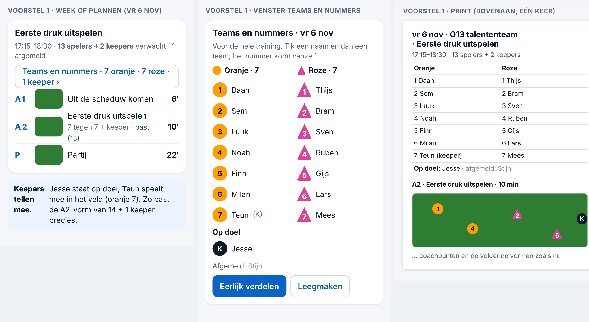
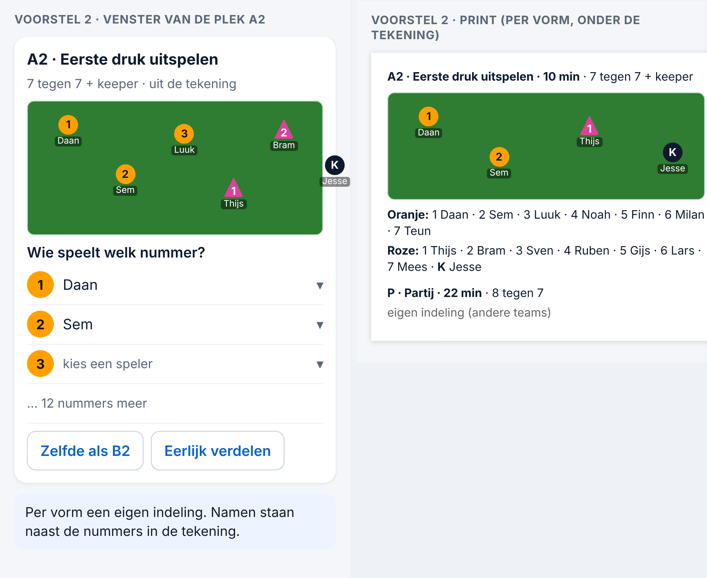
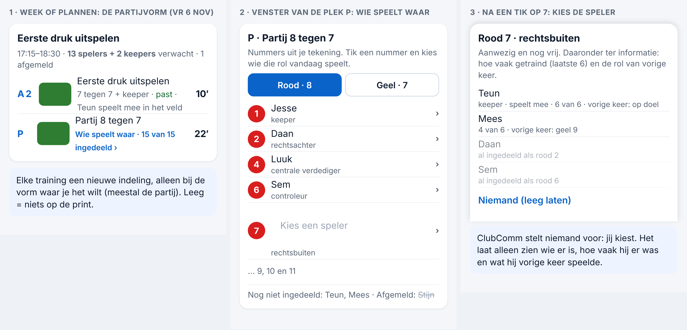
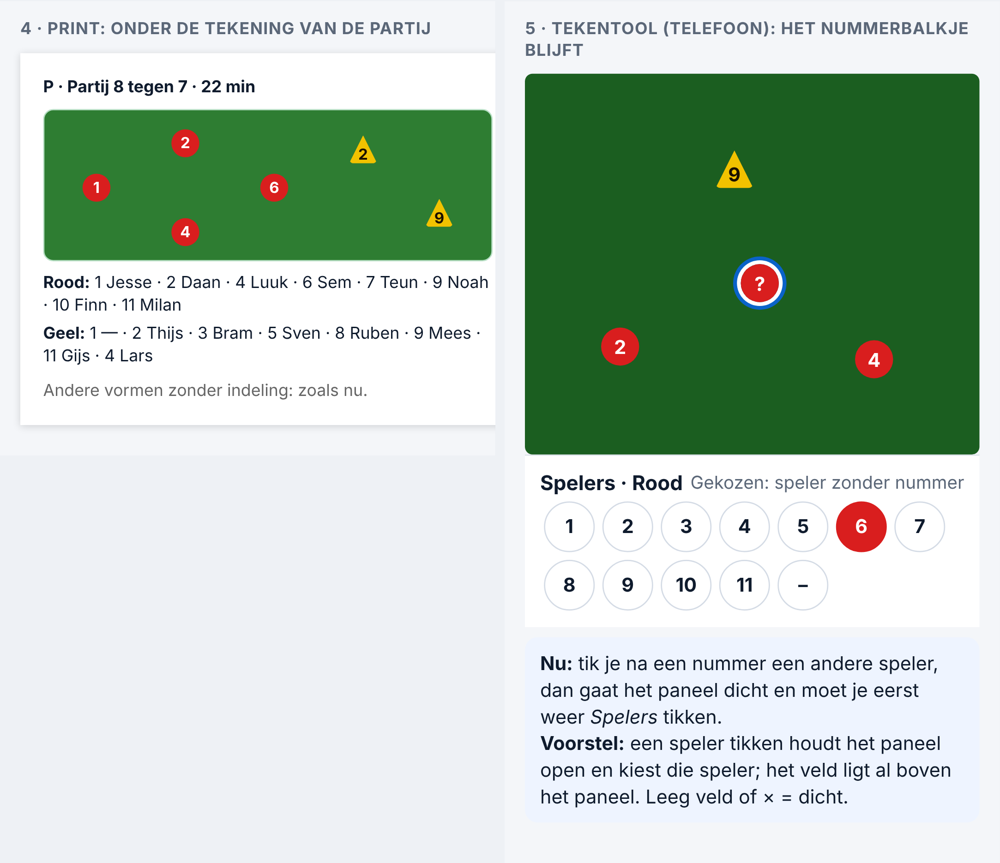

# Voorstel — namen aan nummers koppelen, en keepers meetellen (Spoor 3, 06-11-2026)

*Alleen onderzoek. Er is niets veranderd aan code, database of productie. De productiedatabase is alleen gelezen. De voorbeelden zijn getekend op 390 px, met verzonnen namen.*

**Maat: L.** Er komt een koppeling bij tussen een speler (een kind) en een nummer en teamkleur per training. Dat zijn persoonsgegevens. Zie *Privacy* hieronder.

**Afgewezen ideeën gecontroleerd** (op *nummer, namen, indeling, keeper, kleur*):
- *Shirtjes met cijfers in de tekening* (Besluit 132) is afgewezen. Dit voorstel doet dat niet: de nummers blijven in de rondjes en driehoeken van de tekentool (Besluit 124, 148 en 156).
- Verder is er niets afgewezen dat hierover gaat.

---

## 1. Waarom de app "past niet" zegt bij de A2-vorm (gezien op vr 06-11)

**Wat er in de database staat** (alleen gelezen):
- O13 heeft **16 spelers, waarvan 2 keepers** (positie *keeper*).
- Op vr 06-11 heeft **1 speler** zich afgemeld. Er worden er dus **15** verwacht.
- De A2-vorm *Eerste druk uitspelen* is gemaakt voor **14 spelers + 1 keeper** (7 tegen 7 + keeper), samen dus 15.

**Wat de app doet:**
- Hij telt **15 spelers**: iedereen die niet afgemeld is, de keepers ook.
- Die 15 vergelijkt hij met **14 veldspelers**. De keeper van de vorm telt hij daarbij niet mee.
- Uitkomst: 15 > 14, dus **past niet**. Dat klopt niet.

**Wat er echt gebeurt:**
- Er zijn 13 veldspelers en 2 keepers.
- Eén keeper staat op doel, de andere speelt mee in het veld.
- Dat is 14 + 1 = 15. **Het past precies.**

**Wat er dus mis is:** de app telt niet apart hoeveel keepers er zijn, en hij weet niet dat een keeper ook mag meevoetballen.

**De oplossing** zit in allebei de voorstellen hieronder:
- Uit de aanwezigheid telt de app **veldspelers en keepers apart**: *13 spelers + 2 keepers verwacht*. Wie zich afmeldt, telt niet mee; een keeper die zich niet afmeldt, is er gewoon.
- Een vorm **past** als het totaal klopt (veldspelers + keepers). Er moeten ook genoeg keepers zijn voor het doel.
- Zijn er **meer keepers** dan de vorm nodig heeft, dan **speelt de extra keeper mee in het veld**. De app zegt dat in één zin (*Teun speelt mee in het veld*). Er volgt geen waarschuwing.
- Zijn er **minder keepers** dan nodig, dan zegt de app *geen keeper aanwezig: een veldspeler gaat op doel*.

## 2. Namen aan nummers koppelen — twee voorstellen

### Voorstel 1 — één indeling per training (aanbevolen)

- **Waar:** in Week en in Plannen staat één knop onder de kop van de training: **Teams en nummers · 7 oranje · 7 roze · 1 keeper ›**.
- **Het venster:**
  - de aanwezige spelers in twee kolommen per teamkleur, in dezelfde kleuren en vormen als de tekentool (oranje rondje, roze driehoek);
  - **Op doel** apart;
  - afgemelde spelers staan doorgestreept onderaan.
- **Indelen:** tik een naam en dan een team; het nummer komt vanzelf (1, 2, 3 …). **Eerlijk verdelen** maakt in één tik twee gelijke teams. **Leegmaken** begint opnieuw.
- **Voor de hele training:** dezelfde nummers in A2, B2 en de partij. Je noemt ze één keer op bij het wegzetten.
- **Print:** bovenaan het printblad komt één tabel (*Oranje 1 Daan … · Roze 1 Thijs … · Op doel: Jesse*). Daaronder volgen de vormen met hun tekening, zoals nu.
- **Telt mee:** het aantal in de kop en *past / past niet* gebruiken deze indeling als die er is. Anders gebruiken ze de aanwezigheid.

**Voordelen:**
- Eén keer indelen per training.
- Je ziet het in één venster en het staat één keer op de print.
- Het werkt ook zonder tekening.

**Nadelen:**
- Wil je per vorm andere teams, dan kan dat niet. Je past dan de indeling tussendoor aan.

### Voorstel 2 — per vorm, gekoppeld aan de tekening

- **Waar:** in het venster van de plek (bijvoorbeeld A2): **Wie speelt welk nummer?**. Per nummer uit de tekening kies je een speler. Daarbij staan de knoppen **Zelfde als B2** en **Eerlijk verdelen**.
- **In de tekening** staat de naam klein onder het nummer.
- **Print:** onder elke tekening staat de lijst *Oranje: 1 Daan · 2 Sem …*.

**Voordelen:**
- Per vorm andere teams.
- De namen staan precies op de plek in de tekening.

**Nadelen:**
- **Veel meer werk:** per vorm 15 keer kiezen.
- Het werkt alleen als de tekening nummers heeft.
- Namen in de tekening worden snel te klein op de telefoon.
- **Bouwwerk:** de tekentool, de print en het venster van de plek moeten alle drie aangepast worden.

## 3. Privacy (maat L)

- **Welke gegevens:** per training de koppeling *speler → kleur en nummer*, en *op doel*. Er komen geen nieuwe persoonsgegevens bij: namen, keeperpositie en aanwezigheid staan al in ClubComm.
- **Wie ziet het:** wie de training nu al ziet. Dat zijn de trainer zelf (scope *eigen*) en, als meekijken aan staat, de begeleider (Besluit 159). Ouders zien het niet. De rechten veranderen niet.
- **Waar het wordt opgeslagen:** in de bestaande training (`trainingsplannen`), dus geen nieuwe tabel en geen migratie.
- **Hoe lang:** zo lang als de training bewaard blijft. Bij het opschonen na het seizoen gaat de indeling mee.
- **De print:** daar staan namen op. Dat is nu al zo bij de aanwezigheid. Het blad hoort bij de trainer en wordt niet gedeeld.
- **Vóór het bouwen:** een rechtentest dat een andere trainer of een ouder de indeling niet kan lezen. Dat het lijkt te kloppen is niet genoeg; het moet echt getest zijn.

## Advies

1. **Eerst het tellen van de keepers** (deel 1). Dat is een kleine fout met grote gevolgen: elke vorm met keeper geeft nu ten onrechte *past niet*. De gegevens veranderen niet.
2. **Daarna voorstel 1** (één indeling per training). Daarmee doe je precies wat je beschrijft: vóór de training indelen, opnoemen bij het wegzetten en het op de print hebben. En het is het minste werk.
3. **Voorstel 2 niet nu.** Kijk na een paar weken met voorstel 1 of je per vorm echt andere teams wilt.

## Wat ik van je nodig heb

1. Akkoord om eerst het tellen van de keepers te herstellen (maat M, geen gegevens).
2. Voorstel 1 of 2 (mijn advies: 1).
3. Moet *Eerlijk verdelen* rekening houden met iets? Bijvoorbeeld keepers verdelen, of niet steeds dezelfde spelers bij elkaar.

---

## Aanvulling 06-11: elke training een andere indeling (gekozen richting)

**Wat de initiatiefnemer zei:**
- Elke training ziet er in de grote partijvorm anders uit. Spelers spelen en trainen verschillende posities.
- Wie welke rol krijgt, hangt af van de aanwezigheid en van de posities die iemand kan spelen.
- Een nummer hoort dus niet vast bij een speler: elke speler vult **die week** een rol in. Het gaat vooral om de partijvorm.

Daarom vervalt voorstel 1 (*één vaste indeling per training voor alle vormen*). In de plaats komt:

**Wie speelt waar — per training, bij de vorm waar je het wilt (meestal de partij)**

1. **Week of Plannen:** onder de plek P staat *Wie speelt waar · 15 van 15 ingedeeld ›*. Een vorm zonder indeling toont niets extra.
2. **Venster van de plek:**
   - de nummers **uit de tekening** van die vorm, per teamkleur (*Rood · 8*, *Geel · 7*);
   - bij elk nummer de rol uit de 1-4-3-3 (*2 rechtsachter, 7 rechtsbuiten …*) en de gekozen speler;
   - onderaan *Nog niet ingedeeld* en de afgemelde spelers.
3. **Tik een nummer:** je ziet de aanwezige, nog vrije spelers. Per speler staat ter informatie hoe vaak hij de laatste 6 keer trainde en welke rol hij vorige keer had. Een keeper staat er ook bij (*speelt mee*). **ClubComm stelt niemand voor; jij kiest.** *Niemand* laat het nummer leeg.
4. **Print:** onder de tekening van die vorm staat de lijst *Rood: 1 Jesse · 2 Daan …*. Vormen zonder indeling blijven zoals nu.

**Posities die een speler kan spelen:** daarvoor staat nu niets in ClubComm, alleen *keeper*. Dat voegen we niet toe: de trainer weet het, en de rol van vorige keer en de aanwezigheid staan erbij. Een nieuw gegeven per speler kan later, met een eigen besluit.

**Het nummerbalkje in de tekentool**

- **Nu:** kies je met het paneel *Spelers* open een andere speler op het veld, dan gaat het paneel dicht. Elke tik op het veld sluit eerst het menu (Besluit 152). Je moet dan opnieuw *Spelers* tikken.
- **Voorstel:** een **speler** tikken houdt het paneel *Spelers* open en kiest die speler. Het volgende nummer gaat dan direct naar hem. Op de telefoon ligt het veld al boven het paneel (Besluit 156). Een tik op een **leeg** stuk veld of op × sluit het paneel, zoals nu, en zet niets neer (Besluit 152 blijft).

**Bouwen (akkoord van de initiatiefnemer, 06-11)**, in twee pull requests:
1. **Keepers meetellen** (deel 1 hierboven) en **het nummerbalkje blijft open**. Maat M, geen gegevens.
2. **Wie speelt waar** per plek, met de print. Maat L: de rechtentest wordt vooraf gedraaid. De gegevens staan in de bestaande training, er komt geen migratie en de rechten veranderen niet.
