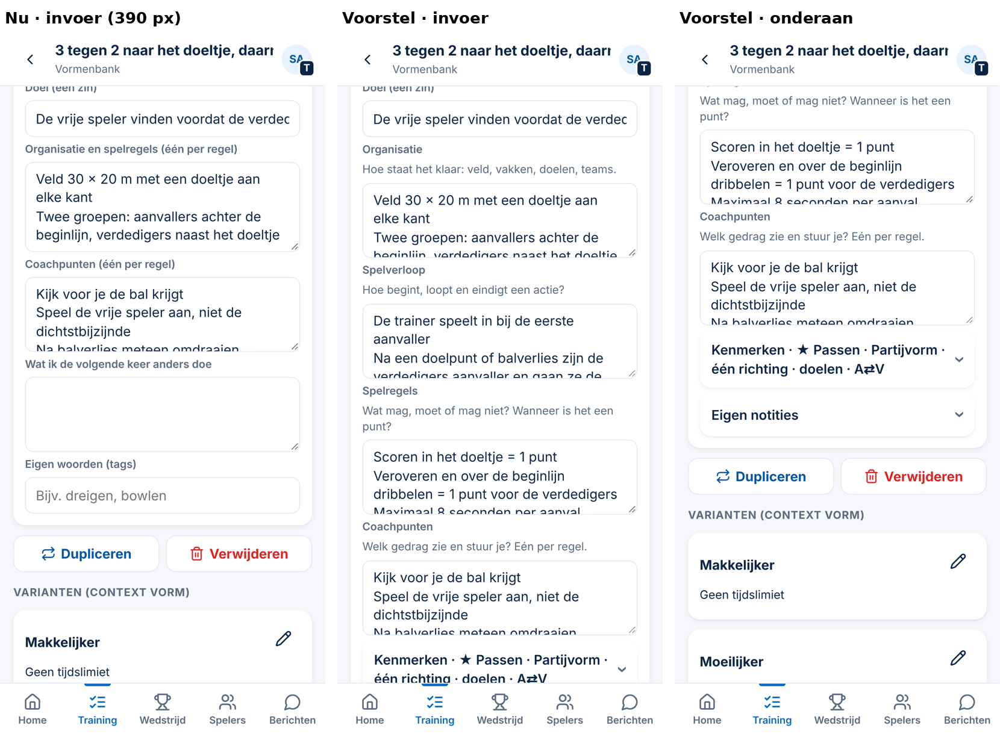
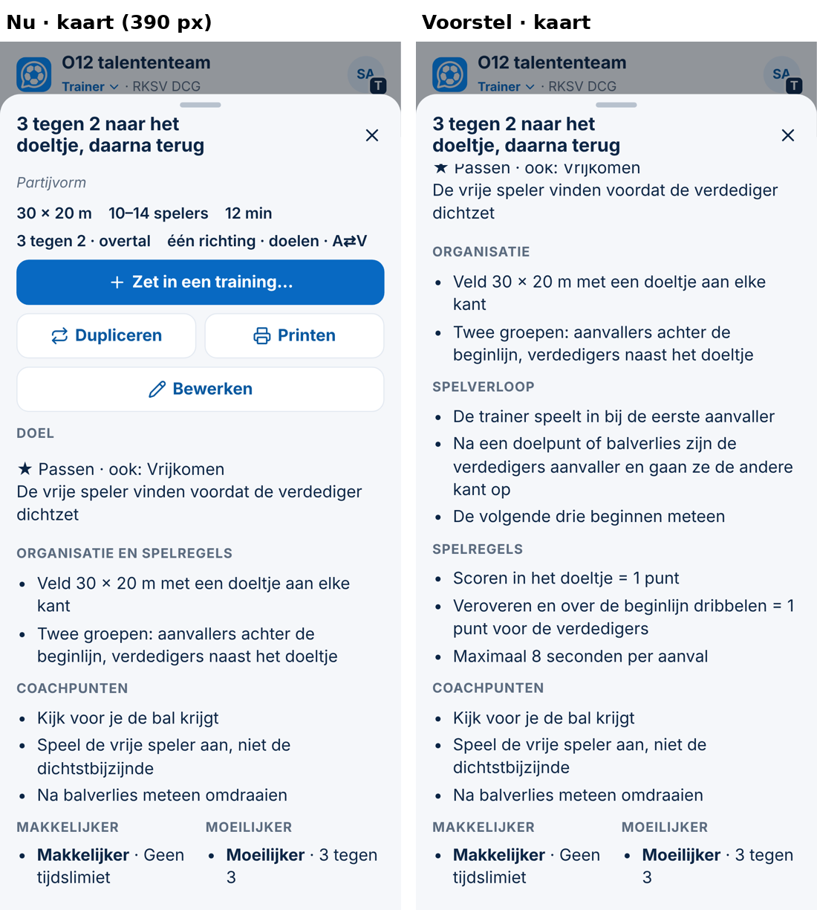
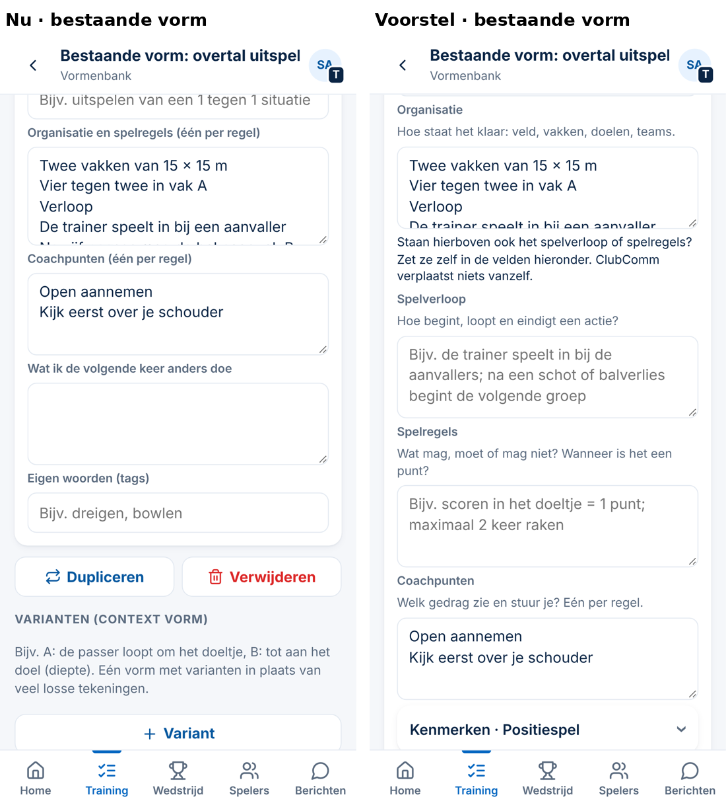
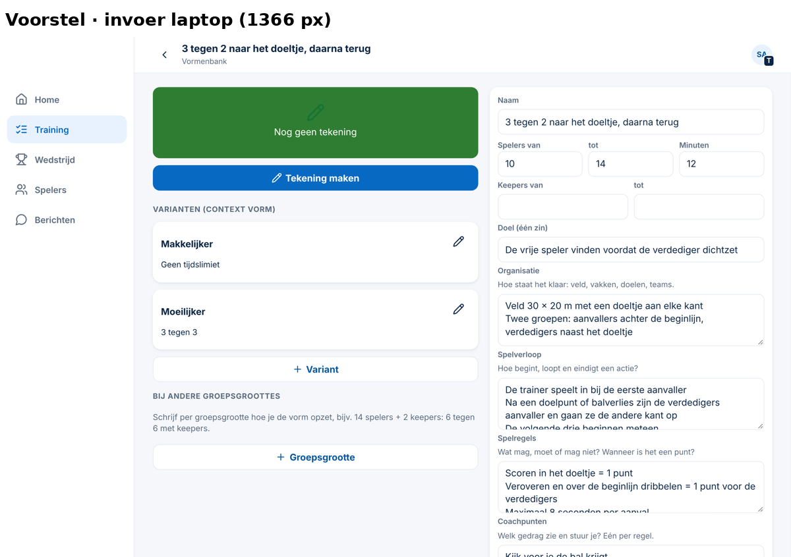
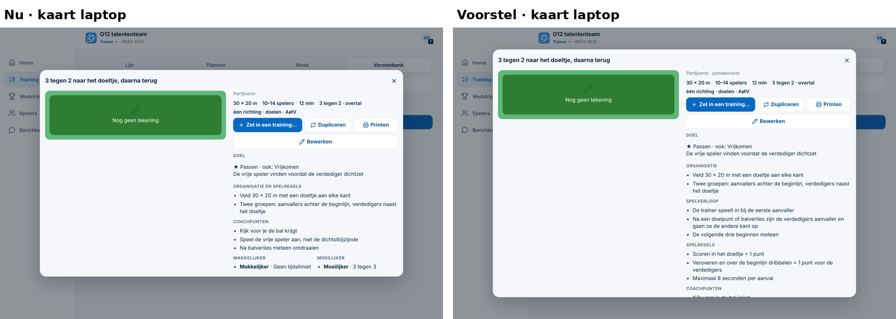

# Voorstel — invoer van een oefenvorm: organisatie, spelverloop, spelregels en coachpunten apart; schakelvorm (Spoor 3, 05-11-2026)

*Alleen een voorstel. Er is niets veranderd aan code, database of productie. De database is alleen gelezen: aantallen en een paar regels van eigen DCG-vormen, om het gebruik te toetsen. De schermen komen uit een tijdelijk prototype met **verzonnen** oefenvormen, op 390 en 1366 px; dat prototype staat niet in de repository. Er zit geen DCG-inhoud of DCG-begrip in de software: de namen van gereedschappen en leerdoelen blijven uit het clubprofiel komen.*

**Maat: M.** Het invoerscherm en de kaart van een oefenvorm veranderen, voor alle clubs. Er komt geen migratie, er veranderen geen rechten en er komt geen nieuw scherm. Na je akkoord komt er één besluit (`Besluit 164`), dat Besluit 131 en 132 deels herziet.

## 1. Bestaande situatie

### Gewenste onderdelen tegenover wat er nu is

| Onderdeel | Nu | Waar |
|---|---|---|
| Naam | ✅ | bovenaan het formulier |
| Classificatie: hoofd- en ondersteunend gereedschap | ✅ per clubprofiel (★ = hoofd, + = ook), naam uit het profiel | blok *Classificatie* |
| Vormtype | ✅ 8 hoofdtypes (+ *Meer precies*), Besluit 131 | *Classificatie* |
| Speelrichting | ◐ *geen · één · twee* + *met doelen*; **meerdere richtingen ontbreekt** | *Classificatie* |
| Afmetingen, aantal spelers | ✅ afmeting, spelers van–tot, keepers, aantallen per groepje (weerstand) | verspreid: afmeting en aantallen in *Classificatie*, spelers eronder |
| Doel | ✅ één zin, plus het hoofdgereedschap | formulier |
| **Organisatie** | ◐ **samen met spelregels in één veld** *"Organisatie en spelregels"* | formulier |
| **Spelverloop** | ✖ **geen eigen veld** | belandt in *Organisatie* of *Coachpunten* |
| **Spelregels** | ◐ in hetzelfde veld als organisatie | formulier |
| Coachpunten | ✅ één per regel | formulier |
| Methodische aanpassingen | ✅ varianten met de richting *makkelijker / moeilijker* (de kaart toont ze apart), en *Als de vorm vastloopt* (alleen met profiel). Maar de kop heet *"Varianten (context vorm)"* | aparte kolom |
| Tekening | ✅ | links |

**Volgorde nu:** Naam → het open blok *Classificatie* (veel keuzes en vaktaal) → spelers → Doel → *Organisatie en spelregels* → Coachpunten → notities. Een beginner ziet dus eerst de vakkenmerken, en pas daarna wat hij moet weten om de vorm neer te zetten.

### Wat het echte gebruik laat zien (DCG, 18 benoemde vormen, alleen gelezen)

| Veld | Regels | Lijkt op spelregel | Lijkt op spelverloop | Kopjes in de tekst |
|---|---|---|---|---|
| Organisatie en spelregels | 178 | ± 13 | ± 24 | 5 vormen (bijvoorbeeld een kopje *Verloop* midden in het veld) |
| Coachpunten | 158 | 0 | 5 (bij nalezen echte coachpunten, zoals *"…daarna versnellen"*) | 1 vorm (*"Aanvallende ploeg:"*) |

**Conclusie:** in de opgeslagen vormen zit de vermenging vooral in het veld **Organisatie en spelregels**. Daar staan organisatie, spelverloop en spelregels door elkaar, soms met een eigen kopje. Coachpunten zijn bijna overal echte coachpunten. Dat spelverloop in *Coachpunten* belandt, zoals jij merkt bij het invoeren, past bij dezelfde oorzaak: **er is geen plek voor spelverloop.** Dat is dus het echte gat.

## 2. Gewenste veldstructuur: compacte basis, de rest uitklapbaar

**Geen enkel veld wordt verplicht** (Besluit 149). Elk veld krijgt een korte vraag als uitleg en een voorbeeld.

| Deel | Velden | Open of dicht |
|---|---|---|
| **Basis** | Naam · Tekening · Spelers van–tot · Minuten · Keepers · **Afmeting** (hierheen verplaatst) · **Doel** *(Welk voetbalgedrag moet beter?)* · **Organisatie** *(Hoe staat het klaar: veld, vakken, doelen, teams)* · **Spelverloop** *(Hoe begint, loopt en eindigt een actie?)* · **Spelregels** *(Wat mag, moet of mag niet? Wanneer is het een punt?)* · **Coachpunten** *(Welk gedrag zie en stuur je? Eén per regel)* | altijd open |
| **Kenmerken** | gereedschap / leerdoel (uit het profiel) · aantallen en weerstand · vormtype · speelrichting · **schakelen** · (met profiel) leerniveau, fase, uitgebreid | **ingeklapt**, met een **samenvatting in de kop**, bijv. *"Kenmerken · ★ Passen · Partijvorm · één richting · doelen · A⇄V"* |
| **Makkelijker, moeilijker en varianten** | de bestaande varianten met richting, en groepsgroottes | dezelfde plek; alleen de kop wordt duidelijker (nu *"Varianten (context vorm)"*) |
| **Eigen notities** | *Wat ik de volgende keer anders doe* · eigen woorden (tags) | ingeklapt |

**Eén uitzondering voor clubs met een profiel:** heeft een vorm nog **geen hoofdgereedschap**, dan staat *Kenmerken* open. Het hoofdgereedschap bepaalt namelijk de minuten in Lijn (Besluit 131/147). Is het gekozen, dan staat het in de samenvatting.

**Afgewogen: één lang formulier tegenover een compacte basis met uitklappen.**
- *Eén formulier:* alles in één keer zichtbaar, maar op 390 px ± 3 schermhoogtes, met de vaktaal vooraan.
- *Compacte basis:* de vragen die elke trainer zich stelt staan bovenaan. Kenmerken zijn één tik verder, en de samenvatting laat zien wat er al gekozen is.
- **Advies: de compacte basis.** Hij past bij Besluit 149 (*aanbieden, niet verplichten*) en bij het voorstel *Lijn en vaktaal*. Daar was punt 4 *"classificatie inklappen zonder profiel"*. **Dat punt vervalt dan**, omdat dit ontwerp het voor alle clubs regelt. Zo komen er geen twee varianten van hetzelfde formulier.

## 3. Vormtype *Schakelvorm*

**Huidige afspraak (Besluit 131, bewust):** *"schakelvorm is geen type maar een kenmerk"*. In de app is dat het kenmerk **Omschakeling: geen · aanval → verdediging · verdediging → aanval · beide**. Onder *Meer precies* staat daarnaast *Stroom- en golfvorm* (bij *Patroon / tactisch*).

**Jouw definitie:** *spelers schakelen tijdens opeenvolgende acties, of na een wisseling van balbezit, snel tussen rollen, spelrichtingen of aanvallen en verdedigen.*

| Optie | Wat | Overlap / gevolg |
|---|---|---|
| **A. 9e hoofdtype *Schakelvorm*** | naast Partijvorm, Rondo enz. | **Veel overlap:** een schakelvorm is meestal ook een partij-, duel- of positievorm. Bij één keuze gaat dan informatie verloren (de weerstand, de kiezer en de filters rekenen met het type). Herziet Besluit 131. |
| **B. Kenmerk *Schakelen* zichtbaar maken (advies)** | het blok *Omschakeling* heet **Schakelen (schakelvorm)**; nieuwe keuze **wisselende rollen of richtingen** naast *na balverlies / balwinst / beide*; staat er iets anders dan *geen*, dan staat er **schakelvorm** in de soortregel van de kaart en de print (*"Partijvorm · schakelvorm"*); zoeken op *schakelvorm* vindt de vorm | **geen overlap:** het type blijft de aard van de vorm, schakelen is een eigenschap. Bestaande waarden blijven geldig. Past binnen Besluit 131. |

**Advies: B.** Het woord *Schakelvorm* wordt zichtbaar en vindbaar, zonder dat een trainer moet kiezen tussen *partijvorm* en *schakelvorm*.

**Ook: speelrichting *meerdere richtingen*** (bijvoorbeeld vier doeltjes of vier vakken). Dat is een extra keuze *meer* naast *geen · één · twee*.

## 4. Gebruiksgemak per trainer

| Trainer | Nu | Met het voorstel |
|---|---|---|
| **Beginnende oudertrainer** | eerst vaktaal (*weerstand, vormtype, omschakeling*); onduidelijk waar *wat de kinderen doen* moet staan | naam, tekening en vijf gewone vragen; kenmerken mag hij overslaan, er is niets verplicht |
| **Ervaren breedtetrainer** | alles in één organisatieveld; op het veld zoeken in één lange lijst | de kaart toont **Organisatie · Spelverloop · Spelregels · Coachpunten** apart, en de print ook; makkelijker en moeilijker staan naast elkaar |
| **Gediplomeerde selectietrainer** | kan alles kwijt, maar spelverloop en regels lopen door elkaar | dezelfde precisie; de kenmerken staan in de samenvatting; het hoofdgereedschap blijft vooraan zolang het niet gekozen is; schakelvorm is vindbaar |

## 5. Voorbeelden (prototype, verzonnen vorm)

**Invoer op de telefoon (390 px):** nu → voorstel → onderaan (kenmerken met samenvatting, eigen notities).

**Kaart op de telefoon:** organisatie, spelverloop, spelregels en coachpunten apart.

**Een bestaande vorm** (alles in het organisatieveld): de tekst blijft staan. Er komt één regel uitleg bij; ClubComm verplaatst niets.

**Laptop (1366 px):** invoer, en de kaart met *Partijvorm · schakelvorm* in de soortregel.

*In het prototype staat de afmeting nog onder Kenmerken. In het voorstel komt hij in de basis, bij spelers en minuten.*

## 6. Gevolgen voor bestaande oefenvormen en gegevens

- **Er wordt niets automatisch verplaatst of ingedeeld.** De bestaande tekst blijft in `organisatie` staan, precies zoals hij is. ClubComm gaat niet raden welke regel spelverloop of een spelregel is; een fout daarin zou de inhoud veranderen.
- **Zolang spelverloop en spelregels van een vorm leeg zijn**, heet het blok op de kaart en de print nog **"Organisatie en spelregels"**. De betekenis van oude tekst klopt dus. Zijn ze ingevuld, dan heet het **"Organisatie"**.
- **Bij meer dan 3 regels in het organisatieveld** staat er in het formulier één zin uitleg: *"Staan hierboven ook het spelverloop of spelregels? Zet ze zelf in de velden hieronder. ClubComm verplaatst niets vanzelf."* Geen knop, geen telling, geen signaal.
- **Gegevens:** twee nieuwe tekstvelden (`verloop`, `regels`) in de bestaande vorm (`rij.data`, JSON), plus de waarde `richting: 3` en `omschakeling: 'rollen'`. **Geen migratie.**
  - Een oudere app-versie die nog in een cache staat, overschrijft deze velden niet: hij voegt alleen zijn eigen velden samen.
- **Mee aanpassen:**
  - zoeken in de Vormenbank (ook in spelverloop en spelregels);
  - de print van een training;
  - de kaart.

  Dupliceren en kopiëren nemen alle velden al mee. De eis om te publiceren (*tekening of organisatie*) blijft gelijk.
- **Rechten en clubscheiding:** ongewijzigd. Vormen blijven privé (`eigen`) of zoals ze nu gedeeld zijn.
- **DCG-vormen opsplitsen** (± 5 vormen met een kopje *Verloop*) doet de trainer zelf. Dat is Spoor 1-werk; de software doet er niets aan.

## 7. Omvang, risico en besluiten

| | |
|---|---|
| **Omvang** | M: het formulier herschikken (geen nieuw scherm), 2 tekstvelden, 2 nieuwe keuzewaarden, kaart, print en zoeken; ± 80 regels plus tests |
| **Risico** | laag: geen migratie, geen rechten; oude vormen blijven precies zichtbaar. Aandachtspunt: bestaande tests die het formulier gebruiken. |
| **Tests** | nieuwe vorm met alle velden (390/1366); bestaande vorm onveranderd (de opgeslagen gegevens blijven byte-gelijk na openen); de kop *"Organisatie en spelregels"* zolang verloop en regels leeg zijn; zoeken op *schakelvorm*; *Kenmerken* open zonder hoofdgereedschap bij een club met profiel; print |
| **Besluit** | één besluit `164`. Het herziet Besluit 132 deels (de secties van de kaart) en vult Besluit 131 aan (schakelen zichtbaar, meerdere richtingen; schakelvorm blijft een kenmerk). Punt 4 van het voorstel *Lijn en vaktaal* vervalt erin. |
| **Afgewezen ideeën** | gecontroleerd: *16 vormtypes als één lijst* (131) blijft afgewezen, want de lijst groeit niet; *methodische fase vast aan een vorm* (131) speelt hier niet |

## Wat ik van je nodig heb

1. Akkoord op de veldstructuur: een compacte basis met *Organisatie · Spelverloop · Spelregels · Coachpunten*, en *Kenmerken* en *Eigen notities* ingeklapt.
2. Bij schakelvorm: **B** (kenmerk zichtbaar maken, mijn advies) of **A** (9e hoofdtype).
3. Akkoord dat bestaande tekst **niet** automatisch wordt gesplitst, met de uitlegregel bij lange organisatievelden.
4. Akkoord dat punt 4 van het voorstel *Lijn en vaktaal* hierin opgaat.
