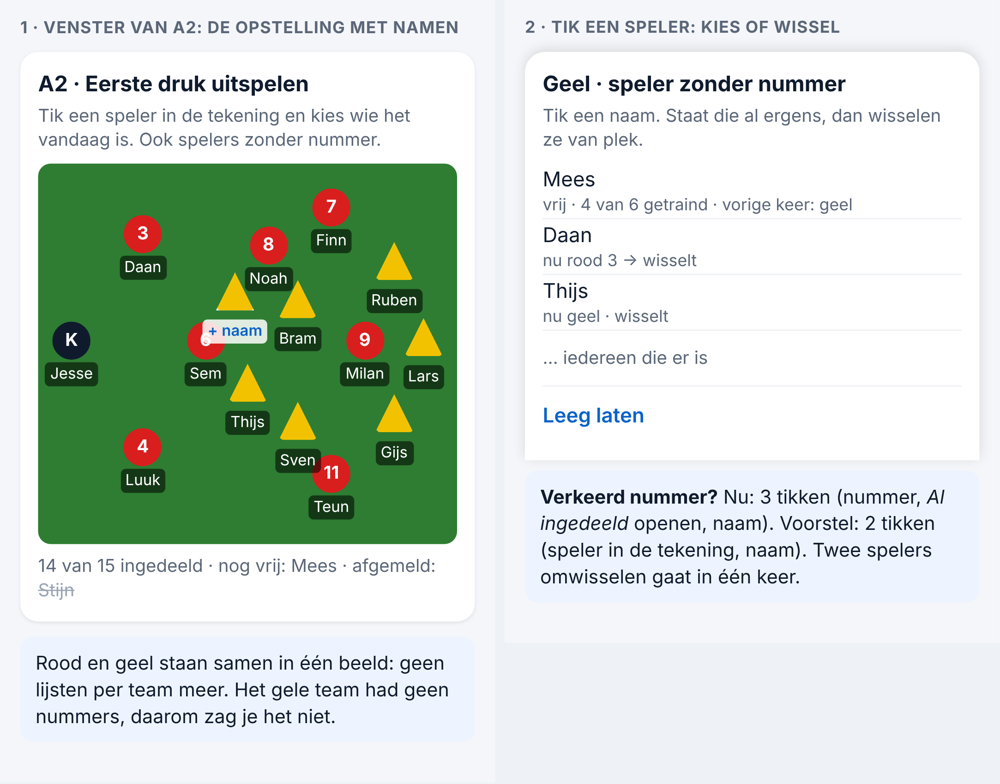
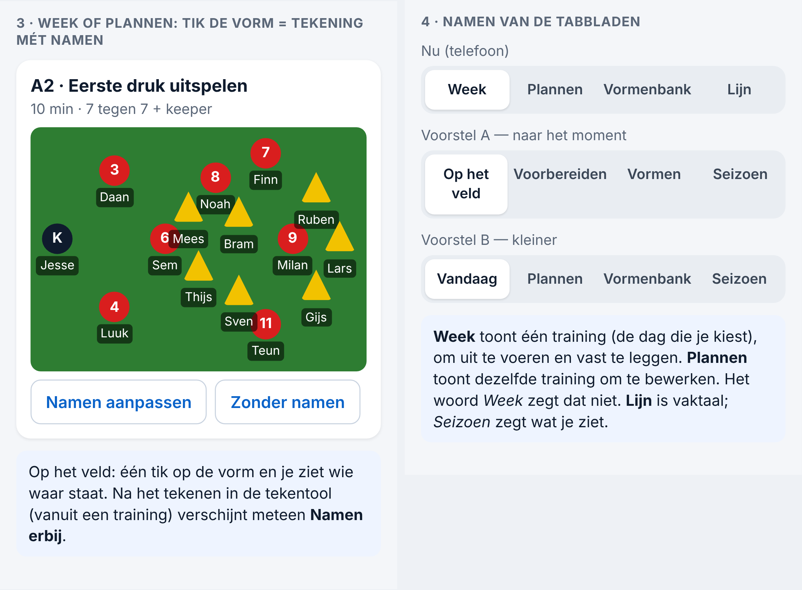

# Voorstel — opstelling met namen in de tekening, en de namen van de tabbladen (Spoor 3, 06-11-2026)

*Alleen onderzoek. Er is niets veranderd aan code, database of productie; de productiedatabase is alleen gelezen. De tekeningen zijn nagebootst op 390 px, met verzonnen namen.*

## Wat er gebeurde (vr 06-11, gelezen)

- De indeling staat bij **A2** (*Eerste druk uitspelen*): 8 rode rollen zijn ingevuld (K, 3, 4, 6, 7, 8, 9, 11).
- In die tekening hebben de **gele spelers geen nummer** (7 driehoeken zonder cijfer). *Wie speelt waar* (Besluit 173) toont alleen genummerde spelers. Daarom zag je alleen rood.
- **Een verkeerd nummer wijzigen kost nu 3 tikken:** het nummer, dan *Al ingedeeld* openen, dan de naam. Twee spelers omwisselen kost 6 tikken.

## Wanneer gebruik je dit, en waar?

| Moment | Waar | Wat je nodig hebt |
|---|---|---|
| Thuis, vóór de training | **Plannen**, op de laptop of telefoon | indelen: wie staat waar, snel wijzigen |
| Op het veld, bij het wegzetten | **Week**, op de telefoon | in één tik zien wie waar staat, om de namen op te noemen |
| Op papier | **Print** | de tekening met namen |

Lijsten per team passen daar niet goed bij. Je denkt in **de tekening**: wie staat links achter, wie is de vrije man. Daarom:

## Voorstel

1. **Het venster van de plek toont de tekening zelf, met de namen eronder.** Rood en geel staan samen in één beeld. Je tikt **elke speler** aan, ook zonder nummer, en kiest wie het vandaag is.
2. **Kiezen of wisselen in 2 tikken:**
   - je ziet iedereen die er is;
   - wie al ergens staat, staat erbij (*nu rood 3*);
   - tik je hem aan, dan **wisselen ze van plek**.
   
   Een verkeerd nummer herstellen kost dus 2 tikken, en omwisselen ook.
3. **Bekijken:** in Week en Plannen geeft een tik op de vorm de **tekening mét namen** (met *Namen aanpassen* en *Zonder namen*). Op de print staan de namen in de tekening, niet in een lijst eronder.
4. **Vanuit de tekentool:** teken je een vorm vanuit een training (de plek), dan staat na *Opslaan* meteen **Namen erbij**. Dat brengt je naar stap 1.

**Waarom niet ín de tekentool zelf?** De tekening hoort bij de **vorm**, en die gebruik je in veel trainingen. Namen horen bij **deze training**. Zet je de namen in de tekening, dan staan ze volgende week verkeerd. Daarom komen de namen in een laag over de tekening, per training. Het voelt als tekenen, maar de vorm blijft schoon.

**Gezien in het voorbeeld:** bij 15 spelers op een telefoonscherm overlappen namen soms. Daarom alleen de voornaam (bij een dubbele voornaam met een letter erbij), klein. Op de laptop en op de print is er ruimte genoeg.

**Gegevens:** de indeling blijft in de training. Spelers zonder nummer krijgen een sleutel op hun plek in de tekening. Verandert de tekening later, dan meldt de app welke namen niet meer passen; er verdwijnt niets stilletjes. Geen migratie, de rechten veranderen niet (maat L blijft: rechtentest vooraf).

## De namen van de tabbladen

Wat ze nu doen:
- **Lijn:** het seizoen, de minuten per gereedschap en de weken.
- **Plannen:** een training voorbereiden en bewerken.
- **Week:** één training (de dag die je kiest) uitvoeren: aanwezigheid, afspraak, vormen, en daarna vastleggen en evalueren.
- **Vormenbank:** alle oefenvormen.

*Week* en *Plannen* tonen dezelfde training. Het verschil is **bewerken** of **uitvoeren**, en dat zegt het woord *Week* niet. *Lijn* is vaktaal: een club zonder opleidingsprofiel ziet er alleen de weekthema's.

| | Telefoon (volgorde) | Voordeel | Nadeel |
|---|---|---|---|
| **A** | **Op het veld · Voorbereiden · Vormen · Seizoen** | Zegt wanneer je het gebruikt | Langere woorden; functiekaarten, snelstart-PDF's en schermafbeeldingen moeten opnieuw |
| **B** | **Vandaag · Plannen · Vormenbank · Seizoen** | Kleinste stap; *Vandaag* klopt meestal | Op een andere dag (bijv. donderdag bekijken op maandag) klopt *Vandaag* niet helemaal |

**Advies: A.** *Op het veld* en *Voorbereiden* zeggen wat je doet. *Vormen* is korter dan *Vormenbank*. *Seizoen* zegt wat je ziet. De code verandert nauwelijks: alleen de woorden, niet de schermen.

## Wat ik van je nodig heb
1. Akkoord op de opstelling met namen in de tekening (punt 1 t/m 4).
2. Tabbladen: A, B, of laten zoals het is.
