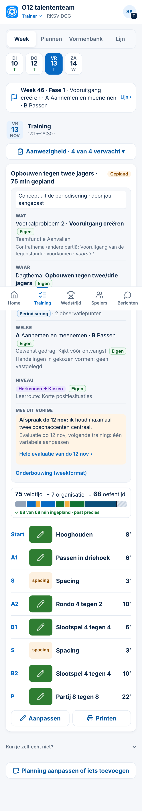
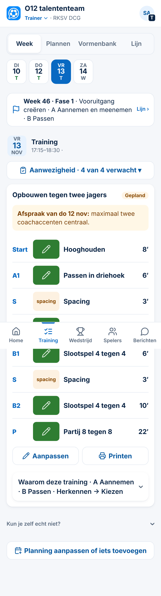
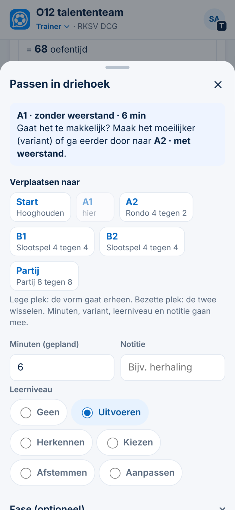
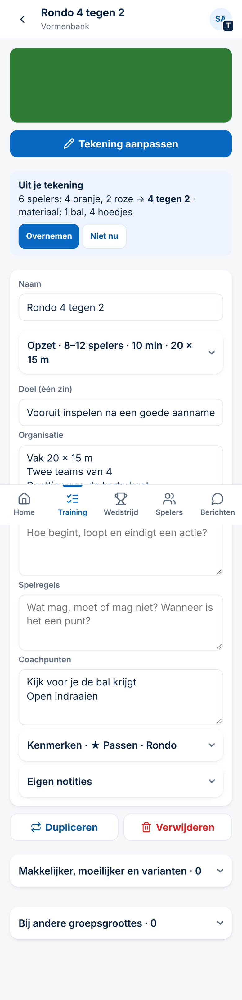

# Voorstel — Week rustiger, oefenvorm sneller invullen (Spoor 3, 05-11-2026)

*Alleen een voorstel. Er is niets veranderd aan code, database of productie. De schermen zijn de echte app op 390 px met verzonnen gegevens. Bij de voorbeelden is de pagina in de browser nagebootst; dat staat niet in de app.*

**Maat: M.** Schermen veranderen (Week, het venster van een plek, Bewerken). Er komt geen migratie, er veranderen geen rechten en er komen geen persoonsgegevens bij. Na je akkoord komt er een besluit (`Besluit NNN`).

**Wat je zei (samengevat):**
- Lijn en Plannen zijn duidelijk.
- In **Week** staat te veel. Hoeveel minuten je precies hebt ingepland, is voor een gediplomeerde trainer niet belangrijk.
- Je wilt een **vast tijdsjabloon**: zoveel tijd voor vormen zonder weerstand (droog) en zoveel voor vormen met weerstand. Gaat een droge vorm te makkelijk, dan pas je hem aan of ga je naar de vorm met weerstand.
- Het **venster van een plek** is sterk: leerniveau, verplaatsen naar A, B of Partij, met de namen erbij.
- **Bewerken** is een lange rij. Bekijk wat echt nodig is, ook bij het invullen na de **tekening**.

**Afgewezen ideeën gecontroleerd** (op *minuten, tijd, sjabloon, weerstand, tekening, formulier*):
- *Een vaste norm voor organisatietijd* is afgewezen (Besluit 142). Dit voorstel doet dat niet: het sjabloon gaat over oefentijd per plek, en de club stelt het zelf in.
- *Weerstand zelf laten kiezen* is afgewezen (Besluit 131). Dat blijft zo: weerstand volgt uit de aantallen. Het sjabloon zegt alleen wat een plek vraagt.
- *Methodische fase vast aan een vorm* is afgewezen (Besluit 131). Dat blijft zo: *zonder* of *met weerstand* hoort bij de **plek** in het sjabloon, niet bij de vorm.

---

## A. Week: eerst de training, de rest ingeklapt

| Nu | Voorstel |
|---|---|
| Kop: *Opbouwen tegen twee jagers · **75 min gepland*** | Alleen het thema en de status (*Gepland*). |
| Daaronder de hele onderbouwing open: Wat, Waar, Welke, Niveau, Mee uit vorige, Onderbouwing | **Eén ingeklapte regel onder de training:** *Waarom deze training · A Aannemen · B Passen · Herkennen → Kiezen*. Een tik opent alles zoals nu. |
| De tijdregel *75 veldtijd − 7 organisatie = 68 oefentijd*, de balk en *68 van 68 min ingepland* | **Niet in Week.** Die regel blijft in Plannen (Besluit 142), waar je de tijd verdeelt. Is er te veel ingepland, dan toont Week alleen die ene waarschuwing (*ClubComm signaleert*). |
| *Mee uit vorige* staat diep in de onderbouwing | **De afspraak van de vorige training in één regel, bovenaan.** Die heb je op het veld nodig. |
| Minuten per plek (8′, 6′, 3′ …) | Blijven staan. Ze komen uit het sjabloon en je stuurt erop tijdens de training. |

**Na de training** verandert niets aan *Klopt zoals gepland*. Lijn telt met de echte minuten (Besluit 141), dus die ene tik blijft nodig.

**Geen instelling per trainer** (*"ervaren trainer: minuten uit"*). Dat is een extra keuze die niemand terugvindt. Het overzicht van de minuten staat gewoon niet meer in Week, voor iedereen.

**Nu:**

**Voorstel:**

## B. Tijdsjabloon: zonder en met weerstand

**Inhoud (Spoor 1, DCG-profiel).** Per plek van het sjabloon komt:
- of de plek **zonder weerstand** of **met weerstand** is;
- hoeveel minuten de plek krijgt;
- één regel, bijvoorbeeld: *"Gaat het te makkelijk? Maak het moeilijker (variant) of ga eerder door naar A2 · met weerstand."*

Die inhoud komt van jou. Die maak ik niet zelf.

**Software (Spoor 3, voor elke club).** Een sjabloonplek krijgt twee velden erbij, allebei optioneel:
- de soort: *zonder* of *met weerstand*;
- de regel uit het profiel.

Het venster van de plek toont dat bovenaan, in één blok. Een club zonder sjabloon ziet niets nieuws. Er staan geen DCG-woorden in de code.

**Later en apart** (alleen als je het wilt): ClubComm laat zien dat een vorm op een plek *met weerstand* volgens de aantallen geen weerstand heeft. De trainer beslist.

**Vraag:** je noemde *"ongeveer 24 minuten voor een A1-versie"*. Het DCG-sjabloon heeft nu A1 6 min, spacing 3 min en A2 10 min; samen is dat 19 minuten voor het A-deel. Bedoel je **24 minuten voor het hele A-deel**? En is A1 altijd *zonder* en A2 altijd *met* weerstand, en voor B hetzelfde?

## C. Vorm bekijken: *Zet in een training…*

*Zet in een training…* zet deze vorm in een **andere** training, bijvoorbeeld de volgende. Je had dat zelf al gevonden. Ik stel **geen wijziging** voor. Wil je de knop toch duidelijker, dan kan die *In een andere training zetten…* heten (maat S).

## D. Bewerken: korter en rustiger

Wat er **zichtbaar blijft**:
- tekening en naam;
- doel;
- organisatie, spelverloop en spelregels;
- coachpunten.

Dat is wat je zei dat je logisch vindt.

| Nu | Voorstel |
|---|---|
| Spelers van–tot, keepers van–tot, minuten en afmeting: vijf velden, drie regels | **Eén ingeklapte regel *Opzet · 8–12 spelers · 10 min · 20 × 15 m*.** Een tik opent de velden. |
| Onder elk tekstvak een extra regel met een hulpvraag | **De hulpvraag staat ín het lege vak** (grijze tekst die verdwijnt zodra je typt). Dat scheelt zes regels, en de vraag zie je alleen bij een leeg veld. |
| *Makkelijker, moeilijker en varianten* en *Bij andere groepsgroottes* staan open, met uitleg | **Ingeklapt, met het aantal in de kop** (*· 0*, *· 2*). |
| *Kenmerken* en *Eigen notities* | Ingeklapt, zoals sinds Besluit 164. |

**Eerlijk:** de pagina wordt ongeveer 13% korter (gemeten in de voorbeelden). Het grootste verschil zit in wat je ziet: de opmaak en hulpteksten van negen invulvakken worden zes vakken met één regel *Opzet* erboven. Nu staat er onder elk vak ook nog uitleg.

## E. Na de tekening: overnemen wat erin staat

De tekening weet al:
- hoeveel spelers er per kleur zijn;
- of er een keeper is;
- welk materiaal er ligt.

Het materiaal komt nu al vanzelf op de print (Besluit 132). Het voorstel:

- Onder de tekening staat **Uit je tekening**: *6 spelers: 4 oranje, 2 roze → 4 tegen 2 · materiaal: 1 bal, 4 hoedjes*, met **Overnemen** en **Niet nu**.
- *Overnemen* vult spelers (van–tot), keepers en de aantallen per groepje in (*Kenmerken*; daaruit volgt de weerstand, Besluit 131). Alleen lege velden worden gevuld. Wat jij al hebt ingevuld, blijft staan.
- **Afmeting kan niet** uit de tekening komen: de tekening kent geen meters. Die blijft een invulveld.
- Er wordt niets vanzelf ingevuld: *ClubComm signaleert, mensen beslissen*.

## Normen (`docs/app-controle.md`)

- Bestaande knoppen en uitklappers: tikvlak 44 px, leestekst 16 px.
- Geen horizontaal scrollen op 390 px (nagelopen in de voorbeelden).
- Kleur alleen voor aandacht: de afspraak (oranje) en de regel van de plek (blauw).

## Voordelen en nadelen

**Voordelen**
- Week toont wat je op het veld nodig hebt: de afspraak en de vormen. De onderbouwing is één tik verder.
- Het sjabloon helpt een beginnende trainer met tijd en opbouw, zonder dat de vorm vastligt.
- Bewerken is korter, en na het tekenen hoef je spelers en aantallen niet nog eens over te typen.

**Nadelen**
- De onderbouwing (Besluit 144) staat in Week niet meer open. Wie die altijd leest, tikt één keer extra.
- Het sjabloon vraagt inhoud van jou (Spoor 1) voordat het iets toont.
- *Uit je tekening* leest de kleuren: een tekening met drie kleuren (bijvoorbeeld neutralen) geeft *4 tegen 2 + 1*. Klopt dat niet, dan tik je *Niet nu*.

## Advies

In deze volgorde, elk deel in een eigen kleine pull request:
1. **A (Week)** en **D (Bewerken)**: het snelste resultaat, alleen schermen.
2. **E (Uit je tekening)**.
3. **B (tijdsjabloon)**, zodra jij de minuten en de regels hebt vastgesteld (Spoor 1).

## Wat ik van je nodig heb

1. Akkoord op A, D en E (of zeg welke niet).
2. Bij B: welke minuten (zie de vraag hierboven), en de regel per plek in je eigen woorden.
3. Bij C: laten zoals het is, of de knop hernoemen?
