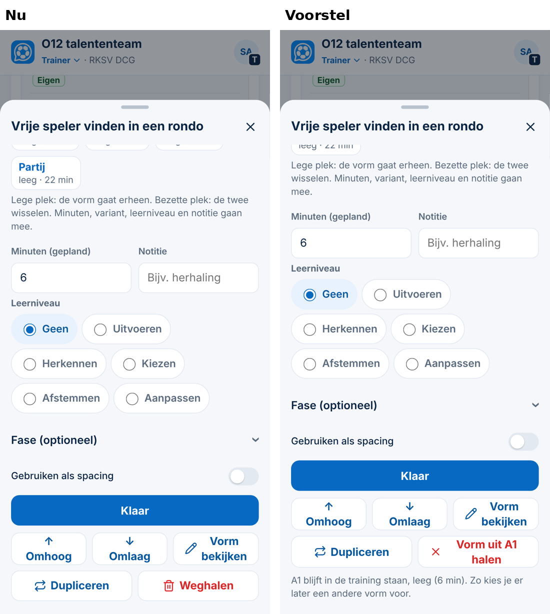
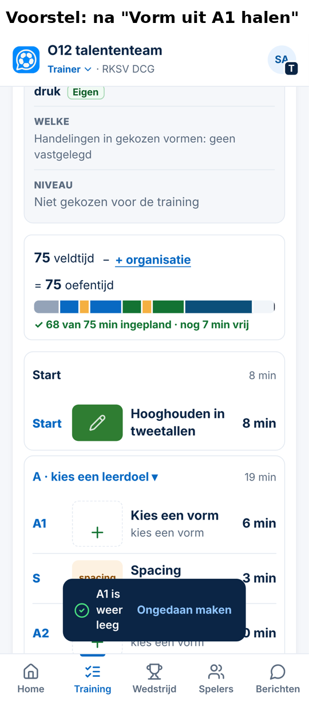
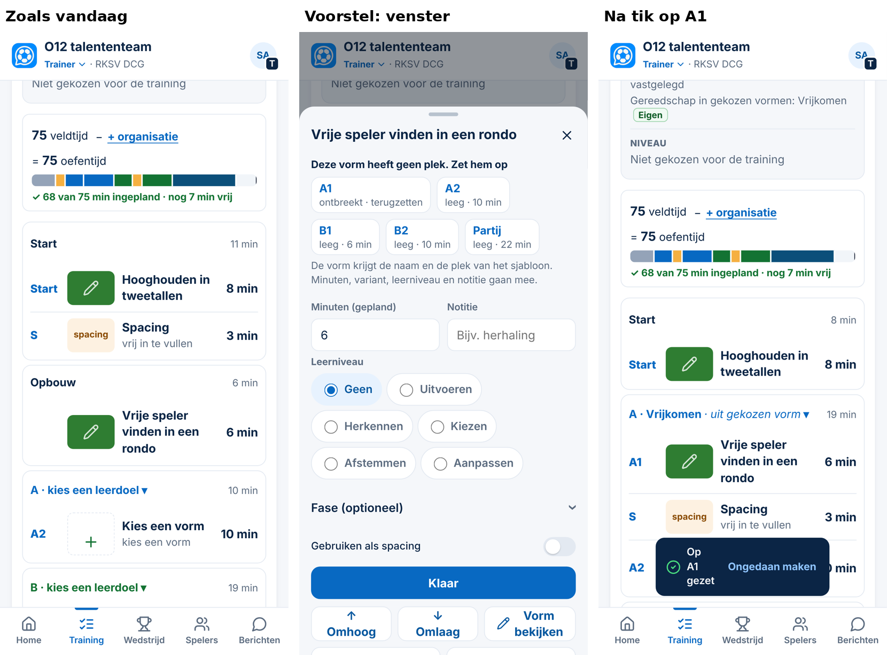

# Voorstel — een vorm weghalen zonder de plek kwijt te raken (Spoor 3, 05-11-2026)

*Alleen een voorstel. Er is niets veranderd aan code, database of productie. De schermen komen uit een tijdelijk prototype met verzonnen gegevens (390 px). Dat prototype staat niet in de repository.*

**Maat: M.** Het verandert wat de trainer kan doen in Plannen. Er komt geen nieuw veld, geen migratie en er veranderen geen rechten. Na je akkoord komt er een besluit (`Besluit NNN`).

## Aanleiding (gezien op 05-11, DCG)

In de training van do 5-11 haalde de trainer per ongeluk de vorm op **A1** weg. Daarbij gebeurde het volgende:

1. **Weghalen** haalde de **hele plek A1** weg. Er was geen vraag vooraf en geen *Ongedaan maken*.
2. De nieuwe vorm die daarna werd toegevoegd, kreeg **geen plek**. Hij staat onder de groepsnaam **"Opbouw"**. Met ↑/↓ verandert alleen de volgorde, niet de plek.
3. **A1 terugzetten kon niet:**
   - *Verplaatsen naar* (Besluit 145) werkt alleen voor een vorm die al op een plek staat;
   - *Sjabloon* zet alle 8 plekken er nóg een keer achter.

Dit botst met Besluit 149, ontwerpregel 10: *"Ongedaan maken bij verwijderen"*.

**Gevolg:** de training zelf werkt. Maar de vorm telt niet als A, en de plek A1 is weg.

## Voorstel (drie kleine aanpassingen in bestaande vensters)

| # | Waar | Nu | Voorstel |
|---|---|---|---|
| 1 | Venster van een vorm **op een plek** (Start, A1, A2, B1, B2, Partij) | **Weghalen** haalt vorm én plek weg | **Vorm uit A1 halen**: alleen de vorm gaat eruit. A1 blijft staan, leeg en met zijn minuten. Met de zin *"A1 blijft in de training staan, leeg (6 min)"* en de melding *"A1 is weer leeg · Ongedaan maken"*. |
| 2 | Venster van een **lege plek** (via de kiezer → *Minuten en leerniveau van A1*) | **Weghalen** | **Plek A1 verwijderen**, met *Ongedaan maken*. Start blijft dus *niet verplicht*, zoals in Besluit 145. |
| 3 | Venster van een vorm **zonder plek** (onder *"Opbouw"*) in een training met plekken | geen manier om een plek te kiezen | Bovenaan: **"Deze vorm heeft geen plek. Zet hem op"**, met de plekken die **ontbreken** volgens het sjabloon (*A1 · ontbreekt · terugzetten*) en de **lege** plekken. Eén tik zet de vorm op die plek, op de plaats uit het sjabloon. Daarna volgt *Ongedaan maken*. |

**Altijd *Ongedaan maken*.** Elke manier van weghalen krijgt de melding met *Ongedaan maken* (8 seconden), zoals bij *Verplaatsen* en bij het kiezen van een vorm. Dat geldt ook bij een spacing en bij een training zonder plekcodes (bijvoorbeeld Swift). Daar blijft *Weghalen* verder zoals het is.

**Training van 5-11:** met punt 3 zet de trainer A1 zelf terug in de app, met één tik. Er is dan **geen databasescript nodig**. Daarmee vervalt optie A.

## Voorbeelden op 390 px

**1. Het venster van een vorm op A1, onderaan:** *Weghalen* wordt *Vorm uit A1 halen*, met één zin uitleg.

**2. Na *Vorm uit A1 halen*:** A1 staat er nog, leeg (*Kies een vorm · 6 min*). Onderaan staat de melding *A1 is weer leeg · Ongedaan maken*.

**In het prototype nagelopen:**
- *Ongedaan maken* zet de vorm terug op A1;
- na *A1 · ontbreekt* is de volgorde Start · A1 · spacing · A2 · B1 · spacing · B2 · Partij.

**Ook gezien:** de melding is smal, zodat *"A1 is weer leeg"* over drie regels loopt. Dat is de bestaande meldingsstijl en hoort niet bij dit voorstel. Het kan als kleine opmaakverbetering mee.

**3. Zoals vandaag (vorm onder *"Opbouw"*) → venster → één tik op *A1 · ontbreekt* → de vorm staat weer op A1, vóór de spacing.**

## Gegevens en wat er niet verandert

- **Geen nieuw veld en geen migratie.** Een vorm op een plek zetten gebruikt de bestaande velden (`blok`, de plek in de lijst). *Vorm eruit* haalt dezelfde velden weg die bij *Verplaatsen* meegaan (`MEE`: vorm, variant, leerniveau, fase, echte minuten, notitie, vastlegging). De geplande minuten van de plek blijven.
- **Gegeven training (Besluit 147):** de vastlegging hoort bij de vorm. Haal je de vorm eruit, dan gaat de vastlegging mee. *Ongedaan maken* zet beide terug.
- **Ongewijzigd:** de Vormenbank, andere trainingen, evaluaties, Week en Lijn. Bij een training zonder plekcodes (Swift) verandert alleen dat er *Ongedaan maken* bij komt.
- **Afgewezen ideeën gecontroleerd** (op *plek, verwijder, weghalen, ongedaan, bevestig*): niets van toepassing. Er komt geen extra bevestigingsvraag *"Weet je het zeker?"*; *Ongedaan maken* is sneller en past bij Besluit 149.

## Normen (`docs/app-controle.md`)

- Bestaande knopstijl: tikvlak 44 px, en de rode tekst heeft hetzelfde contrast als de huidige *Weghalen*.
- Leestekst 16 px. Geen horizontaal scrollen op 390 px.
- *Beperk beweging*: de melding gebruikt de bestaande regel (Besluit 150).

## Voordelen en nadelen

**Voordelen**
- Per ongeluk weghalen kost niets meer: de plek blijft staan, of je maakt het ongedaan.
- Een vorm zonder plek krijgt in één tik weer een plek, ook in een training die al zo staat.
- Geen nieuw scherm en geen dubbele functie: het is dezelfde rij plekken als bij *Verplaatsen naar* (Besluit 145).

**Nadelen**
- De knop heet per plek anders (*Vorm uit A1 halen*, *Vorm uit B2 halen*). Dat is langer, maar je ziet meteen wat er gebeurt.
- Wie bewust een plek kwijt wil, doet dat in twee stappen: eerst de vorm eruit, dan de lege plek verwijderen.
- Een paar bestaande tests gebruiken *Weghalen* en moeten mee veranderen.

## Advies

**Bouwen zoals hierboven**, in één kleine pull request. Tests:
- vorm eruit → plek blijft, en ongedaan maken werkt;
- lege plek verwijderen → ongedaan maken werkt;
- vorm zonder plek → *A1 ontbreekt* → de vorm staat op A1 vóór de spacing;
- gegeven training → de vastlegging gaat mee en komt terug;
- training zonder plekcodes → *Weghalen* met ongedaan maken;
- dit alles op 390 en 1366 px.

## Wat ik van je nodig heb

1. Akkoord op de drie aanpassingen en de knopnaam *Vorm uit A1 halen*.
2. Daarna bouw ik. Samenvoegen gebeurt pas na je aparte akkoord.
