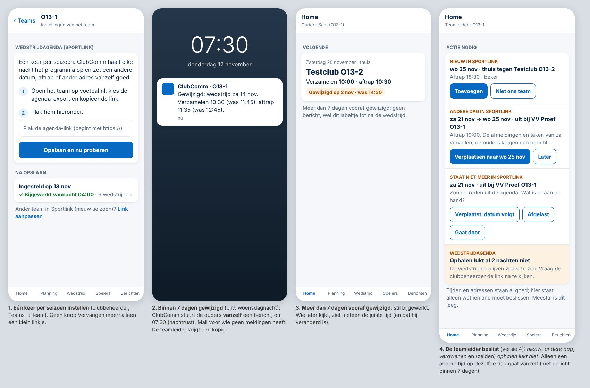

# Voorstel D — Wedstrijden vanzelf bijwerken uit de Sportlink-agenda

*Spoor 3 · maat **L** (de server past wedstrijden aan en bewaart een geheime link) · versie 4, 20 november 2026 · nog geen besluit.*
Hoort bij `docs/onderzoek/wedstrijd-bijhouden/voorstel.md` (stap D). Versie 1–3 (13-11) staan in de geschiedenis van dit bestand op GitHub.

## 1. Waarom nu
ClubComm heeft geen koppeling met voetbal.nl. De wedstrijden zijn op 17-10 **één keer** ingeladen uit de Sportlink-agenda (iCal, `supabase/scripts/2026-10-17_dcg_wedstrijden_fase2.sql`). Wat daarna verandert, komt er niet vanzelf in. Het ging nu twee keer mis:

| Wanneer | Wat er op voetbal.nl veranderde | Hoe opgelost |
|---|---|---|
| 13-11 | za 14-11 Sporting Martinus: aftrap 12:45 → 11:35 | eenmalig script, na akkoord |
| 20-11 | za 21-11 AGB: aftrap 12:30 → 10:30; nieuwe wedstrijd tegen VVA Spartaan | eenmalig script (#175); Spartaan staat er nog niet in |

Beide keren kregen de ouders geen bericht van ClubComm. Elke wedstrijd bewaart het kenmerk uit de agenda (veld `sportlink`, bijv. `20261017T213938Z-1@sportlink.com`). Daarmee is dezelfde wedstrijd terug te vinden.

## 2. Wat er al is
- **Besluit 184 (stap 1, 14-11):** de teamleider past datum en aftrap zelf aan.
  - Zelfde dag: afmeldingen en taken blijven.
  - Andere dag: ze vervallen (bewaard, niet gewist) en de ouders krijgen altijd een bericht.
  - Binnen 7 dagen staat er *Opslaan en ouders inlichten*.
- **#172 (19-11):** verzamelen schuift mee met de aftrap. Een nieuwe wedstrijd krijgt de verzameltijd van de club.
- **Opnieuw plakken** (Besluit 168): het programma plakken toont *gelijk*, *gewijzigd* en *nieuw*. Je moet dan wel zelf weten dat er iets veranderd is. Dat is het gat dat D dicht.

## 3. Bron
| | Wat | Voor | Tegen |
|---|---|---|---|
| **A. Agenda-link (iCal) per team** | dezelfde agenda als op 17-10 | nu beschikbaar, geen aanvraag nodig, geen persoonsgegevens | één link per team; de link kan per seizoen veranderen |
| **B. Sportlink Club.Dataservice** | sleutel van de club, alle teams | goed voor meer teams en clubs | sleutel aanvragen (staat sinds 27-09 open) |

**Advies:** nu **A** voor het O13 talententeam (pilot). **B** komt later, als DCG de sleutel heeft. Voor de app werkt het dan hetzelfde.

## 4. Hoe het werkt
1. **Eén keer per seizoen instellen.** De clubbeheerder plakt bij *Teams → team → Wedstrijdagenda* de agenda-link.
   - Daarna toont ClubComm alleen *Ingesteld op … · bijgewerkt vannacht 04:00*. De link zelf zie je nooit meer voluit.
   - Er is één klein linkje *Link aanpassen*, voor een nieuw seizoen of een ander team. **Nooit via de chat.**
2. **Ophalen om 04:00 en om 18:00.** De avondronde is nieuw ten opzichte van versie 3. Zo komt een wijziging van vrijdagmiddag nog dezelfde avond binnen, en niet pas op de wedstrijddag. Het gaat als eigen taak naast de bestaande automaat (pg_cron + Edge Function, Besluit 77).
3. **Vergelijken** op het kenmerk `sportlink`. Een wedstrijd zonder kenmerk (zelf toegevoegd) vergelijkt ClubComm op datum en tegenstander.

### Wat ClubComm vanzelf doet, en wat de teamleider beslist
**Nieuw in versie 4:** alleen een **andere tijd op dezelfde dag** gaat vanzelf. Een **andere dag** wordt een vraag aan de teamleider, met één knop.

Waarom die keuze? Bij een andere dag vervallen afmeldingen, taken en vervoer, en dat raakt ouders (Besluit 184). Die regels staan nu op één plek in de app (`wedverplaats.js`). Laat je de server 's nachts ook een andere dag zelf doorvoeren, dan moet hij precies dezelfde regels in een tweede kopie uitvoeren. Twee kopieën lopen uit elkaar. Met één tik van de teamleider gaat het via de bestaande weg, en dat is ook *ClubComm signaleert, mensen beslissen*.

| In Sportlink | ClubComm doet | Bericht aan de ouders |
|---|---|---|
| **Andere tijd, zelfde dag** | past aftrap en einde aan; verzamelen schuift mee (een zelf gekozen verzameltijd houdt zijn afstand); afmeldingen en taken blijven | binnen 7 dagen **vanzelf**: om 07:30, of meteen na de ronde van 18:00 (push, mail voor wie geen meldingen heeft; de teamleider krijgt een kopie). Meer dan 7 dagen vooraf: geen bericht, wel het label *Gewijzigd · was …* |
| **Ander adres of thuis/uit** | past het aan | binnen 7 dagen zoals hierboven |
| **Andere dag** | vraag aan de teamleider: *Verplaatsen naar wo 25 nov* · *Later* | bij *Verplaatsen*: altijd, via Besluit 184 |
| **Nieuw** (beker, inhaal, of zoals VVA Spartaan) | vraag: *Toevoegen* · *Niet ons team* | nee; een nieuwe wedstrijd is informatie |
| **Verdwenen zonder reden** | vraag: *Verplaatst, datum volgt* · *Afgelast* · *Gaat door* | via Besluit 184 |
| **Uitdrukkelijk afgelast** | vraag: *Afgelast* · *Gaat door* | via Besluit 184 |
| **Ophalen lukt 2 keer achter elkaar niet** | één regel voor de clubbeheerder en de teamleider: *Wedstrijdagenda werkt niet* | nee; de wedstrijden blijven zoals ze zijn |

**De vragen staan bij *Actie nodig*.** Meestal is dat leeg. Tijden en adressen staan dan al goed.

## 5. Gegevens, rechten en privacy (zware controle bij maat L)
- **Welke gegevens:** alleen het wedstrijdprogramma: datum, tijd, tegenstander, adres van het sportpark en kenmerk. Er zitten geen namen van kinderen of ouders in. De agenda-link is geheim.
- **Waar en wie:**
  - De link staat in een aparte tabel met RLS aan en zonder leesregels, net als `automaat_geheim`. Alleen de server leest hem.
  - Zetten en weghalen gaat via een databasefunctie die eerst controleert of je beheerder van **die** club bent (clubscheiding).
  - Ouders, trainers en teamleiders kunnen de link niet lezen of zetten. Ook de beheerder leest hem nooit terug.
- **Hoe lang:**
  - De link blijft tot de beheerder hem weghaalt of tot het seizoen afloopt.
  - Een logboek per ronde (oud → nieuw) blijft **30 dagen** bewaard, voor de vraag *"waarom staat dit zo?"*.
- **Database:** migratie **036** met de tabel, twee functies (zetten en weghalen), het logboek en de taak om 04:00 en 18:00. Daarbij een lokale rechtentest:
  - ouder, trainer, teamleider en beheerder van een andere club worden geweigerd;
  - de beheerder van de eigen club mag zetten en leest nooit de volledige link terug.
- **Productie:** niets in de database of de rechten zonder apart akkoord. Eerst lokaal testen met een nagemaakte agenda: zelfde opbouw, verzonnen gegevens. Wat niet echt getest is, heet niet *gecontroleerd*.

## 6. Afgewezen ideeën nagekeken
Er is geen afgewezen idee over Sportlink of de wedstrijdagenda. Wel nagekeken:
- *Automatisch posten in WhatsApp-groepen* (Besluit 9) blijft afgewezen. Het bericht gaat via ClubComm.
- *Automatisch taken toewijzen of vervoer indelen* (Besluit 76) blijft afgewezen. Bij een andere dag vervallen taken en vervoer; ze worden niet opnieuw ingedeeld.

## 7. Voorbeeld op 390 px

`voorbeeld-v4.html` (verzonnen club en namen):
1. Eén keer per seizoen instellen.
2. Binnen 7 dagen: vanzelf een bericht.
3. Meer dan 7 dagen: stil bijgewerkt, met label.
4. **De teamleider beslist**: nieuw, **andere dag** (nieuw in versie 4), verdwenen, ophalen lukt niet.

**Voordelen**
- Een tijdswijziging zoals bij AGB staat de volgende ochtend goed, en de ouders horen het vanzelf.
- Een nieuwe wedstrijd zoals VVA Spartaan wordt niet vergeten: er staat een vraag klaar.
- De regels voor een andere dag staan op één plek.

**Nadelen**
- Een andere dag vraagt één tik van de teamleider. Tot die tik staat de oude dag nog in ClubComm. De vraag staat bovenaan *Actie nodig*, en de ouders zien de oude datum tot dan.
- Per team één link. Voor alle teams is B nodig.
- Eerlijk risico: we weten pas zeker of de agenda-link vanaf de server werkt als we hem één keer echt hebben opgehaald (stap D3).

## 8. Stappen (elk met een eigen akkoord)
1. **D1 — besluit** op dit voorstel en het voorbeeld (dit document).
2. **D2 — bouwen en lokaal testen:**
   - migratie 036, Edge Function `agenda`, rechtentest;
   - Playwright-tests: andere tijd binnen en buiten 7 dagen, andere dag als vraag, nieuw, verdwenen, link kapot, verzameltijd schuift mee.
   - Daarna een pull request.
3. **D3 — toepassen** in productie, na akkoord. Jij zet zelf de link van het O13 talententeam in de app. Daarna draait het één week mee en kijken we elke ochtend of het klopt.
4. **Later — B:** de Club.Dataservice-sleutel, zodra DCG die heeft.

## 9. Wat ik van jou nodig heb
1. **Akkoord op versie 4**, met de keuzes:
   - (a) A nu, B later;
   - (b) een andere tijd gaat vanzelf, met een bericht binnen 7 dagen;
   - (c) een andere dag wordt een vraag met één knop;
   - (d) ophalen om 04:00 en 18:00.
2. **Waar kwam de agenda van 17-10 vandaan?** Was dat voetbal.nl (website of app) of de Sportlink-app? Dan schrijf ik de stappen precies zo in het instelscherm. **Plak de link zelf niet in de chat.**
