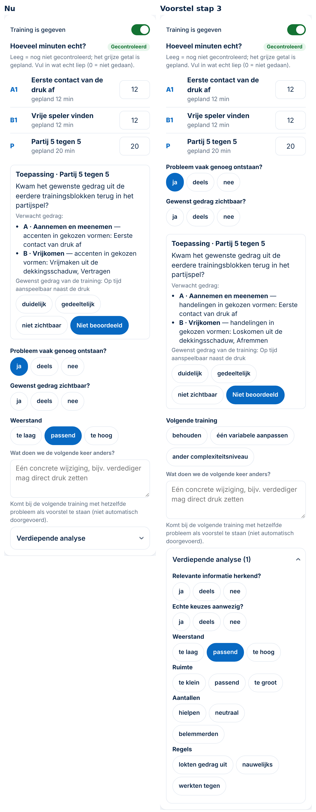
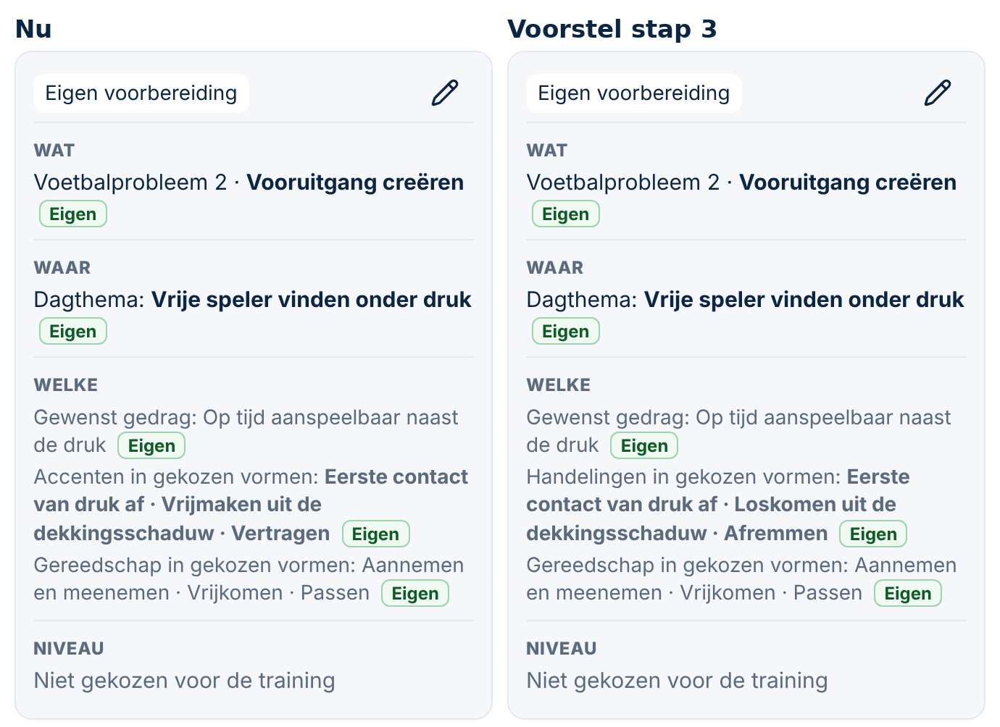
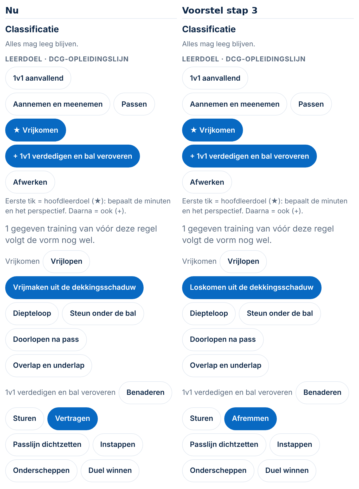

# Voorstel stap 3 — labels en korte evaluatie (Spoor 3, 04-11-2026)

*Alleen een voorstel. Er is niets veranderd aan code, profiel, database of productie. De schermafbeeldingen komen uit een tijdelijk prototype met verzonnen gegevens; dat prototype staat niet in de repository.*

**Maat: M.** Wat de trainer ziet verandert, en het DCG-profiel krijgt versie 4. Er is geen migratie, er komen geen nieuwe rechten en er verandert niets aan trainingen of antwoorden. Er komt een besluit (het eerstvolgende vrije nummer, vlak voor het opslaan gekozen).

**Afhankelijk van Spoor 1:** de begrippen komen uit begrippenlijst v2.1 (*akkoord als uitgangspunt*, 04-11). Bouwen pas als Spoor 1 die lijst heeft vastgesteld, of als jij zegt dat deze vier punten al vaststaan.

## Wat er verandert (vier punten)

| # | Wat | Waar | Soort |
|---|---|---|---|
| 1 | `vh-vrijmaken-uit-de-dekkingsschaduw` heet voortaan **Loskomen uit de dekkingsschaduw** | DCG-profiel (label) | profielinhoud |
| 2 | `vh-vertragen` heet voortaan **Afremmen** (de handeling; *vertragen* is het beoogde effect) | DCG-profiel (label) | profielinhoud |
| 3 | *Accenten in gekozen vormen* heet voortaan **Handelingen in gekozen vormen**, op de trainingskaart en bij Toepassing | `periodisering.js`, `training.js` | tekst in de code |
| 4 | **De korte evaluatie** staat in het profiel (`evaluatie.kort`). DCG: doel/situatie · gedrag · toepassing · volgende leerstap | DCG-profiel + `training.js` | profielinhoud + kleine code |

De codes blijven precies hetzelfde. Alleen de namen die de trainer ziet veranderen.

## Voorbeelden op 390 px

### Evaluatie na de training (`vergelijking-1-evaluatie.png`)

| Nu | Voorstel |
|---|---|
| Toepassing (transfer) · Probleem · Gedrag · **Weerstand** open; *Volgende training* zit in *Verdiepende analyse* | **Probleem · Gedrag · Toepassing · Volgende training** open, in de volgorde van de begrippenlijst; *Weerstand* en de andere vragen staan in *Verdiepende analyse* |

### Trainingskaart, regel *Welke* (`vergelijking-2-kaart.png`)

### Vormenbank, vaardigheden (`vergelijking-3-vaardigheden.png`)

## Oude gegevens en betekenis (gecontroleerd)

- **Antwoorden** worden bewaard als code en keuze (`"ev-weerstand": "passend"`), niet als tekst. De vraagteksten veranderen niet (ook `ev-probleem` blijft *Probleem vaak genoeg ontstaan?*), dus oude antwoorden houden hun betekenis.
- **Een al ingevulde vraag die niet meer standaard open staat** (zoals *Weerstand* op 29 en 30 oktober) blijft zichtbaar. *Verdiepende analyse* klapt dan vanzelf open en toont het aantal; zie de schermafbeelding.
- **Vaardigheden:** de codes blijven, dus vormen, filters en het vastgelegde gereedschap (Besluit 147) veranderen niet. Er hangen 0 vormen aan deze twee vaardigheden.
- **Zonder `evaluatie.kort`** (andere clubs, of een profiel zonder die regel) blijft alles precies zoals nu.
- **Mee uit vorige** leest `ev-volgende` zoals nu. Dat verandert niet.

## Wat er technisch gebeurt

1. **Profiel v4** (`supabase/profielen/dcg.json`):
   - versie 3 → 4;
   - twee namen aangepast;
   - `evaluatie.kort: ["ev-probleem", "ev-gedrag", "ev-transfer", "ev-volgende"]`.
2. **Code (± 10 regels):**
   - `EV_OPEN` komt uit het profiel, met de huidige drie als terugval;
   - `ev-transfer` blijft het blok *Toepassing*, maar staat nu op zijn plek in de volgorde;
   - twee teksten *accenten* → *handelingen*.
3. **Tests:** de bestaande controles op *Accenten in gekozen vormen* aanpassen, plus nieuwe tests:
   - de volgorde van de vier vragen;
   - een oud antwoord *Weerstand* zichtbaar onder Verdiepende analyse;
   - een club zonder `kort` die precies zoals nu werkt;
   - de nieuwe labels in de Vormenbank.
4. **Database (apart akkoord nodig):** het DCG-profiel in Supabase naar v4.
   - Eerst een back-up van v3 in `supabase/backups/`.
   - Dan een script in `supabase/scripts/`.
   - Daarna controleren dat de controlesom gelijk is aan `dcg.json` (zoals op 29-10).

   Zonder deze stap ziet DCG de code-wijziging (*handelingen*) wel, maar de nieuwe labels en de korte evaluatie nog niet.

## Voordelen en nadelen

**Voordelen:**
- de woorden in de app passen bij de begrippenlijst;
- de trainer krijgt standaard precies de vier afgesproken vragen;
- *accent* is vrij voor het trainingsaccent dat later komt;
- andere clubs merken niets.

**Nadelen:**
- *Weerstand* staat niet meer standaard open. Wie die vraag gewend was, moet één tik doen;
- de profielwijziging in de database is een aparte stap met een eigen akkoord.

## Mijn advies

Bouwen zoals hierboven, in één pull request. Daarna, apart, de profielupdate in de database.

De optionele punten uit *technische punten* T3 laat ik eruit, zodat deze stap klein blijft:
- de naam *voetbalprobleemcategorie* in de app;
- de omschakelcodes op *vervallen*.

## Ook gezien (voor later)

Een vorm heeft al een veld **Omschakeling** (*aanval → verdediging*, *verdediging → aanval*, *beide*). Dat sluit aan op het overgangsmoment (balverlies/balverovering) uit de begrippenlijst. Bij T6 kan dat bestaande veld waarschijnlijk worden hergebruikt in plaats van een nieuw veld te maken.

## Wat ik van je nodig heb

1. Akkoord met de vier punten. Of wacht je eerst op de vaststelling in Spoor 1?
2. Akkoord dat *Weerstand* naar *Verdiepende analyse* gaat.
3. Daarna, apart: akkoord voor de profielupdate in de database (v3 → v4).
