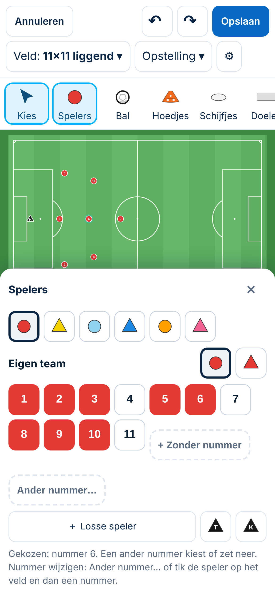
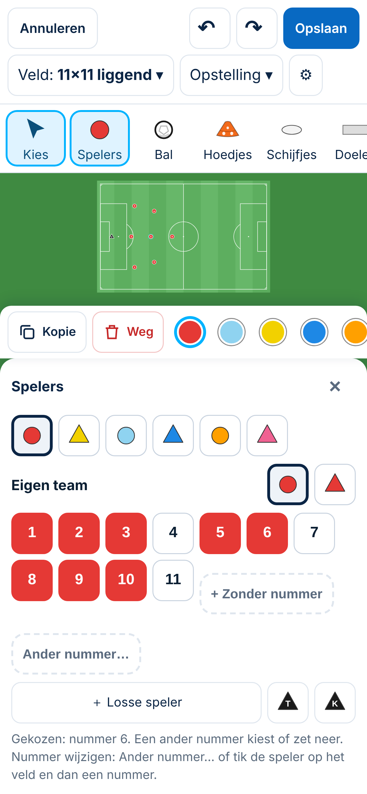
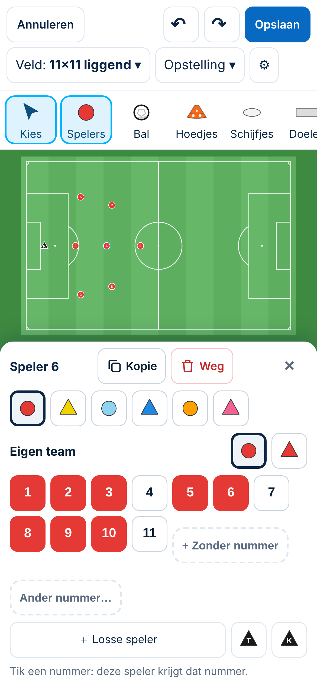

# Tekentool: de balk onder het veld achter het paneel Spelers (telefoon staand)

*4-11-2026. Spoor 3. **Voorstel met conceptbeelden. Gekozen: B, met de adviezen = Besluit NNN.** Gevonden bij het bouwen van de kleurrondjes van 44 px. Gemeten op 390 × 844 met de versie van de Besluiten 156 en 157. De concepten zijn een simulatie in de browser; de app is niet aangepast.*

## 1. Wat er nu gebeurt (gemeten)
Kies je op de telefoon (staand) een speler terwijl het paneel *Spelers* open is, dan verschijnt de balk onder het veld (*Dupliceren · kleuren · Verwijderen*). Die balk ligt **volledig achter het paneel**:
- de balk staat op 437–597 px;
- het paneel begint op 381 px;
- een tik daar raakt het paneel, niet de balk.

Gekanteld (Besluit 157) en op de laptop staat de balk wel vrij.

**Ook gemeten:** met een gekozen speler wordt het paneel hoger (de knop *Ander nummer…* en een langere uitleg). Het veld krimpt dan niet mee: de onderste 48 px van het veld (381–429 px) liggen achter het paneel.

**Gevolg:** verwijderen, dupliceren of de kleur wijzigen kan op de telefoon alleen als je eerst het paneel sluit. Dat staat nergens, en de knoppen zijn onzichtbaar.

## 2. Voorstel
| | Wat | Veld (gemeten) | Voordeel | Nadeel |
|---|---|---|---|---|
| A | De balk ligt **direct boven het paneel**, op één regel (kleuren schuiven opzij) | **184 × 119 px** | Alles op dezelfde plek als nu | Het veld wordt te klein om nog te zien wat je doet |
| **B (advies)** | Bij een gekozen speler staan **Kopie** en **Weg** in de **kop van het paneel** (*Speler 6 · Kopie · Weg · ×*); de balk onder het veld is weg zolang het paneel open is. Het veld krimpt netjes mee als het paneel hoger wordt | **338 × 219 px**, helemaal zichtbaar | Geen extra hoogte; de acties staan bij de speler waar je mee bezig bent; het veld blijft groot | De kleur wijzigen gaat dan niet in het paneel (zie keuze 1) |
| C | Het paneel **sluit vanzelf** als je op het veld een speler kiest | volledig | Eenvoudig | Een speler op het veld kiezen en dan een nummer tikken (Besluit 148) kan dan niet meer met het paneel open |

 

**Gevolgen van B:**
- Alleen op de telefoon staand, en alleen zolang het paneel *Spelers* open is.
- Laptop, gekanteld en het paneel dicht blijven gelijk.
- *Weg* is dezelfde handeling als *Verwijderen*, dus *Ongedaan maken* werkt (Besluit 148).
- Geen gegevens; opgeslagen tekeningen ongewijzigd.
- Maat **M**: een besluit (`Besluit NNN`, nummer vlak vóór het samenvoegen).
- In *Afgewezen ideeën* staat niets over dit onderwerp (gezocht 4-11).

## 3. Doelgroepen
- **Beginner:** ziet bij de gekozen speler meteen *Kopie* en *Weg*, en hoeft niet te weten dat hij eerst het paneel moet sluiten.
- **Ervaren trainer:** verwijdert of kopieert een speler zonder het paneel te sluiten en weer te openen.
- **Selectietrainer:** blijft het hele veld zien terwijl hij nummers en spelers aanpast.

## 4. Keuzes
1. **Kleur wijzigen bij B:**
   - (a) zoals nu: paneel sluiten, dan de kleur in de balk onder het veld. Dat is mijn advies: het komt weinig voor en er verandert niets aan Besluit 156.
   - (b) in het paneel: een ander team tikken verplaatst de gekozen speler naar dat team. Nu kiest zo'n tik een ander team en laat de speler los; dat zou dan anders werken.
2. **Woorden *Kopie* en *Weg*, of *Dupliceren* en *Verwijderen*?** Mijn advies: *Kopie* en *Weg* met een pictogram, omdat ze in de kop passen. De schermlezer noemt *Dupliceren* en *Verwijderen*.

## 5. Tests bij bouwen
1. Telefoon 390 × 844: speler kiezen met het paneel open → *Kopie* en *Weg* zichtbaar en tikbaar; *Weg* verwijdert, *Ongedaan maken* zet terug.
2. Met een gekozen speler ligt het hele veld boven het paneel (ook als het paneel hoger wordt).
3. Paneel dicht: de balk onder het veld werkt zoals nu (ook kleur wijzigen).
4. Laptop en gekanteld ongewijzigd: de tests van de Besluiten 156 en 157 blijven groen.
