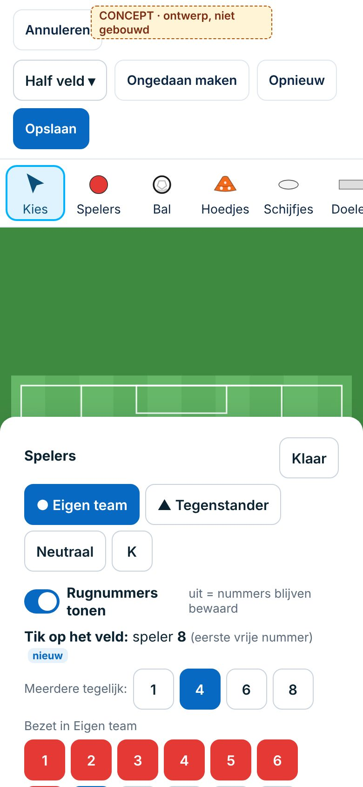
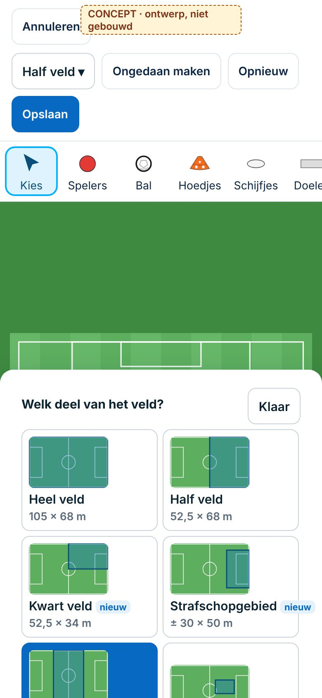
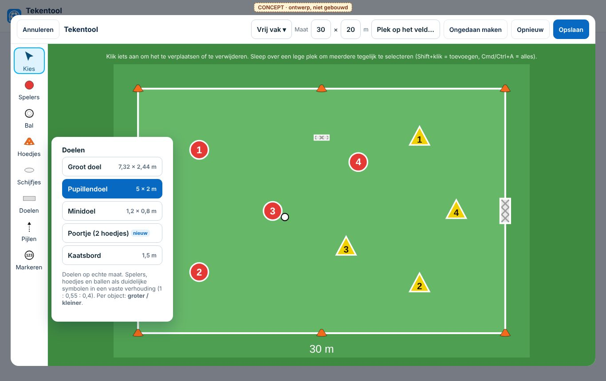

# Tekentool: kritische UX-analyse (spelers, nummers, verhoudingen, veldweergaven)

*4-11-2026. Spoor 3. **Onderzoek, geen besluit, niets gebouwd.** Niets gewijzigd aan code, database, rechten of productie. Bouwt voort op `ontwerpen.md` (27-10, ontwerp A = Besluit 126).*

**Werkwijze:**
- **Code:** `public/app/tekentool.js` (794 regels), de koppeling in `public/app/training.js`, het testscherm `public/tekenen.html`.
- **Bestaande tests:** `tests/app.spec.js`, label `@tekentool`.
- **Browser:** de gemelde fouten **nagespeeld** op `/tekenen` (Chromium, 1366 px en 390 px) en tikken geteld met een script.
- **Productie (alleen gelezen, alleen aantallen):** hoeveel tekeningen er zijn, met welk veld en welke objecten.

**Statuslabels:** ✅ bestaat · ⚠️ fout · ◐ beperking · ✏️ wens of voorstel.

**Conceptschermen:**

 

---

## 1. Wat er nu is

| Onderdeel | Hoe het werkt (code) | Status |
|---|---|---|
| **Objecten** | spelers (`p`) in 4 kleuren (rood, lichtblauw, geel, blauw), trainer *T*, keeper *K*; bal; hoedjes (6 kleuren); *vak met hoedjes* (4 hoedjes op de hoeken); schijfjes (5 kleuren); doelen `M` *pupillendoel 5×2 m* en `S` *minidoel 2×1 m*; kaatsbord; pijlen (loop, pass, dribbel, schot, met of zonder boog); muur/lijn; nummer (volgorde); vak markeren (met maat in meters); tekst | ✅ |
| **Groot doel** | soort `L` (7,4 m) wordt nog getekend in oude tekeningen, maar staat **niet in het menu** | ◐ |
| **Spelers en rugnummers** | gereedschap: nieuwe speler = **hoogste nummer van die kleur + 1**. Nummerbalk (alleen *Eigen team* rood en *Tegenstander* geel): 1–11 en *zonder nummer*; tik = speler op zijn plek in de 1-4-3-3, **nog een keer tikken = weg** (Besluit 124); met een gekozen speler = hem dat nummer geven (ruilen met een teamgenoot) | ✅ / ⚠️ zie §2 |
| **Opstelling** | *6 tegen 6 (2-1-2)* en *8 tegen 8 (3-3-1)*, eigen team of tegenstander. Keeper = apart object *K* (zwart, zonder team); veldspelers krijgen 1, 2, 3… in de volgorde van de lijst | ✅ / ◐ |
| **Teams en kleuren** | 4 teamkleuren; per tekening per team rondje of driehoek (Besluit 125). Kleur achteraf wijzigen (ook meerdere) geeft in het nieuwe team *hoogste + 1* | ✅ |
| **Verplaatsen** | slepen (ook een groep), magneet met hulplijnen (Alt = vrij) | ✅ |
| **Kopiëren** | *Dupliceren* / Ctrl+D (24 px verschoven, kopie geselecteerd) | ✅ |
| **Draaien** | alleen doel en kaatsbord, in stappen van 90° (`(r + 90) % 180`: alleen liggend of staand) | ◐ |
| **Verwijderen** | knop of Delete/Backspace, ook meerdere | ✅ |
| **Meerdere selecteren** | vak slepen over een lege plek; Shift+klik; Ctrl+A | ✅ laptop · ◐ telefoon (alleen het vak slepen) |
| **Ongedaan maken / opnieuw** | 60 stappen, knoppen en Ctrl+Z/Y | ✅ |
| **Doorlopend plaatsen** | gereedschap blijft aan tot Esc, rechtermuisklik, nog een keer op de knop of *Kies* | ✅ |
| **Zoomen in de editor** | geen (geen knijpen, geen zoomknop). Alleen *opslaan ingezoomd* (automatisch bijsnijden) | ◐ |
| **Formaat en schaal** | vaste maten in beeldpunten van het veld (± 10 px per meter op het grote veld); per object geen grootte instelbaar | ◐ zie §3 |
| **Veldweergaven** | *11×11 liggend*, *11×11* (staand), *8×8*, *6×6*, *Half veld*, *Vak* (groen zonder lijnen, 80 × 56 m) | ◐ zie §4 |
| **Opslaan** | JSON `{ field, items, zoom, vormen }` in de vorm (`vormen.tekening`, ook per variant), scope `eigen`. Het plaatje (JPEG) wordt gemaakt maar in de app niet bewaard; tegels en printen tekenen opnieuw uit de JSON (`staticSvg`) | ✅ |
| **In Plannen en Vormenbank** | alleen via de vorm: *Tekening maken/aanpassen* in het vormscherm (en per variant). Een training heeft geen eigen tekening; **een tekening aanpassen verandert hem in elke training** die de vorm gebruikt | ◐ |
| **Telefoon** | tip *"uittekenen gaat het snelst op een laptop"*; rail horizontaal scrollend; menu als paneel over het veld | ◐ |
| **Tests** | 5 tests `@tekentool`: tekenen + opslaan + opnieuw tonen, nummerbalk, vorm per team, rail/veld/pijl met boog, loopactie met boog. **Niet getest:** veld wisselen met objecten, opstelling + nummerbalk samen, nummer > 11, telefoon | ◐ |

**Productie (4-11, aantallen):** 19 tekeningen.
| Club | Veld | Tekeningen | Spelers (met nummer) | Doelen | Hoedjes/schijfjes |
|---|---|---|---|---|---|
| DCG | *Vak* | 11 | 104 (27) | 12 | 87 |
| DCG | *Half veld* | 3 | 36 (25) | 2 | 28 |
| Swift | *11×11 liggend* | 5 | 53 (48) | 3 | 40 |

- Geen oude shirts en geen groot doel (`L`) in gebruik; alleen doelmaten `M` en `S`.
- Bij DCG komen **2 keer dubbele nummers** binnen één team voor (oorzaak niet vastgesteld).
- Bij Swift komt **nummer 12** voor. Dat nummer staat niet in de nummerbalk, dus het is niet meer via de balk te kiezen.

---

## 2. Spelers en rugnummers

### Fouten, nagespeeld in de browser
| # | Wat je doet | Wat er gebeurt | Oorzaak |
|---|---|---|---|
| ⚠️ 1 | *Opstelling 8 tegen 8*, dan in *Spelers* op **1** tikken om een speler toe te voegen | speler 1 **verdwijnt** (labels K,1–7 → K,2–7) | Besluit 124: *nog een keer tikken = weg*. De knop toont "aan", maar dat is op een klein scherm niet te zien en de trainer verwacht *toevoegen* |
| ⚠️ 2 | Speler 3 weghalen, dan met het gereedschap een speler neerzetten | nieuwe speler krijgt **10**, niet het vrije nummer **3** | *hoogste + 1* in plaats van *eerste vrije* |
| ⚠️ 3 | Opstelling 3-3-1, daarna nummer 1 in de balk | in de opstelling is 1 een **verdediger**; in de balk is 1 de **keeper**-plek (1-4-3-3). De keeper *K* telt niet mee als nummer | twee nummersystemen (volgorde van de lijst tegenover posities in de 1-4-3-3) |
| ◐ 4 | Een speler nummer 14 geven | kan niet; de balk gaat tot 11 | geen invoer voor een eigen nummer |
| ◐ 5 | Teams lichtblauw en blauw (bijv. neutralen) | krijgen wel automatisch een nummer, maar hebben **geen nummerbalk** | balk alleen voor rood en geel |
| ◐ 6 | Nummers tijdelijk verbergen | kan niet voor alle spelers; alleen per speler *zonder nummer*, en dan is het nummer weg | geen weergave-instelling |
| ◐ 7 | Bewust twee keer nummer 5 | de balk **ruilt** altijd; dubbel kan alleen per ongeluk | geen keuze *dubbel toestaan* |

### Voorstel (✏️)
- **Eén regel voor elk team:** een nieuwe speler krijgt het **eerste vrije nummer** van dat team (1, 2, 4 → 3). De keeper telt mee als nummer 1 van zijn team, als hij een team heeft (nieuw: `team` bij de keeper; een oude *K* blijft zonder team).
- **Een bezet nummer tikken = die speler kiezen**, niet verwijderen. Verwijderen gaat via 🗑 bij de gekozen speler. Dit herziet Besluit 124 deels.
- **Zelf een nummer typen** (*#…*) voor 12–99; **dubbel mag** en geeft alleen een zachte melding (*"nummer 5 bestaat al · toch zo laten"*).
- **Nummers tonen aan/uit** per tekening (`nummers: false`): de nummers blijven bewaard, alleen het label verdwijnt. Er hoeft niets opnieuw gemaakt te worden.
- **Meerdere tegelijk:** in *Spelers* een aantal (1 · 4 · 6 · 8). Eén tik op het veld zet een rij spelers met de volgende vrije nummers, met de magneet op één lijn.
- **Opstelling** nummert per positie, net als de balk (keeper 1, dan volgens de gekozen speelwijze), zodat er één systeem is.
- **Nummerbalk** voor elk team dat op het veld staat (ook lichtblauw en blauw), standaard 1–11 en verder met *#…*.

**Gevolgen voor bestaande tekeningen:**
- **Geen gegevensmigratie.** Nummers blijven `n`; oude tekeningen tonen precies hetzelfde.
- Dubbele nummers in oude tekeningen blijven staan, want ze zijn nu toegestaan.
- Een oude keeper zonder `team` blijft een zwarte *K*.
- `nummers` ontbreekt in oude tekeningen; dat betekent *tonen*.

---

## 3. Veld en materiaal: verhoudingen

Op het grote veld is de schaal ongeveer **10 beeldpunten per meter**. Gemeten in de code:

| Object | Nu (op 10 px/m) | Werkelijk | Verhouding nu |
|---|---|---|---|
| Speler (rondje) | Ø 25 px = **2,5 m** | ± 0,5 m | symbool |
| Hoedje | 24 px = **2,4 m** | 0,2–0,3 m | **even groot als een speler** |
| Schijfje | 24 × 12 px = 2,4 m | 0,2 m | even groot als een speler |
| Bal | Ø 14 px = 1,4 m | 0,22 m | half een speler |
| Minidoel (`S`, label *2×1 m*) | 26 × 11 px = 2,6 m | 1,2–2 m | **even breed als een speler** |
| Pupillendoel (`M`, *5×2 m*) | 54 × 16 px = 5,4 m | 5 m | ✅ op maat |
| Groot doel (`L`, alleen oud) | 74 × 20 px = 7,4 m | 7,32 m | ✅ op maat, maar niet te kiezen |
| Kaatsbord | 72 × 16 px = **7,2 m** | 1–2 m | groter dan een pupillendoel |

**Velden (zelfde schaal nodig, maar niet overal zo):**
- *11×11* en *half veld*: ± 10 px/m ✅.
- *8×8*: 52 × 74 m tegenover KNVB 42,5 × 64 m (± 20% te groot).
- *6×6*: 42 × 58 m tegenover 30 × 42,5 m (± 40% te groot).
- *Vak*: 80 × 56 m zonder maat.

Ook de **maat van een gemarkeerd vak** (*"20 × 15 m"*) gaat uit van 10 px/m. Op 8×8, 6×6 en *Vak* klopt die maat dus niet.

**Waarom het onlogisch voelt:** doelen zijn op echte maat, maar spelers, hoedjes en ballen zijn symbolen. Daardoor is een hoedje even groot als een speler, een minidoel even groot als een speler, en een kaatsbord groter dan een pupillendoel.

### Voorstel (✏️)
- **Twee soorten maat, bewust:**
  - **Op echte maat:** veld, vakken, doelen, kaatsbord en poortjes. Die bepalen de ruimte.
  - **Als symbool:** spelers, hoedjes, schijfjes en bal, in een **vaste verhouding**. Speler 1 · hoedje 0,55 · schijfje 0,5 · bal 0,4. Op het scherm blijven ze altijd leesbaar (een minimummaat), ook als je inzoomt.
- **Doelen in het menu:** groot doel 7,32 × 2,44 · pupillendoel 5 × 2 · minidoel 1,2 × 0,8 · **poortje** (2 hoedjes met een instelbare breedte, nieuw).
- **Per object groter of kleiner** (3 stappen: `schaal` 0,75 · 1 · 1,25), voor wie het bewust anders wil.
- **Elke veldweergave in meters** (zie §4), zodat de maat van een vak altijd klopt.

**Gevolgen voor bestaande tekeningen:**
- Symbolen worden bij het tekenen uit de JSON opnieuw berekend. **Oude tekeningen tonen dus automatisch de nieuwe verhoudingen**, zonder migratie.
- Risico: hoedjes en ballen worden kleiner, zodat een tekening er luchtiger uitziet. Overlap wordt eerder minder dan meer.
- Doelmaat `S` van 2,6 naar 1,2 m: de 17 bestaande doelen zijn `M` of `S`. Een oud `S`-doel blijft **2 m** als vaste maat (`S` blijft betekenen *minidoel 2×1*), en het nieuwe minidoel krijgt een eigen soort. Zo verandert geen enkele bestaande tekening van ruimte.

---

## 4. Veldweergaven

| Weergave | Nu | Voorstel |
|---|---|---|
| Heel veld | ✅ liggend en staand | ✅ |
| Half veld | ✅ | ✅ |
| Kwart veld | ✖ | ✏️ |
| Vrij trainingsvak | ◐ *Vak* = vaste groene vlakte 80 × 56 m | ✏️ **eigen maat** (bijv. 30 × 20 m) en eventueel een **plek op het veld** |
| Rond het strafschopgebied | ✖ (alleen via half veld) | ✏️ |
| **Rond de middenlijn, vóór en achter** | ✖ | ✏️ **nieuw**: bijv. 20 m vóór en 20 m achter de middenlijn, over de hele breedte |
| 8×8 en 6×6 | ◐ (afwijkende maat, zie §3) | als *heel veld* van een ander formaat, op KNVB-maat |
| Zelf afmeting en positie bepalen | ✖ | ✏️ bij *Vrij vak* en eventueel bij elke uitsnede (slepen) |

### Fout bij wisselen: objecten verspringen of vallen buiten beeld ⚠️
De coördinaten zijn **beeldpunten van het gekozen veld**. Bij een ander veld blijven de getallen gelijk, maar het veld verandert van maat en richting.

Nagespeeld: *8 tegen 8* op *11×11 liggend*, daarna *11×11* (staand):
- de keeper staat dan halverwege de zijlijn;
- speler 1 staat in het andere strafschopgebied;
- bij *6×6* staat speler 7 **buiten het veld** en valt dus buiten het opgeslagen plaatje.

### Voorstel (✏️): één veld in meters, weergave = uitsnede
- Alle objecten krijgen een **plek in meters op één wereldveld** (het grote veld, of een vrij vak met eigen maat). Een *weergave* is alleen een **uitsnede**: welk stuk je ziet, liggend of staand.
- Wisselen van weergave verplaatst dus **niets**. Valt iets buiten de uitsnede, dan staat er *"2 buiten beeld · Toon"*. Er verdwijnt niets stil.
- *Rond de middenlijn*, *kwart veld* en *strafschopgebied* zijn dan alleen vaste uitsneden; *Vrij vak* is een eigen rechthoek. Er hoeft geen nieuwe tekenlogica per veld bij.
- **Zoomen in de editor:** knijpen (telefoon) of − / + (laptop) binnen de uitsnede. Lost ook de te kleine spelers op de telefoon op.

**Gevolgen voor bestaande tekeningen** (het grootste punt):
- Nieuwe tekeningen krijgen `v: 2` met `veld { soort, uitsnede, w, h }` en items in meters.
- **Oude tekeningen (`v` ontbreekt) blijven werken** via een omzetter bij het openen:
  - *11×11 liggend*: px / 10 = m;
  - *half veld*: de bijbehorende helft;
  - *Vak*: een vrij vak van 80 × 56 m;
  - *8×8* en *6×6*: hun eigen formaat, geschaald.
- Pas bij **Opslaan** wordt de tekening `v: 2`. Er is **geen databasemigratie of eenmalig script** nodig: de 19 tekeningen gaan om zodra iemand ze aanpast, en tot die tijd tekent `staticSvg` ze zoals nu.
- Een omzetter met tests (oude tekening → nieuw → dezelfde plek op het scherm) is verplicht.

---

## 5. Gebruiksgemak: tikken en klikken

*Rij 1–3 geteld met een script in de browser (`/tekenen`); rij 4–6 geteld uit de code. Typen niet meegeteld.*

| Taak | Laptop (1366 px) | Mobiel (390 px) | Opmerking |
|---|---|---|---|
| 8 tegen 8 met rugnummers (beide teams) | **4** (Opstelling ▾ · 8 tegen 8 · Opstelling ▾ · tegenstander) | **4** | snel, mits de vooraf ingestelde opstelling past; anders ± 20 (per team: Spelers · kleur · 8 tikken · keeper 2) |
| 6 hoedjes op een lijn | **7** (Hoedjes + 6), magneet lijnt uit | **7** | ⚠️ laptop: de **eerste tik viel op het open menu** en koos een andere kleur: 5 hoedjes geel in plaats van 6 oranje. Mobiel: het menu dekt de bovenkant van het veld af |
| 2 kleine doelen | **4** (Doelen · Minidoel · 2×) + draaien 2 per doel | **4** (+2 per doel) | draaien alleen in stappen van 90° |
| Eén speler verplaatsen en hernummeren | **3** (slepen · Spelers · nummer) | **3**, maar een speler is op 11×11 liggend ± **9 px** groot (norm 44 pt) | nummer > 11 kan niet |
| Oefenvorm dupliceren en aanpassen | **4** (vorm openen · Dupliceren · Tekening aanpassen · Opslaan) + naam typen | **4** | de kopie heet *"… (kopie)"*; goed |
| Opslaan en later openen | **1** (Opslaan) + **2** (vorm · Tekening aanpassen) | **1 + 2** | opslaan kost op een drukke computer tot 7 s (bekend, test wacht 20 s) |

**Telefoon (390 px), los van de tikken:**
- het veld is klein; standaard staat *liggend* aan, wat op een staand scherm de slechtste keuze is;
- de bovenbalk gebruikt 3 regels;
- de hulptekst noemt *Shift+klik* en *Cmd/Ctrl+A*, die op een telefoon niet bestaan;
- de rail scrolt, waardoor *Doelen* half buiten beeld staat.

---

## 6. Drie soorten trainers, één tekentool

| | Oudertrainer (snel en begrijpelijk) | Ervaren breedtetrainer (variaties) | Selectietrainer (teamtactiek) |
|---|---|---|---|
| Goed nu | rail met woorden, opstelling met één tik, magneet, ongedaan maken | dupliceren, varianten per vorm met eigen tekening, makkelijker/moeilijker | pijlen met boog, nummering 1-4-3-3, vakken met maat, sneltoetsen |
| Loopt vast | telefoon: te klein; een nummer tikken verwijdert; hoedje en speler even groot | nummers verspringen na kopiëren en kleur wisselen (*hoogste + 1*); vak zonder eigen maat | geen weergave rond de middenlijn of het strafschopgebied; wisselen van veld verplaatst de opstelling; geen fasen (start → vervolg) |
| Helpt het meest | gewone nummerlogica, grotere spelers op de telefoon, *Vrij vak 20 × 15* als begin | eerste vrij nummer, poortje, eigen vakmaat | wereldveld met uitsneden, zelf nummers 12–99, groot doel |

Alle drie gebruiken **dezelfde** objecten en hetzelfde opslagformaat. De verschillen zitten in de **startweergave** en in wat bovenaan het menu staat, niet in aparte functies.

---

## 7. Oplevering

### 7.1 Wat de tekentool goed doet
- **Opbouw:** een rustige rail met uitklapmenu's (Besluit 126), en de laatst gekozen variant blijft onthouden.
- **Snel werken:** doorlopend plaatsen, de magneet met hulplijnen, en ongedaan maken en opnieuw tot 60 stappen.
- **Spelers:** een opstelling met één tik, en rondje of driehoek per team.
- **Pijlen en vakken:** pijlen met boog en grepen; een vak met maat; een vak met hoedjes in één beweging.
- **Opslag:** de tekening wordt bewaard als gegevens (JSON) en niet als plaatje, zodat hij zich aan verbeteringen aanpast. Opslaan zoomt vanzelf in op het stuk waar getekend is.

### 7.2 Fouten en beperkingen
1. ⚠️ Een bezet nummer tikken **verwijdert** die speler.
2. ⚠️ Een nieuwe speler krijgt *hoogste + 1*, niet het eerste vrije nummer.
3. ⚠️ Opstelling en nummerbalk gebruiken **twee verschillende nummersystemen**; de keeper telt niet mee.
4. ⚠️ Een **ander veld** kiezen laat objecten verspringen of buiten beeld vallen.
5. ⚠️ Op de laptop kan het **open menu de eerste klik op het veld** opvangen.
6. ◐ Er gaat niets boven 11; geen balk voor de teams lichtblauw en blauw; nummers niet te verbergen; dubbel kan niet bewust.
7. ◐ Verhoudingen: hoedje = speler = minidoel; kaatsbord 7 m; 8×8 en 6×6 niet op maat; de vakmaat klopt alleen op het grote veld.
8. ◐ Er ontbreken weergaven: kwart veld, rond het strafschopgebied, rond de middenlijn, en een vrij vak met eigen maat. Er is geen zoom in de editor.
9. ◐ Draaien gaat alleen 0° of 90°; het groot doel staat niet in het menu.
10. ◐ Telefoon: tikvlakken op het veld zijn ver onder 44 pt; de hulptekst is voor de laptop.
11. ◐ Een tekening aanpassen verandert hem in **alle** trainingen met die vorm. Besluit 121 noemt *versies van een vorm*, maar dat is niet gebouwd. Versiebeheer van **trainingen** is afgewezen (Besluit 144). Aandachtspunt, geen voorstel.

### 7.3 Wat onnodig veel klikken kost
- Spelers zonder opstelling neerzetten: 1 tik per speler. Met *meerdere tegelijk* wordt dat 1 tik per rij.
- Een nummer herstellen na een onbedoeld verwijderen: ongedaan maken en zoeken.
- Doelen draaien: steeds kiezen en draaien.
- Op de telefoon mis tikken door kleine spelers, en eerst het menu sluiten.

### 7.4 De drie verbeteringen die direct de meeste tijd besparen
1. **Nummerlogica repareren** (fouten 1–3): eerste vrije nummer, een bezet nummer kiest de speler, één nummersysteem. Klein, geen datamigratie, raakt elke trainer.
2. **Weergave wisselen zonder verspringen + vrij vak met maat** (fout 4, wens middenlijn): het wereldveld in meters met uitsneden. Groter werk, maar het lost meteen de maat van het vak, de 8×8/6×6-maten en alle nieuwe weergaven op.
3. **Verhoudingen en doelen** (§3): een symboolverhouding speler : hoedje : bal, doelen op maat met groot doel en poortje, en op de telefoon een minimummaat met zoomen.

### 7.5 Voorstellen samengevat
Rugnummering in §2, objectschalen in §3, veldperspectieven in §4.

### 7.6 Conceptschermen
Zie boven:
- `concept-mobiel-spelers-390.jpg`: paneel *Spelers* met team, *nummers tonen*, eerste vrij nummer, meerdere tegelijk en bezette nummers;
- `concept-mobiel-veld-390.jpg`: *Welk deel van het veld?* met zes uitsneden, waaronder *Rond de middenlijn*;
- `concept-laptop-vak-doelen.jpg`: *Vrij vak 30 × 20 m*, doelen op maat met poortje, spelers en hoedjes in de nieuwe verhouding.

Normen nog na te lopen bij het voorbeeld voor het besluit: tikvlak 44 pt, contrast, *Beperk beweging*.

### 7.7 Gevolgen voor de 19 opgeslagen tekeningen
| Wijziging | Gegevens | Wat de trainer ziet |
|---|---|---|
| Nummerlogica | geen wijziging | niets verandert in oude tekeningen |
| Nummers tonen aan/uit | nieuw optioneel veld `nummers` | oud = tonen |
| Keeper per team | nieuw optioneel `team` | oude *K* blijft |
| Symboolverhouding | geen wijziging (berekend bij tekenen) | hoedjes en ballen kleiner, ook in oude tekeningen en op de print |
| Nieuw minidoel, groot doel, poortje | nieuwe soorten; `S` en `M` houden hun maat | oude doelen gelijk |
| Wereldveld in meters | `v: 2`; omzetten bij openen, opslaan als v2 | oude tekening opent op dezelfde plek; pas na *Opslaan* nieuw formaat |

**Geen databasemigratie en geen eenmalig script nodig.** Alles gebeurt in de app bij openen en opslaan, binnen de bestaande rij `vormen` (scope `eigen`). Geen wijziging aan rechten.

### 7.8 Benodigde tests
- **Nummers (nieuw):**
  - eerste vrij nummer na verwijderen;
  - een bezet nummer tikken kiest de speler en verwijdert niets;
  - opstelling + balk geven dezelfde nummers;
  - nummer 14 typen;
  - bewust dubbel;
  - *nummers tonen* uit en weer aan laat `n` gelijk;
  - meerdere tegelijk.
- **Veld wisselen (nieuw):** opstelling op heel veld → half → middenlijn → terug: elke speler staat op dezelfde plek in meters, en *buiten beeld* wordt getoond.
- **Omzetter (nieuw, zonder browser):** voor elk oud veld (`liggend`, `staand`, `f8`, `f6`, `half`, `vak`) een vaste oude tekening → v2 → dezelfde schermpositie (± 1 px). Ook een momentopname van `staticSvg` vóór en na.
- **Verhoudingen:** speler > hoedje > bal; doelmaten in meters; vakmaat klopt op elk veld.
- **Telefoon 390 px:** speler tikken en slepen; menu dekt de eerste tik niet af; *Doelen* bereikbaar.
- **Bestaand groen houden:** de 5 `@tekentool`-tests. De nummerbalk-test verwacht nu *nog een keer tikken = weg* en wordt aangepast als dat wordt herzien. Ook `tests/kiezer.spec.js` en `tests/trainingskaart.spec.js` (tegels en printen gebruiken `staticSvg`).

### 7.9 Prioriteiten
| Prioriteit | Wat | Maat |
|---|---|---|
| **Directe reparaties** | nummerlogica (fouten 1–3); eerste tik niet laten opvangen door het menu (5); hulptekst op de telefoon zonder Shift/Cmd | M (herziet Besluit 124 deels) |
| **Gebruiksgemak** | meerdere spelers tegelijk; nummers tonen aan/uit; eigen nummer 12–99; balk voor alle teams; symboolverhouding; groot doel, minidoel op maat, poortje; draaien in vrije hoek (of 45°); telefoon: staand veld als begin, minimummaat | M |
| **Latere uitbreidingen** | wereldveld in meters met uitsneden (kwart, strafschopgebied, **middenlijn**, vrij vak met maat en plek); zoomen in de editor; per object groter/kleiner; fasen in een tekening (start → vervolg, al genoemd in de marktanalyse) | M–L (geen rechten; wel de omzetter) |

**Afgewezen ideeën gecontroleerd:** shirtjes met cijfers (Besluit 132) zitten niet in dit voorstel. Animaties stonden op *later* (marktanalyse) en blijven daar.

**Mijn advies:** begin met de directe reparaties (één kleine PR met tests). Maak daarna het wereldveld als eigen PR, want dat is de enige wijziging met een omzetter voor oude tekeningen. De middenlijn en het vrije vak volgen daaruit bijna vanzelf.
