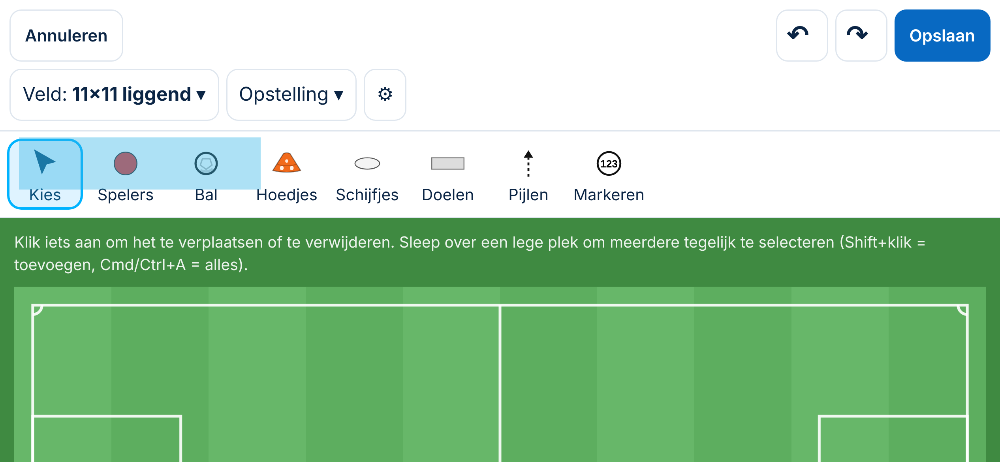
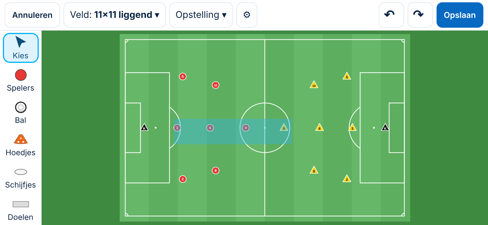
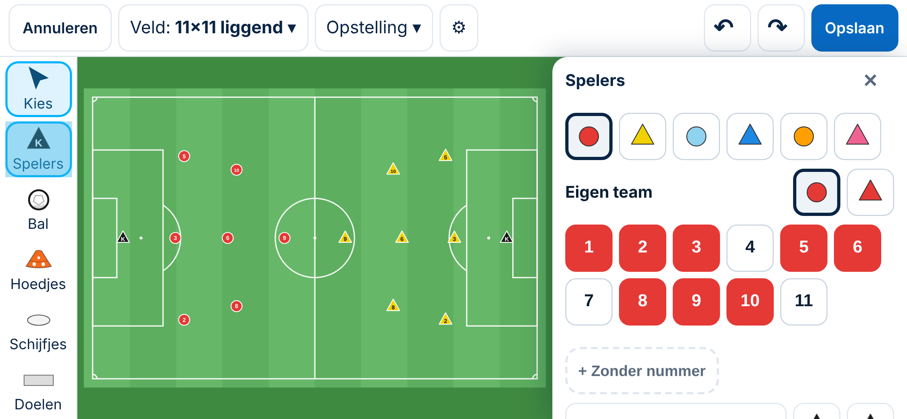
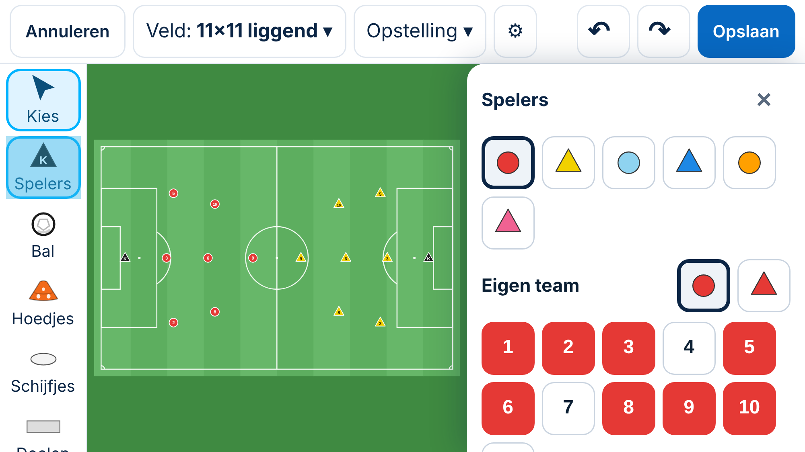

# Tekentool: de telefoon gekanteld (liggend)

*4-11-2026. Spoor 3. **Onderzoek met conceptbeelden; niets gebouwd.** Gemeten met de versie van Besluit 156 (paneel *Spelers*) op `/tekenen`, bij vier telefoons die gekanteld zijn. Het concept is een simulatie in de browser (extra opmaak over de bestaande app heen); de app is niet aangepast.*

## 1. Wat er nu gebeurt (gemeten)
| Telefoon (gekanteld) | Indeling | Veld zichtbaar | Zonder tip | Met menu *Spelers* | Met menu *Hoedjes* | 11×11 staand |
|---|---|---|---|---|---|---|
| iPhone SE 667 × 375 | telefoon | **19%** | 32% | **0%** | 13% | 13% |
| Android 780 × 360 | telefoon | **13%** | 24% | **0%** | 8% | 10% |
| iPhone 13 844 × 390 | telefoon | **17%** | 28% | **0%** | 13% | 12% |
| iPhone Pro Max 932 × 430 | **laptop** (breder dan 900 px) | 100% | 100% | 100% | 100% | 100% |

**Bevestigde fout:**
- **Gekanteld is het grootste deel van het veld onbereikbaar** op de meeste telefoons.
  - Bovenaan staan de bovenbalk (111 px), de tip (56), de rail als rij (73) en de hulptekst (38): samen 278 px van de 360–390 px hoogte.
  - Het veld krijgt zijn breedte (bijv. 820 px) en wordt daardoor 531 px hoog. Dat past niet, en het tekenscherm **scrolt niet**.
  - Je ziet dus alleen een strook bovenaan het veld en kunt de rest niet bereiken. Met het menu *Spelers* open zie je niets meer van het veld.
- Een **Pro Max** (932 px breed) valt boven de grens van 900 px en krijgt de laptopindeling: het veld past wel, maar is klein (304 × 197 px).

**Oorzaak in de opmaak** (`public/app/tekentool.css`): onder 900 px breed staat de telefoonindeling vast (alles onder elkaar). Er is geen aparte indeling voor een telefoon die gekanteld is, en het veld wordt niet beperkt tot de hoogte die over is.

## 2. Voorstel
| | Wat | Voordeel | Nadeel |
|---|---|---|---|
| **A (advies)** | **Eigen indeling voor een gekantelde telefoon** (breed én lager dan 500 px): rail **links** (zoals op de laptop), bovenbalk op **één regel**, geen tip en geen hulptekst, het veld **past in de hoogte**. Het paneel *Spelers* ligt **rechts naast het veld** (hoogstens 330 px breed, en het scrolt). De andere menu's openen naast de rail | Het hele veld is zichtbaar, ook met het paneel open; elke knop is bereikbaar; dezelfde onderdelen als staand, alleen anders geplaatst | Een derde indeling naast laptop en telefoon staand |
| B | Alleen het veld laten passen in de hoogte die over is (en de rest gelijk laten) | Kleine wijziging | Het veld wordt heel klein (± 168 px hoog); met het paneel open nog steeds 0% |
| C | Een melding *"draai je telefoon"* | Geen bouwwerk | Lost niets op; wie liggend wil tekenen, kan dat niet |

**Concept A gemeten:**
| Telefoon (gekanteld) | Veld zonder menu | Veld met paneel *Spelers* | Bovenbalk | Onderste knop van het paneel |
|---|---|---|---|---|
| 667 × 375 | 479 × 310, **100%** | 303 × 196 naast het paneel, **100%** | 53 px | bereikbaar (scrollen) |
| 844 × 390 | 502 × 325, **100%** | 430 × 278 naast het paneel, **100%** | 53 px | bereikbaar |

**Extra voordeel:** spelers zijn gekanteld groter dan staand (± 12–14 px tegenover ± 9 px op 390 px staand), omdat het veld breder kan zijn. Gekanteld tekenen wordt zo een echte keuze op de telefoon.

**Gevolgen:**
- Alleen opmaak voor gekantelde telefoons (breder dan hoog en lager dan 500 px). Laptop, tablet en de staande telefoon blijven gelijk.
- Geen gegevens en geen gevolgen voor opgeslagen tekeningen.
- Maat **M**: een gewijzigd scherm, dus een besluit en een voorbeeld (dit document).
- Herziet Besluit 156 op één punt: gekanteld ligt het paneel rechts in plaats van onderaan.
- In *Afgewezen ideeën* staat niets over dit onderwerp (gezocht 4-11).

## 3. Doelgroepen
- **Beginner:** draait de telefoon vaak vanzelf om een breder veld te zien. Nu ziet hij dan bijna niets en denkt hij dat de tekentool kapot is. Met A werkt het gewoon.
- **Ervaren trainer:** kan op de telefoon gekanteld sneller en nauwkeuriger tekenen (grotere spelers, het hele veld in beeld).
- **Selectietrainer:** een heel 11×11-veld met beide teams en het paneel ernaast, op één scherm.

## 4. Keuzes
1. **A** (mijn advies), of eerst alleen **B**?
2. **De grens voor "gekanteld"** is lager dan 500 px. Daarmee valt een tablet in staande of liggende stand buiten deze indeling. Mijn advies: zo laten.
3. **Pro Max gekanteld** (932 px breed) houdt de laptopindeling; daar past het veld al. Mijn advies: zo laten. Een kleiner veld daar is een apart punt (zoomen).

## 5. Tests bij bouwen
1. Op 667 × 375, 780 × 360 en 844 × 390 gekanteld is het veld volledig zichtbaar, met en zonder paneel *Spelers*.
2. Gekanteld zijn alle knoppen in het paneel bereikbaar (scrollen), en de rail is helemaal te gebruiken.
3. Staand (390 × 844) en laptop zijn ongewijzigd: de tests van Besluit 156 blijven groen.
4. Draaien van staand naar gekanteld met het paneel open: het veld en het paneel springen netjes naar hun nieuwe plek.
