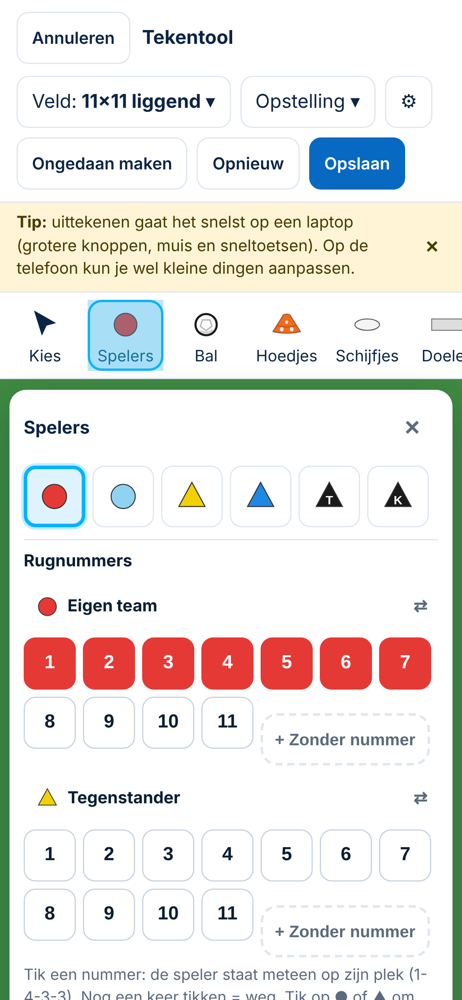
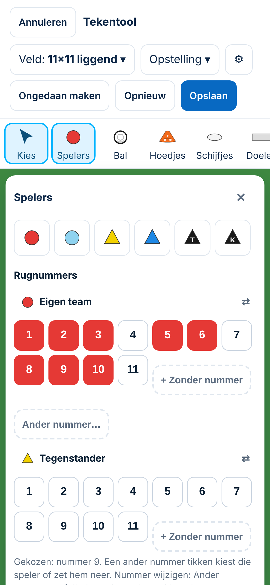

# Tekentool — prioriteit 1: rugnummering en spelers plaatsen

*4-11-2026. Spoor 3. **Onderzoeksrapport, alleen documenten.** Gemeten op `main` (`eb4dcd0`) en op `bouw/tekentool-nummering` (voorstel A). Browser: `/tekenen`, laptop 1366 px en telefoon 390 px, met een script dat de spelers op het veld uitleest. Niets gewijzigd aan database of productie.*

**Uitkomst in het kort:** de gemelde fouten zijn bevestigd. Voorstel A herstelt de nummering. De richting is op 4-11 goedgekeurd en vastgelegd als **Besluit 148** (pull request #110, nog niet samengevoegd). Tijdens de controle zijn twee fouten in de eerste versie van voorstel A gevonden en hersteld. Vijf problemen buiten de nummering blijven open; zie §4.

## 1. Hoe het nu werkt (`main`)

| Vraag | Werking in de code (`public/app/tekentool.js`) |
|---|---|
| **Spelers toevoegen** | Vier manieren: (1) gereedschap *Spelers* (of toets 1–4) en tik op het veld; (2) een **nummerknop** in het menu *Spelers*: de speler komt op zijn plek in de 1-4-3-3; (3) **Opstelling** 2-1-2 of 3-3-1 (eigen team of tegenstander); (4) **Dupliceren**. Trainer *T* en keeper *K* zijn aparte soorten zonder nummer. |
| **Rugnummers toewijzen** | Gereedschap, dupliceren en een andere teamkleur geven *hoogste nummer + 1*: een gat wordt niet opnieuw gebruikt. De nummerknop gebruikt het getikte nummer. *Opstelling* telt 1, 2, 3… in de volgorde van de lijst. Een tekening heeft dus **drie nummerregels**. Daarnaast heeft het object *Nummer* (volgorde, Markeren) een eigen teller. |
| **Losse nummerknoppen** | Er zijn knoppen 1–11 en *+ Zonder nummer*, alleen voor *Eigen team* (rood) en *Tegenstander* (geel). Lichtblauw en blauw hebben geen knoppen. Is er geen speler gekozen: staat het nummer er nog niet, dan wordt de speler neergezet; **staat het er al, dan wordt hij verwijderd** (Besluit 124). Is er wel een speler gekozen, dan krijgt die het nummer; heeft een teamgenoot het al, dan **ruilen** ze. |
| **Opstelling** | Er zijn vaste plekken als fractie van het veld. De keeper is een zwarte *K* zonder team; de veldspelers krijgen 1, 2, 3… Kies je de opstelling twee keer, dan komen er een tweede keeper en een tweede rij spelers **precies op dezelfde plekken**. |
| **Selecteren** | Tik op een speler (ook terwijl een gereedschap aan staat). Een vak slepen kiest meerdere, Shift+klik en Ctrl+A ook (alleen op de laptop). |
| **Verplaatsen** | Slepen, met de magneet (hulplijnen; Alt = vrij). |
| **Verwijderen** | De knop *Verwijderen* onder het veld of Delete/Backspace; óf onbedoeld via een nummerknop. Alles kan met *Ongedaan maken* (60 stappen) terug. |
| **Opslaan** | JSON `{ field, items, zoom, vormen }` bij de vorm (scope `eigen`). Tegels en printen tekenen opnieuw uit de JSON. Een speler: `{ t: "p", c: kleur, n: nummer, x, y }` in beeldpunten van het gekozen veld. |

### Waarom een bestaand nummer aantikken een speler verwijderde
Dat was bewust zo ontworpen (Besluit 124: *"nog een keer tikken = weg"*). De knop werkte als aan/uit-schakelaar. Een trainer verwacht bij een nummerknop echter *toevoegen* of *aanwijzen*. Op de telefoon zie je het verschil tussen een gevulde en een lege knop bovendien slecht.

### Wat dezelfde logica deelt en wat niet
| Plek | Regel op `main` | Na Besluit 148 |
|---|---|---|
| Gereedschap, dupliceren, andere kleur | hoogste + 1 | eerste vrije |
| Nummerknop | vaste plek in de 1-4-3-3; bestaand nummer = weg | vaste plek; bestaand nummer = kiezen |
| Opstelling | 1, 2, 3… op volgorde; keeper zonder team | vast nummer per plek uit de 1-4-3-3; keeper = 1 van zijn team |
| Nummer van een gekozen speler | ruilen | geen ruil (dubbel mag) |
| *Rugnummer +1* | alleen nog voor oude shirts | ongewijzigd |
| Volgordenummer (Markeren) | eigen teller | ongewijzigd (is geen rugnummer) |

## 2. Bevestigde fouten (gemeten)

| # | Wat je doet | `main` | Voorstel A (na de controles) |
|---|---|---|---|
| F1 | nummer 2 en 3 zetten, dan 2 nog eens tikken | 2 **verwijderd** | 2 gekozen |
| F3 | Opstelling 3-3-1, dan knop 9 | **tweede speler** op de spitsplek (8 rode veldspelers) | de spits (9) wordt gekozen |
| F3c | daarna knop 1 | een **verdediger verwijderd** | de keeper wordt gekozen |
| F5 | rood 3 gekozen, tik *Tegenstander 5* | rood 3 en rood 5 **ruilen** | rood blijft gelijk; er komt een gele 5 bij |
| F6 | 1, 2, 3; 2 weg; nieuwe speler met het gereedschap | krijgt **4** | krijgt **2** |
| — | bewust dubbel / nummer 14 | kan niet | kan (*Ander nummer…*) |

**Herkomst van de dubbele nummers bij DCG (productie, 2×):** in de huidige code kan een dubbel nummer niet ontstaan. Vóór Besluit 124 (eerste versie, 27-10) had een speler de knop *Rugnummer +1* zonder controle; dat is de waarschijnlijke oorzaak. Dit is **niet bewezen**, want de productie is niet per tekening gelezen. De ingevoerde DCG-tekeningen (`supabase/scripts/2026-10-27_dcg_training_eerste.sql`) hebben geen dubbele nummers.

**Twee fouten in de eerste versie van voorstel A** (gevonden bij de controles en hersteld vóór de pull request):
- Een speler die met een knop was gekozen, werd door de volgende knop **hernummerd**: tik 5 en dan 7, en speler 5 wordt 7.
- Bij *Opstelling 3-3-1* kreeg de **spits nummer 3** en de middenvelder 9, door nummers plek voor plek aan het dichtstbijzijnde vrije nummer te geven.

## 3. Bestaande tekeningen
Er is geen migratie nodig. Besluit 148 verandert het opslagformaat en de tekencode niet. Openen en opslaan geeft precies dezelfde gegevens; dat is getest met een tekening met een dubbel nummer, nummer 12, een keeper zonder team, spelers zonder nummer en doelen M en S. Het enige nieuwe gegeven is `team` bij een keeper die je **nieuw** via *Opstelling* plaatst.

## 4. Gevonden buiten de nummering (bestaat op `main` én na Besluit 148; voor de chat Ontwikkeling Tekentool)
| # | Wat | Gemeten | Prioriteit |
|---|---|---|---|
| B1 | Het menu *Spelers* zet het gereedschap *speler rood* aan. Op de laptop zet **een klik op het veld om het menu te sluiten een speler neer** (Besluit 126 zegt: klikken op het veld sluit het menu) | laptop: 1 onbedoelde speler | 2 (snel plaatsen en selecteren) |
| B2 | Op de telefoon **bedekt het menu *Spelers* het hele veld** (veld 377–832 px, menu 329–883 px); je ziet niet waar een speler komt | 390 px | 6 (mobiel) |
| B3 | Een speler is op de telefoon **8,7 px** groot op *11×11 liggend* (laptop 23 px); dat is ver onder het tikvlak van 44 pt | 390 px | 6 |
| B4 | **Opstelling twee keer** zet een tweede keeper en vijf spelers precies op dezelfde plekken | beide | 1/2 (klein, apart) |
| B5 | **Veld wisselen verplaatst niets**: na 3-3-1 voor beide teams op *liggend* staan op *staand* 7, op *6×6* 9 spelers buiten de lijnen | beide | 3 (veldcoördinaten) |
| B6 | Op ***Half veld*** (doel boven) komt de keeper van het eigen team **bij de middenlijn** (y 467 van 525) | beide | 3/4 |

 

## 5. Drie doelgroepen
- **Beginnende vrijwilliger:** de nummerknoppen zijn de snelste weg (één tik = speler op zijn plek). Op `main` verwijderde een misser een speler; met Besluit 148 kan een tik niets meer weghalen. Blijft lastig: B1, B2 en B3 (vooral op de telefoon).
- **Ervaren breedtetrainer:** *eerste vrije nummer* en *Opstelling* met dezelfde nummers maken hergebruik voorspelbaar. Mist nog: een eigen startopstelling bewaren (staat bij *Later / ideeën*, Besluit 124).
- **Selectietrainer:** wil vaste nummers per positie, nummers boven 11 en bewust dubbel. Dat kan nu met *Ander nummer…* en per veldspeler. Mist nog: nummerknoppen voor lichtblauw en blauw, en nummers tijdelijk verbergen.

## 6. Keuzes voor jullie (met ChatGPT)
1. **B1 en B2 eerst?** Mijn advies: B1 is klein (het menu *Spelers* zet het gereedschap niet meer vanzelf aan) en levert onbedoelde spelers op. Neem die als eerstvolgende reparatie. B2 en B3 horen bij het mobiele ontwerp.
2. **B4:** bij *Opstelling* een team vervangen of erbij zetten? Mijn advies: vervangen, met *Ongedaan maken*.
3. **Nummerknoppen voor lichtblauw en blauw?** Alleen als trainers echt vier genummerde teams tekenen. Dat is eerst een vraag aan de doelgroep.

## 7. Tests die nodig zijn (status)
- ✅ Nummering (8 tests in `tests/tekentool-nummering.spec.js`): opstelling = balk (wie welk nummer heeft), eerste vrije, dubbel, *Ander nummer…*, verwijderen alleen met *Verwijderen*, keeper, telefoon zonder onbedoelde plaatsing, oude tekening ongewijzigd.
- ☐ Bij B1: menu *Spelers* sluiten met een klik op het veld zet niets neer.
- ☐ Bij B5: veld wisselen met spelers (pas na het ontwerp voor veldcoördinaten).
- ☐ Telefoon: tikvlak van een speler ≥ 44 pt (na het mobiele ontwerp).
