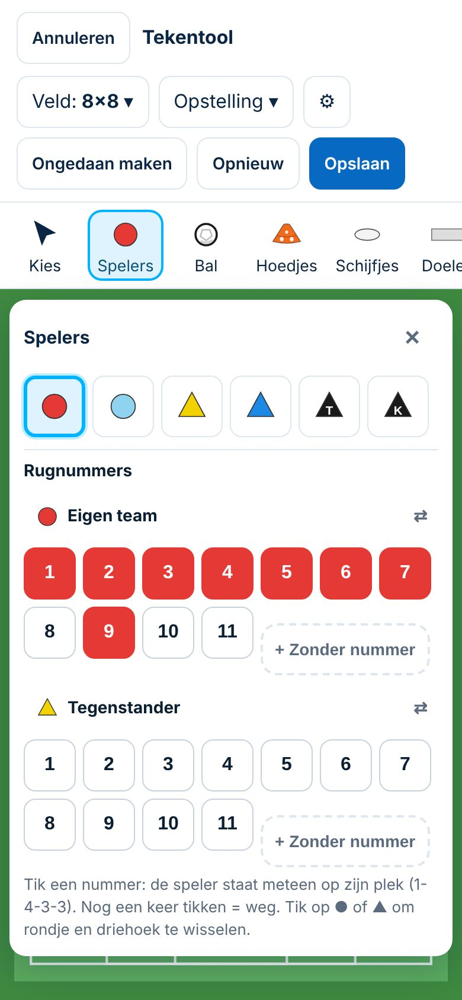
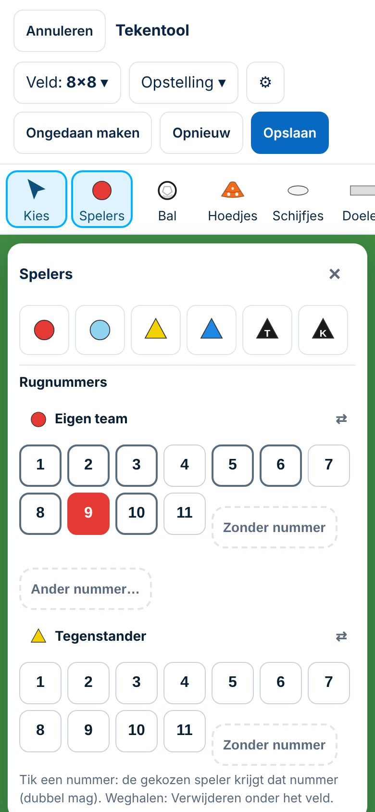

# Voorstel A — Reparatie rugnummering tekentool

*4-11-2026. Spoor 3, maat M (gedrag van een bestaande functie verandert; herziet Besluit 124 deels). **Richting goedgekeurd (4-11) = Besluit 148. Pull request vanaf branch `bouw/tekentool-nummering`; niet samengevoegd en niet gepubliceerd.** Zie *Controles na akkoord* onderaan: daar zijn twee fouten in deze eerste versie gevonden en hersteld. Geen database- of productiewijziging. Vervolg in de aparte chat *ClubComm — Ontwikkeling Tekentool*.*

## Begrippen, uit elkaar gehouden
| Begrip | In de gegevens | Betekenis |
|---|---|---|
| Technisch object | de plek van het item in `items` (geen apart id; voor deze reparatie niet nodig) | welke speler het is |
| Rugnummer | `n` (0 = zonder nummer) | alleen een label; je mag het aanpassen; mag bewust dubbel |
| Teamkleur | `c` (rood, lichtblauw, geel, blauw; keeper en trainer apart) | bij welk team de speler hoort |
| Keeper van een team | **nieuw, optioneel** `team` bij een keeper uit *Opstelling* | telt als nummer 1 van dat team |
| Voorgesteld nummer | wordt berekend, niet bewaard | het **eerste vrije** nummer in dat team |

## Exacte oorzaak (code op `main`, `public/app/tekentool.js`)
1. **Verwijderen met een nummerknop.** `tikNummer()`: staat het nummer al op het veld, dan `st.items.splice(i, 1)`. Dat is het gedrag uit Besluit 124: *"nog een keer tikken = weg"*.
2. **Hoogste + 1.** Bij het neerzetten van een speler, bij dupliceren en bij een andere teamkleur: `1 + max(n)`. Een gat (bijvoorbeeld een verwijderde 3) wordt nooit opnieuw gebruikt.
3. **Twee nummersystemen.** `zetOpstelling()` nummert 1, 2, 3… in de volgorde van de lijst, met een keeper *K* zonder team. De nummerbalk zet nummer n op de plek van n in de 1-4-3-3 (1 = keeper). Daardoor is na *8 tegen 8* speler 1 een verdediger, en zet de knop 9 een **tweede** speler op de spitsplek.
4. **Ruilen.** Een gekozen speler een bezet nummer geven ruilt altijd met de teamgenoot. Bewust dubbel kan dus niet.
5. **Ander team.** Is er een speler van het eigen team gekozen en tik je *Zonder nummer* bij de tegenstander, dan verliest de gekozen speler zijn nummer.
6. Er is geen invoer voor 12–99.

## Gewijzigde bediening
| Handeling | Vóór | Na |
|---|---|---|
| Nummerknop van een nummer dat **er nog niet is** | speler op zijn plek | gelijk |
| Nummerknop van een nummer dat **er al is** | speler **verwijderd** | die speler wordt **gekozen** (verplaatsen, hernummeren, bewust verwijderen) |
| Speler verwijderen | ook via de nummerknop | **alleen** met *Verwijderen* (of Delete); *Ongedaan maken* werkt |
| Nieuwe speler (gereedschap, dupliceren, ander team) | hoogste + 1 | **eerste vrije** nummer |
| Speler **op het veld** gekozen, bezet nummer tikken | ruilen | **dubbel**; de knop toont *2×*, de schermlezer *"staat er 2 keer"* |
| Speler **met een nummerknop** gekozen, ander nummer tikken | (bestond niet) | kiest die speler of zet hem neer; de gekozen speler **houdt** zijn nummer (zie controle 3) |
| Dubbel nummer tikken | eerste wordt verwijderd | eerst de eerst neergezette, nog een keer = de volgende (zie controle 1) |
| Gekozen speler, nummer 14 | kan niet | **Ander nummer…** (1–99, leeg = zonder nummer) |
| Gekozen speler, knop van het andere team | wijzigt de gekozen speler | geldt niet voor de gekozen speler |
| Gekozen speler: welke nummers zijn bezet? | niet te zien | bezette nummers **omrand** |
| *Opstelling* 2-1-2 en 3-3-1 | 1, 2, 3… in lijstvolgorde; keeper zonder team | **vast nummer per plek** uit de 1-4-3-3: **keeper 1**; 3-3-1 = 5, 3, 2 achter · 10, 6, 8 midden · **9 spits**; 2-1-2 = 4, 3 · 6 · 10, 8. Bezet: dichtstbijzijnde vrije nummer |

 

*Links vóór, rechts na: 8×8, opstelling 3-3-1, daarna knop 9.*
- **Vóór:** er komt een tweede speler bij op de spitsplek.
- **Na:** de spits (9) wordt gekozen, en de bezette nummers zijn omrand.

## Meting: mislukte handelingen en correcties
*Script in de browser, op `/tekenen`, laptop 1366 px en mobiel 390 px. "Correcties" = extra handelingen om het bedoelde resultaat alsnog te krijgen.*

### Vóór (main eb4dcd0)
| Scherm | Taak | Tikken | Uitkomst | Correcties |
|---|---|---|---|---|
| laptop | T1 een bestaand nummer aantikken om die speler te kiezen | 2 | MISLUKT (speler 2 verwijderd) | 2 |
| laptop | T3 laagste veldspeler (1) verwijderen, nieuwe speler krijgt 1 | 6 | MISLUKT (kreeg 8) | 2 |
| laptop | T4 speler 1 bewust ook nummer 2 (dubbel) | 3 | MISLUKT (geruild: 2 komt 1× voor, 1 1×) | kan niet |
| laptop | T5 na 3-3-1 nummer 9 (spits) aantikken | 3 | MISLUKT (tweede speler op de spitsplek) | 2 |
| laptop | T6 speler nummer 14 geven | 4 | MISLUKT (kan niet) | kan niet |
| laptop | T7 speler verwijderen (expliciet) en ongedaan maken | 3 | gelukt | 0 |
| mobiel | T1 een bestaand nummer aantikken om die speler te kiezen | 2 | MISLUKT (speler 2 verwijderd) | 2 |
| mobiel | T3 laagste veldspeler (1) verwijderen, nieuwe speler krijgt 1 | 6 | MISLUKT (kreeg 7) | 2 |
| mobiel | T4 speler 1 bewust ook nummer 2 (dubbel) | 3 | MISLUKT (geruild: 2 komt 1× voor, 1 1×) | kan niet |
| mobiel | T5 na 3-3-1 nummer 9 (spits) aantikken | 3 | MISLUKT (tweede speler op de spitsplek) | 2 |
| mobiel | T6 speler nummer 14 geven | 4 | MISLUKT (kan niet) | kan niet |
| mobiel | T7 speler verwijderen (expliciet) en ongedaan maken | 3 | gelukt | 0 |

### Na (bouw/tekentool-nummering)
| Scherm | Taak | Tikken | Uitkomst | Correcties |
|---|---|---|---|---|
| laptop | T1 een bestaand nummer aantikken om die speler te kiezen | 2 | gelukt | 0 |
| laptop | T3 laagste veldspeler (2) verwijderen, nieuwe speler krijgt 2 | 6 | gelukt | 0 |
| laptop | T4 speler 5 bewust ook nummer 6 (dubbel) | 3 | gelukt | 0 |
| laptop | T5 na 3-3-1 nummer 9 (spits) aantikken | 3 | gelukt, **maar** 9 was de middenvelder (zie controle 4) | 0 |
| laptop | T6 speler nummer 14 geven | 4 | gelukt | 0 |
| laptop | T7 speler verwijderen (expliciet) en ongedaan maken | 3 | gelukt | 0 |
| mobiel | T1 een bestaand nummer aantikken om die speler te kiezen | 2 | gelukt | 0 |
| mobiel | T3 laagste veldspeler (2) verwijderen, nieuwe speler krijgt 2 | 6 | MISLUKT (kreeg 3) | 2 |
| mobiel | T4 speler 5 bewust ook nummer 6 (dubbel) | 3 | gelukt | 0 |
| mobiel | T5 na 3-3-1 nummer 9 (spits) aantikken | 3 | gelukt, **maar** 9 was de middenvelder (zie controle 4) | 0 |
| mobiel | T6 speler nummer 14 geven | 4 | gelukt | 0 |
| mobiel | T7 speler verwijderen (expliciet) en ongedaan maken | 3 | gelukt | 0 |

**De ene mislukking ná de reparatie (mobiel, T3) komt niet door de nummering.** Een speler is op de telefoon ± 9 px groot. Het script tikte daardoor een buurspeler aan en verwijderde die. De nieuwe speler kreeg toen terecht het vrijgekomen nummer. Dit is het probleem met de **mobiele bediening** (prioriteit 6), niet een nummerfout.

## Tests
- **Nieuw: `tests/tekentool-nummering.spec.js`** (5 tests):
  1. opstelling en balk geven dezelfde nummers; keeper = 1; een bestaand nummer tikken kiest de speler; bezette nummers omrand;
  2. eerste vrije nummer, ook na verwijderen en dupliceren;
  3. bewust dubbel, *Ander nummer… 14*, knop van het andere team, verwijderen + ongedaan maken;
  4. telefoon (Pixel 5): een bestaand nummer kiest de speler;
  5. **bestaande tekening** (dubbel nummer, nummer 12, keeper zonder team, spelers zonder nummer, doelen M en S): openen en opslaan → gegevens en tegel precies gelijk.
- **Aangepast:** `tekentool: nummerbalk en rood schijfje` in `tests/app.spec.js` (de stap *"nog een keer = weg"* wordt *"kiest de speler"*).
- **Groen:** alle 10 tests `@tekentool`, `tests/kiezer.spec.js` en `tests/trainingskaart.spec.js` (die tonen tekeningen). De volledige `npm test` volgt vóór een eventuele pull request.

## Bestaande tekeningen blijven ongewijzigd
- De tekencode (`itemSvg`, `fieldSvg`, `staticSvg`) en het opslagformaat zijn **niet** gewijzigd. Alleen bediening en nummerkeuze zijn veranderd.
- Een tekening openen en opslaan zonder iets te doen geeft **exact dezelfde gegevens** (test 5).
- Oude dubbele nummers, nummer 12 en keepers zonder team blijven zoals ze zijn. Nieuw gedrag geldt alleen voor wat je **na** de reparatie doet.
- Het enige nieuwe gegeven is `team` bij een keeper die je **nieuw** met *Opstelling* plaatst. Oude tekeningen zonder dat veld tonen precies hetzelfde.
- Geen migratie en geen script. De 19 tekeningen in productie zijn niet aangeraakt.

## Gevolgen voor Besluit 124 (tekst voor het besluit, na akkoord)
> **◐ Deels herzien door Besluit [nummer bij akkoord]:** een nummer dat al op het veld staat aantikken **kiest** die speler; verwijderen gebeurt alleen met *Verwijderen* (ongedaan te maken). Een gekozen speler krijgt het getikte nummer zonder te ruilen (dubbel mag bewust), en *Ander nummer…* geeft 1–99. Nieuwe spelers krijgen het eerste vrije nummer. *Opstelling* gebruikt dezelfde nummers als de balk; de keeper hoort bij een team en is nummer 1.

## Controles na akkoord op de richting (4-11)
*Gevraagd door de initiatiefnemer vóór de pull request. Nagespeeld in de browser (laptop 1366 px, telefoon 390 px) en vastgelegd in tests.*

| # | Vraag | Uitkomst | Gevolg |
|---|---|---|---|
| 1 | Twee spelers van hetzelfde team hebben bewust hetzelfde nummer; wat kiest de knop? | Eerste versie: altijd de eerste in de lijst, de tweede was met de knop nooit te bereiken | **Aangepast:** eerst de speler die het eerst is neergezet; nog een keer tikken = de volgende, daarna weer de eerste. Kiezen verandert niets aan de tekening (test) |
| 2 | Telt de keeper goed mee, en blijven oude keepers gelijk? | Keeper uit *Opstelling* hoort bij zijn team en is 1: knop 1 kiest hem, een nieuwe veldspeler krijgt niet nog een 1, de keeper van de tegenstander telt niet voor het eigen team. Een oude keeper **zonder team** telt nergens mee en krijgt na openen en opslaan **geen** team erbij | In orde (test). Een keeper die je zelf neerzet (knop *K*) heeft geen team en telt niet mee; zo blijft het voorspelbaar |
| 3 | Veroorzaakt de nummering nieuwe selectieproblemen? | **Ja, in de eerste versie.** Een speler die met een knop was gekozen, werd door de volgende knop **hernummerd**. Tik 5 (kiezen) en daarna 7 (bedoeld: kiezen of erbij) → speler 5 werd 7, er stond twee keer 7 en 5 was weg | **Aangepast:** een met de knop gekozen speler houdt zijn nummer; de volgende knop kiest of zet neer. Nummer wijzigen: speler op het veld aantikken en dan een nummer (zoals Besluit 124), of *Ander nummer…*. Telefoontest: vijf tikken op bestaande nummers = niets erbij, niets weg |
| 4 | (gevonden bij de meting) Is de spits na *Opstelling 3-3-1* nummer 9? | **Nee, in de eerste versie.** De nummers werden plek voor plek aan het dichtstbijzijnde vrije nummer gegeven: de centrale verdediger kreeg 6, de middenvelder 9 en de **spits 3**. De test keek alleen naar de reeks nummers, niet naar wie welk nummer had | **Aangepast:** vast nummer per plek (tabel hierboven); de test controleert nu dat 9 vooraan staat |

**Aanraakvlak op de telefoon:** de nummering verandert niets aan het aantikken op het veld (`onDown`, de tekencode en de grootte van spelers zijn ongewijzigd). De mislukte telefoonhandeling (T3) komt door spelers van ± 9 px op 390 px; dat blijft een apart onderwerp (prioriteit 6). Met de knop kiezen en *Ander nummer…* zijn op de telefoon juist een betrouwbare weg om een nummer te wijzigen zonder het kleine rondje te raken.

**Bestaand gedrag dat niet door deze reparatie komt (gemeten op `main` én deze branch, voor de chat Ontwikkeling Tekentool):**
- Het menu *Spelers* zet het gereedschap *speler rood* aan. Op de laptop zet een klik op het veld om het menu te sluiten daardoor een speler neer.
- Op de telefoon (390 px) bedekt het menu *Spelers* het hele veld: je ziet niet waar een speler komt.
- *Opstelling* twee keer kiezen zet een tweede keeper en vijf spelers precies op dezelfde plekken.
- Veld wisselen verplaatst niets: na 3-3-1 voor beide teams op *11×11 liggend* staan op *11×11 staand* 7 spelers buiten de lijnen.
- Op *Half veld* komt de keeper van het eigen team bij de middenlijn, niet in het doel.

**Tests (4-11):** `tests/tekentool-nummering.spec.js` 8 tests, alle 13 `@tekentool` groen. Volledige `npm test`: 88 van 89 groen. De ene fout (*nieuwe fase: pas een kleur vanaf 6 keer gemeten*, `@afmelden`) faalt op `main` precies zo (3 van 3), hangt af van de datum van vandaag in de demo en heeft niets met de tekentool te maken.

## Nog te doen vóór samenvoegen
1. Pull request controleren, CI groen op GitHub.
2. Je **aparte akkoord** op samenvoegen (samenvoegen = publiceren naar productie).
3. Besluiten 145–147 staan in open pull requests; bij samenvoegen in de juiste volgorde in het Register zetten.
