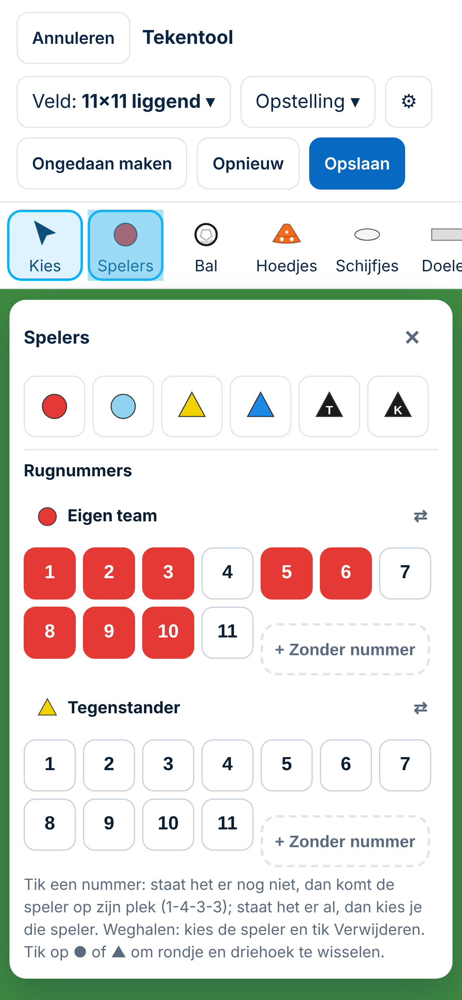
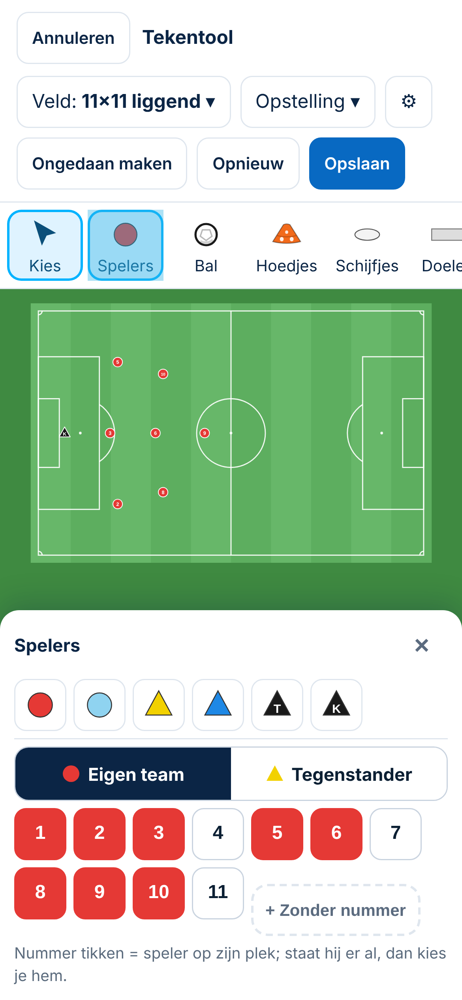
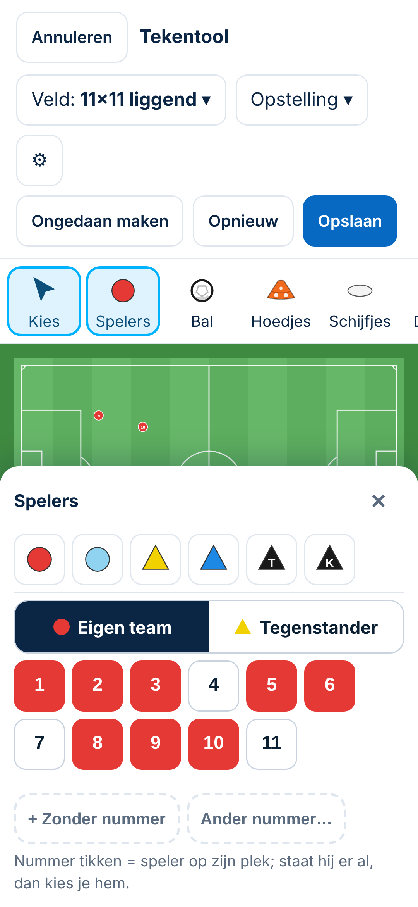
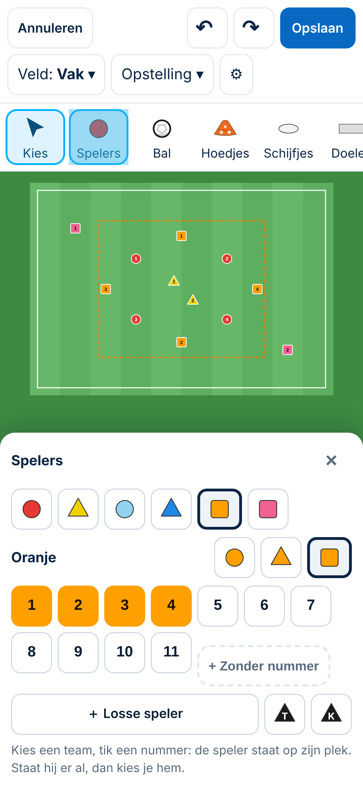
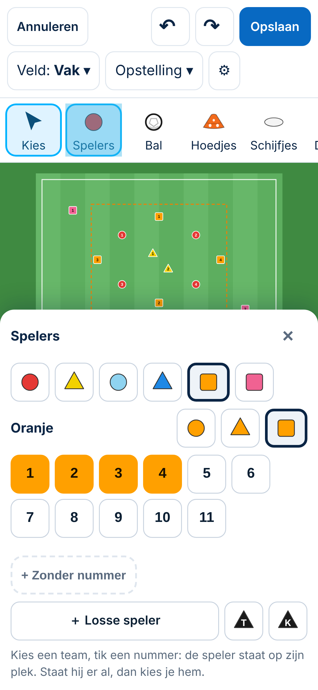
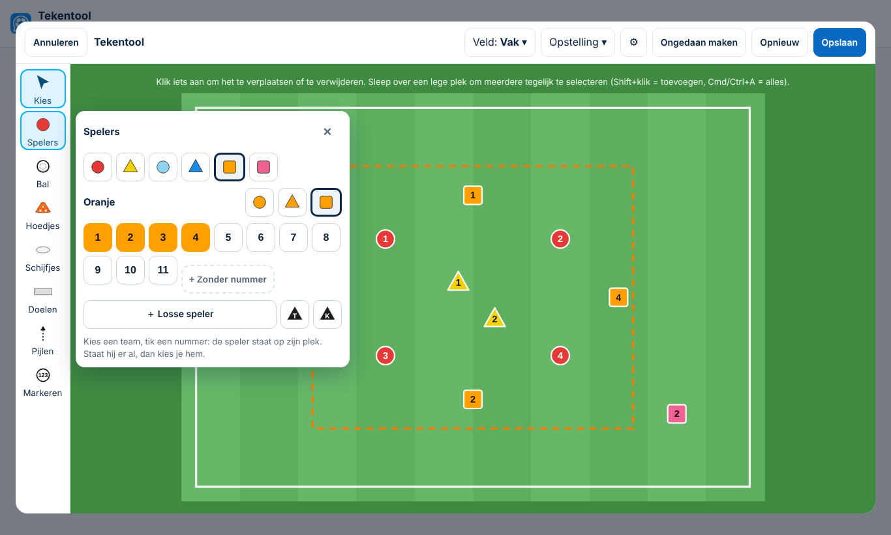

# Tekentool: het menu Spelers op de telefoon

*4-11-2026. Spoor 3. **Onderzoek met conceptbeelden; niets gebouwd.** Gemeten op `main` (`22f6d66`, met de Besluiten 148, 152 en 153) op `/tekenen` bij 360 × 780, 390 × 844, 430 × 932 en 844 × 390 (gekanteld). De conceptbeelden zijn een simulatie in de browser (extra opmaak over de bestaande app heen); de app is niet aangepast.*

## 1. Wat er nu gebeurt (gemeten)
| Scherm | Bovenbalk | Tip | Rail | Veld zonder menu | Menu *Spelers* | Veld zichtbaar met menu open |
|---|---|---|---|---|---|---|
| 360 × 780 | 223 px (3 regels) | 76 | 73 | 336 × 218 | 381–**1131** px | **0%** |
| 390 × 844 | 171 px (2 regels) | 76 | 73 | 366 × 237 | 329–902 px | **0%** |
| 430 × 932 | 171 | 76 | 73 | 406 × 263 | 329–902 px | **0%** |
| 844 × 390 (gekanteld) | 119 | 56 | 73 | 820 × 531 vanaf y = 306 | 257–692 px | 27% |

**Bevestigde fouten:**
1. **Het menu bedekt het hele veld** (0% zichtbaar op elke telefoon in de hand). Je tikt een nummer en ziet niet waar de speler komt. Om dat te zien moet je het menu sluiten en daarna weer openen.
2. **Op een kleine telefoon (360 px) en gekanteld zijn de knoppen van de *Tegenstander* niet te bereiken.** Het menu is langer dan het scherm en kan niet scrollen. *Tegenstander 11* staat op y = 910 bij een schermhoogte van 780; tikken lukt niet. Je kunt dan met de nummerknoppen geen tegenstander neerzetten.
3. **De tip** *"uittekenen gaat het snelst op een laptop"* (76 px) **komt bij elke tekening terug**, ook nadat je hem hebt weggetikt. Het toestel onthoudt dat niet.

**Ook gezien (niet in dit voorstel):**
- **Gekanteld** staat het veld zelfs zonder menu grotendeels onder de rand van het scherm: het begint op y = 306 bij een hoogte van 390. Dat hoort bij de mobiele bediening in het algemeen.
- De hulptekst boven het veld noemt *Shift+klik* en *Cmd/Ctrl+A*; die bestaan op een telefoon niet (eerder gemeld in `gebruik-2026-11.md`).
- Spelers zijn op de telefoon ± 9 px groot. Daarvoor komt een apart voorstel (zoomen of een minimummaat).

## 2. Voorstel
| | Wat | Voordeel | Nadeel |
|---|---|---|---|
| **A (advies)** | **Op de telefoon wordt *Spelers* een vast paneel onderaan**, met **één team tegelijk** (schakelaar *Eigen team · Tegenstander*), nummers 1–11 in twee regels van 44 px, de kleurknoppen en één korte uitlegregel. Het veld schuift erboven en blijft zichtbaar. Het paneel scrollt als het niet past. Laptop ongewijzigd | Je ziet direct waar een speler komt; alle knoppen bereikbaar; één vaste plek (onderaan, bij de duim) | Wisselen tussen teams kost één tik; het paneel en het veld delen de hoogte |
| A+ | **Erbij:** bovenbalk op de telefoon compacter (*Ongedaan maken* en *Opnieuw* als pictogram ↶ ↷ met naam voor de schermlezer), zodat hij op 360 px ook in 2 regels past; en de tip wordt onthouden na wegtikken | Op 360 px ± 60–130 px meer ruimte; dan blijft ook daar het veld grotendeels zichtbaar | Pictogrammen zijn iets minder duidelijk dan woorden |
| B | Het menu blijft over het veld liggen, maar **klapt na een getikt nummer in** tot een smalle strook met alleen de nummers | Het veld wordt weer zichtbaar na de eerste tik | Twee standen van hetzelfde menu, en dus meer om te leren; de eerste tik blijft blind |
| C | Het menu **sluit na elk nummer** | Eenvoudig | 11 spelers = 22 tikken (elke keer opnieuw openen) |

**Concept A op 390 px en op 360 px** (nummer 9 gekozen):

 

- **390 px:** het hele veld met de 3-3-1 blijft boven het paneel zichtbaar.
- **360 px:** het paneel (± 380 px) bedekt nog de onderste helft van het veld, omdat de bovenbalk daar 3 regels heeft. Met **A+** (compacte bovenbalk, tip onthouden) komt er ± 130 px bij. Daarom adviseer ik A en A+ samen.
- **Niet vergeten bij bouwen:** de wissel rondje ⇄ driehoek per team (Besluit 125) zit nu in de teamregel. In het paneel komt hij naast de teamschakelaar. In het concept ontbreekt hij nog.

**Gedrag dat gelijk blijft:** de nummerregels uit Besluit 148 (kiezen in plaats van verwijderen, eerste vrije nummer, *Ander nummer…*), Besluit 152 (× = gereedschap uit, *Spelers* zet niets aan) en de sneltoetsen op de laptop.

**Gevolgen:**
- Alleen bediening en opmaak op schermen smaller dan 900 px.
- Geen gegevens, geen database en geen gevolgen voor opgeslagen tekeningen.
- Maat **M**: een gewijzigd scherm, dus een besluit en een voorbeeld (dit document).
- Het herziet Besluit 126 deels: *"Telefoon: de rail ligt bovenaan als rij, het menu eronder"*.
- In *Afgewezen ideeën* staat niets over dit onderwerp (gezocht 4-11).

## 3. Doelgroepen
- **Beginner:** ziet meteen dat de speler op het veld staat, zonder het menu te hoeven sluiten. Met één team tegelijk zijn er minder knoppen om uit te kiezen.
- **Ervaren trainer:** zet snel een opstelling neer en vult aan met nummers. Wisselen naar de tegenstander kost één tik.
- **Selectietrainer:** kan op de telefoon controleren wie waar staat (Besluit 148: een nummer tikken = die speler kiezen), terwijl het veld zichtbaar blijft.

## 4. Keuzes
1. **A, of A met A+?** Mijn advies is A + A+. Alleen A laat de kleine telefoons half afgedekt.
2. **Bij openen: welk team staat aan?** Mijn advies: het team van de gekozen speler, anders het laatst gebruikte, en de eerste keer *Eigen team*.
3. **Tip onthouden:** voor altijd verbergen na wegtikken, of na 3 keer? Mijn advies: voor altijd, op dat toestel.
4. **Gekanteld scherm** apart oppakken (prioriteit 6)? Mijn advies is ja; het raakt de hele tekentool, niet alleen *Spelers*.

## 5. Tests bij bouwen
1. Op 360, 390 en 430 px met het menu *Spelers* open is het veld minstens grotendeels zichtbaar (op 390 en 430 px volledig, bij een liggend veld).
2. Op 360 px en gekanteld is elke knop in het paneel bereikbaar (ook *Tegenstander 11*).
3. De teamschakelaar wisselt de nummers; met een gekozen speler staat zijn team aan.
4. De wissel rondje ⇄ driehoek werkt in het paneel.
5. Een weggetikte tip blijft weg bij de volgende tekening.
6. De laptop is ongewijzigd: de bestaande `@tekentool`-tests blijven groen.

## 6. Voorbeeld: A + A+ samen met roze en oranje als team (4-11)
*Akkoord op A + A+. De vraag erbij: roze en oranje als team, met een vorm die je zelf kiest. Simulatie in de browser, niets gebouwd. De oefenvorm op het veld is verzonnen.*

 

**Wat je ziet:**
- **Bovenbalk telefoon (A+):** twee vaste regels, *Annuleren · ↶ ↷ · Opslaan* en *Veld · Opstelling · ⚙*: 111 px in plaats van 171 (390 px) of 223 (360 px). De tip staat er niet meer, omdat hij is weggetikt en onthouden.
- **Teamkeuze:** zes knoppen met kleur én vorm: rood ●, geel ▲, lichtblauw ●, blauw ▲, **oranje ■** en **roze ■**. Rood heet *Eigen team*, geel *Tegenstander*; de andere teams heten naar hun kleur.
- **Vorm per team:** naast de teamnaam kies je **rondje, driehoek of vierkant** (nieuw: vierkant). De keuze wordt per tekening bewaard, net als nu (`vormen`, Besluit 125).
- **Nummers 1–11, *Zonder nummer* en *Ander nummer…*** voor het gekozen team. Dat geldt dus voor **alle** teamkleuren, niet meer alleen voor rood en geel.
- ***＋ Losse speler*** (in het gekozen team; daarna tik je op het veld, zoals in Besluit 152), **Trainer** en **Keeper**.

**Gemeten in het voorbeeld:**
| Scherm | Veld | Paneel | Veld zichtbaar |
|---|---|---|---|
| 390 × 844 | 196–424 px | vanaf 464 px | **volledig** |
| 360 × 780 | 196–391 px | vanaf 350 px | ± 80% |
| laptop | ongewijzigde plek | 394 px hoog, naast de rail | zoals nu |

**Kleuren:**
- **Oranje team:** `#FFA000` met donkere cijfers (contrast ± 10 : 1).
- **Roze team:** `#F06292` met donkere cijfers (± 6,5 : 1).
- Ze zijn bewust anders dan de oranje en roze **hoedjes** (`#F26A1B`, `#E91E8C`). Een hoedje heeft bovendien zijn eigen vorm.
- Op het materiaalbriefje tellen ze mee als hesjes, net als lichtblauw, geel en blauw.

**Bestaande tekeningen:**
- Er verandert niets aan wat er al staat.
- Teams zonder gekozen vorm houden hun huidige vorm.
- Het vierkant komt er alleen bij als je het kiest.

**Keuzes:**
1. **Op de laptop hetzelfde paneel** (één team tegelijk, zoals in het beeld), of daar beide rijen (*Eigen team* en *Tegenstander*) tegelijk houden zoals nu? Mijn advies: hetzelfde paneel. Je leert de bediening één keer, en met zes teams passen niet alle rijen tegelijk.
2. **Standaardvorm van oranje en roze:** vierkant (zoals in het beeld)? Mijn advies is ja, want zo zijn ze naast rood ● en geel ▲ direct te onderscheiden.
3. **Een derde vorm:** vierkant (mijn advies), of liever een ruit?
