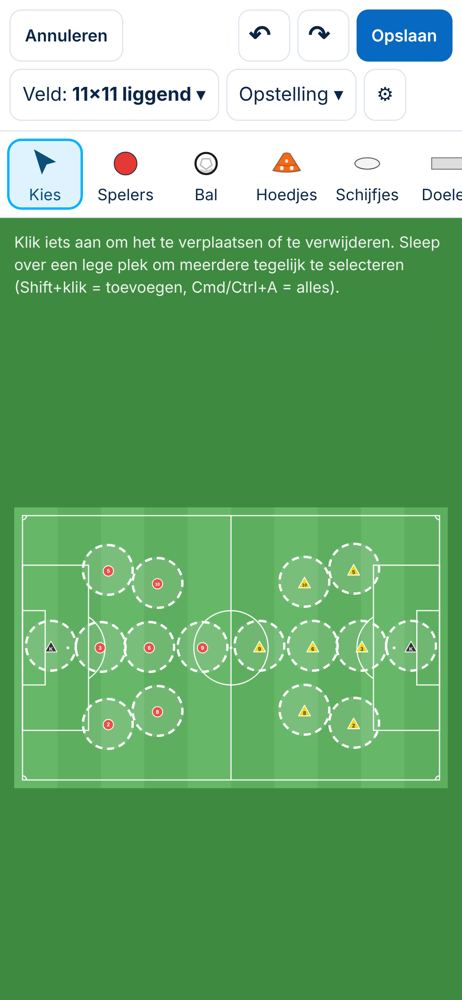

# Tekentool: spelers zijn op de telefoon te klein om aan te tikken

*4-11-2026. Spoor 3. **Onderzoek met een conceptbeeld. Gekozen: A, met de adviezen = Besluit NNN.** Gemeten met de versie van de Besluiten 156–158 op `/tekenen`, met *Opstelling 3-3-1* voor beide teams (16 spelers). Een vingertik is nagebootst als een punt rond het midden van de speler, met een spreiding van 7 px (ongeveer 2 mm). Per speler zijn 40 tikken gesimuleerd, steeds met dezelfde reeks zodat de meting herhaalbaar is.*

## 1. Wat er nu gebeurt (gemeten)
| Scherm | Veld | Speler op het scherm | Tik raakt de juiste speler — **nu** | — met een **tikvlak van 44 px** | Dichtste buren |
|---|---|---|---|---|---|
| telefoon 390 × 844 | 11×11 liggend | 10 px | **19%** | 99% | 41 px |
| | 11×11 staand | 16 px | 40% | 99% | 63 px |
| | Half veld | 16 px | 40% | 97% | 29 px |
| | Vak | 13 px | 32% | 99% | 41 px |
| telefoon 360 × 780 | 11×11 liggend | 9 px | **15%** | 99% | 38 px |
| | Half veld | 14 px | 35% | 96% | 26 px |
| gekanteld 844 × 390 | 11×11 liggend | 14 px | 34% | 99% | 57 px |
| | 11×11 staand | 9 px | 15% | 99% | 36 px |
| laptop 1366 × 820 (ter vergelijking, met een vinger) | 11×11 liggend | 27 px | 73% | 99% | 109 px |

**Bevestigde fout:** op de telefoon raakt een tik maar in **15–40%** van de keren de bedoelde speler. Een speler is 9–16 px groot; de norm is een tikvlak van 44 pt (`docs/app-controle.md`). Mis je, dan gebeurt er iets anders:
- met *Kies* begint een selectievak;
- met een gereedschap aan wordt er iets neergezet;
- of je kiest een buurspeler (zo ging het mis in de meting van de rugnummers, `reparatie-nummering.md`).

**Oorzaak:** de tekentool kiest alleen wat precies onder de vinger ligt (het getekende rondje of de driehoek). Dat is net zo groot als de speler zelf.

**Ook gezien:** met de telefoon staand en een liggend veld gebruikt het veld maar ongeveer een derde van de hoogte; erboven en eronder blijft groen over.

## 2. Voorstel
| | Wat | Voordeel | Nadeel |
|---|---|---|---|
| **A (advies)** | **Onzichtbaar tikvlak van 44 px:** tik je naast een speler of ander object, dan kiest de tekentool het **dichtstbijzijnde object binnen 22 px** (een cirkel van 44 px). Alleen met *Kies*, dus als er geen gereedschap aan staat. Met een gereedschap aan blijft het zoals nu, zodat je een hoedje vlak naast een speler kunt zetten | 15–40% → **96–99%** raak; de tekening ziet er precies hetzelfde uit; geldt op elk scherm; klein in de code | Een tik op het lege veld vlak naast een speler (om een selectievak te slepen) kiest nu die speler. Een selectievak begin je dan iets verder weg |
| B | **Inzoomen** in de tekentool (knijpen of + / −, en het veld verschuiven) | Alles wordt groter, ook voor precies plaatsen | Veel meer bouwwerk; botst met slepen en het selectievak; je moet weten dat het kan |
| C | **Spelers op de telefoon groter tekenen** | Beter te zien | Andere verhoudingen dan op de laptop en in de opgeslagen tekening; spelers gaan elkaar overlappen |
| D | Op de telefoon staand **standaard een staand veld** voorstellen | Spelers ± 16 px in plaats van 10 | Lost het tikken niet op (40%); de trainer kiest het veld zelf |

**Hoe A werkt bij objecten dicht bij elkaar:**
- het dichtstbijzijnde object wint;
- liggen twee spelers op 26–29 px van elkaar (zoals op *Half veld* op 360 px), dan kies je die waar je het dichtst bij tikte; gemeten nog steeds 96–97% raak;
- pijlen, lijnen en vakken hebben al een bredere rand om aan te tikken (Besluit 126) en blijven zoals ze zijn.

**Gevolgen van A:**
- Alleen bediening; de tekening, de opslag en de bestaande tekeningen veranderen niet.
- Maat **M** (gedrag): een besluit (`Besluit NNN`), en geen nieuw scherm.
- Herziet niets: Besluit 126 (*klik iets aan om het te verplaatsen*) wordt alleen ruimer.
- In *Afgewezen ideeën* staat niets over dit onderwerp (gezocht 4-11).

## 3. Doelgroepen
- **Beginner:** tikt gewoon op de speler en krijgt de speler. Nu mist hij vaak en gebeurt er iets anders, zoals een selectievak.
- **Ervaren trainer:** verschuift snel spelers op de telefoon, zonder eerst in te zoomen of de laptop te pakken.
- **Selectietrainer:** kiest de juiste speler, ook als spelers dicht bij elkaar staan.

## 4. Keuzes
1. **A** (mijn advies), en **B** (inzoomen) eventueel later als apart onderwerp?
2. **Alleen met *Kies*, of ook met een gereedschap aan?** Mijn advies: alleen met *Kies*. Met een gereedschap aan wil je juist ook vlak naast een speler iets kunnen neerzetten.
3. **Op alle schermen of alleen op de telefoon?** Mijn advies: overal. Op de laptop tik je met de muis vaak toch al raak, en het tikvlak helpt ook op een tablet.

## 5. Tests bij bouwen
1. Telefoon 390 en 360: een tik op 8–15 px naast een speler (met *Kies*) kiest die speler; de nagebootste vingertik raakt ≥ 95%.
2. Twee spelers dicht bij elkaar: het dichtstbijzijnde wint.
3. Met een gereedschap aan: een tik vlak naast een speler zet iets neer (zoals nu).
4. Een selectievak slepen dat iets verder van de spelers begint, werkt zoals nu.
5. Slepen van een speler die met het tikvlak is gekozen, verplaatst die speler.
6. De bestaande `@tekentool`-tests blijven groen.
