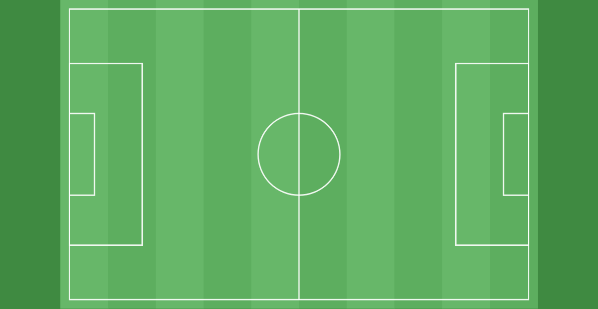
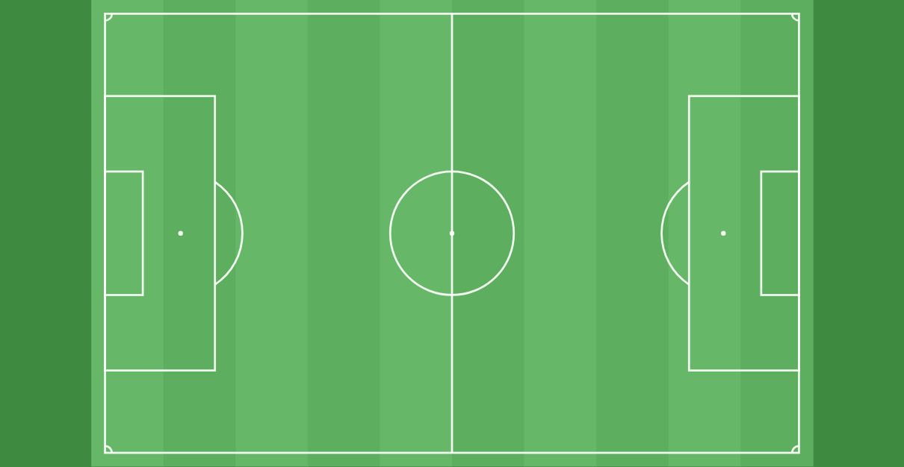
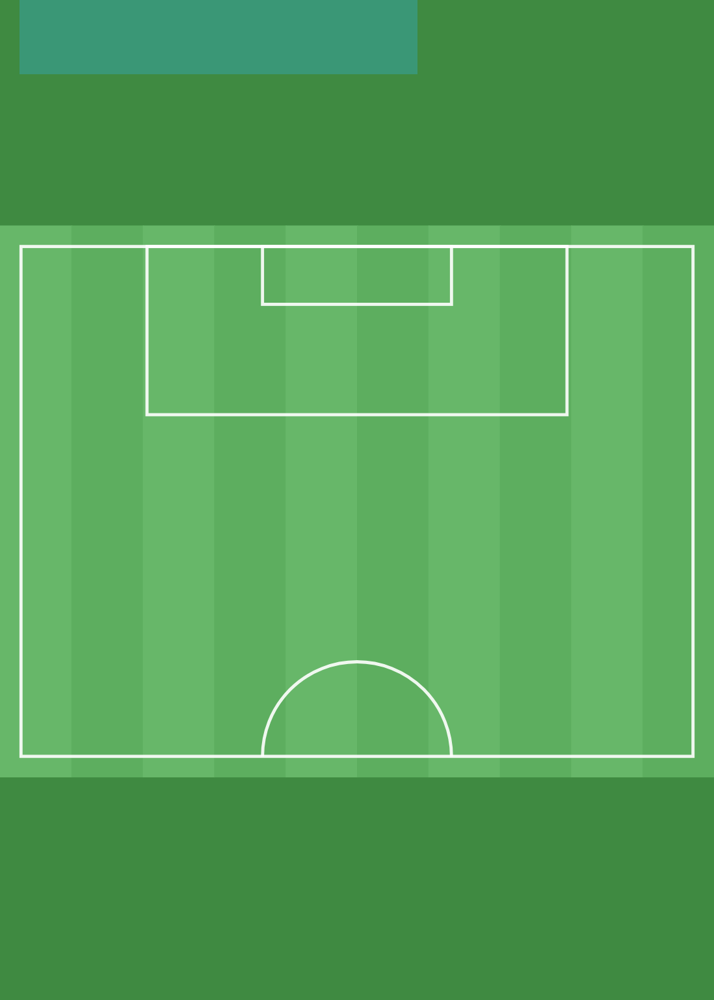
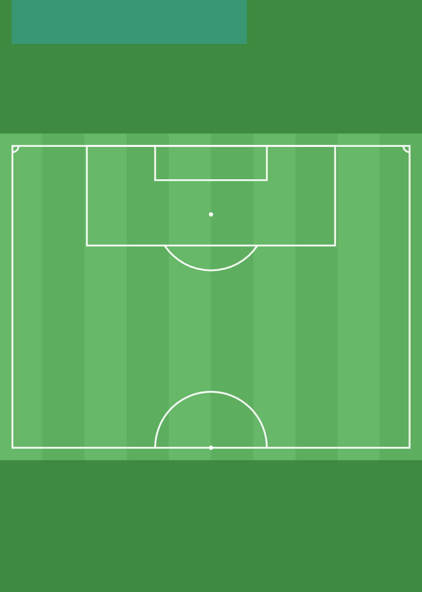
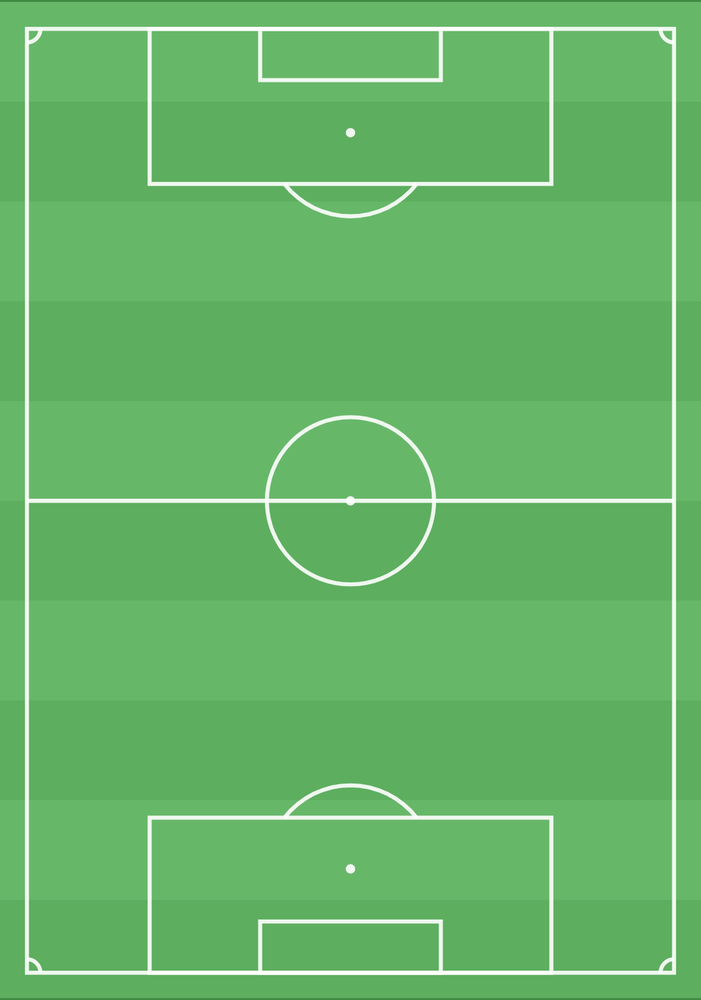

# Tekentool: penaltystip, halve maan en hoekschopboogjes

*4-11-2026. Spoor 3, maat M (wat iedereen op elk veld ziet verandert, ook in bestaande tekeningen). **Voorstel met proefbeelden; gekozen (4-11): middenstip ja, alleen 11×11 en Half veld = Besluit 153.** De proef draaide in de browser met een losse kopie van de tekentool; de app zelf is niet aangepast. Aanleiding: de initiatiefnemer mist de halve maan bij de 16 meter, de hoekschopboogjes en de penaltystip.*

## Wat er nu is (`fieldSvg` in `public/app/tekentool.js`)
| Veld | Nu getekend | Ontbreekt |
|---|---|---|
| 11×11 liggend en staand | buitenlijn, middenlijn, middencirkel, strafschopgebied, doelgebied | penaltystip, halve maan, hoekschopboogjes, middenstip |
| 8×8 en 6×6 | zelfde opbouw, geschaald | idem |
| Half veld | strafschopgebied, doelgebied, halve middencirkel | penaltystip, halve maan, hoekschopboogjes (bij de doellijn), middenstip |
| Vak | alleen een rand (een vrij trainingsvak) | — (hier horen geen veldlijnen) |

## Voorstel
Op de schaal van het veld (± 10 beeldpunten per meter op 11×11):
- **Penaltystip** op 11 m van de doellijn: een witte stip.
- **Halve maan:** de boog met straal 9,15 m rond de stip, alleen het deel buiten het strafschopgebied. Hij gebruikt dezelfde straal als de middencirkel, zodat beide altijd bij elkaar passen.
- **Hoekschopboogjes:** een kwartcirkel van 1 m in elke hoek. Op *Half veld* alleen bij de doellijn, want de andere kant is de middenlijn.
- **Middenstip** (niet gevraagd, maar het hoort bij hetzelfde rijtje): ook een witte stip.
- **8×8 en 6×6:** stip en boog op dezelfde verhouding als het strafschopgebied (stip op twee derde van de diepte, boog met de straal van de middencirkel). **Te controleren:** de echte KNVB-maten van de pupillenvelden. Uit eerder onderzoek is bekend dat deze velden nu al te groot zijn (± 20% en 40%, zie `gebruik-2026-11.md` op branch `onderzoek/tekentool-gebruik`). Dit is een keuze voor de voetbalkant; zie hieronder.

**Proefbeelden (vóór en na):**

  

## Gevolgen
- **Bestaande tekeningen:** de veldlijnen worden bij elke weergave opnieuw getekend uit de gegevens. Daarom krijgen ook de **bestaande** tekeningen de nieuwe lijnen vanzelf: de tegels, de vormkaart en het printen. Er wordt **geen gegeven gewijzigd** en er is geen migratie nodig.
  - In productie (4-11): 5 tekeningen op *11×11 liggend* (Swift) en 3 op *Half veld* (DCG) krijgen stip, boog en hoekjes.
  - De 11 tekeningen op *Vak* blijven precies gelijk.
- **Ingezoomde tegels** tonen alleen het stuk van het veld waar getekend is. De nieuwe lijnen verschijnen alleen als ze in dat stuk vallen.
- **Leesbaarheid:** de lijnen hebben dezelfde dikte en kleur als de bestaande lijnen. De stip is klein (± 0,7 m) en valt niet weg onder een speler of hoedje, want objecten liggen er bovenop.
- **Bediening:** verandert niet. De lijnen kun je niet aantikken (net als de bestaande veldlijnen).

## Keuzes
1. **Middenstip erbij?** Mijn advies is ja: klein, en zo is het veld compleet.
2. **8×8 en 6×6:** stip en boog nu meteen in dezelfde verhouding, of pas wanneer de veldmaten volgens de KNVB zijn rechtgezet (prioriteit 3, veldcoördinaten)? Mijn advies: nu alleen op **11×11 en Half veld**, en de pupillenvelden samen met hun juiste maat. Een penaltystip op een te groot 8×8-veld wekt de indruk van precisie die er niet is. Bij 6×6 is het de vraag of er überhaupt een strafschopgebied hoort; dat is een vraag voor de voetbalkant.
3. **Hoekschopboogjes van 1 m** zijn op een telefoon klein (± 4 px op 390 px). Mijn advies: wel tekenen, want ze horen bij het veld. Ze groter maken dan op schaal past niet bij de rest.

## Tests bij bouwen
1. Elk veld tekent het juiste aantal stippen, bogen en hoekjes (11×11: 2 stippen + middenstip, 2 bogen, 4 hoekjes; Half veld: 1 + middenstip, 1 boog, 2 hoekjes; Vak: geen).
2. Een bestaande tekening openen en opslaan geeft precies dezelfde gegevens (bestaande test).
3. De bestaande `@tekentool`-tests en de tests die tegels tonen (`kiezer`, `trainingskaart`) blijven groen.
4. Schermafbeelding op 390 px en 1366 px ter controle.
