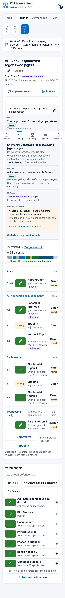
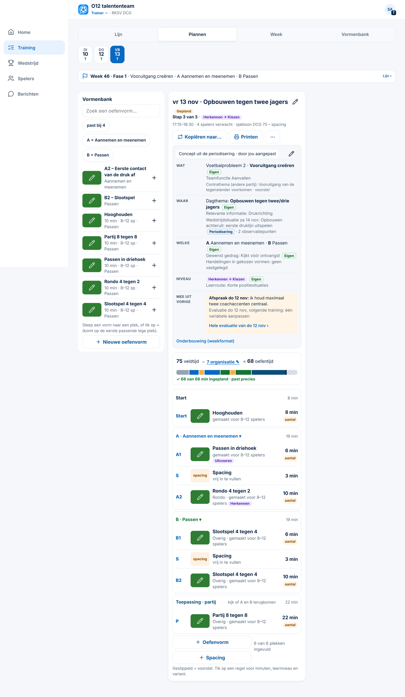
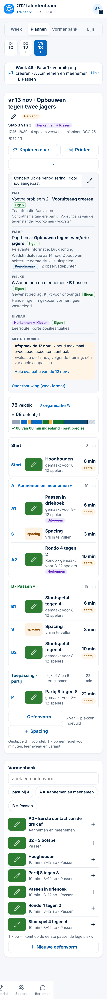
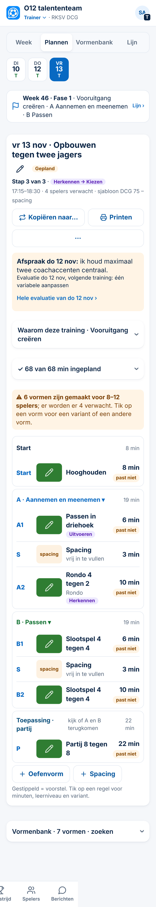

# Analyse en drie voorstellen — tabblad Training (Spoor 3, 05-11-2026)

*Alleen analyse. Er is niets veranderd aan code, database of productie. Gemeten in de echte app (stand van `main` na #146) met verzonnen gegevens, zoals DCG O13 in week 46: een training met acht plekken, een periodisering en een afspraak uit de vorige training. Telefoon 390 × 844 px, laptop 1366 px.*

**Afgewezen ideeën gecontroleerd** (op *tijdlijn, tabblad, vaste kop, klok, samenvoegen*): niets gevonden. Voorstel 3 herziet wel Besluit 135 en 141 (de vier tabbladen); dat staat erbij.

---

## 1. Hoeveel staat er op een pagina?

| Tabblad (telefoon) | Woorden | Knoppen en velden | Ingeklapt | Lengte (schermen van 844 px) |
|---|---|---|---|---|
| **Week**, training nog te geven | 132 | 26 | 3 | 1,8 |
| **Week**, gegeven training | 87 | 21 | 3 | 1,3 |
| **Plannen** | **375** | **47** | 1 | **4,2** |
| **Vormenbank** (5 vormen) | 64 | 14 | 0 | 3,2 |
| **Lijn** (1 week geladen) | 63 | 7 | 1 | 1,0 |

Op de laptop is het aantal woorden gelijk; Plannen is daar 2,3 schermen lang.

*Lijn* is hier kort, omdat de proef maar één week periodisering had. Met een heel seizoen groeit Lijn met elke week.

**Conclusie:** Plannen is het probleem. Het heeft drie keer zoveel woorden als Week en is op de telefoon vier schermen lang. Week en Lijn zijn na #145 redelijk.

## 2. Wat staat er dubbel? (Plannen, telefoon)

| Informatie | Hoe vaak | Waar |
|---|---|---|
| **A Aannemen en meenemen · B Passen** | **4×** | weekbalk bovenaan, regel *Welke*, kop van blok A en B, filterknoppen van de Vormenbank (*A = …*) |
| **Leerniveau** (*Herkennen → Kiezen*) | 3× | kop (*Stap 3 van 3*), regel *Niveau*, per vorm (*Uitvoeren*, *Herkennen*) |
| **Minuten** | 5 soorten | tijdsbalk (*75 − 7 = 68*), *68 van 68 ingepland*, kop per blok (*19 min*), per plek (*6 min*), *6 van 6 plekken ingevuld* |
| *gemaakt voor 8–12 spelers* | 6× | onder elke vorm, ook als het past |
| label *aantal* | 6× | onder elke minutenwaarde; de betekenis is niet duidelijk |
| **Datum en tijd** | 3× | weekstrook, kop *vr 13 nov*, regel *17:15–18:30* |
| **Vormenbank** | 2× | als eigen tabblad, en als lijst onder Plannen (op de telefoon helemaal onderaan, na vier schermen) |
| **Weekbalk** (*Week 46 · Fase 1 …*) | 3 tabbladen | Week, Plannen en Lijn |

**Op de laptop** blijft de derde kolom van Plannen leeg. De training staat in de smalle middenkolom, terwijl rechts ruimte over is.

## 3. Hoeveel tikken kost het? (telefoon, vanaf Home)

| Wat je wilt | Tikken nu | Opmerking |
|---|---|---|
| De training van vandaag zien | 1 | Training → Week opent op de training van vandaag. Goed. |
| Een tekening groot zien | 2 | Goed. |
| Waarom deze training (A, B, niveau) | 2 | Sinds #145 ingeklapt in Week. |
| Aanwezigheid opnemen | 2 | Goed. |
| De afspraak van de vorige training lezen | 1 | Sinds #145 bovenaan in Week. |
| Een andere vorm op een plek zetten | 4 | Training → Plannen → plek → vorm kiezen. |
| Leerniveau van een plek kiezen | 4 | Training → Plannen → plek → leerniveau. |
| De onderbouwing aanpassen (Wat, Waar …) | 3 | Plus scrollen. Het potlood staat midden in de kaart. |
| Een nieuwe oefenvorm maken | 3 | Training → Vormenbank → *Nieuwe oefenvorm*. |
| De minuten per gereedschap in de Lijn | 2 | Plus scrollen. |
| Een vorm uit de Vormenbank in de training zetten (telefoon) | 3 | Plus vier schermen scrollen in Plannen. Of via Vormenbank → vorm → *Zet in een training…* (4). |

**Conclusie:** het aantal tikken is laag. Het probleem is **scrollen en zoeken**, niet tikken.

## 4. Wat is het belangrijkst, en waar hoort het?

| Moet je **altijd** zien (vaste kop) | Hoort in een **tijdlijn** (volgorde) | Hoort in een **venster** (pas na een tik) |
|---|---|---|
| Welke training: dag, tijd, thema | De opbouw van de training: Start → A1 → A2 → B1 → B2 → Partij, met minuten | Alles van één plek: vorm, minuten, leerniveau, variant, verplaatsen (bestaat al) |
| Wat centraal staat: **A** en **B** | De week: di · do · vr · za (de weekstrook, bestaat al) | De onderbouwing: Wat, Waar, Welke, Niveau, weekformat |
| Status: concept, gepland, gegeven | Het seizoen: Lijn (bestaat al) | De tijd: veldtijd − organisatie = oefentijd |
| Aantal spelers (verwacht of aanwezig) | | Een vorm bekijken of bewerken (bestaat al) |
| Een waarschuwing, alleen als er iets mis is (te veel minuten, vorm past niet bij het aantal) | | De evaluatie van de vorige training |

**Knoppen die er al moeten staan:**
- in **Week**: *Aanwezigheid*, *Aanpassen* en *Printen*;
- in **Plannen**: *+ Oefenvorm*, en per plek een tik op de regel.

De rest kan achter **⋯** (*Kopiëren naar…*, *Spacing*, *Sjabloon*). Dat volgt Besluit 34: elke actie heeft één vaste plek.

---

## 5. Drie voorstellen

### Voorstel 1 — Minder dubbel (klein, alleen weghalen)
Plannen houdt dezelfde opbouw, maar met minder herhaling:
- **A/B en leerniveau één keer**, in de kop van de training. De regels *Welke* en *Niveau* in de kaart tonen alleen wat er **extra** is (gewenst gedrag, leerroute).
- **"gemaakt voor 8–12 spelers" en "aantal" weg.** Alleen als een vorm **niet** past, staat er één waarschuwing (*past niet bij 4 spelers*). *ClubComm signaleert.*
- **Tijd in één regel:** *68 van 68 min ✓*. Een tik opent de balk en de organisatie. De regel klapt vanzelf open als er te veel is ingepland.
- **De onderbouwing ingeklapt**, zoals in Week sinds #145.
- *6 van 6 plekken ingevuld* weg: dat zie je aan de lijst zelf.

*Geschat:* Plannen gaat van 375 naar ongeveer 200 woorden en van 4,2 naar ongeveer 2,5 schermen. *Herziet:* Besluit 142 (tijd ingeklapt in Plannen) en 144 (kaart ingeklapt).
- **Voordeel:** klein, weinig risico, niemand hoeft iets nieuws te leren.
- **Nadeel:** de pagina blijft een lange lijst. De Vormenbank staat op de telefoon nog steeds onderaan.

### Voorstel 2 — Vaste kop + tijdlijn + vensters (opbouw anders)
Week en Plannen krijgen **dezelfde vaste kop** (blijft staan tijdens het scrollen): *vr 13 nov · 17:15 · Opbouwen tegen twee jagers · A Aannemen · B Passen · 4 spelers*.

Daaronder staat de training als **tijdlijn**: elke plek één regel met code, tekening, naam en minuten. Optioneel staat de kloktijd ervoor (*17:23 A1*), handig op het veld.

Alles anders gaat naar **vensters**:
- *Waarom* (onderbouwing);
- *Tijd* (veldtijd en organisatie);
- *Vorige training* (afspraak en evaluatie; in Week blijft de afspraak zichtbaar);
- *Vormenbank* op de telefoon: een knop *+ Oefenvorm* opent de kiezer (bestaat al).

Op de laptop staat de tijdlijn in het midden en de onderbouwing in de **lege derde kolom**.

*Geschat:* Plannen is op de telefoon ongeveer 1,5 scherm en 120 woorden. Week blijft zoals het is, met dezelfde kop.
- **Voordeel:** de belangrijkste informatie staat altijd in beeld, en Week en Plannen zien er hetzelfde uit (één keer leren). Op de laptop wordt de lege ruimte gebruikt.
- **Nadeel:** groter werk (maat M, meer schermen tegelijk). Een vaste kop kost op de telefoon ongeveer 60 px hoogte.

### Voorstel 3 — Eén tabblad *Training* dat meebeweegt met het moment
Week en Plannen worden **één tabblad**, dat zich aanpast aan de tijd:
- **vóór** de training: plannen (de tijdlijn van voorstel 2, met bewerken);
- **op de dag zelf**: uitvoeren (afspraak, vormen, aanwezigheid);
- **erna**: vastleggen en evalueren.

Dan blijven er drie tabbladen over: **Training · Vormenbank · Lijn**. De weekstrook en de weekbalk staan er nog maar één keer.

*Herziet:* Besluit 135 en 141 (de vier tabbladen; *evalueren in Week*).
- **Voordeel:** geen keuze meer tussen Week en Plannen, en het minst dubbel van de drie.
- **Nadeel:** het grootste werk. Trainers die nu weten waar alles staat, moeten opnieuw zoeken. De functiekaarten en de snelstart-PDF's moeten opnieuw. Op de laptop is plannen en uitvoeren tegelijk zien juist handig.

---

## Advies

**Eerst voorstel 1, daarna voorstel 2.** Voorstel 1 haalt in één kleine stap het meeste dubbele weg: Plannen wordt bijna half zo lang. Voorstel 2 bouwt daarop voort en lost het scrollen en de lege laptopkolom op.

**Voorstel 3 nu niet.** Het levert het minst op ten opzichte van 1 + 2 en kost het meest: nieuwe uitleg, nieuwe PDF's en trainers die opnieuw moeten leren.

Na je keuze maak ik eerst voorbeeldschermen op 390 px (en 1366 px voor voorstel 2), zoals bij elke schermwijziging.

## Wat ik van je nodig heb
1. Welk voorstel (of welke combinatie).
2. Bij voorstel 1: mogen *gemaakt voor 8–12 spelers* en *aantal* weg als de vorm past?
3. Bij voorstel 2: kloktijden in de tijdlijn (*17:23 A1*), ja of nee?

---

## Voorbeeld voorstel 1 op 390 px (05-11, na je akkoord)

**Correctie op de analyse:** *gemaakt voor 8–12 spelers* en *aantal* staan er **niet altijd**. Ze verschijnen alleen als een vorm niet past bij het aantal verwachte spelers (in de proef 4 verwacht, vormen voor 8–12). Het is dus een terechte waarschuwing. Het probleem is dat die dubbel staat (tekst én label) en op elke regel.

**Wat er in het voorbeeld verandert:**
1. **De afspraak van de vorige training blijft zichtbaar**, net als in Week.
2. **De onderbouwing (Wat, Waar, Welke, Niveau) is ingeklapt** onder *Waarom deze training · Vooruitgang creëren*. Het potlood om aan te passen zit erin.
3. **De tijd staat in één regel:** *✓ 68 van 68 min ingepland*. Een tik opent de balk en de organisatie. Bij te veel minuten klapt de regel vanzelf open, met de waarschuwing.
4. **Niet passende vormen geven één waarschuwing bovenaan:** *6 vormen zijn gemaakt voor 8–12 spelers; er worden er 4 verwacht.* Per vorm staat alleen het label **past niet**. De tekst *gemaakt voor …* staat niet meer op elke regel.
5. *6 van 6 plekken ingevuld* is weg.
6. **Extra (keuze):** op de telefoon is de **Vormenbank onderaan ingeklapt** (*Vormenbank · 7 vormen · zoeken*). Op de laptop blijft die als kolom staan.

**A/B en leerniveau.** A en B staan nog in de weekbalk (de week) en in de kop van blok A en B. Daar kies je ze ook (▾). In de zichtbare pagina stonden ze 4 keer, nu 2 keer. Het leerniveau staat 1 keer in de kop en per plek.

**Gemeten** (telefoon, met dezelfde gegevens):

| | Woorden | Lengte |
|---|---|---|
| Nu | 372 | 4,3 schermen |
| Voorstel 1 | 290 | 3,4 schermen |
| Voorstel 1 + Vormenbank ingeklapt | **219** | **2,7 schermen** |

Mijn schatting vooraf (± 200 woorden, 2,5 schermen) klopt dus alleen **met** de ingeklapte Vormenbank.

| Nu | Voorstel 1 + Vormenbank ingeklapt |
|---|---|
|  |  |

**Normen:** de uitklappers en knoppen bestaan al (tikvlak 44 px, leestekst 16 px), er is geen horizontaal scrollen op 390 px, en kleur staat alleen bij de afspraak en de waarschuwing.

**Voordelen:** bijna half zo lang, de waarschuwing staat één keer met uitleg, en de afspraak en de opbouw staan bovenaan.
**Nadelen:** de onderbouwing en de tijdsbalk kosten één tik extra. Een trainer die de Vormenbank onder Plannen gebruikt op de telefoon, tikt één keer extra (of gebruikt *+ Oefenvorm*, dat opent de kiezer).

**Herziet:** Besluit 142 (tijd ingeklapt in Plannen), 144 (trainingskaart ingeklapt) en 165 (dezelfde lijn als Week).
