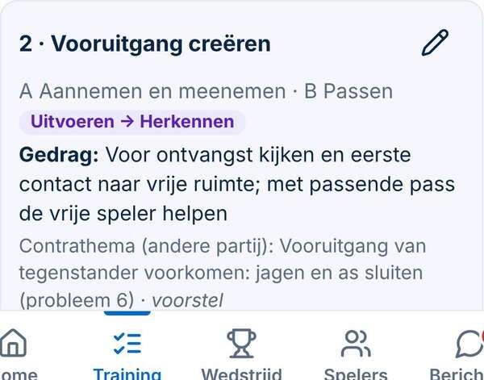
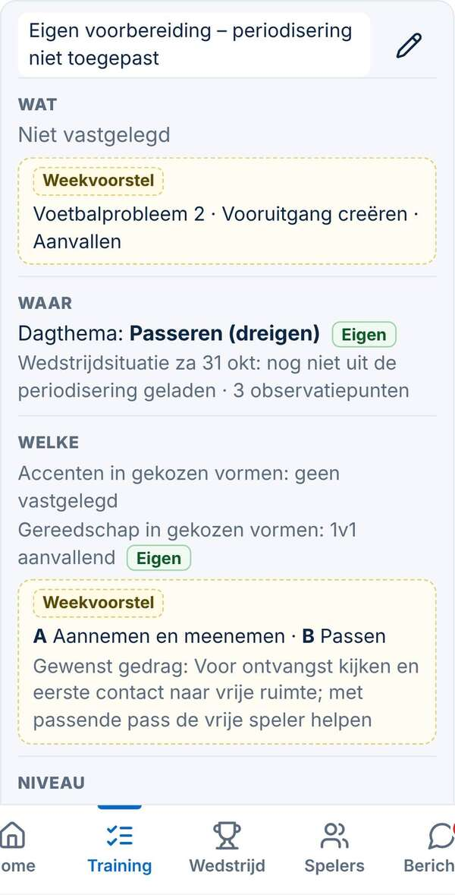
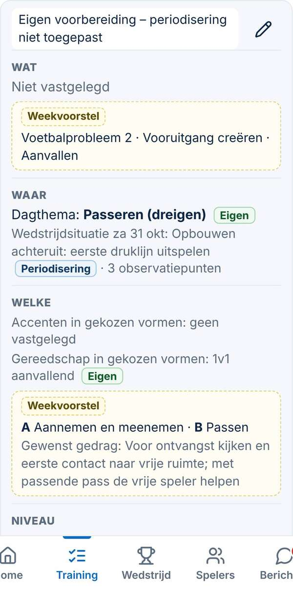
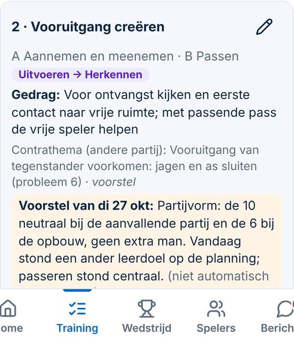
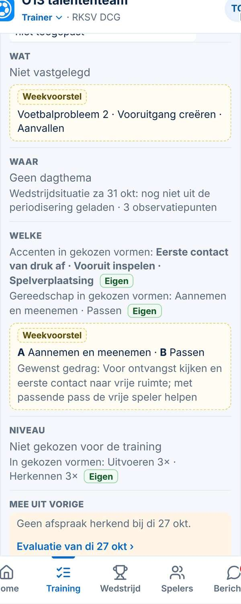
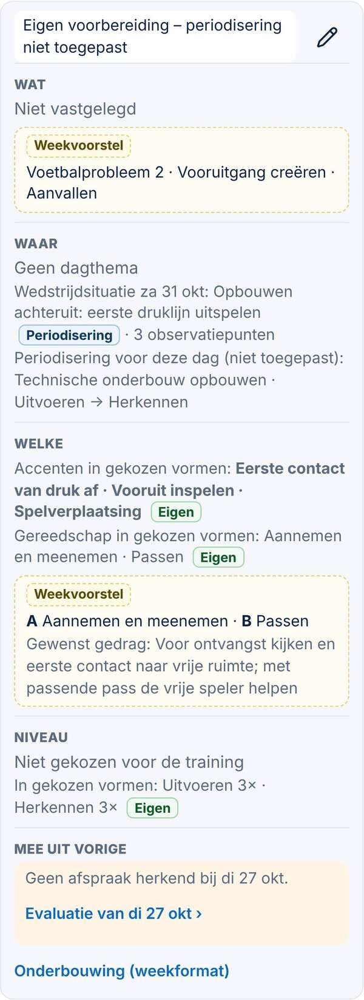
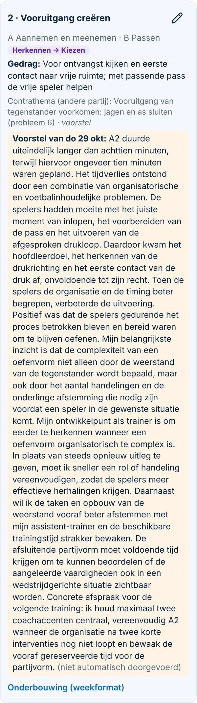
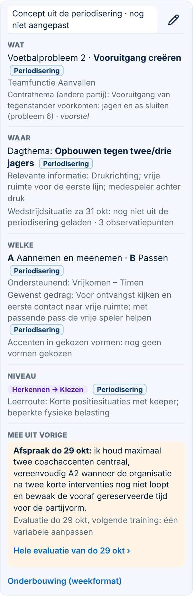
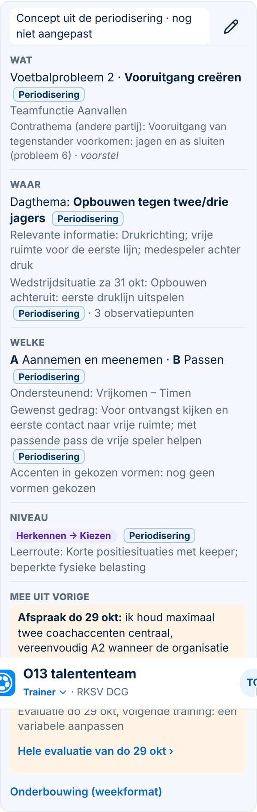

# Trainingskaart — oud en nieuw (Besluit 144)

*30-10-2026, Spoor 3. Echte DCG O13-gegevens (kopie van productie, alleen gelezen; het bekijken veranderde 0 rijen). Drie standen: **oud** (`main`), **nieuw** (deze branch, weekplannen zoals ze nu in de database staan) en **gecorrigeerd** (deze branch, na de voorgestelde correctie van de weekplannen; nog niet uitgevoerd).*

## Vergelijking in het kort

| | Oud | Nieuw |
|---|---|---|
| Opbouw | Losse regels door elkaar (probleem, A/B, niveau, gedrag, contra, voorstel) | Stand bovenaan + vijf vaste regels: Wat · Waar · Welke · Niveau · Mee uit vorige |
| Waar komt het vandaan? | Niet te zien; weekplan en training liepen door elkaar | Label per regel: *Eigen*, *Periodisering*, *Weekvoorstel* |
| Weekplan | Vulde stil aan wat de training niet had (ook het niveau van de eerste dag) | Staat apart als *Weekvoorstel*; vult nooit vanzelf in |
| Vorige training | De hele evaluatietekst (vr 30: een alinea van ruim 260 woorden) | Alleen de *Concrete afspraak*-zin + *volgende training: één variabele aanpassen* + link |
| Wedstrijd | Niet in de kaart | Eigen regel onder Waar, los van het dagthema |
| Accenten | Niet te zien | *Accenten in gekozen vormen* (uitdrukkelijk geen trainingsaccent) |
| Concept gewijzigd? | Niet te zien | *nog niet aangepast* / *door jou aangepast*; *Oorspronkelijke planning ›* bij de eerste wijziging |
| Swift (geen profiel) | Geen kaart | Alleen weekvoorstel (als er geen eigen thema is) en *Mee uit vorige* |

## Per dag

- **di 27 (eigen training, periodisering niet toegepast).** Oud toonde het weekniveau *Uitvoeren → Herkennen* alsof het de training was. Nieuw: *Niveau: niet gekozen voor de training*, het dagthema *Passeren (dreigen)* als *Eigen*, het weekvoorstel apart.
- **do 29 (eigen training).** Oud: probleem en A/B van de week + de hele evaluatie van di 27. Nieuw: *Geen afspraak herkend bij di 27 okt* met de link, accenten en gereedschap uit de gekozen vormen (*Eigen*). Gecorrigeerd: ook *Periodisering voor deze dag (niet toegepast): Technische onderbouw opbouwen · Uitvoeren → Herkennen*.
- **vr 30 (concept, onveranderd).** Alles *Periodisering*; *Mee uit vorige* toont alleen de afspraak van do 29. Gecorrigeerd: *Wedstrijdsituatie za 31 okt: Opbouwen achteruit: eerste druklijn uitspelen · 3 observatiepunten*.

## Schermen (telefoon 390 px)

| | Oud | Nieuw | Gecorrigeerd |
|---|---|---|---|
| di 27 |  |  |  |
| do 29 |  |  |  |
| vr 30 |  |  |  |

Laptop, do 29: [oud](oud-lap-kaart-do29.jpg) · [nieuw](nieuw-lap-kaart-do29.jpg) · [gecorrigeerd](gecorrigeerd-lap-kaart-do29.jpg).

## Correctie van de acht weekplannen (voorstel, niet uitgevoerd)

`supabase/scripts/2026-10-30_dcg_weekplannen_correctie.sql.voorstel`
- **Controle tegen de CSV** (`docs/methodiek/persoonlijk/periodisering-o13-import-CONCEPT.csv`): bij alle acht weekplannen zijn hoofdthema, leerniveaus en route gelijk aan de **eerste trainingsrij** van die week. Het zijn dus dagwaarden, geen weekwaarden.
- **Wat het doet, per weekplan:** hoofdthema, niveaus en route uit `methodiek` halen. Alleen wk 44: die dagwaarden bewaren bij `dagen['2026-10-29']`, omdat die eigen training bij het laden niet is overschreven. Bij zes weken het hoofdthema van de wedstrijd als `wedstrijd.context`. Daarna een nieuwe `stempel`.
- **Wat het niet aanraakt:** de trainingen zelf, observatiepunten en hun uitkomsten, *vastgelegd*, alle andere velden. Elke regel werkt alleen als het weekplan nog precies zo is als bij de controle (`stempel`, hoofdthema, wedstrijd zonder context); anders gebeurt er niets.

## Wat nog ontbreekt voor vaardigheidsaccenten per trainingsplek

1. **Een veld per plek.** Accenten staan nu bij de vorm (`vh`), niet bij de plek in de training. Nodig: een eigen keuze per onderdeel, bijv. `onderdelen[i].accent`. Eigen besluit (M, geen migratie: JSON in een bestaande rij).
2. **De blokkop.** De kop van een blok leest het gereedschap nog met terugval op het weekplan (`blokDoel` → `CC.trWeekDoel`). Die terugval moet eerst weg, net als in de kaart, anders lijkt een weekwaarde een keuze van de trainer.
3. **De kiezer.** Waar kiest de trainer het accent (in het blok of bij de vorm), en adviseert de oefenvormkiezer op dat accent? Nu adviseert hij op de vaardigheden van het profiel.
4. **Evaluatie en Lijn.** Evalueren per accent of per training, en of Lijn minuten per accent telt. Pas besluiten als de keuze per plek bestaat.
5. **De kaart.** *Accenten in gekozen vormen* wordt dan *Accenten per plek* (keuze van de trainer), met de vormaccenten als hulp.
6. **Swift.** Een club zonder vaardigheden in het profiel krijgt geen accentveld; controleren dat niets leeg zichtbaar wordt.
