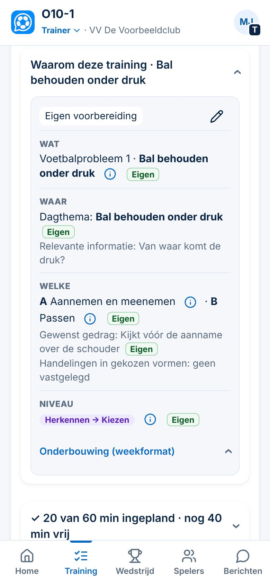
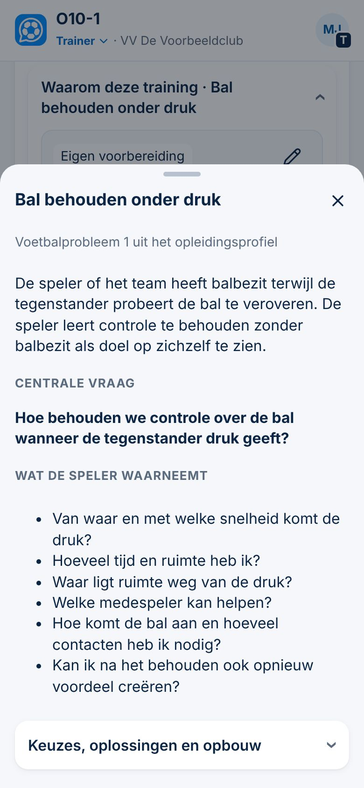
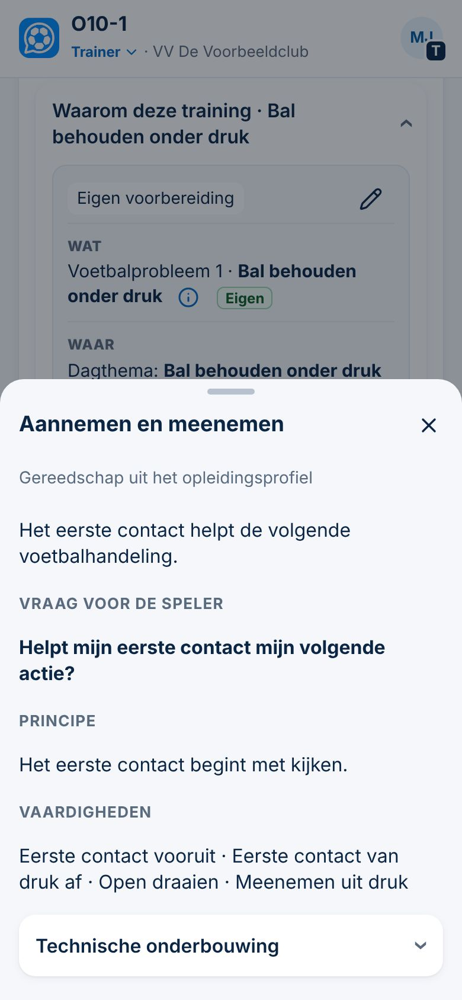
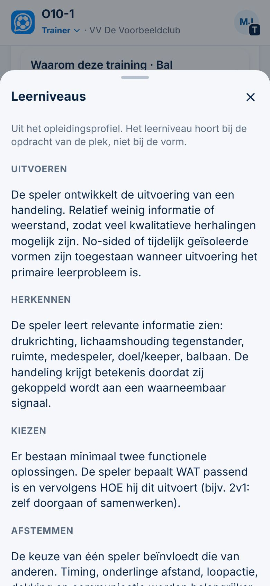
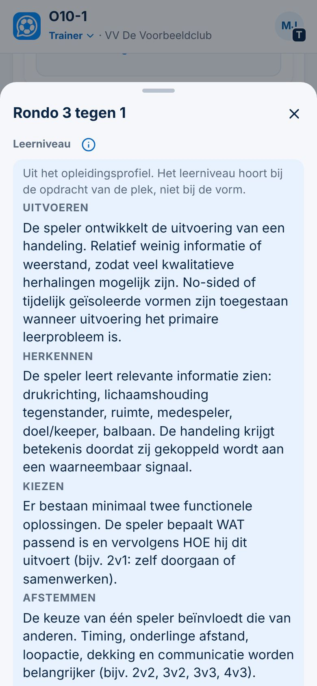

# Voorstel I3 — uitleg via ⓘ (Spoor 3, 18-11-2026)

*Onderzoek met een werkend voorbeeld. Akkoord op B (20-11); gebouwd als Besluit 185. De database en de opleidingsprofielen zijn niet gewijzigd. De schermen komen uit dat voorbeeld, op 390 px, in de demo met verzonnen gegevens en het DCG-profiel als voorbeeldprofiel.*

**Opdracht (16-11).** *"Onderzoek hoe we de bestaande uitleg van leerniveaus, gereedschappen en voetbalproblemen kunnen openen via ⓘ, zonder nieuwe invoervelden of dubbele teksten."* Achtergrond: `docs/onderzoek/vormenbank-audit/README.md`, bevinding I3.

**Maat: M.** Het is een nieuwe functie op een bestaand scherm. Er verandert niets aan de database, de rechten of de persoonsgegevens. De teksten komen uit het opleidingsprofiel, dat alleen gelezen wordt.

---

## 1. Wat is er nu?

**De uitleg staat al in het profiel, maar de app laat hem nergens zien.** In `supabase/profielen/dcg.json`:

| Onderdeel | Wat er al staat | Nu in beeld? |
|---|---|---|
| Leerniveaus (5) | een omschrijving per niveau | nee |
| Gereedschappen (`leerlijnen`) | omschrijving, principe, vraag voor de speler, vaardigheden, technische onderbouwing | alleen de naam |
| Voetbalproblemen | definitie, centrale vraag, wat de speler waarneemt, keuzes (wat en hoe), oplossingen, complexiteit | alleen de naam |

**Waar de namen nu staan:**
- de trainingskaart *Waarom deze training* (Wat, Welke, Niveau);
- het venster van een plek (keuze *Leerniveau*);
- de keuzes en filters bij het voorbereiden en in de Vormenbank.

## 2. Waar komt de ⓘ? Drie mogelijkheden

| | Wat | Voordeel | Nadeel |
|---|---|---|---|
| **A** | ⓘ naast **elke** keuze en filter | overal uitleg | tientallen knoppen; het scherm wordt druk (Principe 10) |
| **B** | ⓘ alleen waar je **leest**: de trainingskaart en de keuze *Leerniveau* van een plek | weinig knoppen, één vaste plek per onderwerp | in een filter zie je geen uitleg |
| **C** | de **naam zelf** wordt tikbaar | geen extra knop | botst met tikken die al bestaan (zoals de kop van een blok); niet te zien dat het kan |

**Advies: B.** Dat zijn vier knoppen:
1. **Wat**: naast het voetbalprobleem;
2. **Welke**: naast gereedschap A en naast gereedschap B;
3. **Niveau**: één ⓘ voor alle leerniveaus samen;
4. **Plek**: naast de kop *Leerniveau* in het venster van een plek.

Een filter blijft een filter. Wie de betekenis wil weten, leest hem in de trainingskaart (*elke actie één vaste plek*, Besluit 30).

## 3. Wat staat er in het venster?

Alleen tekst die al in het profiel staat. Bovenaan kort waar de tekst vandaan komt.

- **Voetbalprobleem:** de definitie, de centrale vraag en *Wat de speler waarneemt*. Ingeklapt: *Keuzes, oplossingen en opbouw*.
- **Gereedschap:** de omschrijving, de vraag voor de speler, het principe en de vaardigheden. Ingeklapt: *Technische onderbouwing*.
- **Leerniveaus:** alle vijf onder elkaar, met de zin *Het leerniveau hoort bij de opdracht van de plek, niet bij de vorm.* Zo zie je ze in hun volgorde en hoef je niet vijf keer te tikken.
- **In het venster van een plek** opent de ⓘ geen nieuw venster (dan zou wat je invulde verdwijnen), maar klapt de uitleg ter plekke open onder *Leerniveau*. Nog een tik klapt hem dicht.

 

 

## 4. Geen nieuwe velden, geen dubbele teksten

- **Geen invoer.** Er komt geen veld bij. De trainer schrijft niets.
- **Geen dubbele tekst.** De teksten stonden nog nergens in beeld. Ze staan alleen in het venster en alleen als je erom vraagt.
- **Eén bron.** Verandert de club de tekst in het profiel, dan verandert de uitleg mee. ClubComm bewaart geen kopie.
- **Zonder profiel of zonder tekst: geen ⓘ.** Een club zonder opleidingsprofiel ziet niets nieuws. Ontbreekt bij één gereedschap de omschrijving, dan staat alleen daar geen ⓘ.

## 5. Normen (`docs/app-controle.md`)

| Norm | Stand |
|---|---|
| Tikvlak ≥ 44 pt | de ⓘ heeft een tikvlak van 44 × 44 px; het icoon is 18 px |
| Contrast ≥ 4,5:1 | blauw icoon op wit en op lichtgrijs (bestaande kleur van links) |
| Leestekst 16 px | ja, in het venster |
| Schermbreedte | 390 px zonder horizontaal scrollen (gemeten) |
| Beperk beweging | bestaand venster, geen nieuwe animatie |
| Dubbel tikken | bestaande beveiliging van knoppen |
| Schermlezer | elke ⓘ heeft een naam, bijv. *Uitleg: Passen* |

## 6. Gevolgen voor besluiten

- **Nieuw besluit** (bij het bouwen een `Besluit 185`): *Een ⓘ naast een voetbalprobleem, een gereedschap of de leerniveaus opent de uitleg uit het opleidingsprofiel. Alleen in de trainingskaart en bij de keuze Leerniveau van een plek. Geen invoer, geen kopie, geen ⓘ zonder tekst.*
- **Vult aan:** de trainingskaart (*Waarom deze training*) en het venster van een plek.
- **Afgewezen ideeën:** gezocht op *uitleg*, *info*, *naslag* en *help*. Niets geraakt. Het afgewezen idee *"Gezien"-knoppen bij ter informatie* gaat over wegklikken. Dat speelt hier niet, want de ⓘ is geen melding.
- **Spoor 1:** de inhoud van de uitleg is van Spoor 1. Wil je de teksten verbeteren of het naslagwerk toevoegen (bijv. de termen *jagen*, *lokken*), dan is dat een aanpassing van het profiel. Dat is een aparte stap en die gebeurt alleen met jouw akkoord.

## 7. Voordelen en nadelen

**Voordelen**
- De trainer leest wat *Kiezen* of *Aannemen en meenemen* betekent, op de plek waar het staat.
- Het werk van Spoor 1 wordt zichtbaar zonder dat er iets bij komt om in te vullen.
- Vier kleine knoppen, verder blijft het scherm gelijk.

**Nadelen**
- In de filters en keuzes bij het voorbereiden is geen uitleg. Dat is bewust, om het rustig te houden.
- De uitleg is zo goed als de tekst in het profiel. Lange teksten maken het venster lang; de lange delen staan daarom ingeklapt.

## 8. Advies

**Bouwen zoals het voorbeeld (B)**, in één pull request, met:
- het besluit;
- een test die nagaat dat de ⓘ opent met de juiste tekst, en dat hij er niet is zonder profiel of zonder tekst;
- het bijwerken van de kaart (`docs/kaart.md`).
