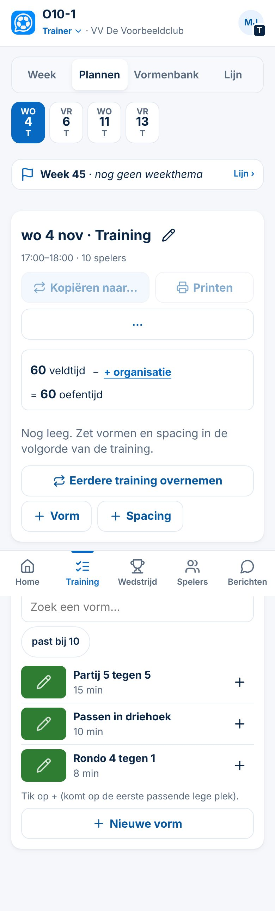
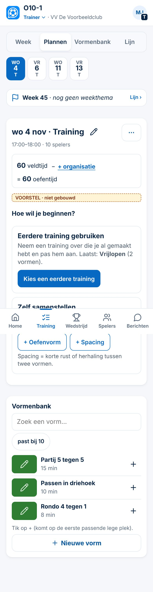
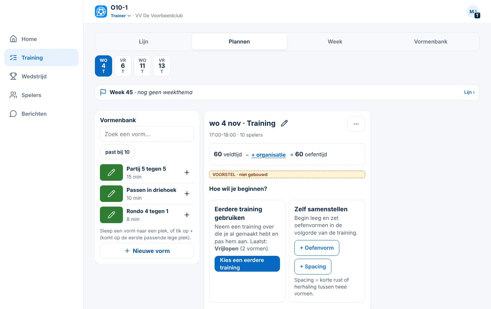
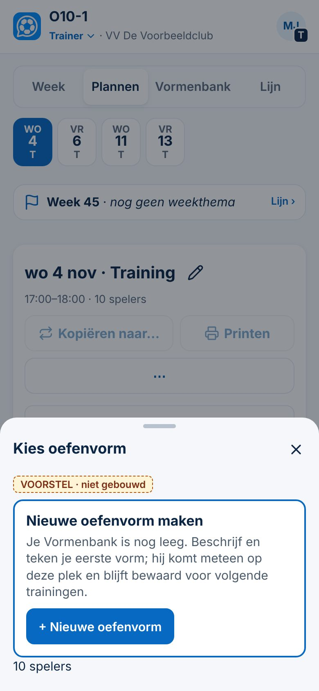
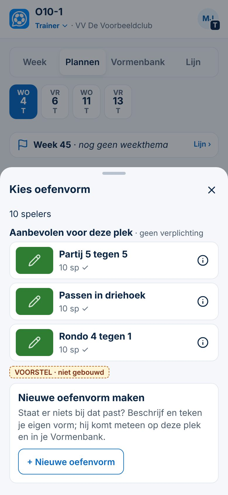

# ClubComm — integrale UX- en workflowaudit

*4-11-2026. Spoor 3. **Alleen audit: geen code, database, rechten of productie gewijzigd; niets samengevoegd.** Beoordeeld met de projectskills **App Design Architect** en **App Workflow Optimizer** (`.claude/skills/`, beide in git en bruikbaar). Gebruikt zijn het scorekader en P0–P3 uit `app-design-architect/references/ux-audit.md` en het flow-sjabloon van de Workflow Optimizer. Normen: `docs/app-controle.md` (tikvlak 44 pt, leestekst 16 px, contrast 4,5 : 1).*

**Bewijslabels (uit de skill):**
- **Gezien:** in de app zelf bekeken of gemeten.
- **Afgeleid:** uit de code.
- **Nog te valideren:** hypothese, nog niet getest met echte gebruikers.

**Getest:**
- `main` (`eb4dcd0`), demomodus met verzonnen gegevens.
- Alle rollen en tabbladen op 390 px en 1366 px (26 schermen per breedte, zie `bijlage-scan.md`).
- Taakroutes gemeten met een script.

**Niet getest:**
- echte gebruikers;
- schermlezer en toetsenbordfocus per scherm;
- volledige contrastmeting.

Open pull requests (#107–#110) en onderzoeksbranches zijn **voorstellen**, geen productie.

---

## 0. Uitgangspunt van de initiatiefnemer: vrijwilligers, aanbieden en niets verplichten

### Wat mogen we van een trainer verwachten?
Trainers zijn vrijwilligers, ook als ze een diploma hebben. Hoeveel tijd iemand erin steekt, verschilt. ClubComm moet dus werken met **bijna niets**, en meer opleveren voor wie meer doet. Voorstel voor een vaste afspraak, **"De drie lagen"**:

| Laag | Wat de trainer minimaal doet | Tijd (doel) | Wat ClubComm dan al doet |
|---|---|---|---|
| **1. Draaien** (iedereen) | niets extra: de club zet het rooster klaar, ouders melden af | 0 min | afmeldingen, verwacht aantal spelers, berichten, vervoer, taken |
| **2. Trainen** (vrijwillig) | per training één keuze: een eerdere of voorbeeldtraining kiezen, of zelf samenstellen; zo nodig printen | 2–5 min per training | training op de telefoon, materiaal, tijdsbalk, aantal spelers uit de aanwezigheid |
| **3. Ontwikkelen** (alleen als hij dat wil, of in een traject) | kennismaking één keer; bij een bezoek 3 reflectievragen; één ontwikkelafspraak | ± 10 min per begeleidingsmoment | begeleiding, verslag, vorige afspraak terug, Lijn en periodisering |

**Vaste regels (voorstel):**
1. **Niets blokkeert.** Geen verplicht veld, behalve wat een ander mens nodig heeft om zijn werk te doen. Bijvoorbeeld: een afmelding met reden voor de trainer.
2. **Leeg is goed.** Een lege vormenbank, lege Lijn of lege terugblik is geen fout. Er komt geen telling *"x van y ingevuld"* bij de trainer, en geen herinnering om de bank te vullen.
3. **Aanbieden op het moment zelf.** Een functie verschijnt waar de trainer al is, bijvoorbeeld bij een lege training. Niet als taak op Home.
4. **De HJO beoordeelt niet op invoer.** Geen overzicht met *"aantal trainingen ingevoerd"* per trainer. Wat de trainer zelf zegt (ambitie, tijd, gewenste hulp) is leidend.
5. **Tijdsbudget per taak:** elke trainertaak op de telefoon kost hoogstens **2 minuten** en **5 tikken**. Lukt dat niet, dan is het voorstel te zwaar.

**Hoe staat het nu?**
- **Afgeleid, goed:** Besluit 139 (adviseren, niet uitsluiten), Besluit 141 (echte minuten optioneel), Besluit 142 (waarschuwen, nooit blokkeren), Besluit 75 (zo min mogelijk handelingen), kennismaking *"voor mijn plezier = geen traject, geen signalen"*.
- **Gezien, schuurt:**
  - een gegeven training toont *"Niet geregistreerd: 40 van 40 geplande min … Dit is dus niet de volledige trainingsduur"*;
  - de Lijn toont *"Er staan nog geen leerdoelen…"* aan een trainer die daar niets aan kan doen;
  - de lege training begint met vier gelijke knoppen en vaktaal (§3.3).

  Dit is informatie, maar het **voelt als een taak**.

---

## 1. Belangrijkste bevindingen (kernobservatie)

1. **Communicatie en rooster zijn het sterkst.** Navigatie per rol is rustig (3–5 tabbladen, Besluit 122). Op 390 px is er **op geen enkel scherm horizontaal scrollen** (Gezien, 26/26).
2. **De trainingsmodule veronderstelt een methodische trainer.** Een nieuwe trainer begint leeg: een eigen vormenbank, geen voorbeelden. De lege training biedt vier gelijkwaardige startknoppen, waarvan één dubbel, met vaktaal (*Spacing*). Gezien, §3.3.
3. **De keten trainer ↔ HJO is nog niet gesloten.**
   - Delen per training bestaat nog niet (alleen ontwerp).
   - De reflectie komt pas ná het delen van het verslag.
   - De vorige afspraak komt niet terug bij het volgende moment.

   Afgeleid; ontwerp in `onderzoek/begeleidingsproces`.
4. **Rechten lopen achter op de uitgangspunten.** *Afgeleid uit de migraties; dit is P0-gebied en hangt alleen af van akkoorden.*
   - Migratie 033 (eigen reflectie beschermd) is niet toegepast.
   - Het werkgebied van een TJC wordt in de database niet afgedwongen.
   - Een clubbeheerder zonder begeleidersrol kan dossiers lezen.
5. **Beheerschermen zijn dicht op de telefoon.** Clubbeheerder · Rollen: 138 bedieningselementen, waarvan 73 kleiner dan 44 px, 3,2 schermhoogtes. Gezien. Dit gebeurt vooral op de laptop (Besluit 120), dus de impact op de telefoon is lager.
6. **Kleine tekst en kleine tikvlakken komen op veel schermen voor.** Op 390 px zijn 222 van de 714 bedieningselementen op 26 schermen kleiner dan 44 px. Veel daarvan zijn tekstlinks en vinkjes; WCAG 2.2 AA vraagt 24 px, de projectnorm 44. HJO · Inzicht heeft 66 tekstelementen onder 14 px. Gezien (grove scan); per element nog te valideren.
7. **Tekentool:** nummering (PR #110) en mobiele bediening, zie `onderzoek/tekentool-gebruik` en de chat *Ontwikkeling Tekentool*.

---

## 2. Beoordeling per gebruikersgroep

*Diploma of ondersteuningsniveau beperkt geen functies of rechten (Afgeleid: rechten volgen alleen uit rollen).*

| Groep | Werkt goed | Frictie | Belangrijkste kans |
|---|---|---|---|
| **Beginnende vrijwilliger / oudertrainer** | Home met de volgende activiteit; afmeldingen en aantal spelers vanzelf; niets verplicht | lege training en lege bank; vaktaal (*Spacing, Lijn, oefentijd*); de tekentool is te klein op de telefoon | eerste keuze bij een lege training (§3.3); voorbeeldtrainingen van de club (later, rechten L) |
| **Ervaren breedtetrainer** | eigen vormen met tekening en varianten; *Kopiëren naar…*; printen | alles eerst één keer zelf invoeren; repertoire niet te delen met een collega-trainer van hetzelfde team | snelle vorm (naam, tekening, één zin); delen binnen het team (later) |
| **Gediplomeerde selectietrainer** | bij DCG: methodiek, periodisering, Lijn, trainingskaart, evaluatie | bij Swift is er geen profiel, dus geen leerlijnen of sjabloon; geen meerweekse planning zonder CSV | KNVB-profiel voor Swift vullen (inhoud, Spoor 2) |
| **HJO / technisch begeleider** | traject, begeleidingsmoment (5 fasen), verslag, terugblik | moment plannen: 4 tikken en 2 schermwisselingen op `main` (Gezien); geen week van de trainers op Home (wel in PR #108: 2 tikken); vorige afspraak niet terug | PR #108; vorige-afspraaklus (technisch voorstel 1) |
| **Clubbeheerder / bibliotheekredacteur** | startlijst inrichten (Besluit 120), teams en schema's laden (136) | Rollen en Regels zeer lang op de telefoon; een bibliotheekredacteur bestaat niet als rol | clubbibliotheek als aparte, kleine rol of taak (rechten L, met voorstel 2) |

---

## 3. Beoordeling per module

### 3.1 Overzicht
| Module | 1. Bestaat en werkt | 2. Wie ervaart frictie | 3. Onnodige handelingen | 4. Dubbel of onduidelijk | 5. Echt ontbrekend | 6. Beter met bestaande architectuur | 7. Raakt gegevens of rechten |
|---|---|---|---|---|---|---|---|
| **Home per rol** | actie eerst, één signaal (Besluit 30/34) | HJO op `main` | — | — | week van de trainers (PR #108) | PR #108 samenvoegen | nee |
| **Navigatie** | 3–5 tabs, laptop met menu links | — | — | *Training* heet bij de trainer het tabblad; *Planning* bij anderen | — | — | nee |
| **Planner en week** | Week · Plannen · Vormenbank · Lijn; tijdsbalk; kopiëren | beginner | uitgeschakelde *Kopiëren* en *Printen* bij een lege training (Gezien) | *Eerdere training overnemen* 2× (knop en ⋯) (Gezien) | voorbeeldtrainingen | startkeuze bij een lege training (§3.3) | nee (§3.3); voorbeeldtrainingen wel (L) |
| **Leerlijnen en periodisering** | DCG: Lijn, CSV, weekvoorstel, trainingskaart (144) | Swift-trainer (leeg) | — | Lijn zonder leerdoelen toont een melding | KNVB-profiel Swift | Lijn verbergen zonder leerdoelen | nee |
| **Vormenbank en clubbibliotheek** | eigen bank, één kiezer (139), Rinus-stijl, varianten | beginner (leeg) | — | *Vorm* / *Oefenvorm* / *Nieuwe vorm* door elkaar | clubbibliotheek | lege kiezer uitleggen (§3.3) | bibliotheek: ja (L) |
| **Tekentool** | rail en menu's, opstelling, magneet, ongedaan maken | iedereen op de telefoon | nummer herstellen na onbedoeld verwijderen | twee nummersystemen | weergave rond de middenlijn, vrij vak | PR #110; ontwerp B | geen datamigratie |
| **Begeleiding en gesprekken** | traject, moment, verslag, terugblik HO | HJO | moment plannen via het dossier | — | vorige afspraak terug | technisch voorstel 1 | nee (na 033) |
| **Reflectie en afspraken** | 3 vragen, *Klaar*, eigen tekst (Besluit 143, nog niet toegepast) | trainer | — | reflectie pas na delen | volgorde: na de training | technisch voorstel 1 | 033 vereist |
| **Delen trainer ↔ HJO** | verslag delen | beide | — | 032 opent te veel | delen per training | voorstel 2 | **ja (L)** |
| **Rollen, rechten, instellingen** | rollen, taken per rol, pakketten | clubbeheerder (lengte) | lange lijsten op de telefoon | — | toewijzing begeleider ↔ trainer | voorstel 2 | **ja (L)** |
| **Mobiel en toegankelijkheid** | geen horizontaal scrollen; safe area | allen | — | toast *"Welkom"* dekt een knop af (Gezien, 390 px) | — | tikvlakken, tekst ≥ 16 px | nee |

### 3.2 Scorekader (1–5)
*Expert-oordeel, geen gebruikerstest.*

| Onderdeel | Trainer | HJO | Beheerder |
|---|---|---|---|
| Vindbaarheid | 4 | 3 (`main`) | 3 |
| Taakefficiëntie | 3 | 3 | 3 |
| Informatiestructuur | 3 (vaktaal) | 4 | 3 |
| Visuele hiërarchie | 3 (lege training) | 4 | 2 (Rollen) |
| Consistentie | 3 (Vorm/Oefenvorm) | 4 | 4 |
| Formulieren | 4 (automatisch bewaren) | 4 | 3 |
| Toegankelijkheid | niet volledig beoordeeld | idem | idem |
| Responsiviteit | 4 | 4 | 3 |
| Foutpreventie | 4 (ongedaan maken, 139) / tekentool 2 | 4 | 3 |
| Feedback | 4 | 4 | 4 |

### 3.3 Voorstel: eerste keuzes in Plannen en de Vormenbank
*Apart UX-voorstel binnen Spoor 3, los van T1 en de DCG-methodiek. **Niet gebouwd.***

**Huidige knoppen en namen (Gezien, 390 en 1366 px):**
- Week: *Training voorbereiden of vastleggen*.
- Plannen: *Training voorbereiden*.
- Daarna een lege training met:
  - *Kopiëren naar…* en *Printen* (uitgeschakeld);
  - *⋯* (met daarin *Eerdere training overnemen* · *Training leegmaken*);
  - *60 veldtijd − + organisatie = 60 oefentijd*;
  - *"Nog leeg. Zet vormen en spacing in de volgorde van de training."*;
  - de knoppen ***Eerdere training overnemen*** · ***+ Vorm*** · ***+ Spacing***;
  - op de telefoon daaronder de Vormenbank met *Zoek een vorm…*, *past bij 10*, *Geen vorm gevonden*, ***Nieuwe vorm***.
- Kiezer (*+ Vorm*): *Kies oefenvorm · 10 spelers · Past het best (0) · Je hebt nog geen vormen · Nieuwe vorm*.
- Met profiel (DCG) staat er ook *Sjabloon …*.

**Probleem:** vijf startacties zien er gelijk uit, waarvan één dubbel. Er staan twee uitgeschakelde knoppen bovenaan. De namen wisselen (*Vorm*, *Oefenvorm*, *Nieuwe vorm*). Het verschil tussen *een eerdere training overnemen*, *een vorm kiezen* en *een vorm maken* moet de beginner zelf uitzoeken.

**Voorstel (zelfde schermen, geen nieuwe velden, geen extra scherm):**

| Waar | Nu | Voorstel |
|---|---|---|
| Lege training | 5 losse knoppen + 2 uitgeschakeld | blok **"Hoe wil je beginnen?"** met twee kaarten: **Eerdere training gebruiken** (alleen als er een eerdere training met inhoud is; noemt de laatste) en **Zelf samenstellen** (*+ Oefenvorm*, *+ Spacing* met één zin uitleg, en *Sjabloon …* als het profiel dat heeft) |
| ⋯ bij een lege training | *Eerdere training overnemen* (dubbel) | alleen *Training leegmaken* (bij een gevulde training blijft *Eerdere training overnemen* in ⋯ staan om toe te voegen) |
| Uitgeschakelde *Kopiëren naar…* en *Printen* | zichtbaar, grijs | verborgen tot er iets in de training staat |
| Kiezer, lege bank | *Past het best (0)* · *Je hebt nog geen vormen* · *Nieuwe vorm* | één kaart **Nieuwe oefenvorm maken**: *"Je Vormenbank is nog leeg. Beschrijf en teken je eerste vorm; hij komt meteen op deze plek en blijft bewaard."* |
| Kiezer, met vormen | *Past het best* · *Past deels* · *Alle andere* · *Nieuwe vorm* | kop **Aanbevolen voor deze plek · geen verplichting** (de groepen blijven precies gelijk); onderaan de kaart **Nieuwe oefenvorm maken** met één zin |
| Namen | *Vorm*, *Nieuwe vorm*, *Kies oefenvorm* | overal **oefenvorm** in knoppen; **Vormenbank** blijft de naam van de bank (Besluit 141) |

**Wanneer tonen:**
- Het blok staat er **alleen bij een lege training** en verdwijnt bij het eerste onderdeel.
- Zonder eerdere training is er alleen *Zelf samenstellen*.
- In de kiezer verandert alleen de lege toestand en de kop.

 

 

**Voordelen:**
- twee duidelijke routes;
- er verdwijnen 3 elementen (2 uitgeschakeld, 1 dubbel);
- dezelfde handlers (`tpKopie`, `tpVormKiezen`, `vormNieuw`), dus geen dubbele functionaliteit;
- bestaande trainingen en vormen blijven gelijk;
- één kiezer voor alle clubs (Besluit 139).

**Nadelen:**
- de lege training wordt op de telefoon iets langer (twee kaarten);
- de knopnamen veranderen, waardoor een paar tests worden aangepast (*Vorm* → *Oefenvorm*);
- de kaart *Eerdere training* moet de laatste training opzoeken (bestaande gegevens).

**Afgewezen ideeën gecontroleerd:** geen tweede lijst *Aanbevolen* naast de bank (afgewezen bij Besluit 139). De kop staat **in** de ene kiezer.

**Advies:** doen, als kleine M-wijziging. Het past bij *"elke actie één vaste plek"* (Besluit 30/34). Het blok *Kies een complete training* (route 1) komt er pas bij als de clubbibliotheek bestaat.

---

## 4. Huidige en gewenste routes

| Taak | Huidig | Gemeten | Probleem | Gewenst | Winst |
|---|---|---|---|---|---|
| Trainer: lege training starten met een eerdere training | Training → Plannen (tel.) → *Training voorbereiden* → *Eerdere training overnemen* → kiezen | 5 tikken tel., 4 laptop (Gezien) | gelijkwaardige knoppen, dubbel | Training → Plannen → *Training voorbereiden* → kaart *Eerdere training gebruiken* → kiezen | zelfde tikken, minder keuzestress (Nog te valideren) |
| Trainer: eerste oefenvorm zonder bank | … → *+ Vorm* → *Nieuwe vorm* → vormscherm | 2 tikken na de lege training (Gezien) | *Past het best (0)* zegt niets | *+ Oefenvorm* → kaart met uitleg → *Nieuwe oefenvorm* | uitleg op het moment zelf |
| Trainer: vorm kiezen voor een plek | plek → vorm | 2 tikken (Besluit 139, Gezien) | — | gelijk | — |
| HJO: begeleidingsmoment plannen | Trainers → trainer → *Begeleidingsmoment* → activiteit | 4 tikken, 2 schermwisselingen (Gezien, 390 px) | via het dossier | Home (week) → *Begeleiden* → bevestigen (PR #108) | −2 tikken, −2 schermwisselingen (PR #108, test groen) |
| HJO: vorige afspraak opvolgen | oude moment openen, tekst lezen, nieuw moment | Afgeleid: ≥ 3 schermen | niet gekoppeld | blok *Vorige afspraak* in het nieuwe moment | 1 scherm (technisch voorstel 1) |
| Trainer: reflecteren | pas na delen van het verslag (Afgeleid) | — | volgorde KNVB omgekeerd | Home-actie na de training | volgorde klopt |
| Tekentool: bestaand nummer kiezen | knop = verwijderen | 5 van 6 nummertaken mislukt (Gezien) | dataverlies in de tekening | knop = kiezen | 0 mislukt op laptop (PR #110) |

**Samenhang (fase 6):**
- **Trainer:** *kiezen → aanpassen → voorbereiden* is aanwezig. *Delen* ontbreekt. *Uitvoeren* (Week) en *reflecteren* zijn los: de reflectie hangt aan het verslag, niet aan de training.
- **HJO:** *trainer bekijken → observeren → feedback → afspraak* bestaat. *Gedeelde voorbereiding* ontbreekt, en *volgende begeleiding* begint opnieuw zonder de vorige afspraak.
- **Risico van een verbetering op één scherm** (Afgeleid): een startkeuze in Plannen mag de Week (controle op de telefoon) niet langer maken. Het voorstel verandert daarom alleen de lege toestand.

---

## 5. De tien belangrijkste verbeterkansen
*P0–P3 volgens de skill. Impact en frequentie 1–5; inspanning S/M/L.*

| # | Kans | P | Impact | Freq. | Bewijs | Inspanning | Risico | Soort |
|---|---|---|---|---|---|---|---|---|
| 1 | Migratie 033 toepassen (trainer eigenaar van eigen tekst; geen dossier voor een beheerder zonder rol) | **P0** | 5 | 3 | hoog (migratie getest) | S | middel (productie) | veiligheid |
| 2 | Werkgebied en toewijzing in de database; 032 niet toepassen | **P0/P1** | 5 | 3 | hoog (Afgeleid) | L | hoog | veiligheid |
| 3 | Tekentool: nummerknop verwijdert niet meer (PR #110) | **P1** | 4 | 4 | hoog (Gezien) | S | laag | fout |
| 4 | Momentopname gereedschap bij een gegeven training (PR #109, met de controles van 4-11) | **P1** | 4 | 3 | hoog (tests) | M | laag | fout |
| 5 | Startkeuze bij een lege training + lege kiezer (§3.3) | **P1** | 4 | 4 | middel (Gezien; effect nog te valideren) | M | laag | gebruiksgemak |
| 6 | Week van de begeleider (PR #108) | **P1** | 4 | 4 | hoog | M | laag | workflow |
| 7 | Vorige-afspraaklus + reflectie na de training (voorstel 1) | **P1** | 4 | 3 | middel | M | laag | workflow |
| 8 | Vaktaal alleen met profiel; Lijn verbergen zonder leerdoelen; *"Niet geregistreerd …"* zachter | **P2** | 3 | 4 | middel (Gezien) | S–M | laag | gebruiksgemak |
| 9 | Tikvlakken en leestekst (≥ 44 pt, ≥ 16 px) op Taken, Inzicht, Teams en Rollen; toast niet over knoppen | **P2** | 3 | 4 | middel (scan) | M | laag | toegankelijkheid |
| 10 | Clubbibliotheek met voorbeeldtrainingen (route *Kies een complete training*) | **P2** | 5 | 3 | middel | L | middel (rechten) | structureel |

---

## 6. Drie snelle verbeteringen met weinig risico
1. **Lege training opschonen** (deel van #5): uitgeschakelde *Kopiëren* en *Printen* verbergen, en *Eerdere training overnemen* alleen in het blok laten. Geen data, geen rechten.
2. **Lege kiezer met uitleg** (deel van #5): *Nieuwe oefenvorm maken* met één zin. De kop *Past het best (0)* vervalt alleen als de bank leeg is.
3. **Toast niet over de inhoud:** *Welkom, Mark!* dekt op 390 px *+ Spacing* af (Gezien). Plaats de toast boven de tabbalk zonder knoppen te bedekken, of laat hem na 2 seconden weg. Alleen CSS.

---

## 7. Gezamenlijke ontwerpregels (voorstel; vult Besluit 30/34 en `docs/app-controle.md` aan)
1. **Aanbieden, niet verplichten.** Geen verplicht veld, tenzij een ander mens het nodig heeft (§0).
2. **Leeg = één zin uitleg en één knop.** Geen *"(0)"*-koppen, geen uitgeschakelde knoppen zonder reden.
3. **Eén primaire knop per toestand.** De rest is licht of staat in ⋯; geen actie dubbel op hetzelfde scherm.
4. **Zelfde handeling = zelfde woord.** Overal *oefenvorm*; de bank heet *Vormenbank*; *training voorbereiden*.
5. **Vaktaal alleen als het profiel het heeft.** Zonder profiel gewone woorden. Verder is er altijd één zin uitleg bij een vakterm die de trainer moet gebruiken.
6. **Eén hoofdstatus per regel** (besluit 4-11). Details in het venster.
7. **Privé tot delen.** Wat de trainer niet deelt, ziet niemand. Ondersteuningsniveau of diploma verandert nooit rechten.
8. **Normen:** tikvlak 44 pt, leestekst 16 px, contrast 4,5 : 1, meldingen bedekken geen knoppen, *Ongedaan maken* bij elke verwijderactie.
9. **Tijdsbudget:** een trainertaak op de telefoon ≤ 2 min en ≤ 5 tikken. Een HJO-taak vanuit Home ≤ 3 tikken.

---

## 8. Afhankelijkheden met besluiten en branches
| Onderwerp | Besluiten | Branch / PR | Stand |
|---|---|---|---|
| Startkeuze Plannen, kiezer | 30, 34, 121, 132, 135, 139, 141 | nog geen (voorstel hier) | ontwerp |
| Verplaatsen | 145 | PR #107 (`bouw/verplaatsen`) | open; `'vast'` in `MEE` toegevoegd |
| Week van de begeleider | 146 | PR #108 (`bouw/ho-week`); ook in `demo/swift-trainer` (dezelfde tekst, nooit samenvoegen) | open |
| Gereedschap vastleggen | 147, 141 deels | PR #109 (`bouw/gereedschap-vastleggen`) | open; controles 4-11 verwerkt |
| Tekentool nummering | 124 deels, nieuw 148 | PR #110 (`bouw/tekentool-nummering`) | open |
| Begeleidingsproces, rechten | 99, 100, 134, 143 (033) | `onderzoek/begeleidingsproces` (voorstel 1 en 2) | ontwerp; 033 wacht op akkoord |
| Trainersdifferentiatie | 121 | `onderzoek/trainersdifferentiatie` | onderzoek |
| Tekentool B | 124–127 | `onderzoek/tekentool-gebruik`, chat *Ontwikkeling Tekentool* | onderzoek |

---

## 9. Gefaseerde verbeterroute
| Fase | Wat | Voorwaarde |
|---|---|---|
| **0 — nu afronden** | PR's in deze volgorde: #107 → #109 → #110 → #108 (§ advies hieronder); 033 toepassen | jouw akkoord per PR; 033 apart |
| **1 — snelle winst (S/M)** | §6 punt 1–3; vaktaal en lege Lijn (#8) | voorbeeld akkoord (dit rapport) |
| **2 — keten trainer ↔ HJO (M)** | vorige-afspraaklus; reflectie na de training | 033; Spoor 2 (vragen) |
| **3 — rechten (L)** | toewijzing begeleider ↔ trainer of team; delen per training; vervangt 032 | privacytoets, lokale rechtentest |
| **4 — inhoud en bibliotheek (L)** | clubbibliotheek met voorbeeldtrainingen; route *Kies een complete training*; voorkeur onthouden (eigen opslag) | fase 3; inhoud Spoor 2 |
| **5 — tekentool B (M–L)** | veld in meters, uitsneden (middenlijn), verhoudingen, mobiel | chat *Ontwikkeling Tekentool* |
| **6 — toegankelijkheid (M)** | tikvlakken en tekst op de dichte schermen; toetsenbord en focus nalopen | — |

---

## 10. Acceptatiecriteria (voor elke toekomstige wijziging)
1. **Geen verplichting:** een trainer kan elk scherm verlaten zonder iets in te vullen; niets blokkeert (test: lege training, lege bank, lege Lijn → geen foutmelding, geen *"x van y"*).
2. **Tijdsbudget:**
   - lege training → printbare training uit een eerdere training: ≤ 5 tikken op 390 px;
   - begeleidingsmoment plannen vanuit Home: ≤ 3 tikken.
3. **Eén primaire actie** per toestand. Geen uitgeschakelde knop zonder uitleg, geen dubbele actie op één scherm (scan).
4. **Gegevens:** bestaande trainingen, vormen en tekeningen blijven byte-gelijk na openen en opslaan (test zoals in PR #109 en #110).
5. **Rechten:** wijzigingen in diploma, ambitie of voorkeur veranderen geen toegang (rechtentest). Privé blijft privé tot delen.
6. **Normen op 390 px:**
   - geen horizontaal scrollen;
   - nieuwe of gewijzigde bedieningselementen ≥ 44 pt;
   - leestekst ≥ 16 px;
   - contrast ≥ 4,5 : 1;
   - een melding bedekt geen knop.
7. **Ongedaan maken** bij elke verwijder- of vervangactie.
8. **Bewijs:** elk voorstel noemt *Gezien / Afgeleid / Nog te valideren*. Grote routes worden getest met minstens 3 echte trainers (oudertrainer, breedte, selectie) voordat ze *"bewezen"* heten.

---

**Status:** alleen analyse en ontwerp. Geen app-code, database, rechten of productie gewijzigd. Nog niet gedaan: een gebruikerstest met echte trainers en een volledige toegankelijkheidstest (schermlezer, toetsenbordfocus, contrast per element).
