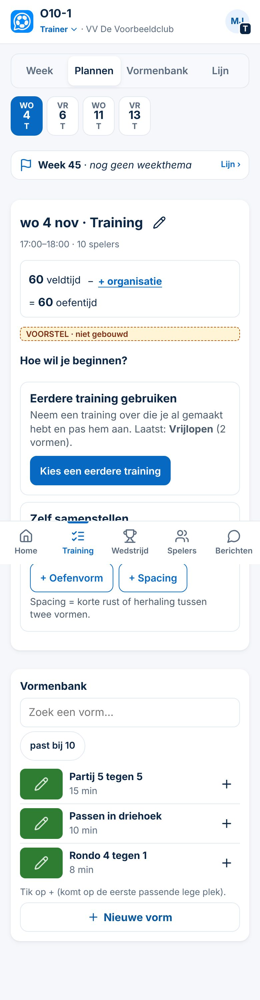
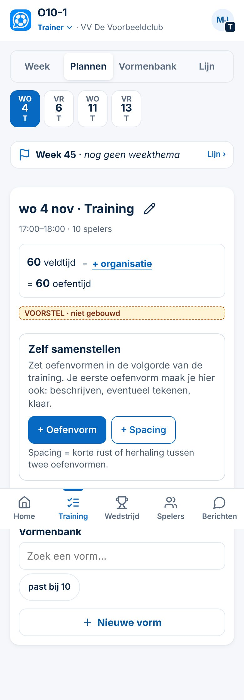
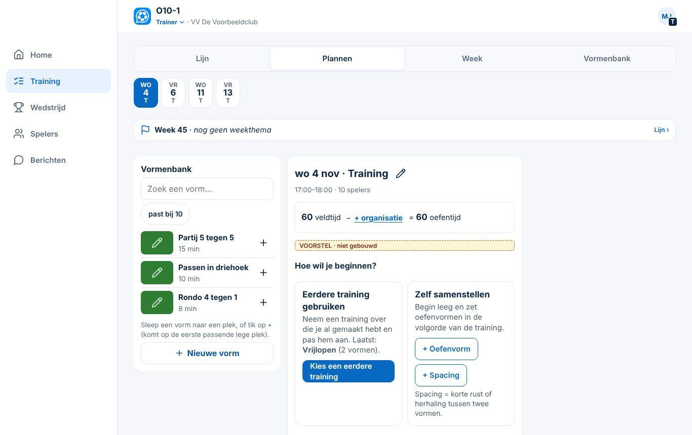
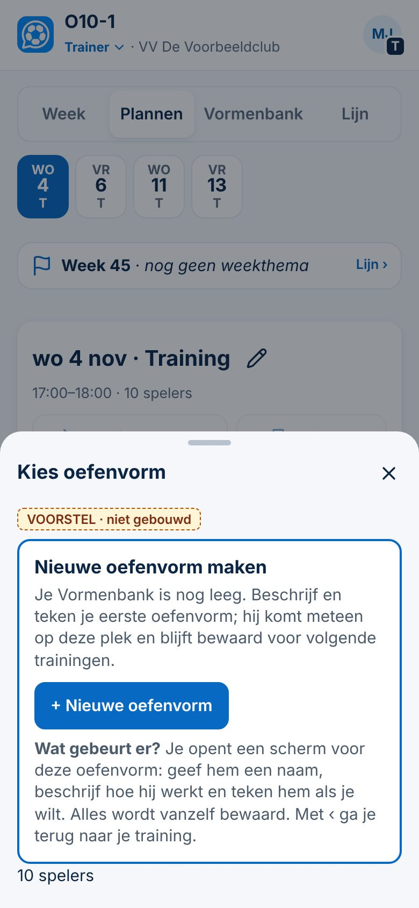
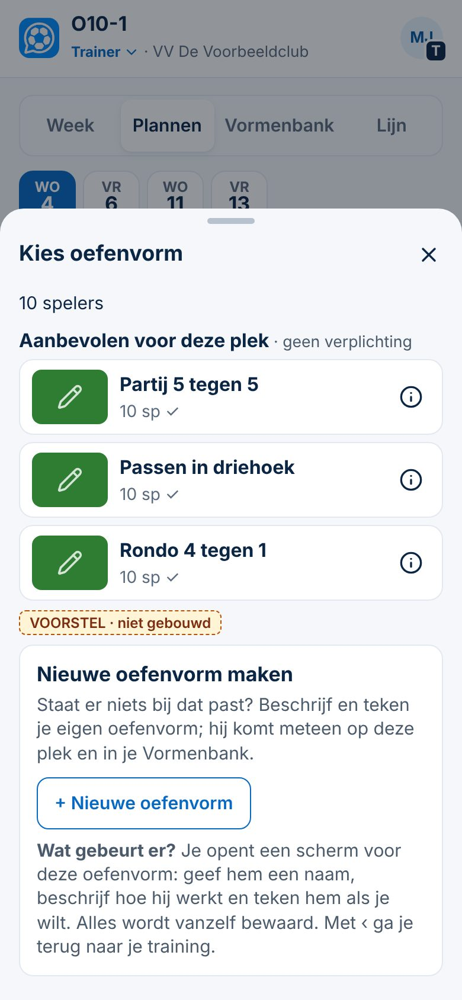
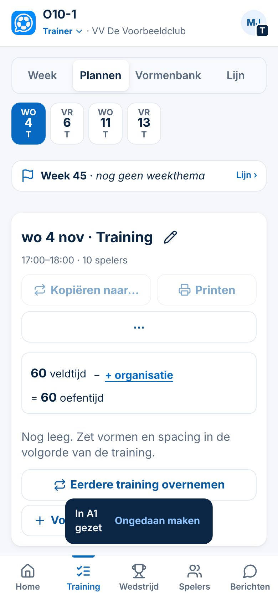
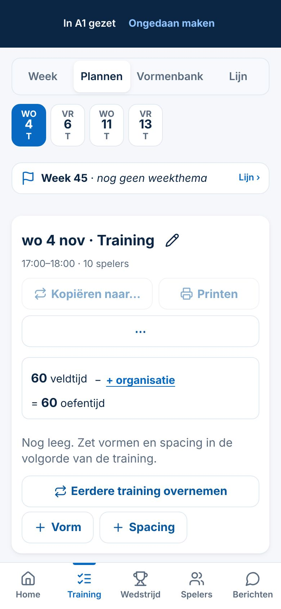
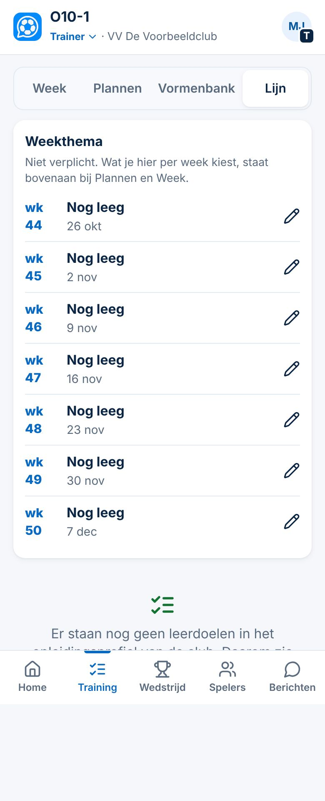
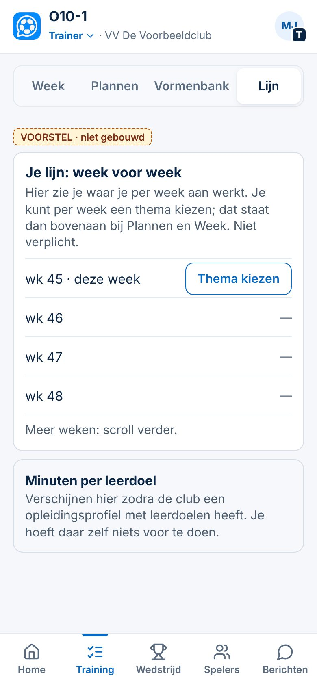

# Definitief voorstel: drie kleine UX-verbeteringen

*4-11-2026, bijgewerkt na de tweede beoordeling. Spoor 3, maat M: alleen bestaande schermen, geen nieuwe gegevens, geen rechten, geen migratie. **Ontwerp ter beoordeling, niet gebouwd.** Gemeten op `main` (`4bf2e97`) in de demo met verzonnen gegevens. Bewijs: **Gezien** (gemeten in de app of in een prototype in de testbrowser), **Afgeleid** (uit de code).*

Valt onder het voorstel *Vrijwilligersprincipe*, regels 2, 3, 4 en 9.

---

## 1. Lege training opschonen
| | Nu (Gezien) | Gewenst |
|---|---|---|
| Startkeuzes | *Eerdere training overnemen*, *+ Vorm*, *+ Spacing*; op de telefoon daaronder ook *Nieuwe vorm* in de bankstrook | blok **"Hoe wil je beginnen?"** met **Eerdere training gebruiken** (alleen als er een eerdere training met inhoud is) en **Zelf samenstellen** (*+ Oefenvorm*, *+ Spacing* met één zin uitleg, *Sjabloon …* als het clubprofiel dat heeft) |
| ⋯ | bevat *Eerdere training overnemen* en *Training leegmaken*, ook als de training al leeg is | **⋯ verdwijnt helemaal** bij een lege training; beide keuzes doen daar niets |
| *Kopiëren naar…*, *Printen* | zichtbaar maar uitgeschakeld | verborgen tot er iets in de training staat |
| Woorden | *Vorm*, *Nieuwe vorm*, *vormen en spacing* | overal **oefenvorm** (knoppen, uitleg, bankstrook) |
| **Gevulde training** | — | **ongewijzigd**: ⋯ met *Eerdere training overnemen* (toevoegen) en *Training leegmaken*; *Kopiëren naar…*; *Printen* |

| Telefoon, met eerdere training | Telefoon, zonder | Laptop |
|---|---|---|
|  |  |  |

*In de ontwerpen staat de bankstrook onder de training op de telefoon nog met de oude knop "Nieuwe vorm". In de bouw heet die "Nieuwe oefenvorm".*

**Tussenstap:** *Kies een complete training* is een aparte vervolgstap. Daarvoor ontwerpen we eerst de clubbibliotheek.

## 2. Lege oefenvormkiezer verduidelijken
| | Nu (Gezien) | Gewenst |
|---|---|---|
| Lege Vormenbank | *Past het best (0)* · *Je hebt nog geen vormen* · *Nieuwe vorm* | één kaart **Nieuwe oefenvorm maken**, met daaronder **"Wat gebeurt er?"**: *"Je opent een scherm voor deze oefenvorm: geef hem een naam, beschrijf hoe hij werkt en teken hem als je wilt. Alles wordt vanzelf bewaard. Met ‹ ga je terug naar je training."* |
| Met oefenvormen | *Past het best* · *Past deels* · *Alle andere* · *Nieuwe vorm* | **dezelfde groepen en volgorde** (Besluit 139); de kop wordt **Aanbevolen voor deze plek · geen verplichting**; onderaan dezelfde kaart |
| Eén kiezer | ja | ja: geen tweede lijst, geen tweede ingang |

| Lege bank | Met oefenvormen |
|---|---|
|  |  |

**Wat er daarna echt gebeurt (Gezien):**
- De oefenvorm wordt meteen gemaakt en op de plek gezet. Het scherm *Nieuwe vorm* opent: bovenaan *Tekening maken*, dan *Naam* (ingevuld met "Nieuwe vorm"), dan de classificatie (*Alles mag leeg blijven*).
- Ga je meteen terug, dan blijft een lege *Nieuwe vorm* staan in de bank en op de plek. Dat kan met de bestaande knoppen worden weggehaald, maar een beginner weet dat niet.

**Open keuze (niet in dit voorstel):**
- een lege nieuwe oefenvorm bij teruggaan vanzelf opruimen, met *Ongedaan maken*;
- het naamveld leeg laten in plaats van "Nieuwe vorm".

Beide raken gedrag en gegevens, en zijn daarom een apart besluit.

## 3. Meldingen: geen onbedoelde handelingen
**Nu (Gezien, prototype op 390 px):**
- De melding staat boven de tabbalk.
- Een tik gaat **door de melding heen** naar wat eronder ligt.

| Situatie | Nu | Oplossing 1: zwevend, vangt de tik zelf | Oplossing 2: in de kop |
|---|---|---|---|
| S1 tik op de melding (verborgen knop eronder) | ⚠️ *+ Spacing* ingedrukt: **onderdeel toegevoegd zonder het te zien** | melding gesloten, niets toegevoegd | melding gesloten, niets toegevoegd |
| S2 tabbalk tikken terwijl de melding er is | werkt | werkt | werkt |
| S3 zichtbare knop elders | werkt | werkt | werkt |
| S4 *Ongedaan maken* | werkt (in de app) | werkt | werkt |
| S5 tik **net na het verdwijnen** op de plek van *Ongedaan maken* | ⚠️ **opende een onderdeel** eronder | opgevangen (nalooptijd 0,4 s) | opgevangen |
| S6 tik **op het moment van verschijnen** | ⚠️ ging door naar de knop eronder | melding gesloten, niets bediend | melding gesloten |
| S7 rolknop in de kop terwijl de melding er is | werkt | werkt | ⚠️ geblokkeerd tot de melding weg is |

| Oplossing 1 (advies) | Oplossing 2 |
|---|---|
|  |  |

**Oplossing 1, zwevend boven de tabbalk:**
- De hele melding vangt de tik: een tik sluit hem, de knop is *Ongedaan maken*.
- Na het verdwijnen vangt een onzichtbare strook nog **0,4 s** de tik op (nalooptijd).
- Tabbalk en kop blijven bereikbaar.
- Een strook inhoud is 2,6 s (gewone melding) of 8 s (met *Ongedaan maken*) bedekt; één tik maakt hem vrij.
- *Ongedaan maken* blijft in de duimzone.

**Oplossing 2, in de kop:**
- Inhoud en tabbalk blijven vrij.
- De kop (rol wisselen, profiel) is tijdelijk bedekt.
- *Ongedaan maken* staat **bovenin**, dus verder van de duim.

**Advies: oplossing 1.** De tabbalk wordt niet bedekt (jouw voorwaarde), er is geen enkele onbedoelde handeling in de test, en *Ongedaan maken* staat waar de duim al is.

**Samen met beide oplossingen:**
- de melding *"Welkom, …"* na het inloggen vervalt (akkoord);
- op de laptop verandert de plek niet (rechtsonder naast het menu); de melding vangt daar ook de klik en heeft dezelfde nalooptijd;
- de schermlezer leest meldingen al voor (`role="status"`, `aria-live="polite"`).

---

## Gevolgen voor bestaande routes
| Route | Gevolg |
|---|---|
| Trainer: eerdere training overnemen | zelfde aantal tikken; begint vanuit de kaart in plaats van een losse knop |
| Trainer: eerste oefenvorm maken | zelfde aantal tikken (≤ 3); één zin uitleg erbij |
| Trainer met een **gevulde** training | **niets verandert** (⋯, kopiëren, printen, *Eerdere training overnemen* om toe te voegen) |
| Club met profiel (DCG) | *Sjabloon …* staat in *Zelf samenstellen*; methodiek, kiezer met gereedschap en Lijn ongewijzigd |
| Week (telefoon, controleren) | ongewijzigd |
| Alle meldingen in de app (± 200 aanroepen van `CC.toast`) | zelfde tekst en duur; alleen de bediening verandert (tik vangen, nalooptijd); de welkomstmelding vervalt |
| Gegevens | geen wijziging: alle bestaande trainingen, oefenvormen en tekeningen blijven gelijk |

## Acceptatiecriteria
**Beginnende vrijwilliger** (geen eerdere training, lege Vormenbank, 390 px):
1. Een lege training toont één blok met één duidelijke hoofdactie (*Zelf samenstellen*). Er is geen ⋯, geen uitgeschakelde knop en geen dubbele knop.
2. Hij komt in ≤ 3 tikken in het scherm voor zijn eerste oefenvorm. Vóór de tik staat in één zin wat er gaat gebeuren.
3. *Spacing* heeft één zin uitleg; overal staat het woord *oefenvorm*.
4. Geen tik op of rond een melding (verschijnen, zichtbaar, net verdwenen) bedient iets eronder.
5. Hij kan elk scherm verlaten zonder iets in te vullen.

**Ervaren trainer** (eerdere trainingen, gevulde Vormenbank):
1. *Eerdere training gebruiken* → kiezen kost ≤ 3 tikken vanaf de lege training.
2. De kiezer toont dezelfde groepen in dezelfde volgorde als nu. *Ongedaan maken* na plaatsen werkt binnen 8 s, ook direct na het verschijnen van de melding.
3. Een gevulde training is precies als nu (⋯, kopiëren, printen).
4. Met een clubprofiel staat *Sjabloon …* in *Zelf samenstellen*; methodiek en Lijn zijn ongewijzigd.

**Beide:**
- geen horizontaal scrollen op 390 px;
- nieuwe of gewijzigde knoppen ≥ 44 pt;
- leestekst ≥ 16 px;
- contrast ≥ 4,5 : 1.

## Regressietests
- **Nieuw** `eerste-keuzes.spec.js` (nieuw, in `tests/`) (390 en 1366 px):
  - lege training met en zonder eerdere training;
  - ⋯ afwezig bij een lege training, aanwezig bij een gevulde;
  - *Kopiëren* en *Printen* verborgen bij een lege training;
  - met clubprofiel: *Sjabloon …* in het blok;
  - de kiezer met lege bank (kaart en uitleg) en met oefenvormen (zelfde groepen en volgorde, nieuwe kop);
  - bestaande trainingen byte-gelijk na openen.
- **Nieuw** `meldingen.spec.js` (nieuw, in `tests/`) (390 px; S1–S7 hierboven):
  - met en zonder *Ongedaan maken*;
  - tik bij verschijnen, tijdens en net na verdwijnen;
  - geen welkomstmelding na het inloggen;
  - tabbalk bereikbaar.
- **Aanpassen** (alleen knopteksten): tests die zoeken op *Vorm*, *Nieuwe vorm* of *Eerdere training overnemen* (onder andere `tests/app.spec.js` trainingsmodule, `tests/kiezer.spec.js`, `vastleggen.spec.js` op `main`).
- **Groen houden:**
  - de volledige `npm test`, onder andere *Ongedaan maken* in de kiezer (Besluit 139), tijdsbalk, trainingskaart, vastleggen (147) en verplaatsen (145, PR #107);
  - de bestaande test *tikvlakken minimaal 44 pt*.

---

## Bijlage A — Lijn zonder opleidingsprofiel (apart voorstel, niet in deze bouw)
- Het tabblad blijft zichtbaar (Besluit 122 en 141). Het weekthema werkt al zonder profiel.
- **Ontwerp (akkoord als ontwerp):**
  - één kaart *"Je lijn: week voor week"* met één zin uitleg;
  - alleen deze week krijgt een rustige knop *Thema kiezen*;
  - andere weken tonen *—* in plaats van zeven keer *Nog leeg*;
  - een informatiekaart *"Minuten per leerdoel verschijnen hier zodra de club een opleidingsprofiel met leerdoelen heeft. Je hoeft daar zelf niets voor te doen."*
- **Geen achterstand suggereren:**
  - geen rode of oranje kleur, geen telling *"x weken zonder thema"*;
  - geen signaal op Home of bij de begeleider.

| Nu | Ontwerp |
|---|---|
|  |  |

## Bijlage B — Rolknop in de kop (gecorrigeerd)
- **Gemeten (Gezien):** het zichtbare vak is 58 × 21 px, maar het **klikbare vlak is 77 × 45 px**. De CSS heeft al een onzichtbare vergroting (`.rolknop::after`, `inset: -8px -10px -16px -10px`).
- Er ligt geen andere knop binnen dat vlak; erboven staat de teamnaam (tekst), eronder de inhoud. De kop is 66 px hoog.
- **Conclusie:** voldoet aan de projectnorm (44 pt) en aan WCAG 2.5.8. **De eerder genoemde kandidaat-fout vervalt.** Aanpassen is niet nodig; de kop wordt niet hoger.
- Wel opgemerkt: de rolnaam staat in 12 px. Dat is een label, geen leestekst, en valt dus buiten de 16 px-norm. Geen actie.
