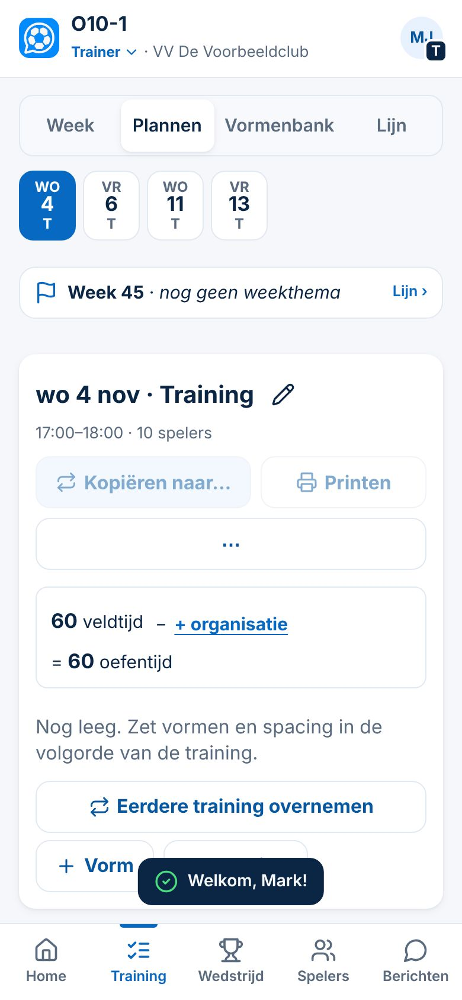
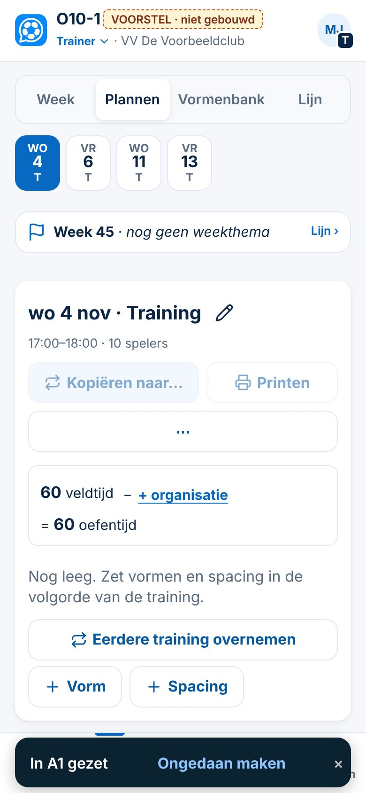

# Voorstel: drie kleine UX-verbeteringen (+ onderzoek Lijn en tikvlakken)

*4-11-2026. Spoor 3, maat M (bestaande schermen; geen nieuwe gegevens, geen rechten, geen migratie). **Alleen ontwerp, niet gebouwd.** Gemeten op `main` (`4bf2e97` en eerder `eb4dcd0`), demo met verzonnen gegevens. Bewijslabels: **Gezien** (gemeten in de app), **Afgeleid** (uit de code), **Nog te valideren**.*

---

## 1. Lege training opschonen
**Nu (Gezien, 390 en 1366 px):**
- Er staan vijf startacties: *Eerdere training overnemen* (ook nog in ⋯), *+ Vorm*, *+ Spacing*, en op de telefoon de Vormenbank-strook met *Nieuwe vorm*.
- *Kopiëren naar…* en *Printen* staan er uitgeschakeld.
- De tekst is *"Nog leeg. Zet vormen en spacing in de volgorde van de training."*

**Voorstel:**
- Er komt een blok **"Hoe wil je beginnen?"**, alleen zolang de training leeg is:
  - **Eerdere training gebruiken:** alleen als de trainer al een training met inhoud heeft; noemt de laatste;
  - **Zelf samenstellen:** *+ Oefenvorm*, *+ Spacing* (met één zin uitleg), en *Sjabloon …* als het clubprofiel er een heeft.
- *Kopiëren naar…* en *Printen* zijn verborgen tot er iets in de training staat.
- In ⋯ staat bij een lege training alleen *Training leegmaken*.
- Overal staat het woord **oefenvorm**.

| Met eerdere training (390) | Zonder eerdere training (390) | Laptop |
|---|---|---|
|  |  |  |

**Tussenstap (aanscherping 4-11):** een trainer zonder eerdere training en zonder Vormenbank wordt hiermee alleen duidelijker geleid, niet echt geholpen. Dat gebeurt pas als de **clubbibliotheek** complete voorbeeldtrainingen biedt. Dan komt er een derde kaart *Kies een complete training*. Die maakt geen deel uit van dit voorstel.

**Gevolgen:**
- Dezelfde handlers (`tpKopie`, `tpVormKiezen`, `vormNieuw`, sjabloon); er komt geen functie bij.
- Bestaande trainingen veranderen niet; het blok staat alleen bij een lege training.
- Tests die op knoptekst zoeken (*Vorm*, *Nieuwe vorm*) worden aangepast.
- De Week (telefoon, controleren) verandert niet.

## 2. Lege oefenvormkiezer verduidelijken
**Nu (Gezien):** *Kies oefenvorm · 10 spelers · Past het best (0) · Je hebt nog geen vormen · Nieuwe vorm*.

**Voorstel:**
- Bij een **lege bank** komt alleen één kaart **Nieuwe oefenvorm maken**, met de zin *"Je Vormenbank is nog leeg. Beschrijf en teken je eerste oefenvorm; hij komt meteen op deze plek en blijft bewaard voor volgende trainingen."* De kop *Past het best (0)* vervalt.
- **Met vormen** blijven de groepen precies gelijk (Besluit 139). Alleen de kop wordt **Aanbevolen voor deze plek · geen verplichting**, en onderaan staat dezelfde kaart met één zin.
- Eén kiezer voor alle clubs. Er komt geen tweede lijst (afgewezen bij Besluit 139) en geen dubbele ingang.

| Lege bank | Met vormen |
|---|---|
|  |  |

## 3. Meldingen buiten bedieningsknoppen houden (hoge prioriteit)
**Nu (Gezien, 390 px):**
- De melding staat onderaan boven de tabbalk en bedekt een knop: *Welkom, Mark!* ligt over *+ Spacing*.
- Een tik gaat door de melding heen naar de knop eronder (`pointer-events: none`). Getest: de tik komt aan op *+ Spacing*.
- Bij een melding met **Ongedaan maken** (8 seconden) geldt dat ook. Wie net naast *Ongedaan maken* tikt, bedient ongemerkt de knop die eronder verborgen ligt. **Risico op een verkeerde handeling.**

**Voorstel A (advies):**
1. **Geen melding na het inloggen.** *Welkom, …* is informatie zonder taak; Home is al het antwoord.
2. Op de telefoon staat de melding **in de strook van de tabbalk** (zelfde hoogte, iets ingesprongen). Hij bedekt dus nooit inhoud, alleen kort de tabbalk.
3. De melding **vangt een tik zelf af**: tik = sluiten, knop = *Ongedaan maken*. Er gaat niets door naar een knop die je niet ziet.
4. De tijden blijven 2,6 s (gewoon) en 8 s (met actie). Een schermlezer leest de melding voor; dat werkt al (`role="status"`, `aria-live="polite"` in `index.html`).
5. Op de laptop verandert niets: daar staat de melding rechtsonder naast het menu en bedekt hij geen knoppen. Afgeleid; nog na te lopen per scherm.

| Nu | Voorstel A |
|---|---|
|  |  |

**Alternatief B:** de melding blijft boven de tabbalk, en zolang hij er is krijgt de inhoud extra ruimte onderaan.
- **Nadeel:** knoppen midden op het scherm kunnen nog steeds bedekt raken, en de pagina verspringt.
- **Daarom:** A.

**Gevolgen:** CSS en een paar regels in `CC.toast`. Geen gegevens. Tests: meldingen met en zonder actie op 390 px; een tik op de melding bedient niets eronder.

---

## 4. Onderzoek: Lijn en clubs zonder opleidingsprofiel (geen akkoord op verbergen)
**Nu (Gezien, club zonder profiel):**
- Het tabblad Lijn toont **Weekthema** (*"Niet verplicht…"*) met zeven regels *Nog leeg*.
- Daaronder staat *"Er staan nog geen leerdoelen in het opleidingsprofiel van de club. Daarom zie je hier nog geen minuten per leerdoel; het weekthema kun je al gebruiken."*
- **De Lijn werkt dus al zonder profiel:** het weekthema verschijnt bovenaan bij Plannen en Week.

**Waarom niet verbergen:**
- Besluit 141 en 122 houden de tabbladen gelijk.
- Het weekthema is ook zonder profiel nuttig.
- Verbergen maakt de navigatie per club anders.

**Voorstel lege toestand:**
- Één kaart **"Je lijn: week voor week"** met één zin uitleg.
- Alleen deze week krijgt de knop *Thema kiezen*; andere weken tonen *—* in plaats van zeven keer *Nog leeg*.
- Daaronder een rustige informatiekaart **"Minuten per leerdoel"**: *"Verschijnen hier zodra de club een opleidingsprofiel met leerdoelen heeft. Je hoeft daar zelf niets voor te doen."*

| Nu | Voorstel |
|---|---|
|  |  |

**Gevolgen:**
- Alleen tekst en opmaak in `lijnHtml` (`training.js`).
- Bij een club **met** profiel (DCG) verandert niets.
- Geen gegevens, en het tabblad blijft.

**Status:** onderzoek. Dit is een vierde, apart voorstel, en alleen met akkoord.

---

## 5. Toegankelijkheid: kleine tikvlakken per element
*De telling van 222 uit de audit was een screening. Hieronder de uitsplitsing per element. Gezien, 390 px, alle rollen en tabbladen; dubbele tabbladen per persoon zijn meegeteld, dus de totalen verschillen van de audit.*

| Element | Kleiner dan 44 px | Kleiner dan 24 px | Oordeel |
|---|---|---|---|
| `button.knop.klein` (bijv. *Afmelden*, *Ik doe het*) | 84 | 0 | 40 px hoog: voldoet aan WCAG AA (24), **niet aan de projectnorm 44**. Ontwerpkeuze, geen fout. Voorstel: 44 px op de telefoon (P2) |
| vinkjes en keuzerondjes | 97 | 29 (het vinkje zelf, 13–18 px) | het **label** is het tikvlak (36–103 px hoog): **in orde**. Eén keuzelabel is 36 px (Regels): onder 44, boven 24 |
| `button.rolknop` (rolwissel in de kop, *Trainer ▾*) | 29 | **29 (21 px hoog)** | **kandidaat-fout WCAG 2.5.8** (24 px), tenzij er genoeg ruimte omheen is; vaak gebruikt. **P1** |
| `button.profielknop` (rondje met initialen) | 34 | 0 | 36 × 36: boven AA, onder 44. P3 |
| `a.icoonknop` / `button.icoonknop` (WhatsApp, verwijderen) | 18 | 0 | 40 × 40; hebben een naam. P3 |
| `li.ok` / `li.half` (stappen traject HJO) | 2 | 2 | waarschijnlijk geen bediening (vals-positief); nog te valideren |

**Conclusie:**
- Er is **één echte kandidaat-fout**: de rolknop.
- De rest is een bewuste afwijking van de projectnorm (knoppen van 40 px) of in orde (label als tikvlak).
- Nog niet gedaan: contrast per element, toetsenbordfocus en een schermlezer.

---

## 6. Acceptatiecriteria
### Beginnende vrijwilliger (geen eerdere training, lege Vormenbank, telefoon 390 px)
1. Vanuit Training → Plannen ziet hij bij een lege training **één blok** met hoogstens twee keuzes. Er staat geen uitgeschakelde of dubbele knop.
2. Hij komt in **≤ 3 tikken** in het scherm om zijn eerste oefenvorm te beschrijven (*Training voorbereiden* → *+ Oefenvorm* → *+ Nieuwe oefenvorm*).
3. Elke vakterm die hij moet gebruiken (*Spacing*) heeft één zin uitleg op dezelfde plek.
4. Geen melding bedekt een knop. Een tik op een melding bedient nooit iets eronder.
5. Hij kan elk scherm verlaten zonder iets in te vullen; er verschijnt geen foutmelding en geen *"x van y"*.
6. De Lijn zonder profiel legt in één zin uit wat er werkt (weekthema) en wat er later komt. Het tabblad blijft.

### Ervaren trainer (met eerdere trainingen en een gevulde Vormenbank)
1. Een eerdere training overnemen kost **≤ 3 tikken** vanaf de lege training (kaart → kiezen), niet meer dan nu.
2. De kiezer toont dezelfde groepen in dezelfde volgorde als nu (Besluit 139). Alleen de kop verandert. *Ongedaan maken* werkt na het plaatsen.
3. Bij een gevulde training is er **niets** veranderd: *Kopiëren naar…*, *Printen* en ⋯ (met *Eerdere training overnemen* om toe te voegen) staan op hun plek.
4. Met een clubprofiel (DCG) staan *Sjabloon …* en de methodiek op dezelfde plek. De Lijn met leerdoelen is ongewijzigd.
5. Bestaande trainingen, vormen en tekeningen blijven **byte-gelijk** na openen (test).

### Voor beide
- Op 390 px is er geen horizontaal scrollen.
- Nieuwe of gewijzigde knoppen zijn ≥ 44 pt.
- Leestekst is ≥ 16 px en het contrast is ≥ 4,5 : 1.
- De volledige `npm test` is groen, plus nieuwe tests voor de lege toestand, de kiezer zonder bank, de meldingen (tik gaat niet door) en de Lijn zonder profiel.
