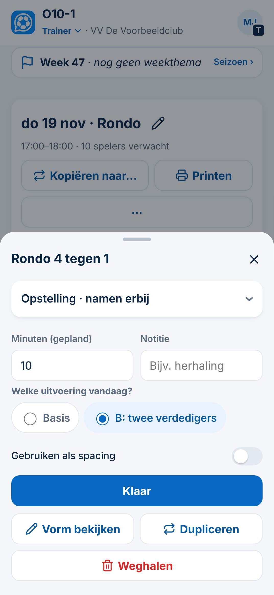
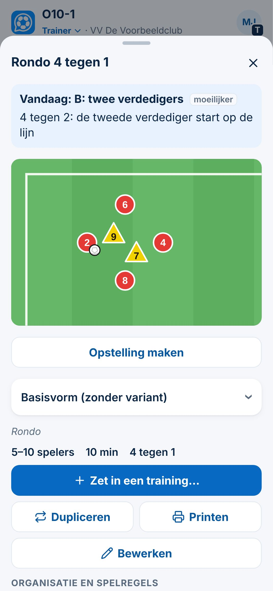
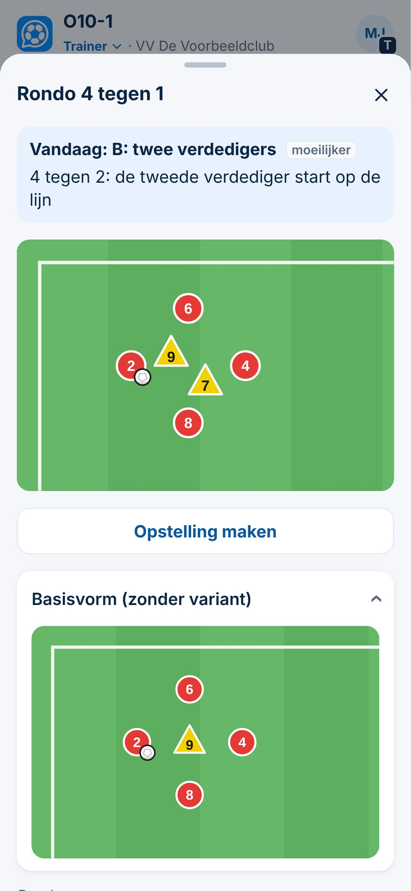
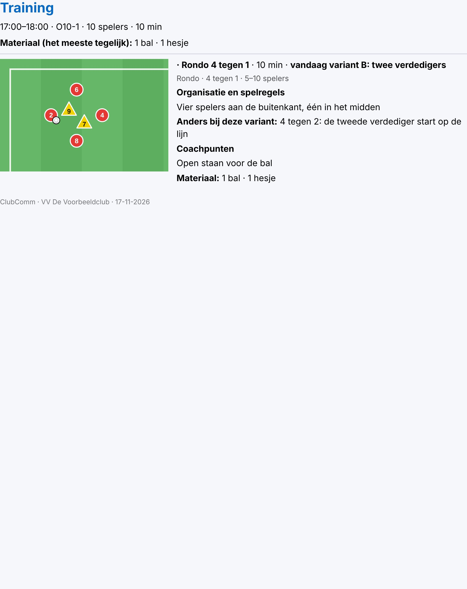

# Voorstel H3 en H4 — variantverwijzingen en de variant op het veld (Spoor 3, 17-11-2026)

*Voorstel met een werkend prototype. Er is **niets gepubliceerd** en de productiedatabase is niet gewijzigd. Het prototype staat op de branch `voorbeeld/varianten-h3-h4` (niet in `main`). De schermen komen uit dat prototype, op 390 px, in de demo met verzonnen gegevens.*

**Opdracht (16-11).** *"We beginnen met H3 en H4, de twee fouten bij varianten. … Maak eerst een concreet voorstel en prototype op 390 px. Geen productieaanpassing zonder mijn akkoord."* Achtergrond: `docs/onderzoek/vormenbank-audit/README.md`, bevindingen H3 en H4.

**Maat: M, met de controles van L op gegevens.**
- H3 verandert hoe een training een variant bewaart. Volgens `CLAUDE.md` is dat maat L (*mogelijk gegevensverlies*). Daarom staat hieronder eerst wat er nu in productie staat en hoe het omzetten gaat.
- Er komt geen migratie, de database-indeling verandert niet en de rechten blijven gelijk. Er komen geen nieuwe persoonsgegevens bij.

---

## 1. Wat staat er nu in productie? (alleen gelezen, 17-11)

Gelezen met `SELECT`, zonder iets te schrijven:

| | Aantal |
|---|---|
| Vormen | 44 |
| Vormen met varianten | 18 |
| Varianten samen | 33 |
| Plekken in trainingen met een vorm | 63 |
| **Plekken met een gekozen variant** | **0** |
| Waarvan in een gegeven training | 0 |
| Verwijzingen naar een variant die niet (meer) bestaat | 0 |

**Betekenis.** Er bestaan varianten, maar geen enkele training heeft er al een gekozen. Er is dus **nog niets verschoven** en er hoeft **geen enkele training omgezet** te worden. Dit is het goede moment om het te repareren, voordat de eerste trainer een variant kiest.

---

## 2. H3 — Vaste variantcode

### Ontwerp
1. **Elke variant krijgt een vaste code** (`id`, bijv. `var…`). Hij verandert nooit, ook niet als je de naam, de tekst of de tekening van de variant aanpast.
2. **Een plek in een training bewaart die code**, niet meer de plaats in de lijst (`o.variant = 'var…'` in plaats van `1`).
3. **Weghalen = verbergen.** Een variant die je weghaalt, krijgt `weg: true`. Hij verdwijnt uit Bewerken en uit de keuze *Welke uitvoering vandaag?*. Trainingen die hem al gebruikten, tonen hem nog, met *(niet meer in gebruik)*. De lijst schuift nooit meer.
4. **Oude gegevens blijven leesbaar.** Een plek met een volgnummer (zoals vóór dit besluit) wordt gelezen als *de variant op die plaats*. Omdat weghalen niet meer schuift, blijft dat kloppen. Zodra de trainer de plek opslaat, staat er de code.
5. **Codes ontstaan pas als ze nodig zijn.** Er is geen omzetting van alle 33 varianten in één keer. Een code komt erbij:
   - bij een nieuwe variant;
   - bij het kiezen van een variant voor een plek;
   - bij het weghalen van een variant.

   Bestaande vormen veranderen dus niet bij het openen van de app.

### Waarom geen eenmalig omzetscript
- In productie hoeft niets omgezet te worden (§ 1).
- Een script dat 44 vormen en 38 trainingsrijen herschrijft, is een schrijfactie op de productiedatabase. Dat kan alleen met jouw akkoord en heeft een terugzetplan nodig. Het voegt niets toe, want punt 4 vangt elk oud volgnummer op.
- Mocht er bij de publicatie toch een plek met een volgnummer zijn (een trainer kiest vandaag een variant), dan blijft die correct. Weghalen verschuift immers niets meer.

### Getest op een kopie (automatische test, nep-database)
`tests/varianten.spec.js`:
1. **Weghalen verschuift niets.** Variant A weghalen → A is verborgen, B houdt zijn code. De geplande **en** de gegeven training noemen nog steeds *B: twee verdedigers* (regel en print). In *Welke uitvoering vandaag?* staat A niet meer; B blijft gekozen.
2. **Oude gegevens.** Varianten zonder code en een plek met volgnummer 1 → de gegeven training toont *B*. Opslaan van de plek → de plek bewaart de code van B.
3. **H4** (hieronder): Op het veld, de basis ingeklapt, de print.

De volledige test draait groen: `npm test` 201 geslaagd, documentcontrole 9/9.

---

## 3. H4 — De gekozen variant op het veld

### Ontwerp
Geopend **vanuit een training** waarin een variant is gekozen:
1. **Bovenaan een blok:** *Vandaag: B: twee verdedigers* met het label *moeilijker* of *makkelijker* en de tekst *wat is anders*.
2. **De grote tekening is die van de variant.** Heeft de variant geen eigen tekening, dan staat er: *Deze variant heeft geen eigen tekening; hieronder de basistekening.*
3. **De basis staat ingeklapt:** *Basisvorm (zonder variant)* met de basistekening, alleen als de variant een eigen tekening heeft.
4. **De rest blijft hetzelfde:** organisatie, spelregels en coachpunten van de vorm. Een variant beschrijft alleen wat anders is.
5. **Het tekeningetje in de regel** (Op het veld en Voorbereiden) is ook dat van de variant.
6. **Vanuit Vormen** (zonder training) verandert er niets: geen *Vandaag*-blok.

 

### Print
De print had de naam en de tekst van de variant al, maar **de basistekening**. Nu:
- de **tekening van de variant**;
- in de kop: *vandaag variant B: twee verdedigers*;
- in de tekst: *Anders bij deze variant: …*.

### Telefoon
Op 390 px past het blok *Vandaag* en de tekening samen in het eerste scherm. Er is geen horizontaal scrollen. Het blok gebruikt de bestaande lichtblauwe achtergrond (kleur alleen voor aandacht, Besluit 180).

---

## 4. Normen (`docs/app-controle.md`)

| Norm | Stand |
|---|---|
| Tikvlak ≥ 44 pt | *Basisvorm (zonder variant)* en de keuzes zijn bestaande uitklappers en chips (≥ 44 px) |
| Contrast ≥ 4,5:1 | donkere tekst op lichtblauw (bestaande combinatie) |
| Leestekst 16 px | ja |
| Beperk beweging | geen nieuwe animatie |
| Dubbel tikken | geen nieuwe knoppen |

## 5. Gevolgen voor besluiten

- **Nieuw besluit** (bij het bouwen een `Besluit NNN`): *Een variant heeft een vaste code; een plek bewaart die code; weghalen = verbergen; vanuit een training tonen de vorm, de regel en de print de gekozen variant (tekening en wat anders is), de basis ingeklapt.*
- **Vult aan:**
  - Besluit 147 (momentopname bij een gegeven training);
  - Besluit 165 (Op het veld);
  - Besluit 175 en 179 (de vorm vanuit een training).
- **Woord in het scherm:** *Variant (context vorm)* wordt *Welke uitvoering vandaag?*.
- **Afgewezen ideeën:** niets geraakt. ClubComm kiest geen variant voor de trainer.

## 6. Voordelen en nadelen

**Voordelen**
- Oude trainingen kunnen niet meer stil naar een andere variant verschuiven.
- Op het veld zie je wat je vandaag echt doet. Dat geldt ook voor de print.
- Er is geen omzetscript en geen schrijfactie op productie nodig. Er hoeft niets omgezet te worden.

**Nadelen**
- Een weggehaalde variant blijft in de gegevens bestaan (verborgen). Dat is een beetje opslag, maar een bewuste keuze, zoals bij *Verwijderen* van een vorm (Besluit 147).
- Wie een variant echt kwijt wil uit oude trainingen, kan dat niet. Dat is gewenst: de historie blijft kloppen.

## 7. Advies

**Bouwen zoals het prototype**, in één pull request, met:
- het besluit;
- de test `tests/varianten.spec.js`;
- het bijwerken van de functiekaart *Vormen* (een variant weghalen = verbergen).

Na samenvoegen controleer ik met één `SELECT` (alleen lezen) dat productie nog steeds 0 plekken met een volgnummer heeft.

## 8. H5 (apart, niet in deze stap)

Zie `docs/onderzoek/vormenbank-audit/README.md` § H5. H3 en H4 lossen alleen de variant op. **De tekening en de tekst van de vorm zelf** veranderen nog steeds mee in oude trainingen. Dat staat nu als afzonderlijk risico geregistreerd. Een waarschuwing bij Bewerken is alleen een tijdelijke maatregel.
