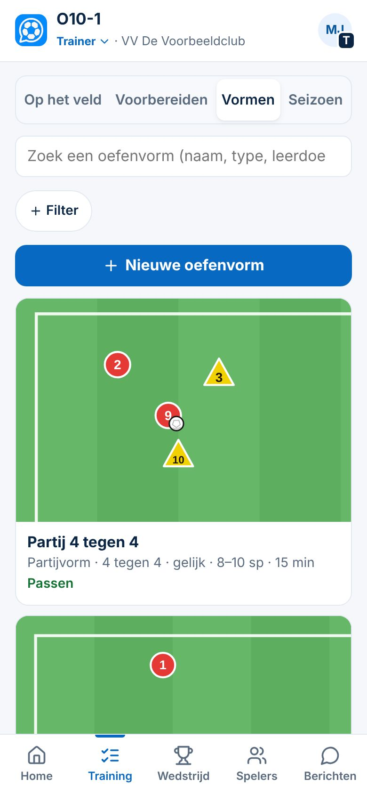
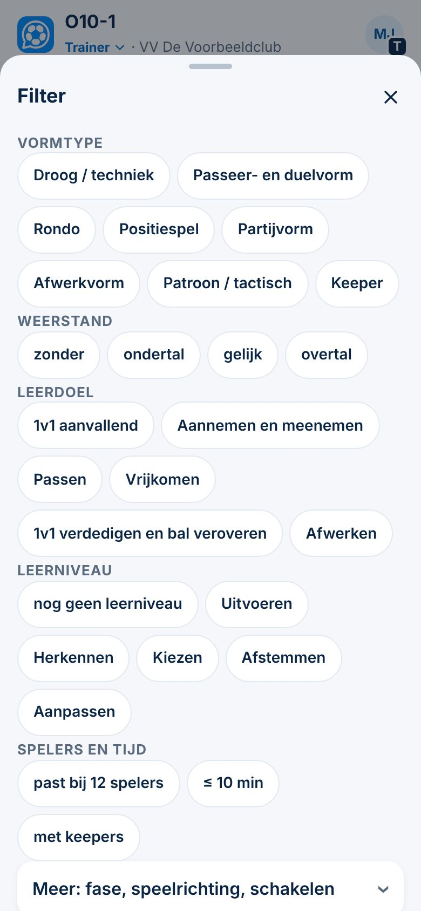
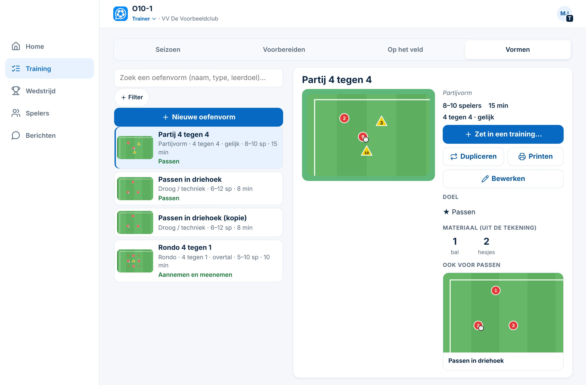
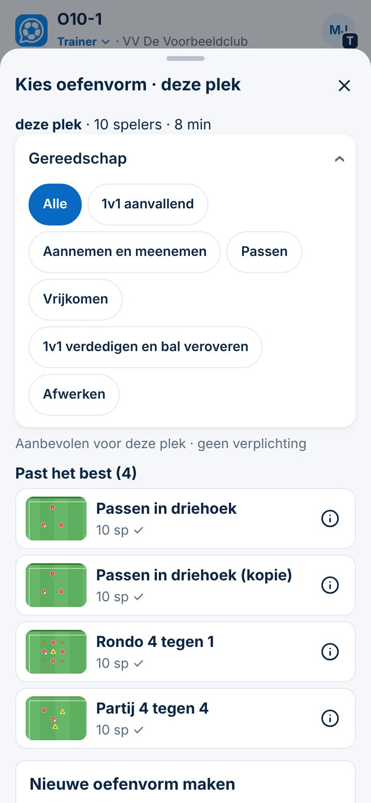
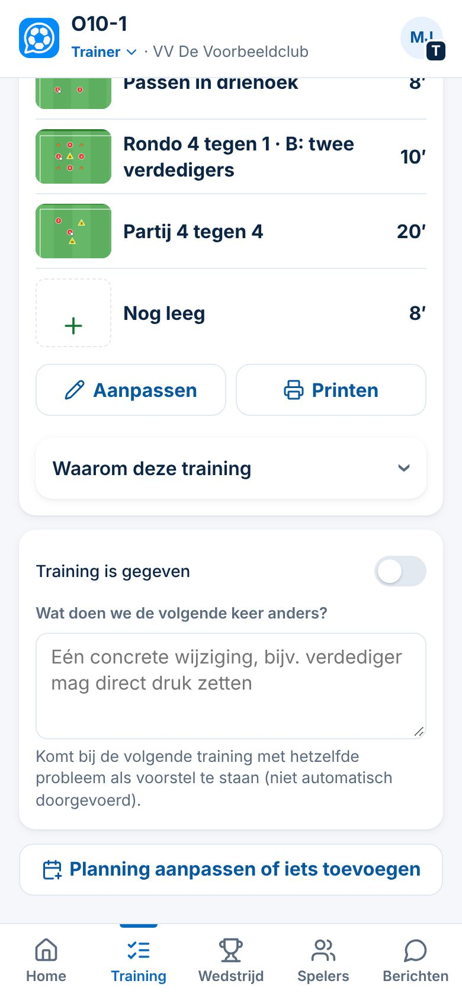
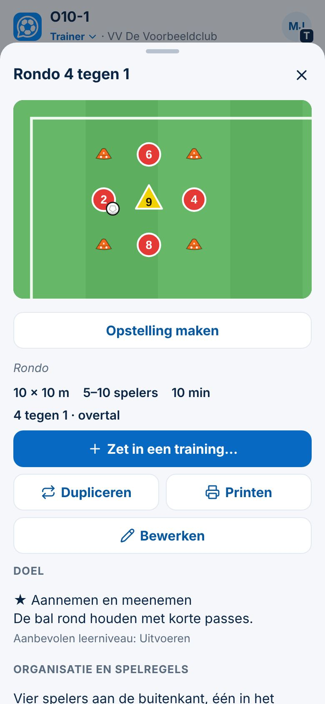
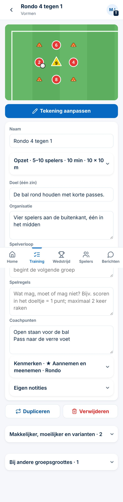
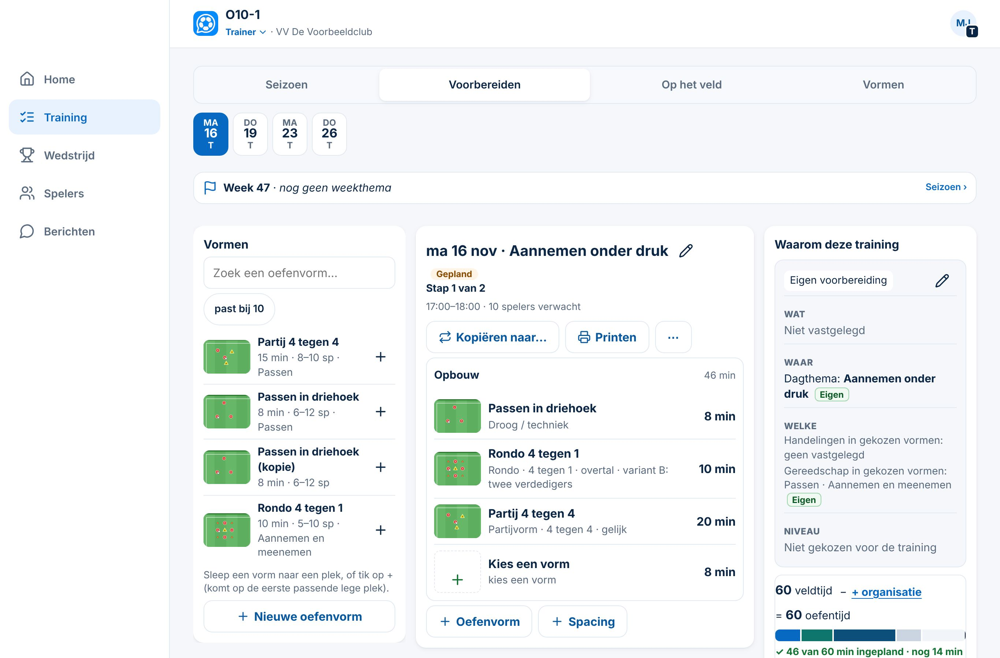

# Functionele audit — Vormen, varianten, informatie voor de trainer, cycli en complexiteit (Spoor 3, 16-11-2026)

*Onderzoeksdocument. Er is **niets veranderd** aan code, database of productie. Gebaseerd op `main` na #169 (t/m Besluit 182). De schermen zijn de echte app op 390 px (telefoon) en 1366 px (laptop), in de demo met verzonnen gegevens en het opleidingsprofiel als voorbeeld.*

**Aanleiding.** *Ontwikkelvoorstel — Leerlijn Sofian 2.0 en ClubComm Vormenbank* (15-11-2026), Fase 3. Opdracht van de initiatiefnemer (16-11): *"SPOOR 3 — maak de functionele audit."*

**Voorwaarden van de opdracht.**
1. **Spoor 1 is inhoudelijk leidend.** De methodiek wordt los van ClubComm ontwikkeld. Dit document zegt alleen wat de software nu kan en wat ze nodig heeft. Het doet geen voorstellen over de inhoud van de methodiek.
2. Het accent ligt op de praktijk: terugvinden, kiezen, gebruiken, variant, dupliceren en aanpassen van een vorm die al in trainingen stond.
3. Er komt geen implementatie. Elk voorstel krijgt pas na akkoord een eigen ontwikkelopdracht, en dan een besluit waar dat nodig is.

**Leeswijzer.** Elke bevinding heeft een code (bijv. **Z2**) en één van drie soorten:

| Soort | Betekenis |
|---|---|
| ✅ **Werkt** | Bestaat al en werkt voldoende. |
| ◐ **Verbeteren** | Bestaat al, maar de presentatie of de bediening moet beter. |
| ✚ **Ontbreekt** | Ontbreekt echt en vraagt nieuwe ontwikkeling. |

Per bevinding staan: **bestaand** (waar in de app of code), **probleem** (voor de trainer), **voorstel**, **maat** (S/M/L, `CLAUDE.md`) en **besluiten** (welke besluiten het raakt).

---

## 0. Samenvatting

**Belangrijkste conclusies.**
1. **Veel bestaat al.** Zoeken, filters, varianten, dupliceren, groepsgroottes, het per training kiezen van een variant, de evaluatie, *Mee uit vorige* en *Waarom deze training* zijn er allemaal. Het knelpunt is meestal **zichtbaarheid en samenhang**, niet een ontbrekende functie.
2. **Er zijn drie verschillende zoekplekken** voor dezelfde vormen, elk met andere regels:
   - **Vormen**: zoeken met filters;
   - **Voorbereiden**: *Vormen · n vormen · zoeken* onder de training;
   - **Kies oefenvorm**: *Alle andere oefenvormen · zoeken*.

   Dat is de grootste winst voor *minder knoppen en hetzelfde resultaat* (Z1).
3. **Een vorm aanpassen verandert ook oude trainingen.** De naam, de tekening, de organisatie, de coachpunten en de print van een al gegeven training volgen de vorm van nu. Alleen het gereedschap ligt vast sinds Besluit 147. Twee echte risico's:
   - een gekozen **variant** wordt bewaard als volgnummer: haal je een variant weg, dan wijst een oude training naar een **andere** variant (H3);
   - **Op het veld** toont de vorm altijd de **basistekening**, ook als je voor deze training variant B koos (H4).
4. **De uitleg bestaat al, maar de trainer ziet hem nergens.** Het opleidingsprofiel heeft per leerniveau een omschrijving, per gereedschap een principe en een spelersvraag, en per voetbalprobleem een definitie, een centrale vraag en wat je waarneemt. Ook termen staan erin. **De app toont daar niets van** (I3). Dit benutten kost geen nieuwe gegevens.
5. **Classificatie en filters zijn te veel en overlappen.** Er zijn 37 filterchips op het eerste scherm en nog 9 onder *Meer*. Bij Bewerken zijn er 23 invoervelden en 46 keuzechips. Er zijn vijf manieren om ongeveer hetzelfde te zeggen: vormtype, *meer precies*, leeromgeving, weerstand en tags (K1–K3).
6. **Cycli en complexiteit.** Het profiel heeft al twee bijna-complexiteitsschalen:
   - de **leeromgevingen**: vijf stappen, van geïsoleerd tot wedstrijdvorm;
   - het **mengpaneel**: ruimte, aantallen, richting, weerstand, tijd, start, regels en informatie.

   De evaluatie kent al *ander complexiteitsniveau* en *bij terugkeer*. Een aparte C1–C5-schaal zou een **derde** systeem worden naast leerniveau en leeromgeving. Advies: **geen C1–C5 als nieuw label**, maar complexiteit tonen als *wat je bewust verandert* (de ontwerpvariabele uit het mengpaneel) en een cyclus als *de vorige keer met hetzelfde voetbalprobleem* (C1–C4 hieronder).

**Advies voor de volgorde** (elk apart akkoord):
1. **Repareren**: H3 en H4 (maat S of M). Dit zijn fouten die oude trainingen of het veld onjuist maken.
2. **Uitleg zichtbaar maken uit het profiel** (I3, maat M): het grootste effect zonder nieuwe invoer.
3. **Eén zoekervaring** (Z1) en **minder filters** (Z2, K1), maat M.
4. **Variant, dupliceren en aanpassen duidelijker** (H1, H2, H5), maat M.
5. **Cyclus zichtbaar maken** (C2), maat M. Complexiteit (C3) pas nadat Spoor 1 de inhoud heeft vastgesteld.

---

## 1. Terugvinden en zoeken

 

### Z1 ◐ Drie zoekplekken met drie verschillende regels
- **Bestaand.**
  - *Vormen*: `CC.vormenLijst`, zoeken (`vormZoek`) plus het venster *Filter* met zes groepen en *Meer* (Besluit 141, 167, 174).
  - *Voorbereiden*: `planBank`, *Vormen · n vormen · zoeken* onder de training. Op de telefoon ingeklapt, op de laptop een kolom (Besluit 167, 169).
  - *Kies oefenvorm*: `kvHtml`. Gereedschap-chips, dan *Past het best*, *Past deels* en *Alle andere oefenvormen · zoeken* (Besluit 139, 150, 172).
- **Probleem.** De trainer leert drie keer een andere manier van zoeken. In *Kies oefenvorm* kan hij niet filteren op vormtype of weerstand. In *Vormen* krijgt hij geen advies voor de plek. Wie in *Vormen* een filter zet, ziet dat niet terug in de kiezer.
- **Voorstel.** Eén zoekonderdeel met dezelfde zoekregel en dezelfde (kleinere) filterset, op alle drie de plekken. Het verschil zit alleen in de context:
  - in *Kies oefenvorm* staat bovenaan *Past bij deze plek* (het bestaande advies);
  - in *Vormen* staat geen advies.

  Gevolg: één regel minder in de kiezer, en geen tweede zoekveld onder de training op de laptop.
- **Maat.** M.
- **Besluiten.** Herziet deels 139, 141, 150 en 167.

### Z2 ◐ Te veel filters op het eerste scherm
- **Bestaand.** Het filtervenster heeft zes groepen met **37 chips**: vormtype (8), weerstand (4), leerdoel (6), leerniveau (6, met *nog geen*), spelers en tijd (3). Onder *Meer* staan nog fase, speelrichting en schakelen (9). Zie het tweede scherm.
- **Probleem.** De drie ingangen uit het ontwikkelvoorstel zijn: (1) voetbalprobleem, (2) gereedschap, (3) spelers en organisatie. Daarvan staat alleen het gereedschap (*Leerdoel*) direct in beeld. *Voetbalprobleem* bestaat niet als filter. Leerniveau staat bij de vorm alleen als *aanbevolen* (Besluit 139: het leerniveau hoort bij de plek). Het is dus een zwakke filter, maar wel een grote groep.
- **Voorstel.** Eerste scherm: **Gereedschap · Past bij n spelers · Weerstand**. De rest onder *Meer filters*: vormtype, leerniveau (aanbevolen), ≤ 10 min, met keepers, fase, richting en schakelen. *Voetbalprobleem* komt pas als ingang wanneer vormen er echt aan gekoppeld zijn (zie Z3). Het venster wordt ongeveer de helft korter.
- **Maat.** M (alleen het scherm).
- **Besluiten.** Herziet 141 (welke filters vooraan).

### Z3 ✚ Zoeken op voetbalprobleem
- **Bestaand.** Een training heeft een voetbalprobleem (`methodiek.probleem`, trainingskaart, Besluit 144). Een vorm niet: die heeft een hoofdgereedschap, vaardigheden, een type en een aanbevolen leerniveau.
- **Probleem.** De ingang *voetbalthema of voetbalprobleem* uit het voorstel kan niet. Een koppeling *vorm → probleem* toevoegen is extra invoer per vorm.
- **Voorstel.** **Nog niet bouwen.** Wel nu al: wie een vorm in een training zet, laat die training zien bij welk probleem de vorm is gebruikt. Dat kan ClubComm **afleiden uit de trainingen** waarin de vorm stond (*gebruikt bij: Bal behouden onder druk, 3×*), zonder extra invoer. Eerst Spoor 1 laten vaststellen of het probleem bij de **vorm** hoort of bij de **uitvoering**. Dat is vergelijkbaar met *fase vast aan een vorm*, dat is afgewezen (Besluit 131).
- **Maat.** M voor de afgeleide regel; L als het een nieuw gegeven wordt.
- **Besluiten.** Raakt 131 (afgewezen idee *fase vast aan een vorm*) en 144.

### Z4 ✅ Zoeken op tekst
- **Bestaand.** `zoekTreft` zoekt in de naam, organisatie, spelverloop, regels, coachpunten, het type, *schakelvorm*, tags en het hoofdgereedschap, met synoniemen (*ssg* → partij, *unopposed* → droog).
- **Probleem.** Geen.
- **Voorstel.** Behouden. Bij Z1 dezelfde regel op alle drie de plekken.
- **Maat.** —

### Z5 ✅ De laptop: lijst en vorm naast elkaar
- **Bestaand.** Vanaf 1100 px staat de lijst links en de gekozen vorm rechts (Besluit 174). Zie het laptopscherm.
- **Probleem.** Weinig. Onder de vorm staat *Ook voor Passen* met grote tekeningen. Dat is veel beeld voor een bijzaak.
- **Voorstel.** *Ook voor …* kleiner maken (zelfde formaat als de lijst links). Maat S, kan meeliften met Z1.

---

## 2. Kiezen en gebruiken in een training

### G1 ✅ Advies voor de plek
- **Bestaand.**
  - Het advies (`advies`) sorteert op gereedschap, vaardigheid, fase, aantal (spelers + keepers, Besluit 172) en duur.
  - Er zijn drie groepen: *Past het best*, *Past deels* en *Alle andere*.
  - Wat niet past, staat oranje (bijv. *voor 8–10 spelers*). ClubComm signaleert, de trainer beslist.
- **Probleem.** Bij een lege bank of weinig vormen is dit prima. Bij 40+ vormen staat *Past het best* lang open en is *Alle andere · zoeken* ver weg.
- **Voorstel.** Meenemen in Z1: het zoekveld bovenaan in de kiezer, het advies eronder.
- **Maat.** Valt onder Z1.

### G2 ✅ Een groep van 16 met een vorm voor 8 (parallelle organisatie)
- **Bestaand.**
  - Bij Bewerken staat *Bij andere groepsgroottes* (`v.aantallen`, Besluit 165): per aantal een korte opzet, bijv. *15 spelers + 1 keeper: drie rondo's naast elkaar*.
  - De kiezer telt die mee (`voorAantal` → *bij 15: eigen opzet ✓*).
  - Daarnaast zijn er de velden *Ideaal aantal*, *Minimum* en *Minimumvariant* onder *Uitgebreid*.
- **Probleem.** Twee plekken voor hetzelfde idee: *Bij andere groepsgroottes* en *Uitgebreid → Minimumvariant*. In de vorm bekijken en Op het veld ziet de trainer niet welke opzet bij **vandaag** hoort.
- **Voorstel.**
  - *Minimumvariant* opnemen in *Bij andere groepsgroottes* (een groepsgrootte onder het minimum). Dat is één invoerplek minder.
  - Op het veld bij de vorm één regel: *Vandaag 15 spelers: drie rondo's naast elkaar*. Dat is de opzet die bij het aantal past, alleen als die er is.
- **Maat.** M.
- **Besluiten.** Herziet deels 133 (uitgebreide velden) en 165.

### G3 ◐ Per training een variant kiezen
- **Bestaand.** Het venster van de plek heeft *Variant (context vorm)*: Basis, A, B … (`o.variant`). Op het veld staat de regel *Rondo 4 tegen 1 · B: twee verdedigers*.
- **Probleem.** Zie H3 en H4. Ook het woord *context vorm* is onduidelijk.
- **Voorstel.** Het label wordt *Welke uitvoering vandaag?*. Zie verder H3 en H4.
- **Maat.** S (tekst), met H3 en H4.

 

---

## 3. Bewerken, variant, dupliceren en aanpassen van een gebruikte vorm

### H1 ◐ Bewerken is lang en heeft veel keuzes
- **Bestaand.**
  - Een tekening, Opzet (ingeklapt), doel, organisatie, spelverloop, spelregels en coachpunten.
  - *Kenmerken* (ingeklapt): leerdoel met vaardigheden, aantallen per groepje, weerstand, vormtype, *functioneel*, *meer precies*, speelrichting met doelen, schakelen, aanbevolen leerniveau, aanbevolen fase en *Uitgebreid* (leeromgeving, als de vorm vastloopt, ideaal, minimum, minimumvariant).
  - *Eigen notities* met tags.
  - Varianten en groepsgroottes.
- **Gemeten op 390 px.** Er zijn **23 invoervelden** en **46 keuzechips** (alles open). De pagina is 1.582 px hoog dichtgeklapt en **4.599 px** met alles open (bijna 6 schermen).
- **Probleem.** De velden uit Besluit 164 en 165 zijn al rustiger. *Kenmerken* is nog steeds één lange lijst met zes onderwerpen die op elkaar lijken (zie K1).
- **Voorstel.** *Kenmerken* splitsen in **Leerdoel** (gereedschap, vaardigheden) en **Organisatie** (aantallen per groepje, waaruit de weerstand volgt; speelrichting met doelen). Vormtype, leeromgeving en *meer precies* worden één keuze (K1). Fase en leerniveau blijven als *aanbevolen*, onder *Meer*.

  Schatting: 46 chips → ongeveer 25. Dat moet ik met een voorbeeld op 390 px meten vóór er een besluit komt.
- **Maat.** M.
- **Besluiten.** Herziet deels 131, 133, 164 en 165.

### H2 ◐ Variant, dupliceren en bewerken: het verschil is niet uitgelegd
- **Bestaand.**
  - **Variant**: een naam, *wat is anders*, makkelijker of moeilijker, en een eigen tekening die begint met de hoofdtekening. Hij hoort bij dezelfde vorm.
  - **Dupliceren**: een volledige kopie met *(kopie)* achter de naam. Hij komt los in de lijst en zit ook in de kiezer (zie *Passen in driehoek (kopie)* op het kiezerscherm).
  - **Bewerken**: verandert de vorm overal.
- **Probleem.**
  - De knoppen staan op verschillende plekken: *Dupliceren* in het venster en onderaan Bewerken; *Variant* alleen in Bewerken, ingeklapt.
  - Nergens staat **wanneer** je wat kiest. Een kopie met dezelfde tekening maakt de lijst langer en het zoeken lastiger.
- **Voorstel.**
  - Eén knop **Aanpassen…** in het venster van de vorm, met drie duidelijke keuzes:
    1. **De vorm zelf** (*geldt overal waar hij staat*);
    2. **Een variant** (*zelfde leerprobleem en organisatie, iets anders*);
    3. **Een nieuwe vorm op basis van deze** (*ander leerprobleem of andere organisatie*).
  - Dit volgt jouw regel uit het voorstel § 8: herkenbaar → variant, wezenlijk anders → zelfstandig. Het zijn dan één knop en drie uitlegregels, in plaats van twee losse knoppen en een ingeklapte sectie.
  - Bij een kopie vraagt ClubComm om een **nieuwe naam**, in plaats van *(kopie)*.
- **Maat.** M.
- **Besluiten.** Herziet deels 141 (knoppen in het venster) en 174.

### H3 ✚ Een variant weghalen verandert oude trainingen (fout)
- **Bestaand.** `o.variant` is een **volgnummer** (0 = A, 1 = B). `vormVariantWeg` haalt een variant met `splice` uit de lijst.
- **Probleem.** Haal je variant A weg, dan schuift B naar plek 0. Elke training met *variant B* toont dan stil **een andere variant**, of geen variant meer. Dat geldt voor de regel Op het veld, de print en het venster van de plek, ook bij al gegeven trainingen. De trainer merkt dit niet.
- **Voorstel.** Een variant krijgt een **vaste code**. Weghalen = *verbergen voor nieuwe trainingen*: oude trainingen blijven hem tonen, met *(niet meer in gebruik)*. Bestaande trainingen worden eenmalig omgezet van volgnummer naar code.
- **Maat.** M (alleen gegevens in de app, geen databasewijziging). Raakt opgeslagen trainingen, dus eerst een voorstel met een test op een kopie.
- **Besluiten.** Nieuw besluit; vult 147 aan.

### H4 ✚ Op het veld toont de vorm de basistekening, niet de gekozen variant (fout)
- **Bestaand.** Het venster van de vorm (`kijkHtml`) krijgt de training en de plek mee (`ctx`), maar gebruikt `o.variant` niet. De print gebruikt de variant wel (`vormPrint`).
- **Probleem.** Op de regel staat *B: twee verdedigers*, maar wie de vorm opent, ziet de tekening en de tekst van de **basis** (zie de twee schermen hierboven). Op het veld is dat precies het verkeerde moment.
- **Voorstel.** Geopend vanuit een training met een variant: bovenaan staat *Vandaag: variant B*, met de tekening en *wat is anders* van die variant. De basis staat ingeklapt eronder.
- **Maat.** S of M.
- **Besluiten.** Vult 165 en 175 aan.

### H5 ◐ Een gebruikte vorm aanpassen: wat verandert er in oude trainingen?
- **Bestaand.** Een training bewaart alleen **een verwijzing** naar de vorm (`vormId`), plus de minuten, de variant, de notitie, het leerniveau en de fase per plek. Sinds Besluit 147 bewaart een **gegeven** training ook het gereedschap en de vaardigheden van toen (`o.vast`).

| Wat je in de vorm wijzigt | Geplande trainingen | Al gegeven trainingen |
|---|---|---|
| Naam, tekening, organisatie, verloop, regels, coachpunten | veranderen mee | **veranderen mee** (ook de print) |
| Gereedschap en vaardigheden | veranderen mee | blijven zoals toen (Besluit 147) |
| Spelers, minuten of afmeting van de vorm | veranderen mee | minuten per plek blijven (die staan bij de plek) |
| Een variant weghalen | **schuift** (H3) | **schuift** (H3) |
| De vorm verwijderen | blijft zichtbaar (zacht verwijderen) | blijft zichtbaar |

- **Probleem.**
  - De melding uit Besluit 147 noemt alleen het gereedschap (*houden het gereedschap van toen*).
  - Dat de **tekening** van een oude training meeverandert, staat in de handleiding (*die wijziging zie je in elke training*), maar niet in de app op het moment dat je wijzigt.
  - Wie terugkijkt (*wat deden we op 6 november?*), ziet de vorm van nu.
- **Voorstel.**
  - **Eerst uitleg** (maat S). Bij Bewerken van een vorm die al in gegeven trainingen stond, één regel: *Staat in 3 gegeven trainingen. Je wijziging zie je ook daar. Wil je de oude houden? Maak een variant of een nieuwe vorm.* Met een link naar *Aanpassen…* (H2).
  - **Pas daarna, als het nodig blijkt**: bij *Training is gegeven* ook de tekening en de tekst van toen vastleggen. Dat is maat L: meer opslag per training, en het raakt de pilotlog en de privacy niet, maar wel de omvang van de gegevens. Advies: **niet nu**. De uitleg en H2 lossen het meeste op.
- **Maat.** S (uitleg); L (vastleggen).
- **Besluiten.** Vult 147 aan.

### H6 ✅ Verwijderen is veilig
- **Bestaand.** Verwijderen is zacht (`v.weg`). Trainingen houden de naam en de tekening.
- **Probleem.** Geen.
- **Voorstel.** Behouden.

---

## 4. Classificatie en tags

### K1 ◐ Vijf manieren om ongeveer hetzelfde te zeggen
- **Bestaand.**

  | Veld | Waarden | Komt uit |
  |---|---|---|
  | Vormtype | 8 hoofdtypes | Besluit 131 |
  | Meer precies | 16 categorieën onder die 8 | Besluit 131 |
  | Functioneel / linietactisch | aan of uit | Besluit 131 |
  | Leeromgeving | 5 (geïsoleerd → wedstrijdvorm) | profiel, Besluit 133 |
  | Eigen woorden (tags) | vrij | Besluit 128 |

- **Probleem.** *Partijvorm* (type), *Small-sided game* (leeromgeving) en *ssg* (tag of synoniem) zeggen bijna hetzelfde. Jouw voorstel vraagt *consistente classificatie, geen willekeurige tags*. De afgewezen keuzelijst van zestien types (Besluit 131) staat er nu nog als *Meer precies*.
- **Voorstel.**
  - **Eén keuze: Soort vorm.** Dat zijn de 8 types, of, als het profiel leeromgevingen heeft, de leeromgevingen van het profiel.
  - *Meer precies* en *functioneel* verdwijnen uit het scherm. Bestaande waarden blijven bewaard; er wordt niets gewist.
  - Tags blijven alleen als zoekwoord (geen filter), onder *Eigen notities*. Dat is nu al zo.
- **Maat.** M (scherm); de keuze tussen type en leeromgeving hoort eerst bij Spoor 1.
- **Besluiten.** Herziet deels 131 en 133. Afgewezen: *zestien types als één keuzelijst* (blijft afgewezen; dit voorstel haalt het verder weg).

### K2 ✅ Weerstand volgt uit de aantallen
- **Bestaand.** *Aantallen per groepje* (aanval, verdediging, neutraal, keepers) → over-, onder- of gelijktal (`CC.weerstand`). Plus *Weerstand?* (passief, afleiding, wisselend) of, met profiel, *mengpaneel*: geen, gestuurd, beperkt, volledig.
- **Probleem.** Klein: *Weerstand?* en het mengpaneel zijn twee lijsten voor hetzelfde. Welke je ziet, hangt van het profiel af. Dat is in orde, maar het label verschilt.
- **Voorstel.** Behouden. Het label wordt overal **Weerstand (hoe actief)**.
- **Maat.** S.
- **Besluiten.** 131. *Weerstand zelf kiezen* blijft afgewezen: over- en ondertal volgen uit de aantallen.

### K3 ◐ Aanbevolen leerniveau en fase bij de vorm
- **Bestaand.** *Vaak gebruikt bij leerniveau* en *Aanbevolen fase*. Allebei optioneel en ter informatie (Besluit 131, 139).
- **Probleem.** Het leerniveau hoort bij de **plek** (Besluit 139), maar staat ook als filter vooraan (Z2) en als keuze bij elke vorm. Dat wekt de indruk dat het bij de vorm hoort.
- **Voorstel.** Naar *Meer* bij Bewerken en bij de filters. Behouden als informatie in de kiezer (*meestal Uitvoeren*).
- **Maat.** S, met Z2 en H1.
- **Besluiten.** 139.

---

## 5. Informatie voor de trainer

### I1 ✅ Wat direct zichtbaar is
- **Bestaand.**
  - *Op het veld*: de afspraak van de vorige training bovenaan, de vormen met minuten en variant, *Waarom deze training* ingeklapt, de opstelling per kleur (Besluit 165, 175, 179).
  - *Voorbereiden*: dezelfde training met de tijd in één regel. Op de laptop rechts de afspraak, *Waarom* en de tijd, open (Besluit 167, 169).
- **Probleem.** Weinig. Dit is na Besluit 165, 167 en 169 rustig.
- **Voorstel.** Behouden.

### I2 ◐ Wat achter *Waarom deze training* staat
- **Bestaand.** De trainingskaart (`CC.trMethodiek`, Besluit 144) heeft vijf regels:
  - **Wat**: voetbalprobleem, teamfunctie, contrathema;
  - **Waar**: dagthema, relevante informatie, wedstrijdsituatie;
  - **Welke**: A en B, ondersteunend, gewenst gedrag, handelingen in gekozen vormen;
  - **Niveau**: leerniveaus, leerroute;
  - **Mee uit vorige**.

  Ingeklapt daaronder: *Onderbouwing (weekformat)* met handelingsketen, transfermoment, technische onderbouwing en observatie. Elke waarde heeft een herkomst (*eigen*, *periodisering*, *week*).
- **Probleem.** Jouw *trainingsaccent* (§ 6: herkenningssignaal, gewenste keuze, beoogd resultaat, hoogstens twee coachaccenten, observatiecriteria) bestaat al grotendeels, verspreid over *Waar* (relevante informatie), *Welke* (gewenst gedrag) en de onderbouwing (observatie). Het is niet als één blok herkenbaar, en *maximaal twee coachaccenten* is nergens begrensd.
- **Voorstel.** **Geen nieuwe velden.** Eerst in Spoor 1 vaststellen welke van de bestaande velden het *trainingsaccent* vormen. Daarna in de trainingskaart die regels samen tonen onder één kop (bijv. *Accent vandaag*), en de rest onder de onderbouwing. Dat is alleen een andere volgorde, met hetzelfde aantal velden.
- **Maat.** M (na Spoor 1).
- **Besluiten.** Herziet deels 144 en 167.

### I3 ✚ De betekenis van leerniveaus, gereedschappen en problemen teruglezen
- **Bestaand.** **In het profiel staat het al, in de app nergens:**
  - **leerniveaus**: een omschrijving per niveau (bijv. *Kiezen: er bestaan minimaal twee functionele oplossingen…*);
  - **gereedschappen** (`leerlijnen`): omschrijving, principe, spelersvraag en technische onderbouwing;
  - **voetbalproblemen**: definitie, centrale vraag en *waarnemen* (de herkenningssignalen);
  - **termen**: jagen, lokken, loeren, direct terugwinnen;
  - ook spelprincipes, ontwerpprincipes, themalessen en het mengpaneel.

  `grep` op `omschrijving`, `spelersvraag`, `centraleVraag`, `waarnemen` en `termen` in `public/app/` vindt **geen** gebruik in beeld.
- **Probleem.** De trainer ziet *Kiezen* of *Aannemen en meenemen*, maar kan nergens lezen wat ermee bedoeld wordt. Jouw voorstel vraagt een informatieknop voor vaste definities.
- **Voorstel.** Eén vaste uitlegplek: **ⓘ** naast een leerniveau, een gereedschap of een voetbalprobleem, waar die genoemd worden (trainingskaart, plek, filter). Een tik opent een klein venster met de tekst **uit het profiel**: definitie, spelersvraag of centrale vraag, en waarnemen.
  - Geen nieuwe invoer. Een club zonder profiel ziet geen ⓘ.
  - Het naslagwerk uit Spoor 1 (Markdown) kan later dezelfde plek vullen, als het profiel daarvoor wordt bijgewerkt (aparte stap, Spoor 1 → Spoor 3).
- **Maat.** M (alleen lezen uit het bestaande profiel; geen rechten of database).
- **Besluiten.** Nieuw besluit; vult 144 aan. Let op: Besluit 167 haalde dubbele uitleg weg. De ⓘ toont alleen iets op verzoek, niet standaard.

---

## 6. Cycli en complexiteit (apart onderzocht)

**Uitgangspunt.** De C1–C5-schaal is nog geen besluit. **Geen automatische niveauverhoging** (jouw voorwaarde, en in lijn met de afgewezen ideeën uit Besluit 142 en 144).

### C1 ✅ Wat er al is
- **Leerniveau** (5, per plek): Uitvoeren, Herkennen, Kiezen, Afstemmen, Aanpassen.
- **Leeromgeving** (5, per vorm, profiel): geïsoleerd → no-sided → gericht/positioneel → small-sided → wedstrijdvorm. Dat is in feite al een **complexiteitsladder** van de organisatie.
- **Mengpaneel** (profiel): ruimte, aantallen, richting, weerstand (geen → volledig), tijd, start, regels, informatie. Dit zijn de **knoppen** waarmee je complexiteit verandert.
- **Evaluatie** (profiel, Besluit 155): o.a. *Weerstand: te laag / passend / te hoog* en *Volgende training: behouden / één variabele aanpassen / **ander complexiteitsniveau***. Daarnaast *Gedrag bij **terugkeer** opnieuw zichtbaar?*. Die laatste vraag verschijnt nu bij elke training met twee A- of twee B-plekken, zoals A1 en A2 (`terugkeer`), en niet wanneer hetzelfde probleem in een latere week terugkomt. De naam belooft dus iets anders dan wat de regel doet.
- **Mee uit vorige**: alleen de **vorige gegeven** training, niet *de vorige keer met hetzelfde probleem*.

### C2 ◐ Een cyclus zichtbaar maken (zonder nieuw systeem)
- **Probleem.** *Wat deden we de vorige keer met dit voetbalprobleem, en wat spraken we toen af?* Dat is nu niet te vinden. *Mee uit vorige* kijkt alleen naar de training ervoor. Bij terugkeer na weken is die informatie weg.
- **Voorstel.** In de trainingskaart, bij **Wat** (voetbalprobleem), één regel: *Eerder: 3 × behandeld, laatst do 30 okt · afspraak: …*. Een tik toont de lijst van die trainingen met hun *Volgende training*-antwoord.
  - ClubComm leidt dit **af** uit bestaande trainingen met hetzelfde `methodiek.probleem`. Er is geen nieuw veld *cyclus* nodig.
  - De vraag *bij terugkeer* gaat dan ook gelden als hetzelfde probleem eerder behandeld is.
  - Wat er **bewust verandert** (jouw § 5) staat al in de evaluatie: *Volgende keer: één concrete wijziging* plus de keuze *één variabele aanpassen*.
- **Maat.** M (alleen lezen en tonen; de regel voor *terugkeer* verandert).
- **Besluiten.** Vult 144, 155 en 165 aan.

### C3 ◐ Complexiteit: geen C1–C5 als nieuw label
- **Probleem.** Een C1–C5-schaal naast het leerniveau (5) en de leeromgeving (5) wordt een **derde schaal van vijf**. De trainer moet dan drie keer per plek kiezen, en de grens tussen *Herkennen + small-sided* en *C3* is niet uit te leggen. Dat is precies het risico van een tweede leerniveausysteem. Jouw voorstel zegt zelf: *complexiteit is niet hetzelfde als kwaliteit of succes*.
- **Voorstel.**
  - **Complexiteit tonen als wat je verandert, niet als getal.** Bij een plek (of variant) kies je hoogstens één **ontwerpvariabele** uit het mengpaneel, met de richting: bijv. *Ruimte ↓ kleiner* of *Weerstand ↑ beperkt → volledig*. Op het veld en in de evaluatie staat dan: *Vandaag moeilijker: weerstand volledig*.
  - Het profiel heeft het mengpaneel al en de evaluatie vraagt al naar de *dominante ontwerpvariabele* (`evaluatie.vooraf`). Er komt dus geen nieuwe schaal bij, alleen een bestaande lijst die nu niet gebruikt wordt.
  - Een **visuele** C1–C5 (kleurintensiteit) alleen overwegen als Spoor 1 kan beschrijven wat C3 precies is, met een vaste maat. Anders is het een oordeel zonder maat (zie de afgewezen sterren *voetbal echt*, Besluit 132).
- **Maat.** M (één keuze per plek uit het bestaande profiel); L als er een nieuw gegeven *complexiteit* komt.
- **Besluiten.** Raakt 131 (afgewezen *fase vast aan een vorm*: complexiteit hoort bij de uitvoering, niet bij de vorm) en 132 (afgewezen *sterren*). Afgewezen bij 142 en 144: niets automatisch, dus ook geen automatische *volgende cyclus hoger*.

### C4 ✅ Geen automatische verhoging
- **Bestaand.** Niets in de app verhoogt een niveau vanzelf. Het weekvoorstel staat apart en vult nooit vanzelf in (Besluit 144).
- **Voorstel.** Zo houden. In C2 en C3 staat alleen wat de trainer zelf vastlegde.

---

## 7. Telefoon en laptop

| Scherm | Telefoon (390 px) | Laptop (1366 px) |
|---|---|---|
| Vormen | grote kaarten, 1,5 per scherm (✅ duidelijk, ◐ weinig overzicht bij veel vormen) | lijst en vorm naast elkaar (✅ Besluit 174) |
| Filter | venster van ruim 2 schermen (◐ Z2) | hetzelfde venster (◐) |
| Kies oefenvorm | venster, advies, zoeken onderaan (◐ Z1) | hetzelfde |
| Bewerken | één kolom, 1,9 tot 5,5 schermen (◐ H1) | drie kolommen (✅) |
| Op het veld | regel met variant, vorm zonder variant (✚ H4) | hetzelfde |

**Voorstel (telefoon).** In *Vormen* een **compacte lijst** (kleine tekening, naam, één regel) als standaard bij meer dan 8 vormen, zoals op de laptop. Dat zijn 6 tot 7 vormen per scherm in plaats van 1,5. Maat M; herziet deels 141.

---

## 8. Minder knoppen, filters en velden: overzicht

| Nu | Voorstel | Winst |
|---|---|---|
| 3 zoekplekken met 3 regels | 1 zoekonderdeel op 3 plekken | één manier leren (Z1) |
| 37 + 9 filterchips | 3 groepen vooraan, rest onder *Meer* | venster ongeveer de helft korter (Z2) |
| Type + meer precies + functioneel + leeromgeving + tags | *Soort vorm* + tags als zoekwoord | 4 keuzes → 1 (K1) |
| *Dupliceren* (2 plekken) + *Variant* (ingeklapt) + Bewerken | *Aanpassen…* met 3 uitgelegde keuzes | minder verkeerde kopieën (H2) |
| *Groepsgroottes* + *Minimumvariant* | alleen *Groepsgroottes* | 1 veld minder (G2) |
| 46 chips bij Kenmerken | ongeveer 25, in twee groepen | (H1) |
| C1–C5 als nieuw label | geen; een ontwerpvariabele uit het profiel | geen derde schaal (C3) |

---

## 9. Besluit 182 en de wedstrijd

Besluit 182 (wedstrijdarchief: basis, wissels, minuten, achteraf aanpassen) raakt de Vormen niet direct. Wel relevant voor § 9 van het voorstel, *transfer naar de wedstrijd*:
- de wedstrijdsituatie en de observatiepunten uit de periodisering (trainingskaart, *Waar*) en het archief van de gespeelde wedstrijd staan los van elkaar;
- een latere stap kan bij een gespeelde wedstrijd de observatiepunten van die week tonen.

Dat is **niet** voor nu. Ik noteer het alleen als mogelijke koppeling, met een eigen voorstel als je dat wilt.

---

## 10. Wat ik nodig heb

1. Welke bevindingen wil je als **eerste ontwikkelopdracht**? Mijn advies: **H3 en H4** (fouten), daarna **I3** (uitleg uit het profiel).
2. **Spoor 1-vragen** (niet voor mij om te beslissen):
   - Hoort het voetbalprobleem bij de **vorm** of bij de **uitvoering** (Z3)?
   - *Soort vorm*: de 8 types of de 5 leeromgevingen (K1)?
   - Welke bestaande velden vormen samen het **trainingsaccent** (I2)?
   - Bestaat er een vaste omschrijving per stap van een complexiteitsschaal, of is het een ontwerpvariabele (C3)?
3. Na je keuze maak ik per onderdeel een **voorbeeld op 390 px** en een besluit (maat M), zoals afgesproken.

## Bronnen in de code (voor de ontwikkelaar)

- `public/app/training.js`:
  - `CC.vormenLijst`, `FILTERS`, `MEER`, `treft`, `zoekTreft` (Vormen);
  - `advies`, `kvHtml` (Kies oefenvorm);
  - `planBank` (Voorbereiden);
  - `kijkHtml` (vorm bekijken);
  - `CC.views.vorm`, `classificatie`, `uitgebreid` (Bewerken);
  - `vormKopie`, `vormVariant*`, `vormAantal*`, `vormWeg*`;
  - `maakVast`, `gsVan`, `vastMelding` (Besluit 147);
  - `evVragen`, `terugkeer`, `evalDiep` (evaluatie).
- `public/app/periodisering.js`: `CC.trMethodiek` (trainingskaart), `meeUitVorige`, `vorigeTraining`, `inVormen`.
- `public/app/vormtypes.js`: types, *meer precies*, synoniemen, weerstandExtra, omschakeling.
- `supabase/profielen/dcg.json`: `leerniveaus`, `leerlijnen`, `voetbalproblemen`, `leeromgevingen`, `mengpaneel`, `evaluatie`, `termen`.
